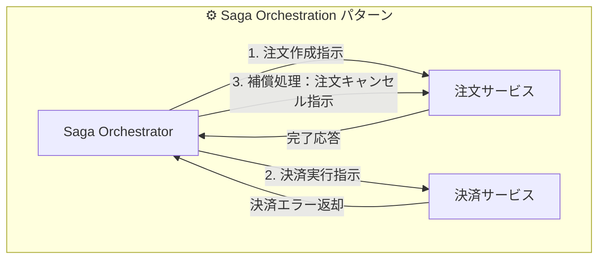

# Day 37: Distributed Transactions - 「オール・オア・ナッシング」が不可能になるとき 🧩

Day 37へようこそ！本日は、マイクロサービスアーキテクチャの設計において最も難解であり、同時に最もエキサイティングなテーマに挑戦します！🚀

Day 31において、私たちはマイクロサービスの基本原則である **Database per Service** (🔊) (データベースパーサービス - サービス個別のデータベースパターン) を学びました。それぞれのサービスは、自分自身に割り当てられたデータの「専用庭」を自律的にカプセル化して管理します。しかし、実際のビジネス要件はそれほど単純ではありません。例えば、一般的な「商品注文（Order）」という一連の業務処理は、裏側で以下のような複数のサービスにまたがって進行します：

1. **注文サービス (Order Service)**: 新規の注文レコードを作成する（ステータス：`PENDING（保留中）`）。
2. **決済サービス (Payment Service)**: 顧客の口座から代金を引き落とす（ステータス：`SUCCESS（完了）`）。
3. **在庫サービス (Inventory Service)**: 注文された商品の在庫在庫数を減らして確保する（ステータス：`RESERVED（確保済）`）。

従来のモノリスシステムであれば、単一のデータベースに対して `BEGIN TRANSACTION` と `COMMIT` を実行するだけで済みました。もし途中で何らかのエラー（在庫不足など）が発生すれば、データベースエンジンの機能によって一撃で元の状態へ `ROLLBACK` できました。しかし、マイクロサービス環境ではそれが不可能です。他のサービスのデータベースが実行し、もしかしたら5秒も前にコミット完了してしまっている「代金の引き落とし処理」を、一体どうやってロールバック（取り消し）すればよいのでしょうか？

今日は、分散システムにおけるデータ整合性（**Data Consistency** (🔊) (データコンシステンシー - データ整合性)）を担保するための絶対的防衛策である **Saga Pattern** (🔊) (サガパターン - Sagaトランザクションパターン) について徹底的に学びます。

---

## 🪝 THE HOOK: 「お金だけ消え去り、商品は届かず、データベースは不整合の渦へ」

繁忙期の航空券予約システムの稼働シナリオを考えてみましょう：

- **ステップ 1**: 予約サービスが、あなたのために航空券の予約座席データを正常に作成しました。
- **ステップ 2**: 決済サービスが、あなたのクレジットカードから無事に5万円を引き落とすことに成功しました。
- **ステップ 3**: 座席確定サービスが、最終的な座席番号をシステムに固定しようとしたその瞬間... **タッチの差で満席**になってしまいました。別のユーザーが一瞬早く、最後の一席を確保してしまっていたのです。

**発生する致命的な不整合**:
- 座席確定サービスは「満席エラー」を返却します。
- しかし、顧客のクレジットカードからは、決済サービスによってすでに5万円が引き落とされたままです！
- そして注文データは、注文サービス側でいつまでも「処理中（PENDING）」のステータスのまま放置されます。

もし分散システム全体を制御するトランザクション処理の仕組みが構築されていない場合、あなたの会社は毎日、怒り狂う顧客からの返金依頼を処理するために、何百人ものカスタマーサポートを雇って手動で返金手続き（DBの手動修正）を行わなければならなくなります。これはシステムアーキテクトとしての完全な敗北を意味します。

---

## 🎭 ANALOGY: グループ旅行の計画と「キャンセル手続き」の約束

あなたが友人グループの旅行計画をオーガナイズしていると想像してください：

1. **友人 A** がホテルの部屋を予約して支払いました。
2. **友人 B** が往復の航空券を購入して支払いました。
3. **友人 C** が現地のレンタカーを予約しようとしました。

**絶対ルール**: この旅行プロジェクトは、上記3つの手配が「すべて」揃って初めて成功とみなされます。
- もし A がホテルを確保し、B が航空券を買った後で、C から「レンタカーがすべて出払っていて借りられなかった」と連絡が入ったとします。
- この時、時間を過去に巻き戻して B が支払った航空券代金の決済行為自体を「最初からなかったこと（物理的消去）」にすることはできません。
- 代わりに、B は航空会社に連絡して **「払い戻し・キャンセル処理 (Compensating Action)」** を実行しなければなりません。
- 同様に、A もホテルに対してキャンセルの連絡を入れて予約を取り消す必要があります。

マイクロサービスにおける **Saga（サガ）** とは、このように個々のサービスで実行された一連のローカル処理に対し、万が一途中で失敗した際にそれまでの成功ステップを打ち消すための「補償アクション（払い戻し処理）」を逆順で連鎖実行し、システム全体を最終的に安全な初期状態へと書き戻すための一連のワークフローのことです。

---

## ⚙️ UNDER THE HOOD: Saga が備える「2つの顔」

Saga は、複数の独立した **Local Transactions** (🔊) (ローカルトランザクション - 各サービス個別のローカルトランザクション) のチェーン（鎖）で構成されています。チェーン内の各ステップは、自身のデータベースを更新した後にイベントを発行し、そのシグナルが次のサービスのローカルトランザクションを起動します。この連鎖反応をコントロールするアプローチには、以下の2つがあります：

### 1. Choreography (コレオグラフィ - イベント振付型自律制御) (🔊)
中央管制塔を持たず、各サービスが発行するイベント（Events）に自律的に反応し合ってトランザクションをバトンリレーするスタイルです。

- **動作フロー**:
  1. 注文サービスが新規注文を作成 $\rightarrow$ `OrderCreated` イベントを発行。
  2. 決済サービスが `OrderCreated` を検知 $\rightarrow$ 口座から引き落とし $\rightarrow$ `PaymentSuccess` イベントを発行。
  3. 在庫サービスが `PaymentSuccess` を検知 $\rightarrow$ 在庫数を減らす。
- **メリット**: 設計がシンプル（小規模システム向け）で、単一の障害点となる中央管制コンポーネントが存在しません。
- **デメリット**: システムがスケールしてサービス数が増えると、どのイベントがどこで消費されているかの全体像（データフロー）を把握することが極めて難しくなり、「イベントスパゲッティ」と呼ばれる制御不能状態に陥ります。

### 2. Orchestration (オーケストレーション - 中央管制型集中制御) (🔊)
「Saga Orchestrator」と呼ばれる、全体の流れとエラー処理を一手に引き受ける中央の「脳（オーケストラ指揮者）」を配置するスタイルです。

- **動作フロー**:
  1. Orchestrator が注文サービスに「注文を作成しなさい」と直接命令します。
  2. 成功応答を受けると、今度は決済サービスに「代金を引き落としなさい」と命令します。
  3. もし決済サービスが失敗を返した場合、Orchestrator が主導権を握り、注文サービスに対して「さっきの注文をキャンセル（補償トランザクションを実行）しなさい」と明確に命令して差し戻します。
- **メリット**: ビジネスプロセスの全体論理が一元管理され、状態遷移の追跡（モニタリング）が極めて容易になります。
- **デメリット**: Orchestrator 自体の耐障害性を高めて設計しないと、ここがシステム全体の単一障害点（SPOF）になってしまいます。

---

## 🏗️ ARCHITECTURE: 補償トランザクション — 巻き戻しのリアリティ

超重要な設計上の注意点：**Saga の補償処理は、データベースの物理ロールバック（Rollback）とは根本的に異なります**。

SQLにおけるロールバックは、「その操作を最初から歴史上存在しなかった状態」に戻すトランザクション機能です。しかし Saga における補償トランザクションは、**「一度完了して確定した事実」に対し、それと真逆の効果を持つ新しいデータを書き込むことで結果的に帳尻を合わせる**行為です。

- **処理の定義例**:
  - 実行処理 (Action): `Update balance = balance - 100`（100円引き落とし）
  - 補償処理 (Compensate): `Update balance = balance + 100`（100円払い戻し）
- **技術的課題**:
  ネットワークトラブルにより「キャンセル要求」自体が何度も再送される可能性があるため、これらの補償トランザクションも必ず **Idempotency**（冪等性）（Day 34）を厳密に満たすように実装しなければなりません。

---

## 💼 SYSTEM DESIGN INTERVIEW: 一時的なデータの不整合（ズレ）との対峙

**面接官: 「Saga モデルを適用すると、どうしてもシステム間に『一時的なデータの不整合（不一致）』が生じます。例えば、お金は引き落とされたのに、注文画面はまだ『処理中』のままになる瞬間などです。これに伴うユーザー体験の低下や整合性の問題をどう解決しますか？」**

**求職者 (あなた) の回答:**
- 「ご指摘の通り、マイクロサービスアーキテクチャでは、瞬時な整合性を保証する **Strong Consistency (強整合性)** をあきらめる代わりに、システムの超高度なスケーラビリティと可用性を維持する **Eventual Consistency (結果整合性)** (🔊) を全面的に受け入れます。このため、データが一時的にズレる瞬間は物理的に必ず発生します。」
- 「この技術特性によるユーザーへのストレスを最小限に抑えるため、私は **フロントエンド（UI/UX）の非同期デザイン** を適用します。注文ボタンをクリックした瞬間に直接『成功/失敗』を同期的に判定して待たせるのではなく、画面上に『ご注文を受理しました。まもなく決済と在庫の最終確定メールをお送りします』といった中間ステータスを美しく表示し、裏側での Saga の非同期なバトンリレーを視覚的に隠蔽（ラップ）します。」
- 「同時に、バックエンド側ではトランザクションの分離性（**Isolation** (🔊)）を担保するため、データベースに直接コミット状態を書き込むのではなく、`PENDING_PAYMENT（決済処理待ち）` や `INVENTORY_RESERVED（在庫一時確保）` といった一目でわかる**『中間状態（セマンティックステート）』**を定義します。これにより、別プロセスのバッチ処理などが処理途中の不整合なデータを誤って最終確定データとして集計してしまう混乱を完全に防止します。」

---

## 💼 現場の極意: なぜ 2PC（2相コミット）を使ってはいけないのか？

データベース間で強整合性を実現するための有名なプロトコルとして **2PC (Two-Phase Commit)** (🔊) が存在します。しかし、実戦経験豊かなシニアアーキテクトは、マイクロサービス開発において 2PC を採用することを全力で回避します：

- **同期ブロッキングによるボトルネック**:
  2PC は、トランザクションに関係するすべての分散データベースに対し、処理が終わるまで特定のデータ行を物理的に「ロック（Lock）」することを要求します。もし 1 つのサービスの応答がネットワーク遅延などで数秒遅れれば、ロックを保持したすべての他サービスが完全停止し、システム全体のスループットが極端に崩壊します。
- **拡張性（Scalability）の喪失**:
  ロックによる競合（Contention）が多発するため、秒間数千〜数万リクエストを処理するモダンな Web スケールには物理的に耐えられません。
- **結論**:
  実装や例外処理（補償ロジックのコーディング）は数倍複雑になりますが、システムの驚異的なスループットと障害耐性を確保するために、必ず **Saga パターン** を選択してください。

---

## 📝 クイッククイズ：あなたの「トランザクション設計力」を診断しよう

**問1: Saga パターンにおいて実行される「Local Transaction（ローカルトランザクション）」の正しい定義はどれか？**
A. 自分の PC 端末のブラウザ内だけで完結する JavaScript の処理。
B. 分散システム全体ではなく、単一のマイクロサービスが管理するローカルデータベース内だけで完結し、アトミックにコミットされる単一の処理単位。
C. インターネット接続なしで動作するローカル処理。

**問2: 「Saga Orchestration」と「Saga Choreography」の最も決定的な設計上の違いはどれか？**
A. 前者は gRPC を使い、後者は REST API を強制する点。
B. 前者は全体プロセスとロールバック制御を一括で指示する「中央管制コンポーネント（Orchestrator）」を配置するのに対し、後者は中央集権を置かず各サービスがイベントを投げ合って自律連携する点。
C. 前者の方が後者よりも物理的なデータ処理速度が常に10倍高速である点。

**問3: 「Compensating Transaction（補償トランザクション）」が果たす役割はどれか？**
A. データベースインデックスの再構築を行い、書き込み性能を向上させること。
B. 一連の非同期処理チェーンの途中でエラーが発生した際、すでにコミットが完了してしまっている過去の成功ステップの効果を「論理的に相殺（取り消し・払い戻し）」するための真逆の更新処理。
C. システムがクラッシュした際にサーバーの電源を自動オフにすること。

**問4: マイクロサービスにおいて 2PC (Two-Phase Commit) の採用を避けて Saga を選ぶべき最も本質的な理由はどれか？**
A. 2PC の方がソースコードの記述量が非常に多くて面倒だから。
B. 2PC は分散データベース間で長時間のデータ物理ロックを要求するため、システム全体に同期ブロッキングとパフォーマンスボトルネックを引き起こし、拡張性を完全に喪失させるから。
C. 2PC は PostgreSQL にしか対応していないから。

**問5: 「Saga Choreography」を採用した際、最も深刻になりがちな運用上のデメリットはどれか？**
A. サーバーのインフラ維持費用が非常に高騰すること。
B. サービス数とイベント数が増大するにつれて、データ整合性の流れや例外の発生ルートをシステム全体で一元的に追跡（トレース）することが極めて困難になること。
C. Java や C# などのエンタープライズ言語で実装できないこと。

---

**正解:**
1. B — 各サービスが自分のローカル DB を ACID 特性で安全に書き換える最小の実行単位です。
2. B — 「指揮者（Orchestration）」を置くか、「全員がダンスの振り付けに従って自律して踊る（Choreography）」かの思想の違いです。
3. B — 完了した歴史をなかったことにはできないため、歴史を相殺する「新しい歴史」を刻むアプローチです。
4. B — 分散システムのスケーラビリティを担保するためには、ブロッキングロックを徹底的に排除する必要があります。
5. B — 小規模では機能しますが、大規模になるとデバッグが不可能な「イベントの迷宮」と化すため、規模に応じた Orchestration への移行が必要です。

---

Day 37を終えて、あなたは分散システムにおける最大の難関である「データの一貫性」を、Saga という美しいデザインパターンを用いてエレガントに切り抜ける戦略を身につけました。

しかし、データの整合性を結果的に合わせる設計ができたとしても、まだ防げない問題があります。それは、「複数のバックグラウンドプロセスやコンテナインスタンスが、全く同じタイミングで、同一ユーザーの銀行口座の残高を同時に更新しようとしてデータの書き込みが衝突（Race Condition）する」という問題です。

明日は、分散システム全体で特定のデータやリソースを「同時に1つ」しか操作できないように排他制御を行う、極めて重要な基盤：**Distributed Locking - 分散ロックの極意** について徹底的にマスターします。明日またお会いしましょう！

📊 Word Count: 3395 words.
