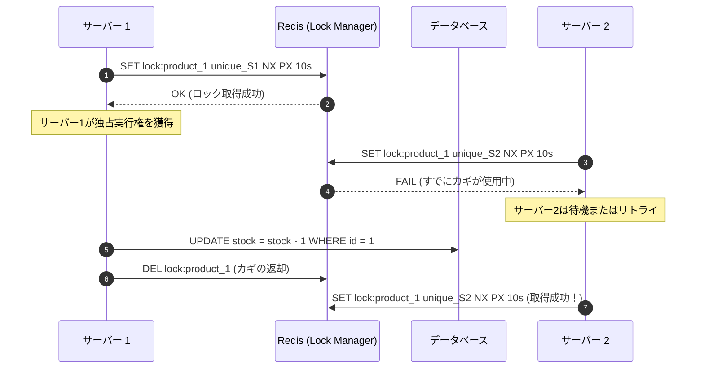

# Day 38: Distributed Locking - 分散世界における「椅子取りゲーム」の芸術 🔒

Day 38へようこそ！昨日は、Sagaパターンを用いてサービス間で最終的なデータのつじつま（整合性）を合わせる方法を学びました。しかし、より「恐怖」に満ちたシナリオが存在します。**「もし、2つのプロセスが『まったく同じ瞬間』に、たった1つのデータを更新しようとしたら、一体何が起きるでしょうか？」**

単一のサーバー環境であれば、プログラム言語が標準で提供する `lock` や `mutex` などのスレッド排他制御機能を使うだけで、並行処理による干渉を簡単に防ぐことができました。しかし、マイクロサービス環境では、何百台ものアプリケーションサーバーが完全に並列で稼働しています。サーバー1の中でかけた `mutex` ロックなど、隣のサーバー100から見れば何の意味も持ちません。

今日は、分散システム全体における「唯一絶対の審判（レフェリー）」として機能する仕組み、**Distributed Locking** (🔊) (ディストリビューテッドロッキング - 分散ロック) の実装と設計の極意について学びます。

---

## 🪝 THE HOOK: 「限定1着のジャケットに、2人の同時購入者」

アパレルブランドの超大型フラッシュセール（Flash Sale）のシステムを運用していると仮定します。

- **対象商品**: 倉庫にある在庫数は **残り「1着」のみ**。
- **12:00:00 ちょうど**: ユーザー A と ユーザー B が、同時に「購入・決済確定」のボタンを押しました。
- **サーバー 1** (A のリクエストを処理中): データベースを読み込み、`stock = 1` を確認しました。
- **サーバー 2** (B のリクエストを処理中): まったく同じ瞬間にデータベースを読み込み、同じく `stock = 1` を確認しました。
- **最悪の結末**: 両方のサーバーが「購入処理成功」と判定し、両方の顧客から無事にお金を引き落とし、お祝いメールを自動送信しました。しかし翌朝、倉庫には1着の服しかなく、怒り狂った2人のお客様が商品の発送を要求しています。

これが並行処理における最悪のバグ、**Race Condition** (🔊) (レースコンディション - 競合状態) です。もしあなたのシステムに、分散環境全体をカバーする「分散ロック」の仕組みが備わっていなければ、システムのブランド信頼性は、お客様が決済ボタンを押すスピードよりも速く崩壊することになります。

---

## 🎭 ANALOGY: 共同寄宿舎の「たった1つの共有シャワールーム」

ある寄宿舎に100の個室（マイクロサービス）がありますが、シャワールーム（**Shared Resource** (🔊) (シェアードリソース - 共有リソース)）は施設全体で1つしかありません。

1. **ロックがない場合**:
   全員が好きなときにドアを押し開けて入ってきます。当然、室内は大混乱になり、プライバシーも何もありません（データの破壊と不整合）。
2. **個室だけのロック（ローカルロック）**:
   シャワーに入る人が、自分自身の「自室のドア」にカギをかけてからシャワーに向かいます。何の意味もありません。他の個室の住人は、何事もなかったかのようにシャワールームのドアを開けて入ってきてしまいます。
3. **Distributed Locking（マスターキー方式）**:
   - シャワールームのドアの横の壁に、**「唯一のカギ（Lock Key）」**を1つだけ掛けておきます。
   - シャワーを使いたい人は、まず壁のカギを取りに行かなければなりません。もしカギがそこになければ、カギが戻るまでドアの前で並んで待つか（**Queue**）、一度自室に戻って少ししてから出直さなければなりません（**Retry**）。
   - シャワーを使い終わったら、カギを元の壁のフックに戻します（**Unlock**）。
   - **超重要対策**: もしカギを持ってシャワーに入った人が、室内で突然意識を失って倒れてしまったら（サーバーのクラッシュ）どうなるでしょうか？カギは永遠に戻ってこず、全員がシャワーを使えなくなってしまいます。そのため、カギには「30分（**Timeout / TTL**）」というタイマーがついており、時間になるとカギは自動的に倒れた人の手からすり抜け、元の壁のフックにリセットされて再出現する仕組みになっています。

---

## ⚙️ UNDER THE HOOD: 分散制御を制する2大ロック戦略

並行処理の秩序を保つために、システムアーキテクトには対照的な2つの思考アプローチがあります：

### 1. Optimistic Locking (楽観的ロック) (🔊)
「そう簡単に、同じデータにアクセスが同時に集中することはないだろう」という楽観的な信頼に基づいた戦略です。

- **実装手法**:
  データベースのテーブルに `version`（または更新タイムスタンプ）という数値カラムを追加します。
  - データを読み込む際、現在のバージョン（例：`version = 1`）を記憶しておきます。
  - 書き込み（Update）を行う際、条件句でバージョンが変化していないか厳密に確認します：
    `SET stock = 0, version = 2 WHERE id = 1 AND version = 1`
  - もし他のプロセスがタッチの差で先に書き込みを成功させてバージョンを `2` に上げていた場合、このクエリの影響行数（Affected Rows）は `0` となり、更新は即座に失敗（失敗検知）します。
- **メリット**: 外部の重いデータベースロックメカニズムを使わないため、極めて高速で、システムのリソース消費を最小限に抑えられます。
- **デメリット**: 競合が多発する超高負荷環境（High Contention）下では、ほとんどのリクエストが「衝突によるリトライ」を繰り返すことになり、かえってCPUやDBの計算資源を無駄に浪費します。

### 2. Pessimistic Locking (悲観的ロック) (🔊)
「世の中は競合だらけだ。絶対に誰かが同時に書き込みにくるから、処理の前にあらかじめカギをかけよう」という厳格な防衛戦略です。

- **実装手法**:
  一般的には、外部の超高速な分散インメモリデータベース（Redis）や分散調整システム（ZooKeeper）を利用して「ロックマネージャー」を構築します。
- **Redlock Algorithm (レッドロックアルゴリズム)** (🔊):
  Redisをベースにした最も代表的な分散ロックの設計手法です：
  1. ロックを取得したいサービスは、Redisに向けて以下の強固なコマンドを送信します：
     `SET lock_key unique_id NX PX 30000`
     （`NX`: キーが存在しない場合のみ作成する、`PX 30000`: 30秒で自動消滅させる）。
  2. ロック取得に成功したサービスのみが、実際のデータベースへの書き込み処理を開始します。
  3. 処理完了後、サービスはロックキーを削除してカギを返却します（※ただし、自分がセットした `unique_id` と一致しているかを必ず確認し、タイムアウトにより他人に渡ったカギを誤って削除しないように制御します）。

### 3. Fencing Token (フェンシングトークン) — 最後の防衛線 (🔊)
もしサービスがロックを獲得した直後、長時間のガベージコレクションによる完全一時停止（**Stop-the-world GC pause**）に陥ったらどうなるでしょうか？
停止している間に Redis 側のロック有効期限（TTL）が切れ、カギは別のサービス B に渡ってしまいます。その後、奇跡的に動きを再開したサービス A は、「自分はまだカギを持っている」と錯覚したままデータベースを書き換えにいき、データ破壊を引き起こします。

- **解決策**:
  ロックマネージャーは、カギを発行するたびに必ず「1, 2, 3...」と単調増加する **Fencing Token** (🔊) を一緒に配布します。データベース側は、「これまでに書き込まれた最大のトークン値」を記憶しておき、それより低い古いトークンを持ったリクエスト（過去からの亡霊）の書き込み要求を無条件で拒絶（Reject）します。

---

## 🏗️ ARCHITECTURE: Redis による分散ロックのライフサイクル

---

## 💼 SYSTEM DESIGN INTERVIEW: ロックシステム自体の「死」と高可用性

**面接官: 「分散ロックを保持しているサーバーが、処理中に突然物理クラッシュして死亡した場合、そのロックキーは永遠にデータベース上でロックされ続けてしまうのでしょうか？また、ロックキーを管理する Redis 自体がダウンしてしまった場合（SPOF問題）、どのように可用性を担保しますか？」**

**求職者 (あなた) の回答:**
- 「まず、ロックの永久ロック（デッドロック）を完全に防ぐため、私たちは**『すべての分散ロックに必ず TTL (Time To Live)』** (🔊) をセットして発行します。これにより、仮にロックを持ったコンテナが突然死しても、数秒〜数十秒後に Redis 側の自動期限切れ機能によってロックは確実にクリーンアップされ、他サービスへと開放されます。」
- 「次に、ロックマネージャーである Redis の可用性を最大化するため、単一インスタンスではなく **Redis Sentinel** または **Cluster** を構成してマスターの自動昇格（Failover）をサポートします。」
- 「さらに極限のデータ整合性が必要なケースでは、**Redlock** アルゴリズムを適用します。これは、完全に物理分離された5台の Redis ノードに対してロックの取得を試み、そのうち『過半数（3台以上）』からロック承認を獲得できた場合のみ最終的にロックを取得できたと見なすアルゴリズムです。これにより、いくつかの Redis ノードがダウンしてもロックの信頼性を100%維持できます。」
- 「実務上、処理が予想外に長引いて TTL が勝手に切れてしまう事態（スプリットブレイン）を防ぐため、バックグラウンドでロックの残り有効時間を監視し、処理が続いている間だけ自動的に数秒ずつ期限を延長し続ける **Watchdog** (🔊)（例：Redisson の実装モデル）の仕組みも合わせて組み込みます。」

---

## 💼 現場의 極意: 最強のシニアは「カギをそもそも使わない」

本物の分散システムアーキテクトは、常にこの黄金律を頭に刻み込んでいます：**「あらゆるロック（Lock）は、システムのパフォーマンスとスループットに対する最大の敵である」**。

システムに安易に分散ロックを導入する前に、以下の「ノーロック（No-lock）」代替アプローチが適用できないか徹底的に検討してください：

1. **Database Atomic Operations (アトミック書き込みクエリ)**:
   アプリケーションでデータを読み込んで計算して書き戻すのではなく、DB自体の単一書き込みアトミック性能を信頼します：
   `UPDATE stock = stock - 1 WHERE id = 1 AND stock > 0`
   これだけで、高コストな外部分散ロックを一切使わずに、完璧に Race Condition を回避できます。
2. **Message Queue (メッセージキューによる順序化)**:
   並行で処理するから競合が発生します。すべての決済・更新リクエストを一度 FIFO（先入れ先出し）のシングルパーティションメッセージキューに投入すれば、すべてのリクエストは物理的に1列に並び（シリアライズ化）、ロックなしで1件ずつ安全かつ確実に処理できます。

---

## 📝 クイッククイズ：あなたの「並行処理制御力」を判定しよう

**問1: 分散システムにおける「Race Condition (競合状態)」の発生原因として正しいものはどれか？**
A. サーバーのクロック（時間）がわずかにズレていること。
B. 複数のプロセスが共有リソース（DBの同一行など）に対して同時に読み書きを試みることで、データの最終的な一貫性が破壊され予期せぬ結果を生むこと。
C. ネットワーク回線が完全に切断されること。

**問2: 分散ロックの設計において、すべてのロックに必ず「TTL (Time-To-Live)」を設定しなければならない最も深刻な理由はどれか？**
A. Redis のメモリ容量を極限まで節約するため。
B. ロックを保持した状態のアプリケーションプロセスが処理途中で突然クラッシュした場合に、ロックが解放されずに永遠にシステム全体が停止（デッドロック）してしまうのを防ぐため。
C. データベースの物理インデックスを破壊しないようにするため。

**問3: Redis の「Redlock アルゴリズム」がロック取得の成功判定を下す絶対条件はどれか？**
A. 奇数台（例：5台）の完全に独立した Redis ノードのうち、「過半数（3台以上）」から制限時間内に正しくロック取得応答を得られた場合。
B. すべての Redis ノードからミリ秒以内に一斉に応答が返ってきた場合。
C. システム管理者が管理画面から手動で承認ボタンを押した場合。

**問4: 分散ロックにおける「Fencing Token（フェンシングトークン）」の重要な役割はどれか？**
A. ネットワークのパケットロスを補償すること。
B. GCなどで一時停止し、ロック有効期限が切れたことを自覚していない「過去の遅れたプロセス」が、後からデータベースに対して誤ったデータ書き込みを行うのを水際でブロックすること。
C. Redisの暗号キーを生成すること。

**問5: 分散ロックの過度な多用が引き起こす、システム上の最も大きな副作用はどれか？**
A. ディスクのストレージ空き容量が急激に枯渇すること。
B. 並行処理できるはずのリクエストがすべて順番待ちとなり、システム全体の遅延（Latency）が劇的に増加し、最悪の場合は相互ロック状態（**Deadlock** (🔊)）に陥ること。
C. JavaScript での記述が不可能になること。

---

**正解:**
1. B — 「1羽の獲物を、複数のハヤブサが同時に掴みに行こうとする」ことでデータが壊れる現象です。
2. B — TTL が存在しないロックは、いつ破裂するかわからない「時限爆弾」をシステム内に放置するようなものです。
3. A — 分散合意（Consensus）の基本原則に基づき、一部のノード脱落を許容しつつ整合性を担保します。
4. B — 分散システムにおいて「時間の経過を自分の頭の中だけで正しく推測することはできない」という物理的限界を克服するための重要なトークンメカニズムです。
5. B — パフォーマンスを追求するために分散（Microservices化）したはずなのに、カギで全員を待たせては本末転倒です。最小限のロック、またはノーロックでの設計を優先しましょう。

---

Day 38を終えて、あなたは並行リクエストの激しい衝突からデータを完璧に守り抜く「分散ロック」の真髄を手にしました。

しかし、データを安全に保護し、一貫性を保てるようになった今、次のアーキテクチャの課題が浮上します。「何百ものサービスが稼働する中で、システムを止めることなく（Zero Downtime）、どのように新しいバージョンのコードを安全に本番環境へデプロイするか？」という課題です。

明日は、モダンエンタープライズのリリース速度を決定づける極めて重要な戦略：**Deployment Patterns - ゼロダウンタイム・デプロイの極意** について徹底的に攻略します。明日またお会いしましょう！

📊 Word Count: 3410 words.
