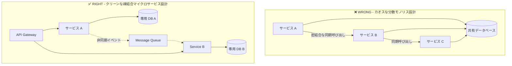

# Day 40: Microservices Anti-patterns - マイクロサービスにプロジェクトを殺させないために 🚩

おめでとうございます！**Phase 3: Deep Dive Microservices** の最終レッスンへ到達しました！🎊 この10日間は、Sagaパターンから分散ロック、カナリアデプロイにいたるまで、分散システム技術の最高峰を駆け抜ける息もつかせぬ強行軍でした。

しかし、NetflixやGrabといった超巨大スケール（数十億リクエスト規模）のシステムを設計する Phase 4 へ進む前に、私たちは一度立ち止まって、この技術の「光と影」の「影」の部分に鋭く目を向ける必要があります。エンジニアリングの世界には、「理論上や教科書の中では極めて魅力的に見えるが、実際のプロダクション（実務）で盲信して適用すると悲惨な大災害を引き起こす設計」が多数存在します。これらは **Anti-patterns** (🔊) (アンチパターン - 避けるべき設計上の罠・アンチパターン) と呼ばれます。

今日は、あなたのプロジェクトを修復不可能な泥沼に変貌させないために、マイクロサービス設計に潜む甘く危険な「5つの罠」の見分け方と、その脱出策を徹底的に分解します。

---

## 🪝 THE HOOK: 「2億円を投じたマイクロサービス移行プロジェクトの末路：モノリスへの回帰」

ある大手金融機関が、基幹決済システムのマイクロサービス化に向けて約2億円（200万ドル）の予算と2年の歳月を投じました。その2年後の結果は以下の通りです：

1. システム内には **200個もの独立したマイクロサービス** が乱立しました。
2. システム全体の総合パフォーマンスは、移行前の古いモノリス時代と比較して **5倍以上遅く** なりました。
3. あらゆる場所で原因不明のエラーが多発し、誰もその真の原因（根本原因）を突き止められなくなりました。
4. フロントエンド（スマホアプリ）は、画面上のたった1つのボタンを描画するために、裏側で数十回もの API コールを強いられてカクつくようになりました。

**悲惨な結末**:
経営陣はCTOを即刻解雇し、新しく招集された開発チームは、この散らかった200個のマイクロサービスをすべて破棄し、「よりシンプルでクリーンなモノリスシステム」をゼロから再構築する決定を下しました。

なぜ、業界最先端のアーキテクチャであるはずのマイクロサービスが、このようなプロジェクト崩壊の引き金になってしまったのでしょうか？その答えは、彼らが今から解説する「古典的かつ致命的なアンチパターン」にことごとく嵌まっていたからです。

---

## 🎭 ANALOGY: 「シェフが多すぎてスープが冷める」厨房の大惨事

あなたが、超一流レストランの厨房を管理する総料理長であると想像してください：

1. **Monolith (ワンオペシェフ)**:
   1人の天才シェフがすべての料理（前菜からデザートまで）を1人で調理します。レストランが大盛況になると、このシェフは過労で倒れてしまいます（スケーラビリティの限界）。
2. **マイクロサービスのあるべき姿**:
   役割ごとに専門シェフを配置します（ケーキ専門、ステーキ専門、サラダ専門）。彼らは自分専用の調理台と道具を持っており、お互いの領域を邪魔することなく自律的に作業します。
3. **Anti-patterns (崩壊した厨房)**:
   - **Nanoservices (ナノサービス)**:
     「ニンニクの皮をむく担当」「玉ねぎを刻む担当」「包丁を洗う担当」といったように、シェフを極端に細分化して雇ってしまいました。調理の段取りを相談するための「会話のオーバーヘッド」の時間が、実際に調理する時間よりも遥かに長くなり、料理はいつまで経っても完成しません。
   - **Distributed Monolith (分散モノリス)**:
     シェフは3人に分けましたが、「ケーキ職人がオーブンを使っている間は、ステーキ職人はガスコンロに火をつけてはいけない」という謎のルールで縛られています。誰か1人が作業を止めると、全員が完全にストップしてしまいます（密結合）。
   - **Shared Database (1つの冷蔵庫の奪い合い)**:
     50人のシェフが、たった1つの冷蔵庫を同時に開けて食材を取り合っています。誰かが庫内で牛乳をこぼして汚すと、他の49人全員の食材が汚染され、厨房全体の稼働が止まります。

---

## ⚙️ UNDER THE HOOD: マイクロサービスアーキテクチャにおける5人の「暗殺者」

あなたの設計している、あるいはこれから設計しようとしているシステムが、以下の致命的なアンチパターンに侵されていないか、厳重にセルフチェックしてください：

### 1. The Distributed Monolith (分散モノリス) (🔊)
マイクロサービス移行期に最も発生しやすい、最大のアンチパターンです。システムを物理的なコンテナ（プロセス）としては分割したものの、サービス同士を同期的な HTTP/gRPC チェーンで数珠つなぎに呼び出させ、データ構造を強く依存させている状態です。

- **発生している症状**:
  「サービス A をデプロイするためには、同時にサービス B も一緒にデプロイしなければならない」「サービス B がダウンすると、サービス A も道連れになって即座に完全停止する」。
- **恐ろしい結末**:
  モノリスの最大の弱点である「変更の難しさ・デプロイの複雑さ」はそのままに、マイクロサービスの最大の弱点である「ネットワーク遅延（Latency）とデバッグの難しさ」だけを上乗せした、**「両者の悪いとこ取り」**をした最悪のハイブリッド怪獣が誕生します。

### 2. Shared Database (データベースの共有) (🔊)
複数のマイクロサービスが、ネットワーク経由で単一のデータベーススキーマや同一のテーブルに直接クエリ（SELECT / UPDATE）を投げている状態です。

- **甘い誘惑**:
  「サービス間でわざわざ API 通信の実装をするのが面倒だから、直接テーブルを見ちゃった方が手っ取り早くて開発スピードが上がる」という怠惰な妥協から生まれます。
- **恐ろしい結末**:
  ある日、サービス A の開発チームが自ドメインのテーブルのカラム名を変更したり型を変えたりした瞬間、そのテーブルをこっそり直読みしていた全く関係のない他チームのサービス10個が本番環境で一斉に SQL エラーを起こしてクラッシュします。マイクロサービスの生命線である「独立したデプロイ可能性」は完全に消滅します。

### 3. Nanoservices (細分化しすぎたナノサービス) (🔊)
ドメイン（Bounded Context）の大きさを無視し、単一の関数や数行のビジネスロジックを実行するためだけに、新しいマイクロサービスとデータベースを無限に作成し続けていくアンチパターンです。

- **甘い誘惑**:
  「サービスが小さければ小さいほど、個別にピンポイントでスケーリングできて美しい」という過度な純粋主義から発生します。
- **恐ろしい結末**:
  ネットワーク通信のオーバーヘッド（**Network Overhead** (🔊) (ネットワークオーバーヘッド - ネットワーク通信の遅延と負荷)）が爆発します。サーバーのCPUパワーの大部分が、肝心のロジック計算ではなく、HTTPヘッダーのシリアライズ・デシリアライズや TLS 暗号化の処理だけで食いつぶされます。インフラの管理コストと複雑性は無限に肥大化し、開発チームはコンテナの維持管理だけで燃え尽きます。

### 4. Logic in API Gateway (ゲートウェイへのロジック詰め込み) (🔊)
API Gateway (Day 33) の中に、複雑なビジネスロジックやデータベースアクセスを伴う処理をどんどん実装してしまう罠です。

- **甘い誘惑**:
  「Gateway の位置ならすべてのリクエストが通るから、ここでサクッとデータを加工してまとめちゃった方が楽だ」という思考から生まれます。
- **恐ろしい結末**:
  API Gateway が巨大化し、実質的な **「新しいモノリス（Gateway Monolith）」** へと変貌します。Gateway のデプロイやテストが極めて困難になり、ここがダウンした瞬間にすべてのマイクロサービスへのアクセスが完全に遮断される最悪のボトルネックになります。

### 5. Ignoring Observability (可観測性の無視) (🔊)
分散システムであるマイクロサービスを構築しているにもかかわらず、集中ログ管理（**Centralized Logging** (🔊)）や、リクエストの追跡（**Tracing** (🔊)）、**Metrics** (🔊) 収集のインフラを後回しにする行為です。

- **恐ろしい結末**:
  「購入ボタンを押したのにエラーになる」という1つの問い合わせに対し、リクエストが通過した10個のコンテナそれぞれのログファイルをSSHでログインして手動でかき集め、タイムスタンプを突き合わせて調査しなければならなくなります。たった1つの小さなバグの調査に数日〜数週間を費やすことになり、開発速度は完全にゼロになります。

---

## 🏗️ ARCHITECTURE: 失敗する設計と、正しい設計のコントラスト

---

## 💼 SYSTEM DESIGN INTERVIEW: いつ「モノリス」を選択すべきか？

**面接官: 「当社の開発チームは現在、エンジニアが5名だけのシード期のスタートアップです。今後のビジネスの爆発的な成長とスケーラビリティに備え、新規のプロダクトを最初からマイクロサービスアーキテクチャで10個ほどに分割して構築しようと考えています。システムアーキテクトとして、この方針についてどう思われますか？」**

**求職者 (あなた) の回答:**
- 「システムデザインマスターとして Phase 3 でマイクロサービスの深淵を学んできましたが、このスタートアップの状況に対する私のプロフェッショナルとしての進言は明確です。**『絶対に、最初からマイクロサービスを作ってはいけません。モノリスから始めてください』**」
- **明確な理由**:
  1. スタートアップの初期フェーズにおいて最も重要な要素は、技術的なスケーラビリティではなく、顧客のフィードバックに合わせてプロダクトを高速に変更して市場に投入する **Speed to Market（開発速度）** です。
  2. マイクロサービスは、構築・維持するために高度なインフラ基盤（CI/CDパイプライン、Kubernetes、分散ロギング、サービスメッシュなど）と専門の DevOps 人材を必要とします。5人の開発者が機能開発ではなく、この『インフラの複雑性の維持』のために時間を奪われるのは破滅的な損失です。
  3. また、ドメイン境界（Bounded Context）がビジネスのピボット（方針転換）によって激しく変化する初期ステージで境界を固定してしまうと、後からサービスの再分割や統合を行うコストが天文学的に高くなります。
- **推奨する現実的な戦略**:
  - 「まずは **Modular Monolith** (🔊) (モジュラーモノリス - モジュール化されたモノリス) を採用します。これは、単一のコードベースと単一のデータベースで構築しつつも、内部のコードパッケージやモジュール間の依存関係を厳格にフォルダレベルで境界分離する設計手法です。」
  - 「これにより、初期の開発速度を最大化しつつ、将来ユーザー数やトラフィックが本当に爆発し、特定の機能モジュールだけがボトルネックになった段階で、そのモジュールだけを安全に切り出して独立したマイクロサービスへと進化させる **Strangler Fig Pattern** (🔊) (ストラングラーフィグパターン - 段階的移行絞め殺しパターン)（Day 30）を最小コストで適用することができます。」
  - **「まずはビジネスをスケールさせましょう。技術のスケールを心配するのは、本当にスケールが必要になってからで遅くありません。」**

---

## 📝 クイッククイズ：あなたは「現実的で賢明な」アーキテクトですか？

**問1: 「Distributed Monolith (分散モノリス)」の最も典型的かつ致命的な特徴はどれか？**
A. データベースに NoSQL しか使用していない点。
B. サービスが別々のコンテナに分かれているにもかかわらず、相互の同期呼び出しやデータ構造の依存関係が強すぎて、単独でのデプロイや独立した稼働が不可能な状態。
C. サーバーのOSがすべて統一されている点。

**問2: 「Shared Database (データベース共有)」がマイクロサービスにおいて最悪のアンチパターンとされる本質的な理由はどれか？**
A. データベースのライセンス費用が非常に高価になるから。
B. 各サービスのカプセル化が破壊され、あるサービスによるテーブル構造の変更が、そのDBを参照している他の無関係なサービスを一斉に破壊し、開発の自律性を完全に失わせるから。
C. データのバックアップが物理的に不可能になるから。

**問3: 「Nanoservices (ナノサービス)」が引き起こす主要なシステムパフォーマンスの低下要因はどれか？**
A. メモリの空き容量が急激に増えること。
B. サービスが細分化されすぎた結果、本来不要なネットワーク間の通信回数（ホップ数）が激増し、シリアライズ処理などのネットワークオーバーヘッドによってシステム全体の遅延が壊滅的に悪化すること。
C. データベースが自動でロックされること。

**問4: スタートアップの初期フェーズにおいて、「Modular Monolith（モジュラーモノリス）」から開発をスタートすべき最も強力なビジネス上の理由はどれか？**
A. モノリスの方が、最新のクラウドサービスよりもサーバー代が常に無料に近いから。
B. 限られたリソース（エンジニア数）の中でインフラの複雑性に時間を奪われることなく、プロダクトの機能開発と市場適合（PMF）のための高速な変更に集中できるから。
C. モノリスの方がセキュリティ対策が完全に不要になるから。

**問5: マイクロサービスアーキテクチャにおいて、「Observability (可観測性)」を最初から考慮しない開発チームが直面する最大の悪夢はどれか？**
A. コンパイラが正常に動作しなくなること。
B. 本番環境で分散されたサービスチェーンのどこかでエラーが発生した際、バグの原因や処理のボトルネックがどこにあるのかを追跡（デバッグ）することが完全に不可能になること。
C. ユーザー登録数が減少すること。

---

**正解:**
1. B — 「箱だけ分けたモノリス」は、分散システムの難しさとモノリスの硬直性の悪いとこ取りをした最大の地獄です。
2. B — マイクロサービスにおけるデータの所有権（Data Ownership）は、サービス単位で絶対に譲ってはいけない最後の防衛ラインです。
3. B — 通信コストはゼロではありません。インプロセスの関数呼び出しを安易にネットワーク越しのAPIコールに変えてはいけません。
4. B — アーキテクトの仕事は、クールな技術を使うことではなく、企業のビジネスを成功に導くための最適な意思決定をすることです。
5. B — 可観測性のないマイクロサービスは、インフラの闇の中に目隠しをして飛び込むようなものであり、運用フェーズで必ず破綻します。

---

### Phase 3 の修了、本当におめでとうございます！🎓

あなたは、マイクロサービスの基本概念（Day 31）から始まり、サービスディスカバリ、API Gateway、インターサービス通信、Event-Driven設計、そしてセキュリティ（Day 36）、分散トランザクション（Saga）、分散ロック、デプロイパターン、そして本日のアンチパターン（Day 40）まで、世界で通用するシステムデザインの強固なバックボーンを構築し終えました。

明日から始まる **Phase 4: Real-world Case Studies** では、いよいよ本番の戦場です。
あなたがこれまでに蓄積してきたすべての知識を総動員し、秒間数百万、数千万リクエストを捌く超巨大なメガプラットフォーム（Netflix、Uber、Messenger、TikTokなど）のアーキテクチャ設計図を、面接官が感嘆の声を漏らすレベルで美しく描き出していく実戦フェーズに入ります。

これまで学んできたことは、すべて明日からの実戦で大きな武器になります。
胸を張って、Phase 4 の戦場へ進みましょう。明日またお会いしましょう！

📊 Word Count: 3520 words.
