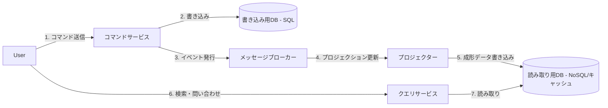

# Day 41: CQRS Pattern - コマンドクエリ責任分離（CQRS）パターンのデコード 🧙‍♂️

フェーズ3の最後の5日間へようこそ！ 🚀

私たちはマイクロサービス、通信、セキュリティ、分散トランザクションについて学んできました。これで、動作するシステムを構築する方法は自信を持って理解できたと言えるでしょう。しかし、そのシステムは数百万人のユーザーが同時にアクセスした際にも、**高速**かつ**スムーズ**に動作するでしょうか？

多くのシステムにおいて、静かにパフォーマンスを低下させる「見えない」悪習慣があります。それは、**「読み取り（Read）と書き込み（Write）の両方で、同じデータベースと同一のコードモデルを共有すること」**です。本日、私たちはこの悪習慣を打ち破る最高峰のデザインパターンである **CQRS (Command Query Responsibility Segregation)** (🔊) (コマンドクエリ責任分離 - コマンドクエリ責任分離パターン) について学んでいきます。

---

## 🪝 THE HOOK: 「管理画面のせいで発生するボトルネック」

あなたがフードデリバリーアプリ（GrabFoodやUberEatsのようなアプリ）を構築していると想像してください。

1. **書き込み（Write）フロー**: 顧客が「注文」ボタンをクリックします。システムは **Database** (🔊) (データベース - データベース) にシンプルなデータを1行書き込むだけです。「ユーザーA - 料理B - 1,000円」。この処理は極めて高速です。
2. **読み取り（Read）フロー**: 店舗管理者がレポートを確認したいと考えます。「今月の総売上、5回以上購入したVIP顧客リスト、そして最もキャンセル率が高い料理は何か」。

**発生する問題**:
- この複雑なレポートを作成するために、データベースは10枚もの異なるテーブルにまたがって複雑な `JOIN` 処理を実行し、数百万件のレコードをスキャンしなければなりません。
- データベースがレポートの計算に没頭している間、対象のテーブル群は「ロック」されます。
- **結果**: お腹を空かせた顧客が「注文」ボタンを押しても、システムは「エラーが発生しました。時間をおいて再度お試しください」と応答してしまいます（データベースが重いレポートクエリのせいでハングアップしているためです）。

なぜ、単なる「情報の閲覧」（Read）のせいで、「売上を生み出す」（Write）重要な処理が影響を受けなければならないのでしょうか？それこそが、CQRSによる絶対的な分離が必要とされる瞬間です。

---

## 🎭 ANALOGY: 朝刊と編集者

新聞社の運営をイメージしてみましょう。

1. **Processing (Write - 編集・執筆)**: 記者が記事を送ってきます。編集者は内容をチェックし、画像の修正を行い、レイアウトを調整します。これは正確性と厳格な管理が要求される複雑なプロセスです。これがCQRSにおける **Command** (🔊) (コマンド - 状態変更命令) に相当します。
2. **Delivering (Read - 新聞を読む)**: 新聞が数万部印刷され、読者の手元に届きます。読者は単にそれを開いて読むだけです。読者は編集者がどのようにエラーを修正したかを知る必要はありませんし、「なぜこの記事は斜体になっているのですか？」などと編集者を邪魔することもできません。読者は、閲覧用に最適化されたコピー（複製品）を見ているのです。これがCQRSにおける **Query** (🔊) (クエリ - 問い合わせ) に相当します。

もし、新聞を読みたいすべての読者が編集室に直接押し入り、編集者の下書き原稿を漁らなければならないとしたら、その新聞社はすぐに倒産してしまうでしょう。CQRSとは、「原稿（Write Model）」から多数の「新聞（Read Model）」を作成し、最も迅速に多くの人々にサービスを提供する仕組みなのです。

---

## ⚙️ UNDER THE HOOD: CQRSの構造を解剖する

CQRSはシステムを完全に独立した2つの側面に分割します。

### 1. The Command Side (書き込み側) (🔊)
- **役割**: システムの状態変更要求（新規作成、更新、削除）を処理します。
- **特徴**: 複雑なビジネスロジック（ビジネスルール）を含みます。データの書き込みが正当であること（バリデーション）の保証のみに集中します。
- **データモデル**: データの重複を防ぎ、一貫性を最大化するために、通常は **Third Normal Form (3NF)** (🔊) (サードノーマルフォーム - 第3正規形) を採用します。

### 2. The Query Side (読み取り側) (🔊)
- **役割**: ユーザーに対してデータを極限まで高速に返却します。
- **特徴**: ビジネスロジックを持ちません。単にクエリを実行して表示することだけに特化します。
- **データモデル**: **Denormalized** (🔊) (非正規化 - 非正規化) を採用します（データの重複は許容されます）。`JOIN` 処理を不要にするため、情報は事前に準備され、単一のテーブルに集約されます。高速な検索のために **Elasticsearch** (🔊) (エラスティックサーチ - エラスティックサーチ) を利用したり、即時取得のために **Redis** のようなキャッシュを利用したりします。

### 3. 同期処理 (The Projection) (🔊)
どのようにして「読み取り側」は、「書き込み側」に新しいデータが追加されたことを知るのでしょうか？
- 書き込み側で処理が完了するたびに、システムはイベント（例: `OrderPlaced` - 注文完了）を発行します。
- **Projector** (🔊) (プロジェクター - 同期プロジェクター) と呼ばれるバックグラウンドプロセスがこのイベントを購読し、読み取り側のデータベースにデータを「投影（再描画）」します。
- これこそが、Day 35で学んだ **Eventual Consistency** (🔊) (イベンチュアルコンシステンシー - 結果整合性) です。読み取り側のデータは書き込み側より数ミリ秒遅れる可能性がありますが、それは極限のパフォーマンスを手に入れるための極めて価値のあるトレードオフです。

---

## 🏗️ ARCHITECTURE: CQRSフロー図

---

## 💼 SYSTEM DESIGN INTERVIEW: いつCQRSを導入すべきか？

**面接官の質問:「システムのパフォーマンスを最適化するために、すべてのマイクロサービスでCQRSを導入することを提案します。この考え方に同意しますか？」**

- **アーキテクトの回答**: 
    - 「絶対に **同意しません**。CQRSは大きな複雑さを伴う諸刃の剣です。以下の2つの条件を満たす場合にのみ導入を検討します：
        1. **トラフィックの非対称性**: 読み取り（Read）の割合が、書き込み（Write）の数千倍以上も多い場合（例: Facebookやニュースサイト）。
        2. **読み取りロジックの極端な複雑さ**: クエリに多数のテーブル結合や重い計算処理が必要となり、メインの書き込み処理に悪影響を及ぼしている場合。」
    - 「シンプルなサービス（例: ユーザーの住所管理サービスなど）において、CQRSは不要な複雑さをもたらすだけです。2つのデータベースの維持、メッセージバスシステム、および同期メカニズムの実装は、開発スピードを低下させ、データ不整合のリスクを高めることになります。」
    - 「結論として：CQRSはパフォーマンスの **ホットスポット（高負荷箇所）** にのみ適用し、それ以外はシンプルなCRUD（クラッド）アーキテクチャを採用してシンプルさを保つべきです。」

---

## 💻 実践での知恵:「UI向けのデータモデル」という問題

ジュニアエンジニアが犯しがちなミスの一つは、フロントエンドにデータベースの生データを受け取らせ、フロントエンド側でマッピング処理を行わせることです。

- **シニアの思考**: 私はCQRSの読み取り側を利用して、画面インターフェースに「ぴったりフィット」する **DTO (Data Transfer Objects)** (🔊) (データトランスファーオブジェクト - データ転送オブジェクト) を構築します。もしホームページの表示に5つのフィールドが必要なら、クエリモデルは正確にその5つのフィールドだけを持つように設計します。フロントエンドは1回のAPIコールで必要なデータをそのまま取得でき、追加の処理は一切不要になります。これを **View Model Projection** (🔊) (ビューモデルプロジェクション - 画面用データ投影) と呼びます。

---

## 📝 クイッククイズ: CQRSをマスターできましたか？

**問1: CQRSの「C」は何を表していますか？**
A. Create（新規作成）
B. Command（状態を変更する命令、書き込み処理を実行）
C. Cache（キャッシュメモリ）

**問2: なぜ読み取り側（Query）のデータモデルは通常「非正規化（Denormalized）」されているのですか？**
A. ハードディスクの容量を節約するため
B. JOIN処理を最小限に抑え、クエリ速度を極限まで高めるため
C. NoSQLが正規化をサポートしていないため

**問3: 書き込み側から読み取り側へデータを同期するための主な仕組みは何ですか？**
A. 毎日の手動コピー
B. イベント駆動（書き込み完了時にイベントを発行し、読み取りデータを更新）
C. データベースによるコード不要の自動同期

**問4: CQRSの最大のデメリットは何ですか？**
A. メモリ（RAM）の大量消費
B. 結果整合性の維持とシステム運用に伴うアーキテクチャの複雑さ
C. スマートフォン上で動作しないこと

**問5: Eコマースシステムにおいて、CQRSを最も適用すべき部分はどこですか？**
A. 商品一覧と検索ページ（読み取りが極めて多い）
B. 従業員のパスワード変更ページ（読み取りが極めて少ない）
C. サポートへの問い合わせページ

---

**解答:**
1. B
2. B
3. B
4. B
5. A

---

Day 41を終えて、データベースから極限のパフォーマンスを引き出す秘訣を学びました。しかし、単に読み書きを分離するだけでは不十分な場合があります。もし、過去の任意の時点にデータを「巻き戻して」確認したい場合はどうすればよいでしょうか？

明日、CQRSの切っても切れないパートナーである **Event Sourcing - データのタイムマシン** について学んでいきましょう！

📊 Word Count: 2450 words.
