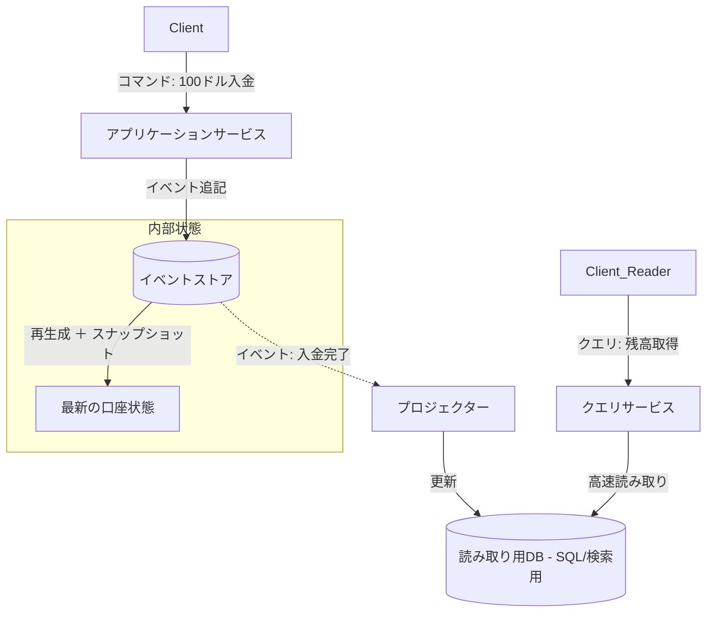

# Day 42: Event Sourcing Deep Dive - イベントソーシングディープダイブとデータタイムマシン 🕰️

Day 42へようこそ！ 🚀

昨日は **CQRS (Command Query Responsibility Segregation)** (🔊) (コマンドクエリ責任分離 - コマンドクエリ責任分離パターン) と、読み取り（Read）と書き込み（Write）の分離について学びました。書き込み側が **Events** (🔊) (イベント - 出来事・事象) を発行して読み取り側を更新することを知りましたね。

しかし、ここで驚くべきアプローチを考えてみましょう：
**「もし、現在の状態（State）をデータベースに直接保存するのではなく、これまでに発生したすべてのイベント履歴（軌跡）だけを保存するとしたらどうなるでしょうか？」**

それこそが、本日深掘りする **Event Sourcing** (🔊) (イベントソーシング - イベントソーシングモデル) の核心となる思想です。これは単なるストレージの技術にとどまらず、システムの「真実の源泉（Source of Truth）」をどのように捉えるかというパラダイムシフトをもたらします。

本日は、世界中の大手金融システムやネット銀行が採用している「真実の記録簿」の仕組みを解剖していきましょう。

---

## 🪝 THE HOOK: 「なぜ私の口座残高が間違っているのか？」

あなたが電子マネー（ウォレット）システムを開発・運用していると想像してください。

ある日、VIP顧客から怒りの電話がかかってきました。「今日の午前中の残高は10,000円だったはずだ。さっき100円の缶コーヒーを買っただけなのに、なぜ残高が2,000円に減っているんだ！？」

慌てて **Database** (🔊) (データベース - データベース) を確認します：
`User(id=1, balance=2000)`

- **疑問**: なぜ2,000円なのか？ 誰がいつ変更したのか？ バグによるものか？ それとも何者かがデータベースを直接書き換えたのか？
- **問題点**: 従来の **CRUD** (🔊) (クラッド - 作成・読み出し・更新・削除) モデルのデータベースは**「最終結果（現在の状態）」**しか教えてくれません。過去の変更履歴はすべて「上書き」されて消え去ってしまっています。別システムでテキストログを詳細に残していない限り、この2,000円という数字が正しいのか間違っているのかを証明することは不可能です。

しかし、Event Sourcingを採用していれば、「分かりません」と回答する必要は一切なくなります。あなたは単に電子の「総勘定元帳」を開き、以下のように説明すればよいのです：
「お客様、午前8:01に10,000円を入金されました。その後8:15に電気代の自動引き落としで7,900円を支払われています。そのため、9:00に100円のコーヒーを購入された時点で、残高が2,000円になるのは完全に正確な計算です。」

---

## 🎭 ANALOGY: 会計士の帳簿とExcelシート

Event Sourcingを理解するために、2つのデータ管理方法を比べてみましょう。

1.  **CRUD（Excelのシート）**: Excelに「残高」というセルがあります。取引が発生するたびに、古い数値を消しゴムで消し、新しい数値を上書きします。
    - **デメリット**: 過去の履歴が失われます。以前そのセルがいくらだったのかを知る術はありません。これが、一般的なWebアプリケーションのデフォルトの管理方法です。
2.  **Event Sourcing（会計士の総勘定元帳）**: プロの会計士は、帳簿の古い行を消しゴムで消すようなことは絶対にしません。
    - 1行目：+ 10,000円（入金）
    - 2行目：- 7,900円（電気代支払い）
    - 3行目：- 100円（コーヒー購入）
    - **真実の源泉（Source of Truth）**は、「残高2,000円」という結果ではなく、**「この履歴のリストそのもの」**です。残高という数字は、単にこれらの履歴を最初から最後まで計算（足し引き）した結果にすぎません。

Event Sourcingとは、データベースを「決して消去・変更できないデジタル帳簿」へと昇華させるパターンなのです。

---

## ⚙️ UNDER THE HOOD: 「不変」の動作メカニズム

### 1. Event Store (イベントストア) (🔊)
通常のリレーショナルデータベースやMongoDBを使用する代わりに、**Append-only** (🔊) (アペンドオンリー - 追記専用) （追加のみ可能で、更新や削除は一切禁止）の特性を持つ専用の **Event Store** (🔊) (イベントストア - イベント専用データベース) を使用します。
- すべてのレコードは過去に発生した事実を表します：`UserCreated`（ユーザー作成）, `MoneyDeposited`（入金完了）, `OrderCancelled`（注文キャンセル）。
- **特性**: イベントは **Immutable** (🔊) (イミュータブル - 不変) です。過去に発生した事実は不変であり、誰もそれを書き換えることはできません。

### 2. State Reconstitution (状態の再構築) (🔊)
では、特定のユーザーの「現在の残高」を知るにはどうすればよいでしょうか？
- そのユーザーに関するすべてのイベントを最初（ID=1）から読み出します。
- メモリ上で、各イベントを順番に実行（**Replay** (🔊) (リプレイ - 再生)）して最新の状態を算出します。
- **懸念点**: もしそのユーザーに100万件のイベントがあったら？ 状態の再構築に10分以上かかってしまいます！

### 3. Snapshots (スナップショット) (🔊)
このパフォーマンス問題を解決するために、例えば100イベントごとに、その時点の状態の「コピー」を保存します。これが **Snapshots** (🔊) (スナップショット - スナップショット) です。
- 例：イベント#100の時点でのスナップショットは「残高 = 5,000円」。
- イベント#105の時点の残高が必要な場合、システムはスナップショット#100を読み込み、そこから最後の5つのイベントだけをリプレイします。これで極めて高速に処理できます！

### 4. Projections (データの投影) (🔊)
ここでEvent SourcingとCQRSが融合します。
- **Event Store** は書き込み側（Write Side）として機能します。
- 同時に、バックグラウンドシステムが新しいイベントを監視し、検索や表示に最適化された別のデータベース（Read Side）にデータを反映させます。これを **Projections** (🔊) (プロジェクション - データの投影) と呼びます。

---

## 🏗️ ARCHITECTURE: Event Sourcing & CQRS 構成図

---

## 💼 SYSTEM DESIGN INTERVIEW: Event Sourcingの課題とトレードオフ

**面接官の質問:「Event Sourcingは完全な監査証跡（Audit Trail）を提供できるようですが、アーキテクトや開発者が直面する最大の課題は何ですか？」**

-   **アーキテクトの回答**:
    - 「最大の課題は、**『システムの複雑さ』** と **『イベントスキーマのバージョン管理（Versioning）』** です。」
    - 「CRUDのデータであればスキーマ変更（Migration）は容易ですが、Event Sourcingのイベントは過去に遡って変更できません。例えば、数年前に保存した `UserCreated` イベントに `name` というフィールドがあり、現在それを `firstName` と `lastName` に分割したい場合、過去の不変データを書き換えることはできません。」
    - 「これを解決するために、**Upcasting** (🔊) (アップキャスティング - イベント構造変換) という技術を採用します。アプリケーションコード内で、古いバージョン（V1）のイベントを読み込んだ際に、メモリ上で動的に最新バージョン（V2）へ変換してから再構築プロセスに渡します。」
    - 「もう一つの課題は、**Eventual Consistency (結果整合性)** です。イベントストアから読み取り専用データベースへの反映（Projection）に遅延が生じると、ユーザーが入金した直後に入金結果が画面に反映されないという事象が起きます。これには、処理パイプラインの厳密なモニタリングと、UX面での考慮（楽観的UI更新など）が必要です。」

---

## 💻 実践での知恵: デリート文（DELETE）を禁止せよ！

一流のシステムアーキテクトは、安易に `DELETE` クエリを実行しません。
- `DELETE FROM users WHERE id = 1` を実行する代わりに、`UserDeactivated` というイベントをイベントストアに追記します。
- これにより、誤操作によるアカウント削除を瞬時に復元できるだけでなく、ユーザーがなぜサービスを退会したのかという行動分析のデータを永久に残せます。**ビッグデータ**の時代において、過去のログは最も価値のある資産です。CRUDの都合だけでそれを消し去ってはいけません。

---

## 📝 クイッククイズ: 「データタイムマシン」をマスターしましたか？

**問1: Event Sourcingにおける「真実の源泉（Source of Truth）」とは何ですか？**
A. 最新のスナップショット
B. 発生したすべてのイベント（Events）の時系列シーケンス
C. 読み取り側（Read Side）のデータベース

**問2: 「スナップショット（Snapshot）」を使用する主な目的は何ですか？**
A. ハードディスクの空き容量を増やすため
B. 状態再構築時に何万件ものイベントを最初からリプレイするのを防ぎ、処理を高速化するため
C. 法的な監査証跡として提出するため

**問3: なぜイベントストアのイベントは不変（Immutable）でなければならないのですか？**
A. データベースのパフォーマンスを落とさないため
B. 過去の履歴を完全な状態で保証し、いつでも任意の過去の時点の状態を正確に再現できるようにするため
C. プログラミング言語が不変データしかサポートしていないため

**問4: Event Sourcingにおける「アップキャスティング（Upcasting）」とは何のための技術ですか？**
A. データベースサーバーのスペックを引き上げること
B. 古い形式のイベントデータを、メモリ上で最新のデータスキーマ形式に変換して互換性を保つこと
C. データベース内の不要な古いイベントを削除すること

**問5: Event Sourcingと最も相性が良く、通常セットで採用されるデザインパターンは何ですか？**
A. MVCパターン
B. CQRSパターン
C. Singletonパターン

---

**解答:**
1. B
2. B
3. B
4. B
5. B

---

Day 42を完了し、あなたは過去の任意の時点へデータを巻き戻せる「時間のアーキテクト」になりました。しかし、システム上でこのような無数の非同期イベントや状態遷移が複雑に絡み合うとき、それらが正しく動作していることをどうやって確認すればよいでしょうか？あるサービスを変更した際、他のサービスが静かに壊れてしまうのを防ぐにはどうすればよいでしょうか？

明日、マイクロサービス設計の極めて重要な関門である **Microservices Testing - 賢者たちのテスト戦略** について探求していきましょう！

📊 Word Count: 2580 words.
