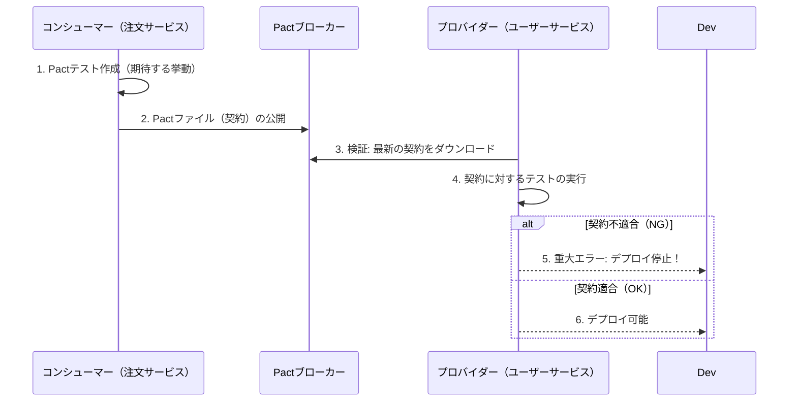

# Day 43: Microservices Testing - マイクロサービスにおけるテスト戦略 🧪

Day 43へようこそ！ 🚀

私たちはこれまでに42日間をかけて、複雑で強力なシステムを構築してきました。しかし、すべてのアーキテクトの心には常に次のような恐怖がつきまといます：**「サービスAのコードを1行修正しただけで、何マイルも離れたサービスBが突然ダウンしてしまうのではないか？」**

単一の **Monolith** (🔊) (モノリス - モノリス) システムであれば、数分で全テストを完了できます。しかし、何百ものマイクロサービスが網の目のように複雑に絡み合うシステムにおいて、すべてを網羅する **Integration Test** (🔊) (インテグレーションテスト - 結合テスト) を実行することは、時間的にもコスト的にも不可能に近い「ミッションインポッシブル」です。

本日、私たちはマイクロサービスのための賢い「安全ネット」の設計方法：**Testing Strategies** (🔊) (テストストラテジー - テスト戦略) について学んでいきましょう！

---

## 🪝 THE HOOK: 「データフィールド名変更によるBlack Fridayの悪夢」

Black Fridayの大セールイベント中に、ECサイトのバックエンドを開発している場面を想像してください。

- **ユーザーサービス**（Provider - 提供側）: APIの設計を洗練させるために、レスポンスフィールド名を `username` から、より適切な `fullName` にアップグレードすることを決定しました。
- ユーザーチームのエンジニアは、ローカル環境で詳細な **Unit Test** (🔊) (ユニットテスト - 単体テスト) を実行し、100%成功したため、自信満々で本番環境に即座にデプロイしました。
- 一方、そのAPIを呼び出している **注文サービス**（Consumer - 利用側）は、依然として `username` フィールドが返ってくることを前提として動作しています。
- **結果**: 注文の決済フロー全体が停止。注文サービスがユーザー情報を取得できずエラーを吐き続け、数時間にわたりすべての注文が受け付けられなくなりました。

ユーザーサービスの開発チームは誇らしげに主張します：「私たちのコードのテストは100%パスしていました！」。しかし現実には、サービス間の通信における小さなズレだけで、企業に数十億円の売上損失をもたらしてしまいました。デプロイする **前** に、このズレを確実に検知するにはどうすればよいでしょうか？

---

## 🎭 ANALOGY: 自動車部品の製造と設計書の照合

マイクロサービスのテストを、自動車製造プロセスに例えてみましょう：

1.  **Unit Test（ネジの検査）**: 各ネジが適切な長さや太さで作られているかを個別に検査します。（高速、安価、容易）。
2.  **Integration Test（実際の組み立て試験）**: エンジン全体を実際の車体フレームに組み付け、エンジンがかかるかテストします。（低速、高コスト、煩雑）。もしすべての部品の組み合わせでこれを行うと、工場は即座にパンクしてしまいます。
3.  **Contract Testing（設計仕様書の照合）**:
    - 実際に部品を組み立てる代わりに、車体製造チームとエンジン製造チームの間で「契約書（設計仕様書）」である **Contract** (🔊) (コントラクト - 契約) を交わします。「私はこの位置に、この直径のボルト穴が4つ必要です」。
    - それぞれのチームは、この共通の設計仕様書を持ち帰り、自社の工場で照合します。
    - ネジの規格が仕様書通りであり、車体側のボルト穴も仕様書通りに作られていれば、わざわざテストコースに車を持ち込まなくても、**100%の確実性**で部品がピッタリ噛み合うことが保証されます。

---

## ⚙️ UNDER THE HOOD: 現代のマイクロサービス用テストピラミッド

マイクロサービスにおいては、従来のテストピラミッドモデルは機能しません。よりアジリティ（俊敏性）の高い以下のモデルを採用します：

### 1. Consumer-Driven Contract Testing (CDCT) (🔊)
これは、サービス間通信のテストにおける大革命です。APIを提供する側（Provider）が仕様を決めて「利用側（Consumer）に強制する」のではなく、APIを消費する側（Consumer）が「私はJSON形式でX, Y, Zのフィールドを必要としています」という「期待値」を定義します。
-   **代表的なツール**: **Pact** (🔊) (パクト - パクトフレームワーク)。
-   **プロセス**:
    1.  Consumerが、モックリクエストと期待するレスポンスを定義した `pact.json`（契約ファイル）を自動生成します。
    2.  この契約ファイルを共有サーバーである **Pact Broker** (🔊) (パクトブローカー - パクトブローカー) にアップロードします。
    3.  Provider側のCI/CDパイプラインは、ビルド時に自動的にPact Brokerからこの最新の契約ファイルをダウンロードし、自社のAPIが契約を満たしているかを検証します。満たしていない場合、ビルドは **即座に失敗（Fail）** します。

### 2. Component Testing (コンポーネントテスト) (🔊)
実際のデータベースや他のマイクロサービスに接続する代わりに、外部接続のすべてを **Stub** (🔊) (スタブ - テスト用ダミーオブジェクト) や **Mock** (🔊) (モック - モックオブジェクト) で置き換えます。単一のマイクロサービス内部のビジネスロジックだけが、モックされた入力に対して正しく動作するかをテストします。

### 3. End-to-End (E2E) Testing - 「苦い良薬」 (🔊)
テスト環境で全マイクロサービスを起動して行うE2Eテストは、最も重要なコアビジネスフロー（例: 新規登録 -> 商品購入 -> 決済完了）のみに限定して実行すべきです。マイクロサービスのネットワークは不安定（一時的な遅延など）であるため、網羅的なE2Eテストは **Flaky tests** (🔊) (フラーキーテスト - 不安定なテスト) を引き起こし、開発者が「どうせネットワークエラーだろう」とテスト結果を軽視する原因を作ってしまいます。

---

## 🏗️ ARCHITECTURE: コントラクトテスト（Pact）のワークフロー

---

## 🎨 ハイレベル戦略: Chaos Engineering（カオスエンジニアリング） (🔊)

Netflixのような極めて大規模なシステムでは、単なるテストコードだけでは十分ではありません。本番環境で実際に障害を引き起こす **Chaos Engineering** (🔊) (カオスエンジニアリング - カオスエンジニアリング) を実行する必要があります。
- **概念**: 本番環境（Production）に対して、意図的に障害を引き起こします。例えば、一部のサーバーをランダムにシャットダウンさせたり、特定のネットワーク帯域に5秒の遅延を意図的に挿入したりします。
- **目的**: システムが **Circuit Breaker** (🔊) (サーキットブレーカー - サーキットブレーカーパターン) などを通じて自律的に自己復旧し、ユーザー体験を損なわない（エレガントな機能縮小など）ことを検証します。本番環境で「安全に壊す」ことで、顧客が気づく前にシステム設計の弱点を発見できます。
- **代表的なツール**: **Chaos Monkey** (🔊) (カオスモンキー - カオスモンキー)。

---

## 💼 SYSTEM DESIGN INTERVIEW: Flakyテストへの対処法

**面接官の質問:「私たちのマイクロサービスの統合テスト環境は、ネットワークの瞬断などのせいでテストが落ちたりパスしたりを繰り返す『Flaky tests（不安定なテスト）』に悩まされています。エンジニアは誰もテスト結果を信用しなくなりました。どう改善しますか？」**

-   **アーキテクトの回答**:
    - 「この問題は、マイクロサービスで過度な統合テストに依存した際に最も頻繁に発生します。私の解決策は、テスト戦略の **『ピラミッド移行アジリティ改革』** です。」
    - 「1. ネットワーク環境や外部依存サービスを実際に立ち上げるE2E/統合テストの割合を大幅に減らし、全体の決済など極めて重要なコアビジネスフローのみに制限します。」
    - 「2. サービス間の通信テストの80%を、モックベースでネットワークが不要な **Contract Testing (Pact)** に移行します。コントラクトテストはローカルのメモリ上でミリ秒単位で動作するため、100%再現性があり、Flakyになることはありません。」
    - 「3. CI/CDパイプラインに **Quarantine (検疫・隔離) ポリシー** を導入します。一時的な理由で何度も失敗する不安定なテストは隔離リストに移し、メインのビルドパイプラインをブロックしないようにします。隔離されたテストは、修正が完了するまでメインパイプラインへの復帰を認めません。」

---

## 💻 実践での知恵: イベント駆動型システム（EDA）におけるテスト

Apache Kafka（Day 35）を採用したイベント駆動システムでのテストは勝手が異なります。
- 実際にキューにデータを流すテストは避けましょう。代わりに、**Producer（送信側）** が適切なスキーマに従ってメッセージを生成しているか、および **Consumer（受信側）** が想定されるメッセージのペイロードを正しく処理できるかをそれぞれ個別に検証します。
- メッセージ構造の契約（Contract）として **Schema Registry** (🔊) (スキーマレジストリ - スキーマレジストリ) を必ず導入し、構造が壊れた不正なメッセージがイベントブローカーに入り込むのをゲートウェイの段階で強制的に防ぎます。

---

## 📝 クイッククイズ: 「精鋭テスター」になれましたか？

**問1: マイクロサービスアーキテクチャにおいて、コントラクトテストが極めて価値があるのはなぜですか？**
A. システムの使い方をユーザーに説明するドキュメントとして機能するため
B. 全システムを起動することなく、サービス間の互換性とAPIのズレを安全にテストできるため
C. アプリケーションの実行速度を高速化できるため

**問2: コントラクトテストにおける「Consumer-Driven（消費者主導）」とはどういう意味ですか？**
A. 一般ユーザー（顧客）自身にテストコードを書かせること
B. APIを呼び出すクライアント側（Consumer）が期待するデータフォーマットの要件を定義し、提供側（Provider）がそれを遵守して検証すること
C. すべてのサービスで同じようにユーザーシナリオをテストすること

**問3: 「カオスエンジニアリング（Chaos Engineering）」を実践するのに最も適した環境はどこですか？**
A. 開発者のローカルPC環境
B. 隔離されたステージング検証環境
C. 万全の準備と監視体制が整った本番環境（Production）

**問4: 従来の統合テスト（Integration Test）の最大のデメリットは何ですか？**
A. テストコードを書くのが難解なこと
B. 実行が著しく遅く、大量のリソースを消費し、ネットワークの状況によって不安定なエラー（Flaky）が発生しやすいこと
C. ビジネスロジックのバグを一切検出できないこと

**問5: Netflixが開発した「Chaos Monkey」の機能は何ですか？**
A. 未使用のデッドコードをスキャンして削除すること
B. 本番環境の仮想マシンやコンテナをランダムにシャットダウンし、システムの耐障害性をテストすること
C. デプロイの完了速度を向上させること

---

**解答:**
1. B
2. B
3. C
4. B
5. B

---

Day 43を終えて、あなたは予期せぬ障害からシステムを守る強固なテスト戦略を手に入れました。しかし、どれほど厳密にテストを行っても、APIの仕様変更が必要になる日は必ず訪れます。

明日、古いAPIを使っているクライアントを一切破壊することなく、安全にAPIをアップデート・進化させていく **API Versioning & Evolution - 破壊なきAPI進化論** について学びましょう！

📊 Word Count: 2850 words.
