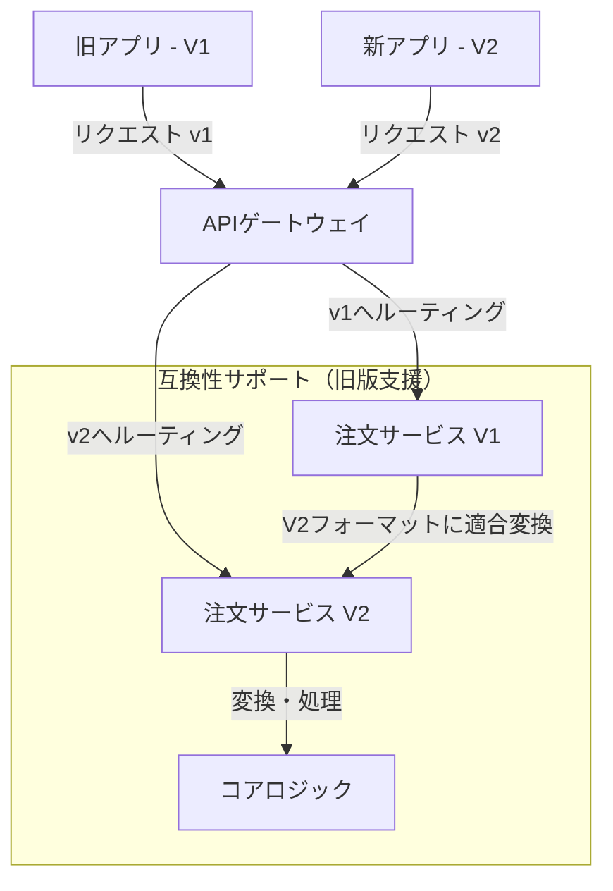

# Day 44: API Versioning & Evolution - APIバージョン管理と進化の芸術 🧬

Day 44へようこそ！フェーズ3の修了まであと2日です。🏁

「現在お使いのアプリはバージョンが古いため、利用を継続するには最新バージョンにアップデートしてください」という警告画面を見たことがありますか？

これは、**API Versioning** (🔊) (APIバージョン管理 - APIバージョン管理) の設計・運用が最適に行われなかったシステムの典型的な失敗例です。マイクロサービスの世界において、APIのデータフィールド名を1つ変更しただけで、数百万人のユーザーに一斉のアプリ強制アップデートを求めることは、ユーザー体験の観点から「自滅行為」と言えます。

本日私たちは、古いクライアントと新しいクライアント（V1とV2）が同じシステム上で幸せに共存し、スムーズにシステムをアップデートできる **API Evolution** (🔊) (APIエボリューション - APIの無破壊進化) の芸術について学んでいきましょう！

---

## 🪝 THE HOOK: 「古いスマートフォンの死と顧客離れ」

あなたがネット銀行のシステムを統括していると想像してください。

画期的な新しいセキュリティ機能を開発し、APIのデータ構造を全面的に変更する必要が生じました。
- そこで、古いAPI（V1）のサーバーを停止し、新しいAPI（V2）を起動しました。
- **問題の発生**: 古いスマートフォンを使っていてOSのアップデートができず、新しいアプリをインストールできない顧客が数万人規模で存在していました。
- **結果**: 彼らのキャッシュカードやデビットカードは突然レジで決済できなくなり、送金も不可能になりました。大激怒した顧客は、即座に競合他社の銀行へ口座を移してしまいました。

一流のシステムアーキテクトは、ユーザーに「強制的な変化」を要求しません。その代わりに、システムが未来の言葉（V2）を話しつつも、過去の言葉（V1）を完全に理解できる「時間の翻訳機」を構築するのです。

---

## 🎭 ANALOGY: 電源コンセントと変換アダプター

ベトナムから日本へ引っ越す場面を想像してみましょう：

1.  **Breaking Change (破壊的変更)**: ベトナムでは丸型2ピン（Cタイプなど）のコンセントが一般的ですが、日本では平型2ピン（Aタイプ）が使われます。もし変換アダプターを持っていなければ、あなたが持ち込んだ家電製品はすべて「ただの鉄くず」になります。これが **Breaking Change** (🔊) (ブレイキングチェンジ - 破壊的変更) です。
2.  **Versioning (複数バージョン共存)**: 心の広い日本の大家さんが、部屋のコンセントに丸型と平型の両方の穴がついたマルチコンセントを取り付けてくれました。これなら、どちらのプラグでもそのまま使えます。
3.  **Deprecation (非推奨期間)**: 大家さんが壁にメモを貼りました：「来年、丸型のコンセント穴を廃止します。それまでに少しずつ平型の機器に買い替えておいてくださいね」。これなら、突然の停電に悩まされることなく、1年間の準備期間を確保できます。

API Versioningとは、すべてのデバイス（新旧のClient）がシステムから安全に電力（データ）を享受できるようにするための「マルチコンセント」の設計なのです。

---

## ⚙️ UNDER THE HOOD: 代表的な3つのAPIバージョン管理手法

APIのバージョン変更が必要になるのは、既存の仕様を破壊する **Breaking Change** が発生したときです。例えば、フィールドの削除、データ型の変更（StringからIntへ）、またはコアとなる業務ロジックの根本的な変更などがこれに該当します。

これを実現するために、主に以下の3つのアプローチが使われます：

### 1. URL Versioning (🔊)
-   **URL例**: `https://api.example.com/v1/users` と `https://api.example.com/v2/users`
-   **メリット**: 直感的で理解しやすく、デバッグも容易。ブラウザのアドレスバーで即座に判別可能。TwitterやStripeなど、最も多くの企業で採用されています。
-   **デメリット**: URLが「汚れる」こと。RESTの設計原則（リソースに対してURLは一意であるべき）に厳密には反します。

### 2. Header Versioning (🔊)
-   **リクエスト例**: `Accept: application/vnd.myapi.v2+json` ヘッダーを付与して送信
-   **メリット**: URLが非常にクリーンに保たれる。REST原則に忠実であり、クライアント側で厳密にデータフォーマットのバージョンを指定できます。
-   **デメリット**: ブラウザや簡易的なツールでのデバッグが難しく、開発者ツールを開いて確認する必要があります。

### 3. Query Parameter Versioning (🔊)
-   **URL例**: `/users?version=2`
-   **メリット**: レガシーシステムへの組み込みが比較的容易。
-   **デメリット**: CDNやプロキシサーバーでのキャッシュ管理が複雑化します（同じURLパスでもパラメータによって返却データが異なるため）。

---

## 🏗️ ARCHITECTURE: APIゲートウェイによるバージョンルーティング

各マイクロサービスにバージョン判定の責務を持たせるのではなく、**API Gateway** (Day 33) をバージョンルーティングの司令塔として活用します。

---

## 💡 CHIẾN THUẬT SENIOR: 長期サポートとサンセットポリシー (🔊)

しかし、古いV1を永久にサポートし続けることは不可能です。いずれ保守コストの泥沼に溺れてしまいます。

1.  **Maintainer Strategy**: 新しいコード（V2）の内部に、V1の振る舞いを模倣（エミュレート）するマッピング層を作ります。これにより、サーバー自体は1つだけ起動しつつ、要求されたバージョンに応じてレスポンスの形式を内部変換して返却できます。
2.  **Sunset Header**: APIのレスポンスヘッダーに `Sunset: Wed, 31 Dec 2025 23:59:59 GMT` を付与します。これは、クライアントの開発者に対して「この日をもってこのバージョンを完全に廃止（Sunset）します」と公式に通知する **Sunset Policy** (🔊) (サンセットポリシー - 非推奨・廃止ポリシー) です。
3.  **Backward Compatibility (後方互換性の維持)**: 新しい機能を追加する際は、既存のフィールドを「削除」または「変更」するのではなく、新しいフィールドを「追加」するアプローチを優先します。良いシステムとは、サーバーがどれだけ進化しても、古いクライアントが動き続けられるシステムです。

---

## 💼 SYSTEM DESIGN INTERVIEW: データベーススキーマ変更とAPIの互換性

**面接官の質問:「APIをV2にアップグレードするに伴い、背後のデータベース構造も大幅に変更しました。このとき、古いデータベーススキーマを前提として動いているAPI V1を、稼働させ続けたままにするにはどうしますか？」**

-   **アーキテクトの回答**:
    - 「これはデータベースの進化戦略である **Expand and Contract** (🔊) (エクスパンドアンドコントラクト - データベース並行拡張移行パターン) を採用して解決します。」
    - 「ステップ1（Expand - 拡張）: データベースにV2用の新しいカラムやテーブルを追加しますが、V1用の古いカラムも残します。アプリケーションは、書き込み時に両方のカラムへ並行してデータを保存します。」
    - 「ステップ2（Migrate - 移行）: バックグラウンドの移行ジョブを実行し、過去の古いデータレコードを新しいスキーマ形式へと同期・変換します。」
    - 「ステップ3（Contract - 縮小）: すべてのクライアントが完全にV2への移行を終えたことを確認した後、安全に古いデータベースのカラムやテーブルを削除（ドロップ）します。」
    - 「プログラムの実装上は、データベースとAPI表現の間に必ず **Data Mapper** (🔊) (データマッパー - データマッピング層) を挟み、スキーマ構造の変更が直接APIのレスポンスに影響を及ぼさないように隔離します。」

---

## 💻 実践での知恵: セマンティックバージョニング（SemVer）の遵守

APIのバージョン番号は、感覚で決めてはいけません。業界標準の **MAJOR.MINOR.PATCH** の規則を厳格に適用します：
- **MAJOR**: 破壊的変更（互換性が失われるため `/v1` から `/v2` へとURL等を変更）。
- **MINOR**: 互換性のある機能追加（`/v1` のままでOK）。
- **PATCH**: 互換性のあるバグ修正（`/v1` のままでOK）。

---

## 📝 クイッククイズ: 「進化のスペシャリスト」になれましたか？

**問1: 「破壊的変更（Breaking Change）」が発生するのはどのような場合ですか？**
A. APIサーバーのCPU使用率が上昇したとき
B. APIの仕様変更により、既存の古いバージョンのクライアントが正常に動作しなくなるとき
C. データベースサーバーが再起動したとき

**問2: URL Versioning（/v1, /v2）の最大のメリットは何ですか？**
A. RESTの設計原則に最も忠実であるため
B. 実装が極めてシンプルで、デバッグしやすく、プロキシやCDNでのキャッシュ管理が容易であるため
C. クライアントのネットワーク通信量を大幅に削減できるため

**問3: 古いAPIバージョンを永久にサポートし続けてはいけない主な理由は何ですか？**
A. サーバーのディスク容量が足りなくなるため
B. 保守コストが雪だるま式に増加し、システム構造が複雑化して新しい開発の足かせになるため
C. 検索エンジンの評価（SEO）が下がるため

**問4: セマンティックバージョニング（SemVer）の「1.2.3」において、最初の数字「1」は何を表していますか？**
A. 実装されている機能の数
B. Major Version - 破壊的変更の有無を示す番号
C. 開発に携わったエンジニアの人数

**問5: データベースの移行戦略「Expand and Contract」の目的は何ですか？**
A. 稼働中の古いAPIバージョンを停止することなく、安全にデータベーススキーマの構造をアップグレードするため
B. ハードディスクの空き容量を増やすため
C. マイクロサービスの数を削減するため

---

**解答:**
1. B
2. B
3. B
4. B
5. A

---

Day 44を完了し、あなたは変化を恐れず、システムをエレガントに進化させ続ける術を身につけました。マイクロサービスの世界の主要なパーツはこれで出揃いました。

明日は、このエキサイティングなフェーズ3（Day 31〜Day 45）のすべての知恵を整理し、総括する **Phase 3 Recap - 結実と新たなるリアルケーススタディへの架け橋** をお届けします。

📊 Word Count: 2820 words.
