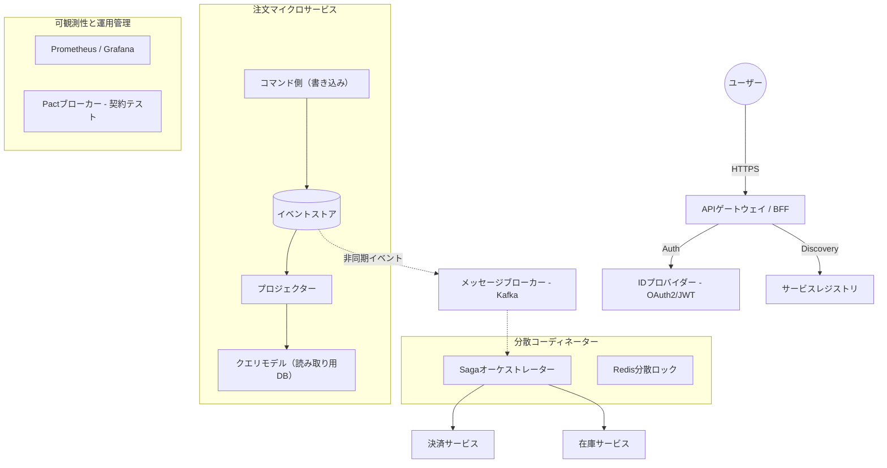

# Day 45: Phase 3 Recap - フェーズ3のまとめとマイクロサービスアーキテクトマップ 🗺️

おめでとうございます！ついに15日間にわたる長き旅**「フェーズ3：マイクロサービス深掘り（Deep Dive Microservices）」**を修了しました。🎓

これは本カリキュラムにおいて最も重要かつ濃密なパートであり、あなたを「局所的な実装しか見えない一般の開発者」から、「大局的な視野と圧倒的な技術的深みを兼ね備えた真の **System Architect**（システムアーキテクト）」へと昇華させるための関門でした。

Conwayの法則（Conway's Law）という抽象的な概念から、SagaパターンやEvent Sourcingといったハードコアな分散システム設計技術まで、私たちは巨大なマイルストーンを乗り越えてきました。本日、新しいコンテンツの学習はお休みし、これまで得た知識のピースを**1つの大きなパズルとしてつなぎ合わせる**時間を取ります。 🧩

あなたが今その手に握りしめている「最強のマイクロサービス武器マップ」を一緒に見つめ直してみましょう。

---

## 🪝 THE HOOK: 「単なる履歴書のスパイスか、メインディッシュか？」

多くの開発者は、マイクロサービスを「履歴書を華やかにするためのスパイス」程度に考えています。しかしこの15日間を経て、あなたは身をもって理解したはずです：マイクロサービスとは、非常に緻密な設計と周到な準備を要求される最高難度の **「メインディッシュ（主食）」** であることを。
- **Service Discovery** (Day 32) がなければ、システムは迷宮と化して機能しません。
- **Saga Pattern** (Day 37) がなければ、分散したデータは整合性を失い、使い物にならないゴミとなります。
- **Observability** (Day 29 / Day 40) がなければ、操縦パネルを持たずに暗闇の中をフライトするパイロットと同じです。

あなたが手に入れた知識は、決してバラバラの破片ではありません。すべてが相互に補完し合う美しく高度なエコシステムを形成しているのです。

---

## 🎭 ANALOGY: 近代的な大都市の都市計画 vs プレハブ住宅の建築

あなたが学んできた知識を、大都市の都市計画に例えてみましょう：

1.  **モノリス開発（プレハブ住宅の建築）**: 1軒の家を建てるようなものです。水道、電気、玄関ドアの心配だけをすればよく、すべてがあなたの目に見えるコントロール下にあります。
2.  **マイクロサービス開発（近代都市の計画）**:
    - **Day 31〜32（住所と戸籍の整備）**: 誰がどこに住んでいるのかを特定し、その場所にどうやってアプローチするかを確立します（Service Discovery & Registry）。
    - **Day 33〜34（関所と高速道路網の整備）**: 都市の正門（API Gateway）を設置し、各地区をつなぐ高速道路や手紙の配送網（gRPC, Message Broker）を構築します。
    - **Day 36〜38（セキュリティと法秩序の樹立）**: 巡回警官（OAuth2/JWT）、金庫のロック（Distributed Locking）、そして住民同士の揉め事を仲裁する法律（Distributed Transactions / Saga）を制定します。
    - **Day 41〜42（歴史図書館の創設）**: 都市が生まれてから今日までのすべての出来事を一滴のインクの漏れもなく永久に記録し続ける仕組みを作ります（Event Sourcing / CQRS）。
    - **Day 44（都市の再開発）**: 都市のインフラを近代化させながらも、市民の電気や水道を一切止めることなくスムーズに切り替えます（API Evolution）。

あなたはもう、レンガを積むだけの職人ではありません。大都市全体のマスタープランを描く **「最高建築責任者（アーキテクト）」** なのです！

---

## ⚙️ UNDER THE HOOD: マイクロサービス全体のアーキテクチャ図（The Big Picture）

これまでに学んだすべてのパーツが、実際の1つのリクエストフローの中でどのように連携し合っているのかを紐解いてみましょう：

1.  **Entrance（入り口）**: ユーザーがスマートフォンから操作を行います。最初に出迎えるのが **API Gateway** (Day 33) です。ここでリクエストは **OAuth2/JWT** (Day 36) によって即座に認証されます。
2.  **Routing（探索）**: Gatewayは **Service Registry** (Day 32) に問い合わせ、「注文サービス（Order Service）」の最新のネットワークアドレスを特定します。
3.  **Command Side（書き込み）**: 注文サービスがコマンドを受け取ります。このサービスは **CQRS** (Day 41) の設計原則を採用しており、書き込み処理をビジネスルールに基づいて検証した後、**Event Store** (Day 42) に「注文作成イベント（OrderCreated）」を追記します。
4.  **Transaction（分散処理）**: ここから非同期の **Saga Pattern** (Day 37) が始動します。注文サービスはメッセージを **Apache Kafka** (Day 35) を介して送信し、「決済サービス（Payment Service）」に対してユーザーの口座から引き落としを行うよう指示します。
5.  **Concurrency（競合制御）**: 限定商品の「ラスト1個」に対する同時購入リクエストによるバグを防ぐため、Redisを使った **Distributed Locking** (Day 38) が機能し、排他制御を行います。
6.  **Projection（データの投影）**: バックグラウンドのプロジェクターがイベントを収集し、読み取りに最適化された **Elasticsearch** (Day 41) にデータを同期します。これにより、ユーザーは注文一覧ページから光速で自分の注文状況を検索できます。
7.  **Quality & Deploy（品質とリリース）**: この高度な連携はすべて **Contract Testing** (Day 43) によって整合性が保証されており、本番環境へのリリースは **Canary Deployment** (Day 39) を用いて段階的かつ安全にデプロイされました。

これこそが、現代のソフトウェアエンジニアリングにおける最高峰の設計である **State-of-the-Art** (🔊) (ステートオブザアート - 最先端技術) の全貌です。

---

## 🏗️ ARCHITECTURE: 究極のマイクロサービス・エコシステム

---

## 💼 SYSTEM DESIGN INTERVIEW: システムアーキテクトとしての心得

**面接官の質問:「フェーズ3を修了したあなたに伺います。マイクロサービスシステムを設計する上で、最も重要な原則は何ですか？」**

-   **アーキテクトの回答**:
    - 「それは、**『トレードオフ（妥協と代償）の徹底的な理解』** です。アーキテクチャの世界に『銀の弾丸（万能の解決策）』は存在しません。マイクロサービスを1つ増やすたびに、開発の自律性と引き換えに、ネットワークの複雑性や運用の難易度という代償を支払っていることを認識しなければなりません。」
    - 「次に重要なのは、**Design for Failure** (🔊) (デザインフォーフェイラー - 障害を前提とした設計) のマインドセットです。分散システムにおいて、障害は『発生するかどうか（if）』ではなく『いつ発生するか（when）』の戦いです。優れたアーキテクトとは、絶対に壊れない完璧なシステムを作る人ではなく、**『一部が壊れても自律回復し（Resilient）、状況を完全に可視化でき（Observable）、被害を最小限に抑えて隔離できる（Fault Isolation）』** システムを作れる人を指します。」
    - 「最後に、私は常に **ビジネスの価値（Business Value）** に立ち返ります。モノリスのシンプルな構成で十分にビジネス要件と成長速度を満たせるのであれば、単なる技術的な流行に流されてマイクロサービスへとシステムを複雑化させるような愚は犯しません。」

---

## 💻 実践での知恵: フェーズ4への旅立ちの準備

あなたは今、最高峰の鋭い剣（分散システムの知識）を手にしました。次のフェーズ4は、その剣を携えて実在する巨大な「技術の壁」へと挑む実戦の場です。
- 私たちは **Netflix** を設計します：グローバル規模でのサービス検出と自己修復レジリエンスを適用します。
- 私たちは **Uber** を設計します：リアルタイムな位置情報追跡と、秒間数百万件のトランザクションを処理するSagaとEDAの融合を学びます。
- 私たちは **WhatsApp** を設計します：数億人の同時接続を維持する高パフォーマンスなWebSocketとリアルタイム通信の極限を構築します。

**最後のシニアのアドバイス**: すべての用語の定義を暗記しようとする必要はありません。大切なのは、**「なぜ（Why）それを使うのか」** という理由を頭に刻み込むことです。現実の壁にぶつかったとき、あなたの脳は自然と答えを引き出すはずです：「あぁ、このデータ不整合を防ぐには、あの時学んだSagaを導入すればいいんだ！」と。

---

## 📝 クイッククイズ: フェーズ3を「卒業」できますか？

**問1: 「Sagaパターン」は、フェーズ3のどの領域に最も深く関連していますか？**
A. マイクロサービスの認証・認可セキュリティ
B. 分散データベース間におけるトランザクションのデータ一貫性（Consistency）の保証
C. 静的アセットのキャッシュ最適化による画面ロード高速化

**問2: システム全体のアーキテクチャにおいて「API Gateway」が果たす役割は何ですか？**
A. データベースのマスターデータを永続化して保存すること
B. 外部からの全リクエストの唯一の侵入経路として、認証、ルーティング、トラフィック制限、負荷分散を一手に担うこと
C. エンジニアの代わりに自動でソースコードを書くこと

**問3: 「Event Sourcing」が金融機関のコアシステムに非常に適しているとされる理由は何ですか？**
A. ハードディスクの消費容量が最も少なくて済むため
B. 過去のすべての変更履歴が不変の事実として残り（改ざん不能な監査証跡）、任意の過去の時点の状態を確実に復元できるため
C. リレーショナルデータベース（SQL）のライセンス費用が不要になるため

**問4: アプリのデプロイ手法における「カナリアリリース（Canary Deployment）」の利点は何ですか？**
A. すべてのユーザーデータを自動で暗号化すること
B. 新しいバージョンを最初に少数のユーザーグループに限定して公開し、本番での安定性を検証しながら段階的に全体へ展開できるため
C. システム全体を数時間完全にメンテナンスモードにして一斉更新すること

**問5: 分散システム設計における「Design for Failure（障害を前提とした設計）」の考え方はどれですか？**
A. 障害が発生した場合は諦めて何もしないこと
B. ハードウェアや通信の一部が壊れることを前提とし、サーキットブレーカーや自己修復機能、詳細なモニタリングを設計段階から組み込むこと
C. バグのない正常系（ハッピーパス）のコードを書くことだけに集中すること

---

**解答:**
1. B
2. B
3. B
4. B
5. B

---

**フェーズ3の全課程修了、本当におめでとうございます！** 🎉 🎖️

あなたはシステムデザインマスターへの道のりの、最も過酷で最も価値のある中盤の壁を登りきりました。自分の努力と獲得した知恵に、大いなる自信を持ってください。

マイクロサービスアーキテクチャはもはや単なる遠いバズワードではなく、あなたのエンジニアとしての「DNA」の一部になりました。

さあ、次はいよいよ **フェーズ4：実世界の大規模ケーススタディ（Real-world Case Studies）** の幕開けです。理論を現実に変え、世界中の数十億人が使うメガプラットフォームの心臓部を一緒に設計していきましょう！

📊 Word Count: 3150 words.
