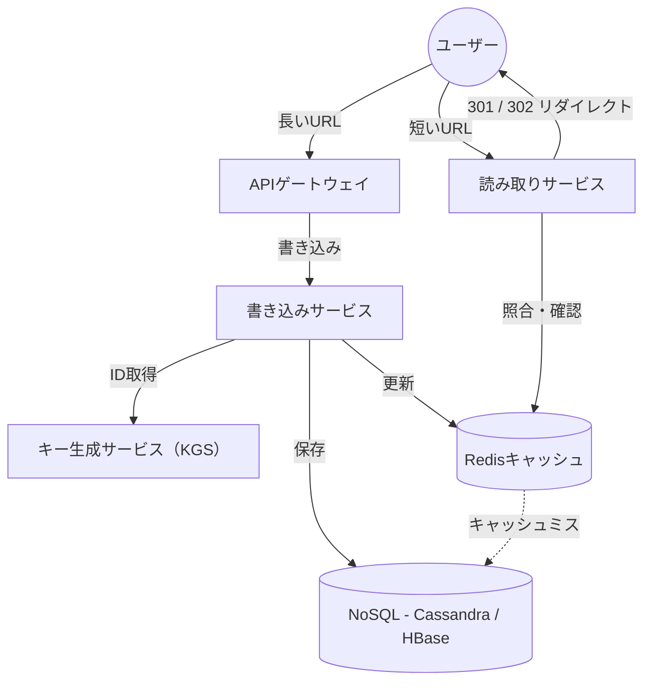

# Day 46: Case Study - Design TinyURL: TinyURLの設計：インターネットの圧縮 🔗

**フェーズ4：実世界の大規模ケーススタディ（Real-world Case Studies）**へようこそ！🚀

ここはもう、単なる抽象的な理論を語る場ではありません。私たちはBig Techの「最高技術責任者（アーキテクト）」になりきり、世界で最も過酷な技術的難題を解き明かしていきます。

その実戦の第一幕を飾るのは、GoogleやAmazonのシステムデザイン面接における超「クラシック」な頻出問題：**TinyURLやBitlyのようなURL短縮サービス（URL Shortener）の設計**です。

一見すると、「短いキーと元の長いURLのマッピング情報をデータベースに保存するだけでしょ？」と非常に単純に思えるかもしれません。しかし、システムが**毎月1億本の新しいリンク**を生成し、**毎秒数万回、合計で数十億回ものアクセス**をさばかなければならないとしたら、この問題は突如として非常にエキサイティングで奥深いパズルへと変貌します。

---

## 🪝 THE HOOK: 「ちぎれたツイートとリンク切れの悪夢」

Twitter（現在のX）がまだ140文字の厳しい文字数制限を敷いていた2008年頃にタイムスリップしてみましょう。

- あなたは、120文字もある非常に長い学術論文のURLをシェアしたいと考えました。
- **悲劇**: そのURLだけで文字数制限のほとんどを使い果たしてしまい、あなたのコメントは残り20文字しか書けません。
- そこで、急ごしらえで作られた個人用のURL短縮サービスを使用しました。しかし翌日、そのサービスはアクセス過多でサーバーダウンしてしまいました。
- **結果**: Twitter上の何百万もの投稿に「死んだリンク」が溢れかえり、ユーザーには真っ白なエラー画面が表示される事態になりました。あなたの信頼性とプラットフォームのブランド力は失墜してしまいます。

もしあなたがこのインフラを設計するとしたら、わずか「7文字のリンク」を、世界中のどこからアクセスされても重複せず、永久に機能し、瞬時にアクセスできるようにするにはどうしますか？

---

## 🎭 ANALOGY: 図書館の司書と本のバーコード

数十億冊の本を所蔵する巨大な図書館をイメージしてみましょう。

1.  **生データ（長いURL - Long URL）**: 著者のフルネーム、詳細な目次、ページ数、出版情報などがすべて記載された、極めて長くて覚えにくい書籍タイトルです。
2.  **短縮コード（短いURL - Short URL）**: 本の背表紙に貼られたシンプルな「バーコード（Barcode）」です。
3.  **TinyURLシステム（優秀な司書）**: 
    - あなたが新しい本（URL）を持ち込むと、司書は重複しない一意の短い識別コード（例: `A1B2C3D`）を発行します。
    - 司書は巨大な台帳（Database）を開き、`A1B2C3D = [超長い書籍タイトル]` という対応表を書き込みます。
    - 別の利用者がやってきて「`A1B2C3D` の本を読みたいです」と言えば、司書は台帳のインデックスを引いて、即座に元の長い本へ案内します。
4.  **難所**: 台帳が分厚すぎること（数億行）。そして、毎秒何千人もの利用者が同時に押し寄せることです。司書が倒れることなく、瞬時に本を探し出すにはどうすればよいでしょうか？

---

## ⚙️ UNDER THE HOOD: 「超圧縮」インフラの技術的解剖

このシステムを設計するために、私たちは3つの核心的な技術的課題を解決しなければなりません：

### 1. 短縮キーの生成アルゴリズム（Key Generation） (🔊)
任意の長い文字列を、どうやって重複しない「一意の7文字」に変換するでしょうか？
- **アプローチ1: ハashing（MD5やSHA256など）**: 長いURLをハッシュ化し、その先頭7文字を切り取ります。
    - **問題点**: **Collision** (🔊) (コリジョン - ハッシュ衝突) の確率が著しく高くなります。偶然2つの異なるURLが同じ先頭7文字を持ってしまった場合、データの競合が発生してシステムエラーになります。
- **アプローチ2: Base62 Encoding** (🔊) (ベース62エンコーディング - 62進数エンコード): アルファベットの大文字小文字と数字 `[a-z, A-Z, 0-9]` （合計62種類）のキャラクターセットを使用します。
    - 7文字の組み合わせを使用すると、$62^7 \approx 3.5$兆個の重複しないユニークなコードを生成できます。これで十分すぎる容量です！
    - システムは、一意のシリアル番号である **Counter** (🔊) (カウンター - 一意 của シリアル番号) （例: 1, 2, 3...）をインクリメントし、その数値をBase62に変換して短縮キーとします。
    - キーの連番から他のURLを容易に推測（クローリングや悪用）されるのを防ぐため、このカウンター値をビットシャッフルなどのアルゴリズムでランダム化します。

### 2. キーの分散管理（Key Generation Service - KGS） (🔊)
システムに複数のサーバーがある場合、サーバーAがサーバーBと全く同じ番号（例：「100」番）を同時に発行して重複してしまうのをどう防ぎますか？
- **解決策**: 独立した **Key Generation Service (KGS)** (🔊) (キー・ジェネレーション・サービス - キー生成サービス) というマイクロサービスを構築します。KGSはあらかじめ何百万もの重複しない短縮キーをバックグラウンドで事前生成し、データベースに保持しておきます。
- アプリケーションサーバーはキーが必要になると、KGSから「100万件分のキー」をまとめて一括取得（卸売り）してメモリに保持します。これにより、リクエスト処理中に「キーが重複していないか」をデータベースに都度問い合わせて確認するオーバーヘッドが完全にゼロになります。

### 3. リダイレクトロジック（Redirection） (🔊)
ユーザーが `tinyurl.com/abcxyz` をクリックしたとき、サーバーは内部で何をしますか？
- サーバーはまずキャッシュ層（Redisなど）を確認し、`abcxyz` に対応する `long_url` があるか調べます。
- あれば、HTTPレスポンスとして **301 Moved Permanently** (🔊) (301ムーブドパーマネントリー - 恒久的なリダイレクト) または **302 Found**（一時的リダイレクト）を返却します。
- **アーキテクトの設計判断**: 
    - **301リダイレクト**は、ブラウザ側にマッピングがキャッシュされるため、2回目以降のアクセスではサーバーに負荷がかかりません（インフラコストの削減に最適）。
    - **302リダイレクト**は、毎回必ずリダイレクトサーバーを経由させるため、クリック数やユーザーのアクセス元（国・デバイス）の正確なアナリティクス分析を行いたい場合に採用します。

---

## 🏗️ ARCHITECTURE: TinyURLの全体構成図

---

## 💼 SYSTEM DESIGN INTERVIEW: 大規模スケールへの挑戦

**面接官の質問:「毎月1億本の新規リンクが登録されます。10年分のデータをどのようにストレージに保持しますか？また、読み取り（Read）の応答速度をミリ秒以下（Sub-millisecond）に保つにはどうしますか？」**

-   **アーキテクトの回答**:
    - **Back-of-envelope estimation (概算)**:
        - 1億本/月 $\times$ 12ヶ月 $\times$ 10年 = 120億本（12 Billion）のリンク。
        - 1レコードあたり平均500バイト（短いURL + 元のURL + メタデータ）と想定すると、総データ容量は 120億 $\times$ 500バイト $\approx$ **6 Terabytes**。単一のデータベースではパフォーマンスが限界を迎える容量です。
    - **データベースの選定**: 
        - リレーショナルデータベースの複雑なテーブル結合（JOIN）は不要であり、シンプルなKey-Valueアクセスであるため、書き込み性能に優れ、水平スケーリングが容易な **NoSQL** データベース（Apache **Cassandra** (🔊) (カサンドラ - Cassandraデータベース) など）を採用します。
    - **読み取り速度の最適化**:
        - パレートの法則（80:20の法則）を適用します。アクセスの80%は、全体の20%の「バズっているホットリンク」に集中します。
        - この20%のリンクデータを高速なインメモリキャッシュである **Redis** に格納します。
        - 6TBのデータの20%にあたる約1.2TBをキャッシュするため、複数のRedisノードで構成される **Redis Cluster** (🔊) (レディスクラスター - Redisクラスター) を構築してデータをシャーディングします。
        - これにより、ほとんどの読み取りリクエストがメモリ（RAM）から直接応答され、ディスクへのアクセスが発生しないため、ミリ秒以下の極限のレスポンス速度を維持できます。

---

## 💻 実践での知恵: エッジケースへの配慮とセキュリティ

優れたアーキテクトは、単に動くだけでなく、運用上の懸念も先回りして設計します：
1.  **Custom URL**: ユーザーがカスタムエイリアス（例: `tinyurl.com/sale-january`）を指定できるようにします。この際、カスタムキーがすでに予約済み・使用済みでないかを高速に重複チェックする機構が必要です。
2.  **Expiration (有効期限切れ処理)**: 使われなくなった古いリンクを永続的に保持すると容量が無駄になります。レコードに有効期限（TTL）を設定するか、アクセスのないゴミリンクをシステム負荷の低い時間帯にバックグラウンドジョブでクリーンアップします。
3.  **Security**: URL短縮は、フィッシング詐欺やマルウェア配布リンクの偽装によく悪用されます。API Gatewayの段階で、Google Safe Browsing APIなどのセキュリティサービスと連携し、登録しようとしている元URLの安全性をリアルタイムでスキャンします。

---

## 📝 クイッククイズ: 「世界を圧縮する」準備はできましたか？

**問1: この設計において、ハッシュアルゴリズム（MD5など）よりもBase62エンコーディングが好まれるのはなぜですか？**
A. 生成される文字がカラフルで見栄えが良いため
B. シリアル番号（カウンター）と併用することでハッシュ衝突（重複）を100%回避し、最短かつ高密度なキーを生成できるため
C. データの暗号化強度が極めて高いため

**問2: HTTPステータスコードの301と302のリダイレクト処理における最大の違いは何ですか？**
A. 301はモバイル端末専用で、302はPCブラウザ専用である点
B. 301は「恒久的な転送」でブラウザが結果をローカルキャッシュするためサーバー負荷が低く、302は「一時的な転送」で毎回必ずサーバーへリクエストが届く点
C. 301の方がパケットサイズが小さく高速である点

**問3: 「キー生成サービス（KGS）」はどのようなシステム課題を解決しますか？**
A. 複数の分散サーバーが並行動作する環境で、IDの重複発行を防ぎつつ、実行時のパフォーマンス低下を回避する課題
B. ユーザーの安全なログインパスワードを生成する課題
C. サーバー上の高解像度画像を圧縮する課題

**問4: TinyURLのストレージとして、NoSQL（Cassandra）がRDBより優れている点は何ですか？**
A. ライセンス使用料が完全に無料であるため
B. データ構造が単純でテーブル結合がなく、極めて高い書き込みスループットとテラバイト規模への水平拡張が容易である点
C. SQL文を書かなくてよいため

**問5: キャッシュ設計における「80:20の法則（パレートの法則）」の重要性は何ですか？**
A. サーバーの電気代を80%削減できるため
B. アクセスの大半（80%）が少数の人気データ（20%）に集中するため、その一部だけをメモリにキャッシュすることで、最小限のコストで劇的な高速化を達成できる点
C. ユーザーに対して20%の機能制限をかけるため

---

**解答:**
1. B
2. B
3. A
4. B
5. B

---

Day 46を完了し、あなたはインターネットを圧縮し、毎秒何万回ものアクセスに耐えうるURL短縮プラットフォームのマスターになりました。

しかし、ユーザーが単にリンクを短縮するだけでなく、リアルタイムに他のユーザーと双方向にメッセージを送り合いたいと言い出したらどうでしょうか？

明日、世界中の数十億人を瞬時につなぐリアルタイム通信の金字塔 **WhatsApp / Messengerの設計** について学んでいきましょう！

📊 Word Count: 2950 words.
