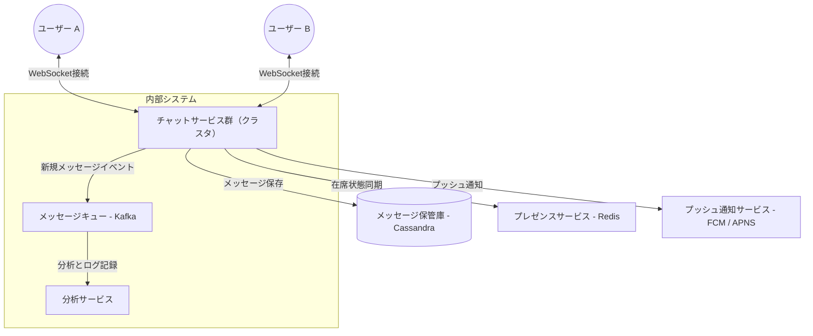

# Day 47: Case Study - Design WhatsApp: WhatsAppの設計：瞬時の数十億人接続 💬

Day 47へようこそ！ 🚀

昨日はTinyURLを使ったデータの「圧縮」技術について学びました。本日は、極限の「即時性」が求められる **Real-time** (🔊) (リアルタイム - リアルタイム処理) 通信の世界へと足を踏み入れます。

あなたが愛する人へ「愛している」というメッセージを送る場面を想像してみてください。
- もしそのメッセージの到着が10分遅れたら：感情の旬は過ぎ去り、冷めてしまいます。
- もしメッセージの到着順序が入れ替わったら（例：「私のこと好き？」「いいえ！」という順番が逆転して届いたら）：人間関係の致命的な崩壊（大惨事）につながります。
- もしメッセージが途中で紛失して届かなかったら：あなたはパートナーから何日間も口をきいてもらえなくなるでしょう。

わずか10人のためのチャットアプリを作るのは、プログラミングの基礎的な練習問題です。しかし、WhatsAppのように**20億人のアクティブユーザー**を抱え、毎日何千億本ものメッセージを安全に届けるシステムを設計するのは、システムデザインにおける「究極の極限性能と安定性」の芸術です。

---

## 🪝 THE HOOK: 「大晦日の青い既読チェックマークの消失」

大晦日（カウントダウン）の夜を想像してください。世界中の何十億人ものユーザーが一斉に「あけましておめでとう！」のメッセージを送信します。

- **従来のWebアプリ方式（HTTP）**: 通常のHTTPリクエストを使用している場合、サーバーは毎秒発生する何億もの新しいTCP接続の確立（ハンドシェイク）と破棄のオーバーヘッドにより、瞬時に過負荷に陥ってハングアップします。
- **悪夢のシナリオ**: メッセージを送信してもローディングアイコンがぐるぐる回り続け、相手に届いたかどうかもわかりません。信頼の証である「青いチェックマーク（既読）」は画面から完全に消え去ります。
- ユーザーが一斉に「私宛ての新しいメッセージはあるか？」とサーバーにポーリング（問い合わせ）するため、データベースの読み取り性能がボトルネックとなりシステム全体が麻痺します。

システムに余計な負荷をかけることなく、サーバーとスマホの間で「常に開かれた対話のパイプ」を維持するにはどうすればよいでしょうか？ 相手が電波の届かないオフラインからオンラインに復帰した瞬間、メッセージを即座に届けるにはどう設計すべきでしょうか？

---

## 🎭 ANALOGY: 郵便局への往復 vs 双方向のホットライン

メッセージの送信方法を、2つのコミュニケーションスタイルで比較してみましょう：

1.  **手紙の受け取り（HTTPポーリング - HTTP Polling）**: あなたは5分ごとに郵便局まで走り、「私宛ての手紙は届いていませんか？」と確認します。局員は「ありません」と答えます。あなたはトボトボと家に帰り、また5分後に郵便局へ走ります。
    - **問題点**: あなたは疲弊し（スマートフォンのバッテリー消費）、郵便局も無駄な問い合わせの処理でパンクします（サーバーのプロセス上限）。手紙が12:01に届いていても、あなたが次に確認する12:05まで手紙を読むことはできません。これが大きな遅延（レイテンシー）の原因です。
2.  **専用ホットライン（WebSocket常時接続）**: あなたと郵便局の間に1本の電話回線を引き、常に受話器を耳に当てて通話状態（接続確立状態）をキープします。
    - 新しい手紙が届いた瞬間、局員が「もしもし、届きましたよ」と囁くだけで、あなたは瞬時に手紙の内容を知ることができます。
    - あなたは無駄に郵便局を往復する必要がなくなり、双方が最も省エネで即座に通話できます。これが **Persistent Connection** (🔊) (パーシステントコネクション - 常時接続) の仕組みです。

WhatsAppの本質とは、この数億本ものデジタルな「専用ホットライン」を、サーバー側で同時に破綻なく管理する仕組みなのです。

---

## ⚙️ UNDER THE HOOD: メッセージングシステムの心臓部

数十億人規模のリアルタイムチャットを実現するために、以下の技術的コンポーネントを連携させます：

### 1. WebSocketによる双方向常時接続 (🔊)
通常のREST API（HTTP）を使用する代わりに、チャットアプリは **WebSocket** (🔊) (ウェブソケット - 双方向常時接続プロトコル) を採用します。
- 最初の接続確立のための **Handshake** (🔊) (接続確立のためのハンドシェイク) を経た後、そのTCP接続は切断されずに維持されます。サーバーはクライアントからのリクエストを待つことなく、必要な時にいつでもデータを **Push** (🔊) (プッシュ - サーバー主導プッシュ送信) できます。
- **アーキテクチャの課題**: Linuxサーバーはデフォルトのネットワークポート制限により、1つのIPアドレスあたり物理的におよそ65,000接続しか維持できません。数百万、数千万の同時接続を維持するためには、巨大な **Chat Service** のクラスタを構築し、Linuxカーネルパラメータ（ファイルディスクリプタ上限など）の極限までのチューニングが必要です。

### 2. メッセージの一時保管と永続化（Message Store） (🔊)
あなたがAさんにメッセージを送った際、Aさんが携帯の電源を切っていて **Offline** の場合：
- 送信されたメッセージは、サーバー側の **Message Store** (🔊) (メッセージストア - メッセージ一時保管庫) に一時的に安全に保存されます。
- Aさんがオンラインに復帰し、WebSocket接続が再確立された瞬間、サーバーは保留されていたすべての未読メッセージを一気にAさんの端末へプッシュし、送信が完了したメッセージを保管庫から削除（または既読フラグを更新）します。
- **データベースの選定**: メッセージの書き込み速度が極めて高速であり、時系列（Time-series）でのアクセスパターンに特化し、テラバイト〜ペタバイト規模へのスケールアウトが容易な **Cassandra** (🔊) や **HBase** が最適な選択肢となります。

### 3. 在席状態管理（Presence Service） (🔊)
友だちが今「オンライン」なのか、「最終接続時刻」がいつなのかを、どうやってリアルタイムに把握するのでしょうか？
- ユーザーのクライアントアプリは、バックグラウンドで定期的に小さなパケット（**Heartbeat** (🔊) (ハートビート - 生存確認信号)）をサーバーに送信し続けます。
- サーバーはこの信号を受け取るたびに、超高速なインメモリデータベース（**Redis**）に `User A: Online` というステータスを有効期限（TTL）付きで更新し続けます。これが **Presence Service** (🔊) (プレゼンスサービス - 在席状態管理サービス) です。
- 信号が30秒〜60秒間途絶えると、Redis内のキーが自動的に消去（または更新）され、ステータスは自動的に `Offline` に切り替わります。
- **シニアの最適化手法**: あるユーザーがオンラインになったからといって、その人の全友だちに即座にオンライン通知をブロードキャスト（一斉送信）してはいけません。通信帯域が無駄になります。ステータスは、その友だちとのチャット画面を開いているアクティブな相手にのみ限定して通知を送るべきです。

---

## 🏗️ ARCHITECTURE: WhatsAppのシステム全体図

---

## 💼 SYSTEM DESIGN INTERVIEW: メッセージ順序の保証と既読チェックマークの設計

**面接官の質問:「分散システム環境において、メッセージが送信された順番通りに相手に届くことをどう保証しますか？ また、『既読通知（Read Receipt）』機能を効率的に実装する方法を説明してください。」**

-   **アーキテクトの回答**:
    - **メッセージ順序（Ordering）の保証**: 
        - クライアント端末のローカルタイムスタンプを信頼してはいけません。端末によって時刻のズレがあるためです。また、データベースのグローバル自動採番（Global Auto-increment ID）を使用すると、ID生成処理が集中してボトルネックになります。
        - 解決策として、**『会話ごとのローカルシーケンスID（Sequence ID per Conversation）』** を採用します。AさんとBさんの特定の会話スレッドごとに、1から始まる連番IDをメッセージに付与します。受信側のクライアントは、ネットワークの遅延によりメッセージが前後して届いた場合でも、この会話内シーケンスIDに基づいて正しくスレッド上に時系列順でソートして表示します。
    - **既読通知（Read Receipt - 🔊）の実装**:
        - メッセージのステータスは以下の3段階で推移します：
            1. **Sent（送信完了）**: メッセージがサーバーに到達（サーバーから送信側へ確認応答を返却）。
            2. **Delivered（配送完了）**: サーバーが受信側の端末へメッセージのプッシュに成功し、受信側からサーバーへ受信確認（ACK）が返された状態。
            3. **Read（既読）**: 受信者がアプリを開いて該当チャットスレッドを表示した際、クライアントからサーバーへ既読イベント（Read Event）が送信された状態。
        - **通信量の最適化**: メッセージ1本ごとに個別に確認応答（ACK）をサーバーに送信すると、パケット数が膨大になります。受信側で複数のメッセージを同時に受け取った場合は、「メッセージID: 10まで受信・既読完了」のように、最新のIDだけを通知する**累積的確認応答（Cumulative ACK）**を採用し、ネットワークトラフィックを大幅に削減します。

---

## 💻 実践での知恵: 100万人規模の「グループチャット」への挑戦

グループチャットの設計は、1対1のチャットに比べて格段に難しくなります。もしメンバー数が1万人を超えるような巨大グループの場合、誰かが1通のメッセージを送るだけで、サーバーはそれを1万人の宛先へと「コピーして配送（Fan-out）」しなければなりません。
- **シニアアーキテクトの設計思考**: 私は **Fan-out on Delivery** (🔊) (ファンアウト・オン・デリバリー - 配信時展開方式) を採用します。送信されたメッセージは、グループのテーブルに「ただ1つだけ」保存されます。各グループメンバーがオンラインになりチャットを開いた際に初めて、サーバーが「このグループに最新の未読メッセージがあるか」をスキャンしてクライアントに届けます。
- これにより、送信時に1万通の個別メッセージデータをデータベースに複製して書き込む必要がなくなり、ストレージ容量とデータベースの書き込み負荷を1万分の1に削減できます。

---

## 📝 クイッククイズ: 「双方向常時接続」の設計をマスターしましたか？

**問1: チャットシステムにおいて、HTTP Long PollingよりもWebSocketが圧倒的に優れている理由は何ですか？**
A. 暗号化通信のライセンス費用が安いため
B. 双方向の常時接続（Full-duplex）を1つのTCPコネクションで確立し、接続の再生成コストなしにリアルタイムで双方向通信ができるため
C. データベースの容量を節約できるため

**問2: ユーザーの在席状態（Presence）データは、どのストレージに保管するのが最もパフォーマンスが高いですか？**
A. ディスク書き込み型のリレーショナルデータベース（PostgreSQLなど）
B. ローカルのテキストファイル（.txt）
C. 極めて頻繁なハートビート更新と即時取得に対応できる、**Redis**などのインメモリキャッシュ

**問3: 受信ユーザーが完全にオフライン（電源オフや電波なし）のとき、システムはどう対応しますか？**
A. そのメッセージを破棄（削除）する
B. サーバー側の未読ストアに一時保管し、同時にOSのネイティブサービス（AppleのAPNSやGoogleのFCM）を経由してモバイル **Push Notification** を送信する
C. 受信側がオンラインになるまで、送信側のアプリ画面をフリーズさせて待機させる

**問4: 大規模メッセージデータ保存において、Cassandraが選ばれる理由は何ですか？**
A. 全文検索エンジンとしての性能が最も優れているため
B. 圧倒的な書き込みスループット、無限の水平スケール性能、および時系列データ（チャット履歴）の保存と相性が良いため
C. リレーショナルデータベースよりもプログラムを書くのが簡単だから

**問5: システム全体のすべてのメッセージに対して、グローバル自動採番ID（Global Auto-increment ID）を割り当てるべきではないのはなぜですか？**
A. 毎秒数千万〜数億通のメッセージが飛び交う環境で、ID発番の排他制御が集中して中央のデータベースがボトルネック（ボトルネック）になるため
B. IDの数値がすぐに上限に達してオーバーフローするため
C. IDの桁数が長くなると見栄えが悪いため

---

**解答:**
1. B
2. C
3. B
4. B
5. A

---

Day 47を完了し、あなたは数億本の接続を同時にさばき、メッセージや在席ステータスを即時にやり取りする「超高速リアルタイム通信」のアーキテクトになりました。

しかし、ユーザーは閉じたチャットだけでなく、世界中の無数の人々（フォロワー）に向けて情報を一斉に拡散し、それらをタイムラインとして高速に閲覧したいと望むようになります。

明日、情報の高速拡散とタイムライン構築の金字塔 **Twitter News Feedの設計** について学んでいきましょう！

📊 Word Count: 3100 words.
