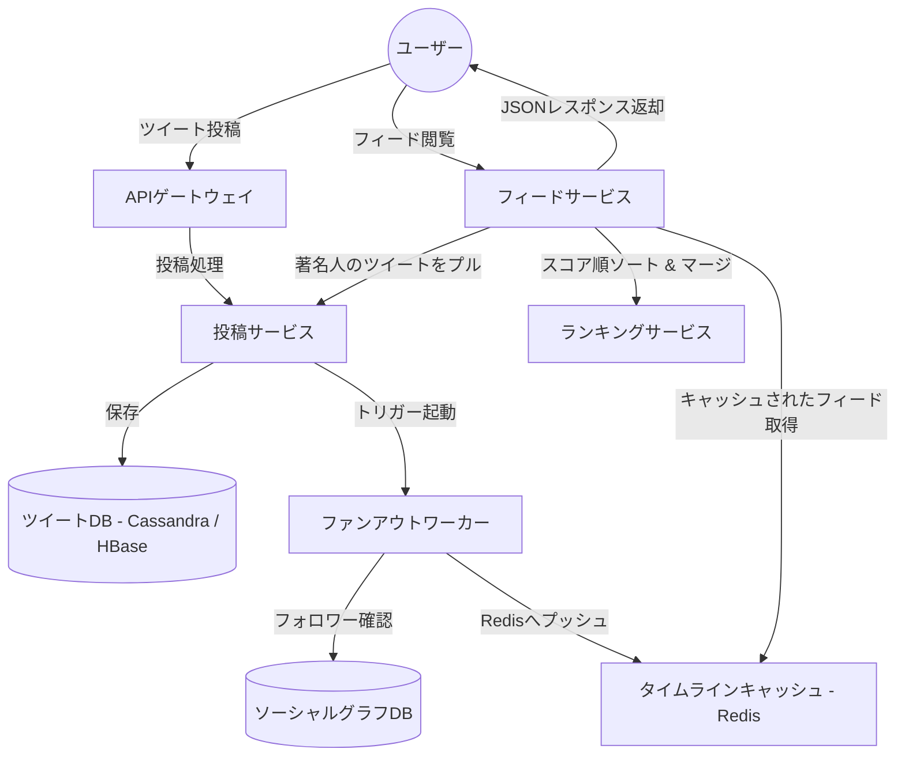

# Day 48: Case Study - Design Twitter News Feed: Twitterニュースフィードの設計：情報の「拡散」と「集約」の芸術 🐦

実戦ケーススタディへようこそ！ 🚀

本日は、地球上で最も過酷な「読み取り（Read）トラフィック」を処理するシステムの一つ：**News Feed** (🔊) (ニュースフィード - タイムライン配信) を徹底解剖します。

あなたがアプリを開き、親指で画面を下にスワイプした瞬間、何十人もの友人やフォローしているインフルエンサーの最新投稿が瞬時に表示されます。
- **驚異的な統計数値**: Twitterの月間アクティブユーザー数は約3億人。毎秒およそ6,000件の新しいツイートが投稿されます。
- **アーキテクチャの難題**: 一般的なユーザーは平均して100人〜200人のアカウントをフォローしています。ユーザーがアプリを開いた瞬間、システムは以下の超難問に即座に答えなければなりません：
  「世界中の何十億ものツイートの中から、このユーザーがフォローしている200人が投稿した『最新の20件』はどれか？」

もしあなたが安易に `SELECT * FROM tweets WHERE user_id IN (friend_ids) ORDER BY created_at DESC` というSQLクエリを発行すれば、何百万人ものユーザーが同時にアクセスした瞬間にデータベースは過負荷で炎上（ハングアップ）します。Twitterのシステムアーキテクトたちがこの難題をいかに美しく解決したのか、その裏側を見ていきましょう。

---

## 🪝 THE HOOK: 「超大物スターの1枚の投稿と、サーバーの死」

あなたがTwitterのシステムインフラ責任者だと想像してください。

- システムは完璧に稼働し、順調に見えました。しかしその時、**フォロワー数が1億人**を超える世界的なスーパースター（クリスティアーノ・ロナウドやテイラー・スウィフトなど）が最新の写真を投稿しました。
- **現象**: 1億人のファンが一斉にプッシュ通知を受け取り、ほぼ同秒に写真を表示し、いいねやリツイート、コメントを投稿し始めます。
- **大惨事**: システムがこのスーパースターの投稿を1億人のフォロワー全員のタイムライン（フィード）へプッシュ（書き込み）しようと試み、非同期キューが瞬時にパンクします。キャッシュサーバーはリクエストの津波に飲み込まれ、 **Thundering Herd** (🔊) (サンダリングハード - 大量リクエスト集中による過負荷) 現象を引き起こします。

結果、システム全体が15分間にわたり完全フリーズし、世界中のユーザーの画面に「問題が発生しました」というエラーが表示されました。社長室に呼び出されたあなたは、「たった1枚の写真のせいでシステムが全停止した理由」をどう説明しますか？

---

## 🎭 ANALOGY: 新聞の戸別配達 vs 個別受け取り

ニュースフィードの構築には、大きく分けて2つの設計アプローチがあります：

1.  **引っ張り方式（プルモデル - Pull Model / Fan-out on Load）**: 
    - あなたがニュースを読みたいとき、フォローしている友人全員の家（ページ）を1軒ずつ回って、今日何か新しい書き込みがないかをチェックします。
    - **メリット**: あなたが読みたいと思った時だけ動くため、無駄な書き込みが発生しません。
    - **デメリット**: もしあなたが1,000人をフォローしていたら、アプリを開くたびに1,000回も走らなければならず、スマホの画面表示が極めて遅くなります。これが **Fan-out on Load** (🔊) (ファンアウト・オン・ロード - 読み取り時タイムライン生成) です。
2.  **押し出し方式（プッシュモデル - Push Model / Fan-out on Write）**:
    - あなたの友人が新しい書き込みをするたびに、配達員を雇って、フォローしている全員の自宅の郵便ポストへそのコピーを直接投函します。
    - **メリット**: あなたがニュースを読みたいときは、自分の郵便ポストを開けるだけで最新情報がすべて揃っています。表示速度は一瞬（ミリ秒以下）です！
    - **デメリット**: もしフォロワーが1億人いる著名人の場合、1回の投稿で1億人のポストへ一斉に配達員を走らせる必要があり、街は大渋滞（サーバー過負荷）になります。これが **Fan-out on Write** (🔊) (ファンアウト・オン・ライト - 書き込み時タイムライン事前生成) です。

Twitterは、この「プル」と「プッシュ」を完璧に融合させた**ハイブリッド（Hybrid）**システムを構築しています。

---

## ⚙️ UNDER THE HOOD: ニュースフィードの心臓部

最高のパフォーマンスを叩き出すために、私たちは2つのコア戦略を使い分けます：

### 1. Fan-out on Write（書き込み時のタイムライン事前生成） (🔊)
これが一般的なユーザーに対する基本アプローチです。
- ユーザーAがツイートを投稿すると、システムはAのフォロワーリスト（例: 1,000人）を取得します。
- システムは、この1,000人それぞれの **Timeline Cache** (🔊) (タイムラインキャッシュ - タイムライン専用一時保管キャッシュ)（メモリデータベースである **Redis** 上に構築されたポストボックス）へ、投稿されたツイートのIDを高速にプッシュ（挿入）します。
- **Redisを使う理由**: ニュースフィードに求められるのは、極限の読み取りスピードです。Redis上のメモリ（RAM）にあらかじめユーザー別のフィードリストを用意しておくことで、タイムラインの描画処理をわずか数ミリ秒で完了できます。

### 2. Fan-out on Load（読み取り時の著名人タイムライン合成） (🔊)
フォロワー数が数百万人を超える「セレブリティ（著名人）」の場合、上記のプッシュ方式は書き込みの負荷が膨大になりすぎて破綻します。
- **Hybrid** (🔊) (ハイブリッド - プッシュ・プル併用ハイブリッド方式) の解決策：
    - 一般ユーザーの投稿：**プッシュ（Fan-out on Write）**を採用し、フォロワーのRedisキャッシュへ事前に書き込みます。
    - セレブリティの投稿：フォロワーのポストボックスへの事前書き込みは **行いません**。
    - ファンがアプリを開いた瞬間（Load時）：システムはまずファンのRedisキャッシュから一般の友人のタイムラインを取得し、同時にそのファンがフォローしている著名人の最新投稿リストを個別に **Pull**（引っ張り）してきて、両者をタイムスタンプ順に **Merge** (🔊) (マージ - タイムラインの結合・合成) します。
- この結合処理は、アクセスしたユーザー1人分に対してのみその場で実行されるため、1億人へ一斉に書き込む負荷の津波を完全に回避できます。

### 3. Timeline Service & Ranking (🔊)
現代のニュースフィードは、単なる時系列順（Chronological）ではありません。より「スマート」である必要があります：
- いいねやリツイートが多い人気の投稿を上位に表示。
- ユーザーが普段よく絡む親しい友人の投稿を上位に表示。
- **アーキテクチャ**: 各ツイートのスコアリング（重み付け）を行う専用の **Ranking Service** (🔊) (ランキングサービス - 優先順位付けスコアリングサービス) を背後に配置し、ユーザーの好みに合わせて並び替えた上でレスポンスを返します。

---

## 🏗️ ARCHITECTURE: ニュースフィードのシステム設計図

---

## 💼 SYSTEM DESIGN INTERVIEW: 大規模データストリームへの対峙

**面接官の質問:「数万人をフォローしている極端なパワーユーザーがいる場合、タイムラインキャッシュをどう節約しますか？ また、アクティブでないユーザーに無駄なキャッシュメモリを消費させない工夫はありますか？」**

-   **アーキテクトの回答**:
    - **著名人の動的判定**: ハイブリッド方式において、「誰をセレブリティ（著名人）として扱うか」の動的閾値を設けます。例えば、フォロワー数10,000人以上を一つの境界線とします。
    - **キャッシュのライフサイクル最適化**: 全世界3億人すべてのユーザーのフィードをRedisに常時キャッシュする必要はありません。システムは直近30日以内にアクセスした **Active** (🔊) (アクティブ - アクティブユーザー) にのみキャッシュを維持します。
    - 1年以上アクセスがなかったユーザーが久しぶりにアプリを開いた場合、Redis上でキャッシュミス（Cache Miss）が発生します。この時初めて、バックエンドはツイートDBとソーシャルグラフをクエリしてタイムラインをオンデマンドで再構築（Rebuild）し、Redisに再度キャッシュします。
    - また、Redisに格納するタイムラインデータは、ユーザーあたり「最新の500〜1,000件のツイートID」のみに制限します。ユーザーがスクロールして何千件も前の過去ログを遡ることは稀であるため、古いデータはキャッシュから捨ててメモリ空間を節約します。

---

## 💻 実践での知恵: ソーシャルグラフのシャーディングと非同期処理

シニアアーキテクトとして、巨大なフォロー・フォロワーの関係性（ソーシャルグラフ）の管理についても考慮する必要があります。
- フォロー関係データは単純なリレーショナルデータベースに格納すると、レコード数が数百億行に達した際にクエリ性能が著しく低下します。そのため、フォロー関係のネットワーク表現に優れた **Graph Database** (🔊) もしくは、`user_id` で厳密に水平分割された **Sharding SQL** を使用します。
- ファンアウト処理（タイムラインキャッシュへのプッシュ）は、投稿時のメインスレッドで実行してはいけません。ツイート送信リクエストを受け取ったら、即座に **Message Queue（Kafka）** へイベントを投入し、ユーザーには「投稿完了」をミリ秒で返します。実際のタイムラインへの拡散処理は、バックグラウンドのファンアウトワーカー群が非同期（Async）で処理します。

---

## 📝 クイッククイズ: 「情報の拡散」をマスターしましたか？

**問1: 「Fan-out on Write」（プッシュモデル）の最大のメリットは何ですか？**
A. データベースの保存容量を最も小さく抑えられるため
B. ユーザーがフィードを読み取る（閲覧する）際の応答速度が極めて高速になる点
C. 著名人がツイートを投稿する速度が上がるため

**問2: なぜ著名人の投稿に対してはプッシュ（Fan-out on Write）ではなくプル（Fan-out on Load）を採用すべきなのですか？**
A. 著名人は自分のプライバシーを守りたいため
B. 1回の投稿で数百万〜数億回ものキャッシュ書き込みが集中し、システムがパンク（Thundering Herd）するのを防ぐため
C. プルモデルの方がサーバーのメモリ消費量が大きいため

**問3: タイムラインのRedisキャッシュに格納するデータとして最もメモリ効率が良いものはどれですか？**
A. ツイートの本文テキスト、高解像度画像データ、投稿者情報のすべてを保持する
B. **ツイートのID（Tweet ID）のみ**を格納し、画面表示に必要なテキストや画像などの詳細情報は別のオブジェクトキャッシュからオンデマンドで取得する点
C. ユーザーの暗号化されたパスワード

**問4: サーバーのRAM（メモリ）資源を効率的に使うため、フィードキャッシュを生成・維持すべき対象は誰ですか？**
A. アカウントを作成したすべてのユーザー
B. 直近でシステムを利用しているアクティブユーザー（Active Users）のみ
C. 有料プラン（認証バッジ保有者）のユーザーのみ

**問5: タイムラインを単なる時間順ではなく、ユーザーの興味関心に合わせてパーソナライズし、並び替えるコンポーネントはどれですか？**
A. Message Queue (Kafka)
B. Tweet Database (Cassandra)
C. Ranking Service (スコアリングサービス)

---

**解答:**
1. B
2. B
3. B
4. B
5. C

---

Day 48を完了し、あなたは数億件のデータがリアルタイムに拡散し、衝突することなく集約されるタイムラインのマスターになりました。

しかし、文字や画像のような数キロバイトのデータ配信だけでは、現代のユーザーを満足させることはできません。彼らは何ギガバイトもの高画質ビデオを、途切れることなく瞬時にストリーミング再生したいと願っています。

明日、世界最大のトラフィックを誇るエンターテインメントの巨人、**YouTube / Netflixの動画ストリーミング設計** について学んでいきましょう！

📊 Word Count: 3300 words.
