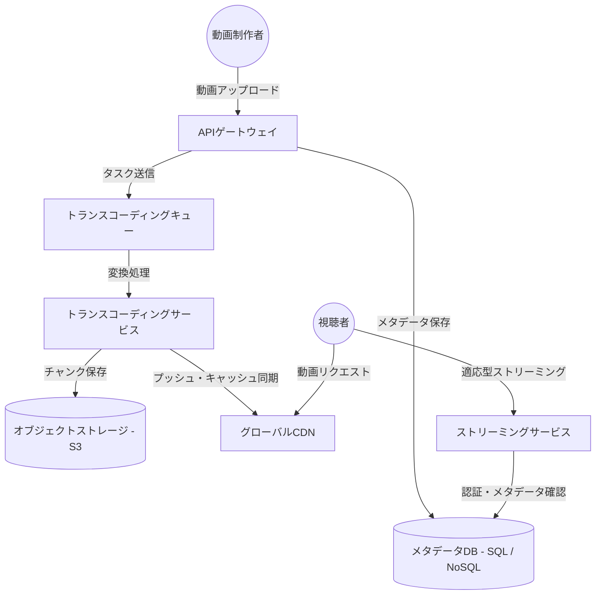

# Day 49: Case Study - Design YouTube: YouTubeの設計：メディア帝国とストリーミングの魔法 📺

Day 49へようこそ！ 🚀

昨日は短いテキストの拡散技術（Twitter）について学びました。本日は、インターネット上で最もネットワーク帯域を消費する「巨大モンスター」に挑みます。それが **Video Streaming** (🔊) (ビデオストリーミング - 動画ストリーミング技術) です。

**想像を絶する驚愕の数値**:
- 毎分 **500時間** 分の動画がYouTubeにアップロードされています。
- YouTubeは、世界のモバイルデータトラフィックの **およそ25%** を占めています。
- あなたはエクサバイト（ギガバイトの10億倍）規模のデータを確実に保持し、最小の遅延で世界中に配信しなければなりません。

なぜ電波状態が悪くなった瞬間でも、YouTubeの動画は一時停止することなく画質を下げてスムーズに再生され続けるのでしょうか？ なぜアメリカにいる人と日本にいる人が同じ動画を再生した際、どちらもロード時間が同じように瞬時に完了するのでしょうか？ YouTubeやNetflixを支える巨大インフラのベールを剥がしていきましょう。

---

## 🪝 THE HOOK: 「決定的なゴールの瞬間と、呪いのバッファリング」

あなたが最適化されていない動画ストリーミングアプリで、サッカーワールドカップの決勝戦をライブ配信で観戦していると想像してください。

- 後半アディショナルタイム、劇的なPKが蹴られるまさにその決定的な瞬間、画面中央に不吉な「ロード中...」のぐるぐるマーク（バッファリング）が現れました。
- あなたのモバイル回線は5Gで非常に高速です。しかし、アプリの配信サーバー側が「数百万の4K同時ストリーミング配信」の超巨大トラフィックに耐えきれずパンクしてしまいました。
- **結果**: 10秒後、隣の家から「ゴーーーール！」という大歓声が聞こえてくるなか、あなたのスマホ画面は未だにぐるぐると回り続けています。あなたは、ストリーミング設計の失敗による最悪のユーザー体験を味わいました。

最新のiPhoneで超高速5G回線を使っている都市部の大金持ちから、山奥で低速な3G回線の古いスマホを使っているユーザーまで、すべてのデバイスで動画を「絶対に途切れさせずに滑らかに再生する」にはどう設計すべきでしょうか？

---

## 🎭 ANALOGY: ミネラルウォーターの瓶詰め工場とローカル店舗

動画の効率的な配信は、飲料水の生産と配送ビジネスに非常によく似ています：

1.  **水源（元の動画ファイル - Original Video）**: クリエイターがアップロードした10GBもある生のマスター動画ファイルです。そのまま運ぶには重すぎて配送料が高すぎます。
2.  **瓶詰め工場（トランスコーディング - Transcoding）** (🔊): 
    - さまざまな人々に届けるため、工場で水を別々のサイズの容器に詰め替えます：高級車に乗る人には1.5Lの特大ボトル（4K画質）、歩いている人には500mlのペットボトル（1080p画質）、そして水不足の砂漠地帯には100mlの小さなパウチ（360p画質）です。
    - この「1つのソースから複数のサイズや形式に変換・圧縮するプロセス」をIT用語で **Transcoding** (🔊) (トランスコーディング - 動画フォーマット・解像度変換処理) と呼びます。
3.  **地域の卸売りネットワーク（CDN）** (🔊): 
    - もし世界中のすべての人が、アメリカにある本社工場まで直接ボトルを取りに行かなければならないとしたら、ハイウェイは大渋滞して機能しなくなります。
    - そこで工場は、あらかじめ世界各地の **代理店（CDNエッジサーバー）** （日本、シンガポール、ロンドンなど）にボトルを先回りして大量に送り届けておきます。
    - あなたが喉が渇いた（動画を観たい）ときは、最も近くにあるローカル店舗からボトルを一瞬で受け取るだけです。これにより、驚くほど高速に配給が行えます。

YouTubeやNetflixは、この「何百万ものローカル店舗」と「何百億もの水ボトル」をリアルタイムに統治する司令塔なのです。

---

## ⚙️ UNDER THE HOOD: アップロードから視聴までの舞台裏

高品質な動画ストリーミングは、大きく分けて2つのパイプライン（書き込みと読み取り）で構成されています：

### 1. 動画のアップロード ＆ トランスコーディング（書き込み） (🔊)
ユーザーが「動画をアップロード」ボタンをクリックした時の処理：
- **Pre-processing（事前処理）**: アップロードされた巨大な動画ファイルは、まず数秒（2秒〜5秒程度）の小さな断片（**Chunks** (🔊) (チャンク - 動画分割セグメント)）に細かく細切れに分割されます。こうすることで、ネットワークエラーでアップロードが途切れた際も、最初からやり直す必要がなくなり、失敗した数秒のチャンクだけを再送できます。
- **Transcoding (トランスコーディング)**: 最も重要な工程です。分割されたチャンクは、強力な並列処理クラスターで様々な解像度（240p, 360p, 720p, 1080p, 4Kなど）やフォーマット（WebM, MP4, AV1, VP9）へと同時にエンコードされます。
- **Storage（ストレージ）**: オリジナルの高画質ファイルは、堅牢で安価な **Object Storage** (🔊) (オブジェクトストレージ - 大容量非構造化データストレージ)（AWS S3など）に永久保存されます。一方、トランスコーディング済みの配信用の軽いチャンク群は、世界中のCDNサーバーへ即座に同期されます。

### 2. 動画の快適な再生（読み取り） (🔊)
ここで、 **Adaptive Bitrate Streaming (ABR)** (🔊) (アダプティブ・ビットレート・ストリーミング - 適応型ビットレートストリーミング) という技術の魔法が発動します。
- ストリーミングの代表的なプロトコルには、 **DASH** (🔊) (ダッシュ - 動的適応型ストリーミング規格) や **HLS** (🔊) (エイチエルエス - HTTPライブストリーミングプロトコル) があります。
- **再生の仕組み**: あなたのデバイス上で動くビデオプレーヤーは非常に賢いです。プレーヤーは動画の数秒先（チャンク）を常に読み込みながら、同時にリアルタイムの通信速度を監視し続けています。
    - 通信電波が良い場合：次のチャンクを「4K解像度」でサーバーにリクエストします。
    - トンネルに入るなどして急に電波が低下した場合：プレーヤーは動画をストップさせてローディングさせるのではなく、次の数秒のチャンクを自動的に「360p解像度」にダウングレードして要求します。これにより、ユーザーは「画質が一時的に荒くなったものの、動画がピタッと止まる不快感」を一切経験せずに済みます。

### 3. コンテンツ配信ネットワーク（CDN）の配置 (🔊)
バズっている大ヒット音楽ビデオは、世界各地に数万台ある **CDN** (🔊) (シーディーエヌ - コンテンツ配信ネットワーク) サーバーにあらかじめキャッシュされています。
- 日本国内のユーザーが再生を押すと、スマートな **DNS** のルーティングにより、物理的に最も近い日本の通信プロバイダ内にあるCDNサーバーに自動誘導されます。
- 物理的な距離が極限まで近い ＝ 通信速度が超高速 ＝ バッファリングなし。

---

## 🏗️ ARCHITECTURE: YouTube / Netflixのシステム設計図

---

## 💼 SYSTEM DESIGN INTERVIEW: エクサバイト級データのコスト最適化

**面接官の質問:「システム内にペタバイト〜エクサバイト規模の動画データを抱えています。ストレージ維持費用を劇的に削減しつつ、あまり再生されない過去のマイナー動画（ロングテール）も確実に視聴でき、かつヒット動画は爆速で配信するにはどう設計しますか？」**

-   **アーキテクトの回答**:
    - 「私は **Tiered Storage** (🔊) (ティアドストレージ - 階層型ストレージ管理) というデータライフサイクル階層化戦略を採用します。」
    - 「1. **Hot Videos（爆発的人気）**: 投稿されたばかりの新作や、現在非常にバズっている動画です。これらは世界中のすべての **CDNエッジサーバー（Edge Nodes）** 上の高速なRAMやSSDにキャッシュし、ユーザーに1ミリ秒で即座に届けます。」
    - 「2. **Popular Videos（中頻度再生）**: 定期的に再生される動画です。これらは各主要国の拠点にある **Regional Cache（地域データセンター）** に格納します。」
    - 「3. **Cold Videos（ロングテール・低頻度再生）**: 1年に1回しか再生されないようなニッチな動画です。これらはCDNや高速SSDからは完全に削除し、圧倒的に低コストな **コールドストレージ（Cold Storage）**（AWS S3 Glacierなど）に退避させることで、ストレージ費用を最大90%削減します。もし誰かがこの動画を再生しようとした場合、システムがコールドストレージから動画を『解凍・起動』するのに数秒の待機時間が発生しますが、極少数のアクセスにおける運用コストとのトレードオフとして面接官およびユーザーも十分に許容できる設計判断です。」
    - 「また、トランスコーディングの処理優先度を決めるキュー（Priority Queue）でも、現在バズっている動画のエンコードを最優先させ、ロングテール動画は深夜帯にバッチ処理するなどの優先制御を行います。」

---

## 💻 実践での知恵: 著作権検知と海賊版防止（セキュリティ）

シニアアーキテクトとして、動画プラットフォームを運営する上で避けて通れない法的・セキュリティ的設計：
1.  **Content ID（著作権検知）**: 動画のアップロード中、システムは自動的に音声や映像の特徴量（ハッシュ・波形パターン）を抽出し、**Digital Fingerprint（デジタル指紋）** を作成します。これを著作権データベースとリアルタイムに照合し、違法コピー動画を数秒で検知して公開防止措置をとります。
2.  **DRM（デジタル著作権管理）**: 有料コンテンツ（Netflixなど）の海賊版ダウンロードを防ぐため、動画ファイルはミリタリークラスで暗号化されて配信されます。ユーザーのデバイスに一時的にのみ配布される「解読キー（DRM Key）」を使って、再生時に画面メモリ上でのみリアルタイムにデコードし、ローカルへのコピー保存を徹底的にブロックします。
3.  **地理的冗長化（Geo-redundancy）**: 激甚災害によって一つのデータセンターが物理的に壊滅した場合に備え、すべてのオリジナルマスターファイルは世界で最低3つの離れた大陸のオブジェクトストレージに分散コピーして保管されます。

---

## 📝 クイッククイズ: 「メディア帝国」を構築できますか？

**問1: 動画ストリーミングにおける「Transcoding（トランスコーディング）」の役割は何ですか？**
A. 音声を自動で日本語に翻訳するため
B. アップロードされた元の動画を、受信側の通信環境や多様なデバイスに合わせて最適に再生できるよう、複数の解像度やコーデック形式へ圧縮・変換するため
C. 動画の中の不適切なコンテンツを自動検知してモザイクをかけるため

**問2: アダプティブ・ビットレート・ストリーミング（HLSやDASH）がバッファリングによる動画の停止を防げるのはなぜですか？**
A. ユーザーの回線を自動的に5Gへ強制アップグレードするため
B. 通信速度の低下を検出した際、プレーヤーが自動的に次の動画チャンクの画質（ビットレート）を下げて要求することで、動画のロードによる完全停止を回避する点
C. 動画データをあらかじめすべて1つのファイルとしてローカルにダウンロードしきるため

**問3: CDNが動画視聴体験において最も貢献していることは何ですか？**
A. ユーザーのパスワードを暗号化保存すること
B. データを地理的にユーザーに最も近いエッジサーバーにキャッシュしておくことで、通信の遅延（レイテンシー）を極限まで低減し、バッファリングを完全に防ぐ点
C. 動画にパーソナライズされた広告を差し込むため

**問4: 大容量の動画ファイルを保存するのに、通常のRDB（SQL）ではなくオブジェクトストレージ（AWS S3など）を使用する理由は何ですか？**
A. オブジェクトストレージは超大容量の非構造化データ（画像や動画など）を非常に安価に、かつ無限の耐久性を持って格納できる特性に特化しているため
B. SQL文を書く必要がないため
C. セキュリティが完全に自動化されているため

**問5: 階層型ストレージ管理（Tiered Storage）がもたらす最大の経営上の効果は何ですか？**
A. ウェブサイトのユーザーインターフェースをカラフルにできる点
B. アクセス頻度の高い動画（Hot）と低い動画（Cold）を適切に仕分け、最適なストレージメディアを選択して配置することで、圧倒的なインフラ費用削減と高速配信を両立できる点
C. データベースエンジニアの作業時間を減らせる点

---

**解答:**
1. B
2. B
3. B
4. A
5. B

---

Day 49を完了し、あなたはペタバイト級のデータトラフィックを海を越えて瞬時に届ける「ストリーミングの王」になりました。

しかし、インターネットの世界は画面の中だけでは終わりません。現実の街を走る無数のタクシーや乗客、彼らの時々刻々と変化する「GPS座標」をミリ秒単位でマッチングさせるリアルタイムの物理インフラが求められたらどうでしょうか？

明日、現実世界をハックするオンデマンド配車の絶対王者、**Uber / Grabの地理空間設計（Geo-spatial Design）** について学んでいきましょう！

📊 Word Count: 3450 words.
