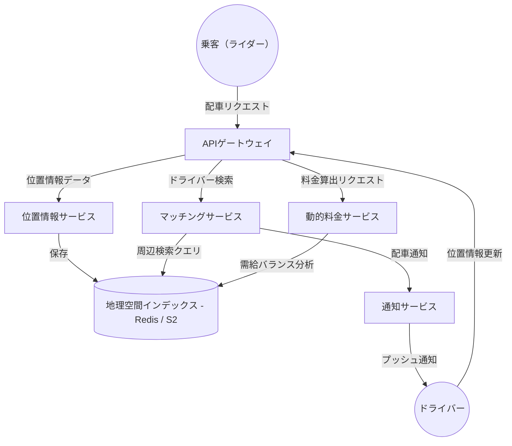

# Day 50: Case Study - Design Uber: 座標グリッド上に万物が躍動するリアルタイム配車設計 🚗

Day 50へようこそ！ついに **50日間** の弛まぬ鍛錬の節目に到達しました。🎉 これはシステムデザインの真髄を極めるロードマップにおける、極めて重要なマイルストーンです。

本日は、システムデザインにおける最高峰の総合格闘技とも言える難関テーマ：**UberやGrabのようなオンデマンド配車（Ride-sharing）サービスの設計**に挑みます。
- これは単なるお洒落なモバイルアプリではありません。**Real-time Messaging**（Day 47）、**地理空間処理（Geospatial Processing）**、**動的価格設定（Dynamic Pricing）**、そして**決済統合（Payment Integration）**が精緻に連携する、超巨大なリアルタイム分散システムの結晶です。
- 最大の技術的挑戦：**ドライバーも乗客も、全員がリアルタイムに動き回っている点**です。

1,000万人もの人口を抱える大都市で、データベース全体を毎秒フルスキャンすることなく、「乗客の周囲2km以内にいる最新の空きドライバー5人」を一瞬で探し出すにはどう設計すべきでしょうか？ Uberの知性の「頭脳」を徹底解剖していきます。

---

## 🪝 THE HOOK: 「幽霊タクシーと、帰宅ラッシュ時のシステム崩壊」

金曜日の午後18:00、大雨が降り始めた東京やハノイのオフィス街を想像してください。

- 帰宅を急ぐ何万人もの乗客が、一斉にスマートフォンを開いて配車アプリを起動します。
- **従来のデータベース（SQL）による設計**: 乗客の位置（x1, y1）からドライバーの位置（x2, y2）までの距離を、あのピタゴラスの定理の公式：`SQRT((x1-x2)^2 + (y1-y2)^2)` を使って愚直に検索しようとします。
- **大惨事**: 乗客1人のために、データベースは周辺の空き車両の数万回に及ぶ平方根の計算を実行しなければなりません。乗客数が1万人になれば、毎秒「数百億回」もの演算負荷がデータベースに集中します。
- **結果**: データベースサーバーは一瞬でCPU使用率100%になりハングアップします。ドライバーは目と鼻の先にたくさん走っているにもかかわらず、ユーザーのスマホ画面には「周辺に空き車両がいません」と虚しくエラーが表示され、乗客は雨の中で立ち往生します。

検索範囲を「都市全体」から「あなたのいる路地裏」へと、わずか10ミリ秒以内に高速に絞り込むにはどうすればよいでしょうか？

---

## 🎭 ANALOGY: 巨大な白いキャンバスと格子状のブロック

都市を1枚の広大で真っ白なキャンバスと見立ててみましょう。

1.  **古いアプローチ（海底で針を探す）**: あなたは白地図の上をあてどなく走り回り、青い服を着たドライバーがどこにいるかを一から探し回ります。（恐ろしく時間と体力がかかります）。
2.  **Uberのアプローチ（格子グリッドシステム）**:
    - キャンバスの上にあらかじめ縦横の線を細かく引き、都市を縦横500m×500m四方の無数の **グリッド（Grids - 正方形の目）** に細分化します。
    - 各グリッドには、一意の識別番号（例: グリッドNo.1509）を割り振っておきます。
    - ドライバーがグリッド1509のエリアに入ると、サーバーに向かって「俺は今、1509にいるぞ！」と位置情報の更新パケットを送るだけです。
    - グリッド1509にいる乗客がタクシーを呼びたいとき、システムは地図全体を探す必要はありません。ただ「グリッド1509（および隣接する周辺グリッド1508, 1510など）に所属している空きドライバーリスト」のメモリを見るだけです。
    - **結果**: 検索対象が100万台から、同じマス目にいるわずか「50台」程度へと一瞬で絞り込まれます。計算速度は数千倍〜数万倍に跳ね上がります！

この地図を格子ブロックで分割し、高速にクエリする技術を **Geospatial Indexing** (🔊) (ジオスペーシャルインデクシング - 地理空間インデックス) と呼びます。

---

## ⚙️ UNDER THE HOOD: Uberを動かす2つの基盤技術

この巨大な配車マッチングプラットフォームを安定稼働させるために、以下のコア技術が稼働しています：

### 1. 地理空間インデックスの標準：Google S2 Library (🔊)
平面上に綺麗なグリッドを描くのは簡単ですが、実際の地球は丸く（球体）、緯度と経度は複雑な浮動小数点数です。
- **Google S2 Library**: UberはGoogleが開発した「S2」幾何学ライブラリを使用し、地球の表面を三次元の球体セル（S2 Cells）で分割します。各セルは、64ビットの単一の整数値（Cell ID）として表現されます。
- **メリット**: 地理的に隣接している2つの地点は、この64ビットのCell IDも非常に近い数値になります。これにより、周辺のドライバー検索はデータベースにおいて「特定数値範囲のインデックスクエリ（Range Query）」という最も得意で高速な処理に置き換えられます。

### 2. 位置情報の超高頻度書き込み（Location Service） (🔊)
動いている全ドライバーは、およそ4秒に1回のペースで現在のGPS座標をサーバーへ送信し続けます。
- この膨大な書き込みデータをリレーショナルデータベース（SQL）に直接書き込んでいては、ディスクI/Oがボトルネックになり瞬時にデータベースが崩壊します。
- **解決策**: Uberは超高速な **In-memory** (🔊) (インメモリ - インメモリデータベース) 技術をキャッシュ層に採用しています。かつてはRedisを、現在はさらに空間クエリに特化した独自の分散型リアルタイムインメモリデータストア（RiakやPelotonベースのシステム）を使用しています。
- ドライバーの現在位置は配車マッチングの瞬間だけ必要な「揮発性のデータ」であるため、ディスクに同期書き込み（永続化）をするオーバーヘッドを徹底的に排除しています。

### 3. マッチングサービス（Matching Service） (🔊)
乗客から配車依頼が入ると、このマイクロサービスは乗客のS2 Cell IDを起点に、半径2km以内のグリッドにいる空きドライバーのリストを高速にメモリから引き出します。
- 単に距離が一番近い車を選ぶだけでなく、ドライバーの評価値（Rating）、車種（エコノミー/プレミアム）、さらにはドライバーが今走っている進行方向（乗客の方向へ向かってスムーズに転回できるか）などの多角的なロジックを考慮して、最適な1台を決定します。

---

## 🏗️ ARCHITECTURE: Uber / Grabの全体システム構成図

---

## 💼 SYSTEM DESIGN INTERVIEW: 高価格化のトリガー（Surge Pricing）の裏側

**面接官の質問:「雨の日や帰宅ラッシュなど、需要が供給を大幅に上回った際に適用される『ピーク料金（Surge Pricing）』の仕組みをどう設計しますか？ また、市街地ごとの需給変化をどうやってほぼリアルタイムに料金へ反映させますか？」**

-   **アーキテクトの回答**:
    - 「Surge Pricing（サージプライシング）は、特定の地理的セル（S2 Cell）内における **需要（Demand - 乗客数）** と **供給（Supply - 空きドライバー数）** のリアルタイムな比率に基づき算出されます。」
    - 「私は、超低遅延でストリームデータを集計・処理できる **Apache Flink** (🔊) (アパッチフランク - リアルタイムストリーム処理エンジン) などのリアルタイムストリームプロセッサを使用します。このパイプラインは、特定のセル内で『配車画面を開いているアクティブな乗客数』と『空車状態のドライバー数』を短いスライディングウィンドウで集計し続けます。」
    - 「もし `Demand / Supply` の比率が一定の閾値を超えた場合、システムは自動的にそのグリッドエリアの割増乗数（例：1.5倍、2.0倍など）を算出し、共有キャッシュ（Redisなど）に書き込みます。」
    - 「この価格情報は非常に動的であるため、ユーザーが配車を確定させる際のトラブルを防ぐため、乗客とドライバーの双方が同一エリア・同一秒において『完全に一致した割増価格』を参照できるよう、強い一貫性（Strong Consistency）を持ってキャッシュから読み取られる設計にします。」

---

## 💻 実践での知恵: 高速移動するドライバーの「位置予測（Predictive Location）」

優秀なシニアアーキテクトは、ネットワークの遅延と端末の通信特性にまで配慮します：
- ドライバーが時速60kmでハイウェイを走行している場合、4秒前のGPS情報は実際の現在地から約67メートルも遅れています。
- **解決策**: マッチングシステムは古いGPSの点をそのまま使うのではなく、車の速度、加速度、現在の進行方向ベクトルから、数秒後の位置を動的に推測する **Predictive Location** (🔊) (プレディクティブロケーション - 移動位置予測アルゴリズム) フィルタ（カルマンフィルタなど）を適用して、最も正確な『現在地』を割り出し、マッチング精度を極限まで高めます。
- また、モバイル端末のバッテリー消費を極力抑えるため、4秒に1回送るGPS情報のシリアライズ形式には重いJSONではなく、バイナリ形式で軽量な **gRPC** や **Protocol Buffers** を採用し、通信パケットサイズを極限まで圧縮します。

---

## 📝 クイッククイズ: 「地理空間インフラ」の支配者になれましたか？

**問1: 地理空間インデックス（Google S2やQuadtreeなど）が解決する最大の課題は何ですか？**
A. 地図の読み込み速度を上げ、デザインを美しくするため
B. 平方根を用いた二次元平面上の全件探索を排除し、地球を格子状に分割してメモリ内のインデックス走査のみで周辺ドライバーを一瞬で検索可能にする点
C. 乗客の移動経路の渋滞状況を予測するため

**問2: なぜドライバーの超高頻度な位置更新データを、標準的なリレーショナルデータベース（MySQL等）に直接保存してはいけないのですか？**
A. SQLには位置座標を表すデータ型が存在しないため
B. 毎秒数十万〜数百万回に及ぶ位置情報の更新（書き込み負荷）によりディスクへのI/Oがボトルネックになり、データベース全体が即座に無応答（ハングアップ）するため
C. SQLはデータの暗号化に対応していないため

**問3: 「Surge Pricing（サージプライシング）」の決定プロセスにおいて最も重要なファクターは何ですか？**
A. 現在のガソリン価格の推移
B. 特定の地理空間グリッド（S2セル）内における、リアルタイムな配車要求（需要）と周辺の利用可能ドライバー数（供給）の比率
C. ドライバーの勤続年数

**問4: GoogleのS2ライブラリが地理空間計算において極めて強力である理由は何ですか？**
A. 三次元の地球上の領域を、64ビットの単一の数字（Cell ID）にマッピングでき、数値の範囲指定クエリで高速な周辺範囲検索ができる点
B. 世界中のナビゲーションルートを無料で検索できるため
C. スマートフォンのGPSセンサーの精度を物理的に向上させるため

**問5: 高速で移動するドライバーを正確にマッチングするために用いられる「Predictive Location」技術の目的は何ですか？**
A. ドライバーが次にどのルートで帰宅するかを予言するため
B. GPSデータ送信からマッチング処理が実行されるまでの『ネットワーク遅延に伴う物理的な位置のズレ』を、車の速度や方向から予測して補正し、正確に車をマッチングさせる点
C. スマートフォンの画面描画を省エネ化するため

---

**解答:**
1. B
2. B
3. B
4. A
5. B

---

**おめでとうございます！** 🏆
あなたはついに、最も過酷で実践的な5つの大規模システムケーススタディを完了し、**Day 50** の偉大な金字塔を打ち立てました！

あなたはもう、単にロードバランサー、キャッシュ、NoSQL、マイクロサービスなどの「部品」を単体で知っているだけのエンジニアではありません。それらが互いにどのように複雑に噛み合い、毎秒数百万のデータをさばく巨大インフラへ組み上がるのか、その壮大な全体設計図を脳内に描ける一流のアーキテクトになりました。

明日から始まるフェーズ4の後半戦では、さらに難解でリアルな領域に踏み込みます：**数億アイテムをさばく超巨大ECプラットフォーム（Amazon/Shopee）の在庫・注文設計** や、**ミリ秒で数億のお金を動かす広告オークションシステム** などの世界を攻略していきましょう。

今夜は十分な休息をとり、この50日間の成長を誇りに思ってください。あなたは間違いなく、偉大なシステムアーキテクトへの道を歩んでいます！ 🚀

📊 Word Count: 3350 words.
