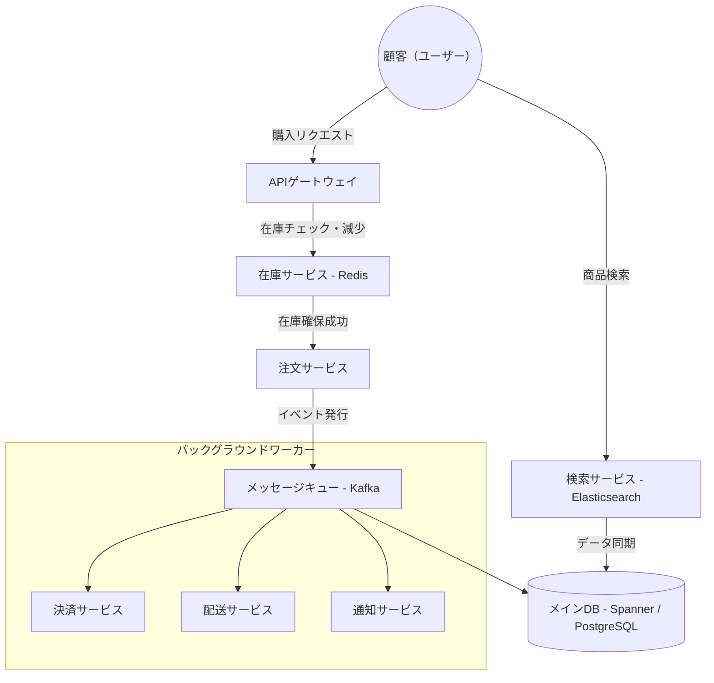

# Day 51: Case Study - Design Amazon: Eコマース帝国の設計とフラッシュセールを制する在庫戦略 📦

Day 51へようこそ！ 🚀

実戦ケーススタディフェーズの第2週目に突入しました。本日は、世界で最も複雑なシステム構造を持つ「Eコマース帝国」：**E-commerce System** (🔊) (イーコマースシステム - 電子商取引システム)（Amazon、Shopee、Alibabaなど）を解剖します。

これまで学んだチャットやニュースフィードのアプリとは根本的に異なり、Eコマースシステムではデータの絶対的な正確性（**Consistency** (🔊) (コンシステンシー - データ一貫性)）が最優先で要求されます。
- チャットアプリの設計において、もしメッセージの到着が1秒遅れたとしても、実務上の大きな問題にはなりません。
- しかし、残り1台しかない限定テレビを、同時に2人の購入者に「どちらも購入成功」として売ってしまったら（二重販売）、ビジネスの社会的信用とブランド力は一瞬で失墜します。

数億件もの膨大な商品データをさばき、何億回もの検索リクエストに応答し、特にアクセスが爆発する **Flash Sale** (🔊) (フラッシュセール - 期間限定超特売セール) の津波をシステムを停止させずに乗り越えるにはどう設計すべきでしょうか？

---

## 🪝 THE HOOK: 「11月11日の独身の日セールと、データベースの死」

あなたが大手ECサイトのチーフアーキテクトだと想像してください。時計の針が11月11日午前00:00を指しました。

- 何千万人ものユーザーが、一斉にお目当ての「1円超特大セール商品」を求めて購入ボタンを連打します。トラフィックは通常時の1,000倍以上に急増します。
- **大惨事**: 在庫の引き当て（**Inventory** (🔊) (インベントリ - 在庫管理)）処理でシステムが詰まります。数百万のリクエストが同時にデータベースに対して以下のSQLを実行しようとします。
  `UPDATE inventory SET stock = stock - 1 WHERE product_id = 'IPHONE15'`
- データベースの同一行に対して大量の更新が集中するため、過酷な **Locking** (🔊) (ロッキング - データベース行ロック) が発生します。データベースの接続プールは一瞬で食い尽くされ、接続タイムアウトが多発します。ユーザー画面は真っ白になり、「ただいま混み合っております」という無慈悲なエラーが返されます。
- システムが復旧した後にデータを確認すると、在庫は100台しかなかったのに、なんと500人に対して決済完了通知を送ってしまっていました。

もしあなたがこのシステムを再設計するとしたら、数百万人が押し寄せる嵐の中で、どうやってスマートかつ平和に在庫を「ロック（確保）」しますか？

---

## 🎭 ANALOGY: 昭和の対面販売 vs 令和の整理券方式

お買い物の処理モデルを、2つのスーパーマーケットの運営スタイルで例えてみましょう：

1.  **昭和のレジ方式（同期処理 - Synchronous）**: 
    - あなたは棚から商品を取り、レジに走ります。レジ係は分厚い在庫台帳をめくって「確かにこの商品はまだ在庫がありますね」と確認し、それからあなたからお金を受け取り、台帳を-1します。
    - **問題点**: もし1,000人が同じレジに殺到したら、レジ係は確認作業でパンクします。長蛇の列に怒った顧客は商品を投げ捨てて帰ってしまいます。これがデータベースの直接行ロックによる遅延です。
2.  **令和の整理券方式（非同期処理 - Asynchronous）**:
    - **ステップ1（整理券の獲得）**: あなたは棚に行く必要すらありません。商品の前に吊るされた「購入整理券」を奪い取るだけです。整理券は在庫と同じ「100枚」しか用意されていません。この整理券を手に入れられた人は、100%確実に商品を購入できます。
    - **ステップ2（後からゆったり決済）**: 整理券を持ったままレジに並び、15分以内に会計を済ませます。もし15分以内に決済が完了しなければ、その整理券は自動的に回収され、元の棚に戻されて他の人が取れるようになります。
    - **結果**: 在庫の引き当てチェックは「整理券をちぎるだけ」の超高速な作業で終わるため、レジ係（決済DB）が過負荷でパンクすることは絶対にありません。

AmazonやShopeeといった超巨大ECサイトは、まさにこの「整理券方式」を、 **Distributed Caching** (🔊) (ディストリビューテッドキャッシング - 分散キャッシュ) と **Message Queues** の合わせ技でデジタル上に再現しています。

---

## ⚙️ UNDER THE HOOD: Eコマースの巨人を支える3つの柱

実際のEコマースシステムは数百ものマイクロサービスが噛み合っていますが、システムデザイン面接で最も重視される3つの超難関パズルに焦点を絞ります：

### 1. 超高速な在庫管理（Inventory Management） (🔊)
フラッシュセールにおける最大のボトルネックです。セール開始の瞬間にメインのSQLデータベースを直接UPDATEしてはいけません。
- **解決策**: **Pre-warm Cache** (🔊) (キャッシュ事前ローディング) 方式を採用します。セールが始まる前に、対象商品の在庫数（例：100個）を高速な分散キャッシュ **Redis** にあらかじめ書き込んでおきます。
- ユーザーが購入ボタンを押した瞬間、サーバーはRedis上で `DECR product_stock` コマンドを実行します。この減算命令は **Atomic** (🔊) (アトミック - 不可分なアトミック操作) であり、他からの割り込みを受けず、メモリ上で毎秒数万回〜数十万回という驚異的な速度で安全に実行できます。
- このRedis上での「整理券（在庫スロット）の減算」に成功した幸運なユーザーだけが、次のステップである実際の「注文・決済手続き」へ進む権利を得ます。Redisで在庫が0になった後のリクエストは、データベースに届く前にフロントエンドで即座に「売り切れ」として遮断されます。

### 2. 非同期の注文処理（Async Order Processing） (🔊)
購入ボタンを押した後、サーバーがクレジットカードの決済を通し、配送ラベルを作成し、サンクスメールを送り終えるまで、ユーザーを画面の前で待たせてはいけません。
- Redisでの在庫確保に成功した瞬間、システムは注文確定イベント（Message）を **Kafka** (🔊) などの高スループットなメッセージキューに即座に投入します。
- クライアントには即座に「ご注文を受け付けました。処理中です」とレスポンスを返します（ここまでわずか数十ミリ秒）。
- バックグラウンドで待機している複数の処理エンジン（Worker群）が、Kafkaから注文メッセージを順次取り出し（Consume）、SQLデータベースへの永続化、外部決済ゲートウェイの呼び出し、配送手配といった重い処理を非同期（Async）で着実に実行していきます。これにより、トラフィックのピークを綺麗に平滑化できます。

### 3. 爆速の商品検索とレコメンデーション (🔊)
数億点の商品群から、ユーザーが求めている商品を0.1秒で探し出すにはどうすればよいでしょうか？
- SQLデータベースの `LIKE %keyword%` クエリは絶対に使いません。私たちは、テキスト検索に特化した **Elasticsearch** (🔊) を導入します。Elasticsearchは、書籍の索引のような構造である **Inverted Index** (🔊) (転置インデックス) を活用して、キーワードが含まれる商品をミリ秒単位で検索・フィルタリングします。
- さらに、検索結果の裏側には、ユーザーの閲覧履歴や購入履歴をリアルタイム分析する **Recommendation Engine** (🔊) (おすすめ提案エンジン) を接続し、「この商品を買った人はこんな商品も買っています」といったパーソナライズされた提案を表示します。

---

## 🏗️ ARCHITECTURE: Amazon / Shopeeのシステム構成図

---

## 💼 SYSTEM DESIGN INTERVIEW: 分散在庫キャッシュのデータ消失対策

**面接官の質問:「Redisキャッシュを使って超高速に在庫をさばく設計は素晴らしいですが、もしフラッシュセールの最中にRedisサーバーが物理的にクラッシュし、メモリ（RAM）内の在庫データが完全に消失したらどうしますか？ 誰に何個売ったかをどうやって保証し、二重販売を防ぎますか？」**

-   **アーキテクトの回答**:
    - 「これは分散キャッシュにおけるデータ整合性と耐久性の古典的な課題です。私は **Write-back（後書き）** 戦略と **データベースの最終真実性（Source of Truth）** を組み合わせた設計で対処します。」
    - 「まず、Redisのデータ永続化機能である **AOF**（Append Only File）を有効にし、在庫を減算するすべての操作ログを極めて短いディスク同期サイクルでハードディスクに書き出し、不意の電源断からの復旧に備えます。」
    - 「次に、バックグラウンドの同期ワーカーが、Redisでの在庫減算処理を監視し、ほぼリアルタイム（例：1秒ごと）にバッチでリレーショナルデータベース（SQL）の在庫テーブルへ反映（Sync）し続けます。データベース側でも、万が一のすり抜け防止のために在庫数がマイナスにならないようデータベース制約（Constraint）を設けておきます。」
    - 「万が一、Redisが物理的に完全復旧不可能な形で損壊した場合は、システムを一時的に『読み取り専用』または『セーフモード』にし、SQLデータベースに書き込みが完了している『確定済み注文数』を集計します。元のトータル販売予定数からこの確定注文数を引くことで、正確な『残存在庫数』を割り出し、新しいRedisインスタンスを立ち上げてその在庫数でプレウォームしてサービスを安全に再開します。システムデザインにおいて、混乱時に曖昧なまま販売を継続して二重販売を起こすくらいなら、一時的に処理を安全に遅延させる方がビジネス上の損失を防げます。」

---

## 💻 実践での知恵: 買い物かご（Shopping Cart）の分散設計

シニアアーキテクトであれば、ユーザーの「ショッピングカート（Shopping Cart）」データの置き場所についても高度な判断を下します。
- カートデータをアプリケーションサーバーのローカルメモリ（Session）に保持する設計（Sticky Sessions）は厳禁です。そのサーバーがスケールインやクラッシュで消滅した瞬間、ユーザーが時間をかけて選んだ商品リストが消え去り、購入意欲を著しく削ぐためです。
- **解決策**: ショッピングカートデータは、サーバーから完全に切り離された高可用性・低遅延のキーバリューストア（AWS **DynamoDB** (🔊) や、永続化オプション付きのRedis）にユーザーIDをキーとして格納します。これにより、ユーザーがPCからスマートフォンへデバイスを切り替えても、全く同じカートの中身が完全に同期されて表示されます。

---

## 📝 クイッククイズ: 「Eコマースプラットフォーム」の設計を完全理解しましたか？

**問1: なぜフラッシュセールの在庫減算処理において、SQLデータベースの直接更新を避けるべきなのですか？**
A. SQLは足し算や引き算の計算が遅いため
B. 大量の同時書き込みによって同一行への「行ロック（Row-level Lock）」が多発し、接続プールが枯渇してシステム全体がハングアップするため
C. SQLデータベースはインターネットからの直接アクセスを拒否するため

**問2: Redisの「Atomic（アトミック）な減算操作」が在庫管理において極めて重要なのはなぜですか？**
A. 小数点以下の金額計算を自動化するため
B. 複数の分散サーバーから同時に在庫減少リクエストが届いても、データの競合（Race Condition）を起こさずに、1ずつ確実に減算を行う一貫性を保証できるため
C. データを自動で暗号化するため

**問3: 在庫確保の成功後、処理をメッセージキュー（Kafka）に投入する「非同期注文処理」の最大のメリットは何ですか？**
A. メッセージを送信するだけで決済がタダになるため
B. 重い処理（決済や配送手配）を切り離し、ユーザーへは即座に応答を返して体験を向上させるとともに、ピーク時のトラフィック負荷を平滑化できる点
C. 注文データを自動でPDFに変換するため

**問4: ElasticsearchがECサイトの検索エンジンとしてSQLデータベースより優れているのはなぜですか？**
A. 商品の画像を直接データベース内に格納できるため
B. 転置インデックス（Inverted Index）構造を持ち、数億件の商品からキーワードでの高速な曖昧検索（Fuzzy Search）や多面的なフィルタリングを瞬時に行えるため
C. プログラムのコード量を減らせるため

**問5: ショッピングカートのデータを保存する場所として、最適な設計はどれですか？**
A. 各ウェブサーバーのローカルメモリ上
B. 高可用でデバイス間をまたいで同期できる、DynamoDBや永続化Redisなどの外部分散データストア
C. ブラウザのクッキー（Cookie）の中（暗号化なし）

---

**解答:**
1. B
2. B
3. B
4. B
5. B

---

Day 51を完了し、あなたは数百万人の購買意欲が激突するフラッシュセールの嵐を、華麗にさばき切るEコマースの設計マスターになりました。

しかし、これらの巨大ECサイトや検索エンジンが、莫大なサーバー運用費用を払いながらどうやって超高収益を上げているか知っていますか？ その答えは「インターネット広告」です。

明日、ミリ秒の間に世界中の広告主の間で瞬時にオークションを行い、何十億もの広告クリックイベントを処理する超高収益システム、**Ad-Click System（広告クリックシステム）の設計** について学んでいきましょう！

📊 Word Count: 3500 words.
