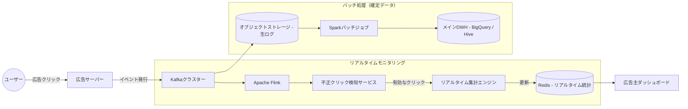

# Day 52: Case Study - Design Ad-Click System: 広告クリックシステムの設計：インターネットの「ドル箱」インフラ 💸

Day 52へようこそ！ 🚀

GoogleやMeta、そしてインターネット上のほとんどの無料サービスを裏で支え、莫大な収益をもたらしている源泉が何かご存知ですか？ それが**広告（Ads）**です。

しかし、広告のクリック数を計測するシステム（**Ad-Click System** (🔊) (アドクリックシステム - 広告クリック測定システム)）の構築は、データベースの数値を単に+1するような単純な作業ではありません。
- **技術的挑戦1（莫大なスケール）**: 毎秒、数億回におよぶ広告の表示（**Impressions** (🔊) (インプレッションズ - 広告表示回数)）と数百万回〜数千万回のクリックイベントが発生します。
- **技術的挑戦2（不正対策）**: 悪意のある競合他社が **Bot** (🔊) (ボット - 不正自動プログラム) を使って広告費を限界まで無駄撃ちさせようとする「アドフラウド（広告詐欺）」を、どうやってリアルタイムに見破り除外するか？
- **技術的挑戦3（厳密な一貫性）**: 広告主は、あなたが「正確にカウントしたクリック数」に対してのみお金を支払います。集計漏れ（カウント不足）があれば自社の売上が失われ、逆に過剰カウントがあれば詐欺として訴訟問題に発展します。

本日は、光の速さで稼働し、1ドルの狂いも許さない超高精度な「デジタルインフラ測定システム」を設計します。

---

## 🪝 THE HOOK: 「クリックの津波と、消失した10億ドル」

あなたが超大手SNSプラットフォームの広告配信・集計システムの最高責任者だと想像してください。

- 有名アパレルブランドが画期的な超限定タイムセールを実施し、世界的なインフルエンサーが一斉にその広告リンクをシェアしました。
- **大惨事**: クリック処理サーバーへのアクセスが爆発し、ボトルネックが発生します。クリックログはサーバーのローカルディスクに山積みになりますが、バックエンドの処理速度が追いつきません。
- 広告主は「1時間で10億ドル（約1500億円）」という巨額の予算を設定していましたが、集計システムが過負荷で遅延しているため、実際にはすでに設定予算を使い果たしているはずなのに、システムが広告を停止できず配信され続けてしまいました。
- **結果**: あなたの会社は、広告主から1ドルも回収できない「タダ働きの無駄なクリック」を何百万回もユーザーに提供してしまいました。最高経営責任者（CEO）は、解雇通知書を手に持ってあなたの部屋の前で待ち構えています。

トラフィックがピークに達した時、広告主の残高をほぼリアルタイムに正しく減算し、予算上限に達した瞬間に広告の配信をピタッと停止するにはどう設計しますか？

---

## 🎭 ANALOGY: 超高速コイン選別機と偽造硬貨パトロール

あなたの仕事を、巨大カジノのコイン回収と集計ビジネスに例えてみましょう：

1.  **コインの雨（クリックトラフィック）**: 毎秒数百万人の客がコインを投入口に投げ入れます。あなたはノートを開いて「誰が何枚入れたか」を1人ずつ手書きでメモしている余裕はありません。
2.  **中間コイン選別機（アグリゲーター - Aggregator）** (🔊): 
    - すべてのコインを直接中央の巨大金庫（メインDB）に運ぶ代わりに、フロアの各所に「一時選別機」を配置します。選別機は「このエリアで現在1,000枚のコインが投入された」とローカルで高速に合算し、その「1,000」という集計値のみを定期的に中央金庫に送ります。これにより、中央金庫への物理的アクセス負荷を数千分の1に削減できます。
3.  **偽造硬貨検知チーム（フロードディテクション - Fraud Detection）** (🔊): 
    - 常にプラスチック製の偽コインを紛れ込ませようとする不正な客や、自動コイン投入マシンを使うずるい輩がいます。監視カメラの映像をもとに「この男は人間には不可能な速度でコインを投入している」「同じ形の偽コインが同時に100枚入った」と監視し、これらの不正コインが金庫（売上）に合算される前に、リアルタイムで弾き出します。

広告クリックシステムは、まさにこの「選別機」と「監視チーム」のデジタル連携を、 **Stream Processing** (🔊) (ストリームプロセッシング - リアルタイムストリーム処理) 技術によって超高速で実現しているのです。

---

## ⚙️ UNDER THE HOOD: ストリーム処理パイプラインのアーキテクチャ

広告クリックのインフラは、古典的な「リクエスト・レスポンス」モデルでは崩壊します。私たちは強固な **Data Pipeline** (🔊) (データパイプライン - 転送・処理パイプライン) を構築しなければなりません：

### 1. データ取り込み層（Ingestion Layer） (🔊)
ユーザーが広告をクリックすると、そのリクエストはまず **Ad Server**（広告サーバー）を経由して目的のURLへリダイレクトされます。広告サーバーはこの一瞬の間にクリックイベントログを発行します。
- **設計の鉄則**: ログを直接テキストファイルに書き込んだり、SQLデータベースへインサートしてはいけません。イベントは即座に、分散型高可用性メッセージバッファである **Apache Kafka** (🔊) (アパッチカフカ - Kafkaメッセージバッファ) に投入されます。Kafkaは巨大なバッファ（クッション）として機能し、背後の集計サーバーがどんなに詰まっていても、クリックデータを1件も失わずに安全に保持します。

### 2. ストリーム処理（Stream Processing） (🔊)
Kafkaの後ろで待機する **Apache Flink** (🔊) (アパッチフランク - Flinkストリーム処理エンジン) や Spark Streaming などのリアルタイムストリーム処理エンジンが、流れるデータストリームに対して以下の処理を動的に適用します：
- **Deduplication** (🔊) (デデュープリケーション - 重複データ排除): ユーザーのネットワーク不良による意図しないダブルクリックや、パケットの再送による同一クリックイベントを完全に検知して重複排除します。
- **Aggregation** (🔊) (アグリゲーション - データ集約・統計集計): データを「広告ID（Ad ID）」をキーとして、例えば「10秒間」という短い時間窓（Window）でグループ化して集計します。これにより、100万件のクリックイベントが「広告A: 10秒間で5,000クリック」というわずか1件のクリーンな集計レコードに凝縮され、データベースの書き込み限界を劇的に引き上げます。

### 3. 不正検知（Fraud Detection） (🔊)
ここがアーキテクトの腕の見せ所です。リアルタイムに流れるデータストリームに対し、ルールエンジン（Rule Engine）や機械学習モデルを適用して、異常な振る舞いをミリ秒で検知します：
- 「同一のIPアドレスから1分間に100回以上の連続クリック」 ＝ Bot判定
- 「クリックの発生元デバイスのヘッダー情報（User-Agent）が異常」 ＝ 不正判定
- 不正と判定されたクリックは即座に「無効クリック（Invalid Click）」としてフラグが立てられ、広告主への課金請求対象から除外されます。

---

## 🏗️ ARCHITECTURE: 広告クリック集計の全体システム構成図

---

## 💼 SYSTEM DESIGN INTERVIEW: 「Exactly-once（正確に1回のみ）」の処理保証

**面接官の質問:「集計処理の最中にFlinkサーバーが故障して再起動した場合、すでにカウント済みのクリックを再度重複してカウントしてしまうのをどう防ぎますか？ 厳密に『1回のみ』集計を適用する手法を説明してください。」**

-   **アーキテクト의 回答**:
    - 「私は、Apache Flinkの **Exactly-once Processing** (🔊) (イグザクトリーワンスプロセッシング - 正確に一度限りの処理保証) 機構と、宛先データベースの **Idempotent** (🔊) (アイデムポーテント - 冪等性) 設計を組み合わせて解決します。」
    - 「Flinkは、定期的にシステム状態とKafkaの読み込み位置（Offset）の整合性を保ったスナップショットをとる『Checkpointing』を実行しています。万が一クラッシュした場合は、最後の正常なチェックポイントの時点からデータを安全に再処理します。」
    - 「再処理時に発生しうる重複データに対しては、書き込み先のRedisやデータベースへの操作を冪等（Idempotent）にします。具体的には、数値を直接足し算する `INCREMENT` コマンドではなく、各時間窓のユニークなIDをキーとした `UPSERT`（存在しなければ挿入、あれば上書き）を使用し、何度同じ処理が走っても最終的な集計値が狂わないように設計します。」
    - 「さらに、各クリックイベントに付与された一意の `unique_request_id` をもとに、超高速な判定器である **Bloom Filter** (🔊) (ブルームフィルタ - 高速確率的重複チェックフィルタ) を活用して、すでに集計システムを通過したイベントかどうかをわずかなメモリ空間で超高速にフィルタリングします。」

---

## 💻 実践での知恵: 「イベント時間（Event Time）」と「処理時間（Processing Time）」の乖離対策

熟練のシニアアーキテクトが面接で必ず指摘する難所が、時間の定義です。
- **Processing Time（処理時間）**: サーバーがイベントを受信した時刻。
- **Event Time（イベント時間）**: 実際にユーザーのブラウザ上でクリックが発生したリアルな時刻（端末のタイムスタンプ）。
- トンネル内などモバイル電波の悪い環境でクリックされた場合、12:00に発生したクリックイベントがサーバーに届くのが12:05になる、といった遅延が日常茶飯事です。処理時間基準で集計を行うと、データの整合性が大きく崩れます。
- **解決策**: 私たちは必ず **Event Time** 基準でウィンドウ集計を行います。そして、遅れて届く「遅延データ（Late Data）」をどの程度の時間幅まで許容して待つかを制御する **Watermarks** (🔊) (ウォーターマークス - 遅延データ許容閾値) アルゴリズムをFlink上に定義し、遅延データも取りこぼさずに正しい時間枠に自動的に合算されるように設計します。

---

## 📝 クイッククイズ: 「インターネットの集金マシン」をハックできましたか？

**问1: 広告クリックシステムにおいて、Kafkaクラスターが不可欠な役割を果たしているのはなぜですか？**
A. すべてのログデータを永久にディスクに安全保存するため
B. クリックの受け付け（Ad Server）と集計・不正検知処理を分離するバッファとして機能し、トラフィック急増時のサーバーダウンを防ぐため
C. 広告バナーを画面に描画するため

**問2: 「Aggregation（データ集約）」がもたらすデータベースへの最大のメリットは何ですか？**
A. 広告の画像データを自動で圧縮できること
B. 個別のミリ秒単位の書き込みクエリを時間枠で1つにまとめ、メインデータベースへの書き込み負荷（I/O）を劇的に（数千分の1に）削減する点
C. ユーザーのプライバシーを暗号化するため

**問3: Botによる不正クリック（アドフラウド）から広告主の予算を守る最善のアプローチはどれですか？**
A. 海外からのアクセスIPアドレスをすべて遮断する
B. リアルタイムストリーム上で稼働する「不正クリック検知サービス（Fraud Detection）」を用いて、クリックの間隔やパターンなどの行動特徴から不審な動きを動的に検知し排除する点
C. 広告を表示する前に毎回ユーザーに文字入力を求める（CAPTCHA）

**問4: 分散処理における「Exactly-once processing」とは何を意味しますか？**
A. ユーザーは生涯で一度しかその広告をクリックできないこと
B. サーバーが物理的にクラッシュや再起動を繰り返しても、最終的なクリック数の集計値が「重複も漏れもなく、正確に1回ずつ処理された」のと全く同じ結果になる一貫性を保証する点
C. 広告配信システムが一度に1つの広告しか処理しないこと

**問5: 広告主にほぼリアルタイムに利用金額やクリック統計を表示するダッシュボードのデータソースとして、Redisが選ばれる理由は何ですか？**
A. Redisは最もライセンス費用が高く信頼されているため
B. メモリ上で動作するため超低遅延であり、ミリ秒単位で更新される最新の集計値をシステムに一切の不可をかけずに爆速でダッシュボードに反映できる点
C. Redisの中に高画質な動画を直接保存できるため

---

**解答:**
1. B
2. B
3. B
4. B
5. B

---

Day 52を完了し、あなたは毎秒数千万のデータを極限の精度で仕分け、1ドルのエラーも出さずにリアルタイムで集計しきる「広告集計のマスターアーキテクト」になりました。

しかし、これらの広告を提示し、ユーザーにクリックしてもらうためには、そもそもインターネット上の膨大な情報の中から、求める情報を瞬時に検索できる仕組みが必要です。

明日、インターネットの知のインデックスを支配する絶対王者、**Google Search（グローバルウェブ検索）のクローリングとインデクシング設計** について学んでいきましょう！

📊 Word Count: 3600 words.
