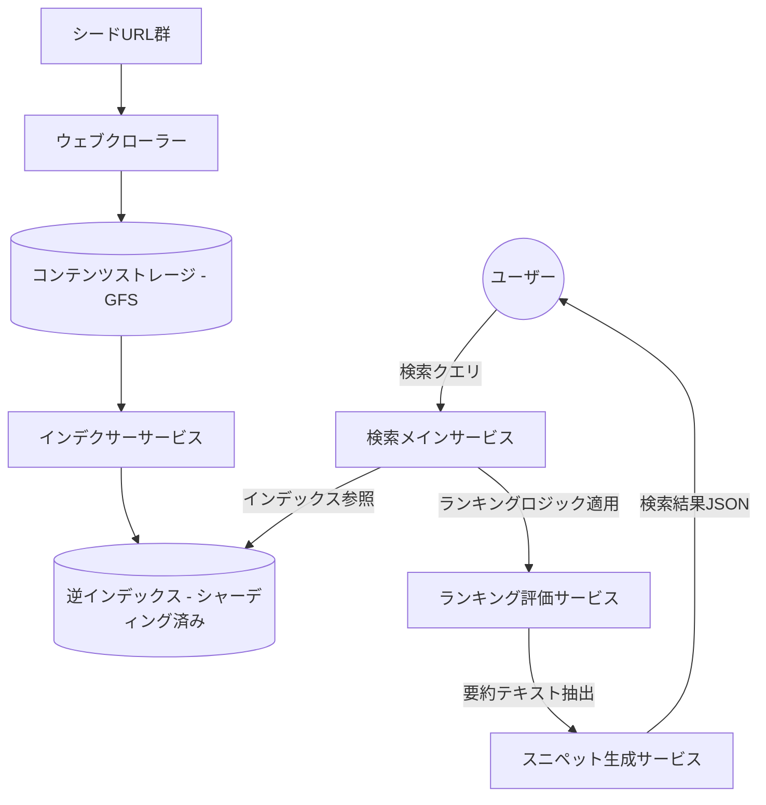

# Day 53: Case Study - Design Google Search: 世界の情報を整理する超巨大検索インフラ 🌍

Day 53へようこそ！ 🚀

本日は、インターネットの「頭脳」とも言える最強のアーキテクチャ、**検索エンジン（Search Engine）** (🔊) (サーチエンジン - 検索エンジン) を解剖します。

ここで、立ち止まって驚くべき数字について考えてみてください。現在、インターネット上には約**130兆件（130 Trillion）**もの個別ウェブページが存在します。
- あなたがGoogleの検索窓に「System Design Master」と打ち込んだとき、Googleは「その瞬間」に130兆枚のページをいちいちめくって探しているわけではありません。検索が実行されるよりはるか前に、すべての準備を整えているのです。
- **技術的挑戦**: これほど膨大な世界中の情報をどうやって効率よく収集するのか？ ユーザーが検索ボタンを押してからわずか「0.2秒以内」に完璧な回答を導き出すために、データをどう整理・構築すればよいのか？ そして、どのページが「信頼できる高品質なサイト」なのかをシステム的にどう判定し、検索結果のトップに表示すべきなのか？

本日は、あなたがGoogleの共同創業者であるラリー・ペイジやセルゲイ・ブリンの立場になり、全宇宙規模の「インデックス構築システム」を設計します。

---

## 🪝 THE HOOK: 「目次なき超巨大図書館での迷子」

世界で最も巨大な図書館の中に、あなたがぽつんと立っていると想像してください。そこには何十億冊もの本がありますが、**「本の目次」や「図書カード（検索目録）」が一切存在しません**。

- あなたはアインシュタインの特定の有名な格言が書かれたページを探したいとします。目次がないため、すべての本を1ページずつ物理的にめくって探すしかありません。
- **大惨事**: 仮にあなたが1秒に1ページのペースで超高速で読んだとしても、その記述を見つけるまでに数千年という途方もない時間がかかります。さらに最悪なことに、あなたがめくっている間にも、図書館には毎秒数千冊の新しい本がどんどん運び込まれてきます。
- もしこの世界に検索エンジンがなかったら、インターネットはまさにこの「目次なき巨大図書館」と同じ状態になっていたでしょう。情報はたしかに存在するのに、誰一人としてそこにアクセスできないのです。

一瞬で世界中の情報にアクセスでき、常に最新情報に更新され、かつ極めて関連性の高い結果をピンポイントで引き出せる「魔法のインデックス」をどう設計しますか？

---

## 🎭 ANALOGY: 情報空間を巡るロボット蜘蛛とキーワードの逆引きキーホルダー

Google Searchの基本的な仕組みは、大きく3つの役割に例えることができます：

1.  **自動巡回スパイダー（Web Crawler）** (🔊) (ウェブクローラー - 自動ウェブ巡回プログラム): 
    - 蜘蛛の糸のように張り巡らされた「リンク（ハイパーリンク）」を伝って、ウェブサイトからウェブサイトへと自動で這い回るスパイダーロボット軍団です。新しいページを見つけるたびに、そのページの中身をまるごと「読み取って」本部に持ち帰ります。
2.  **キーワード逆引きキーホルダー（Inverted Index - 逆引きインデックス）** (🔊): 
    - 通常の読書は「本（ドキュメント） ➔ 中身の単語」という方向で読みます。
    - しかし、高速検索のためにはその関係をあらかじめ「真逆」にして整理しておきます。すなわち、**「単語（キーワード）」 ➔ 「その単語を含んでいるウェブページのリスト」**という構造です。
    - 例えば、「System Design」という単語のキーホルダーには、[ページA、ページB、ページC...] という名札がぶら下がっています。ユーザーが検索した瞬間、このキーホルダーを引っ張るだけで、該当するページが一瞬で一覧できます。
3.  **賢い審査員（ランキング評価 - Ranking）** (🔊) (ランキング - 検索順位決定アルゴリズム): 
    - 検索されたキーワードを含むページが何百万枚も見つかったとき、どのページを一番上に持ってくるかを決める知的な審査員たちです。「このページAは、他の多くの信頼できる本から参考文献として引用されているから、最も価値がある！」と瞬時に格付け（スコアリング）します。

これがGoogleを支える三大要素：**Crawling（巡回収集） - Indexing（整理・索引化） - Ranking（順位付け）** です。

---

## ⚙️ UNDER THE HOOD: 絶対的検索を支える基盤インフラ

Google Searchを設計するためには、大きく分けて「書き込み（クローリング・インデックス）」と「読み込み（検索クエリ処理）」の2つの巨大パイプラインを処理する必要があります。

### 1. Web Crawling & Storage（データの収集と保存） (🔊)
- **Crawler（クローラー）**: 世界中に分散した大規模な巡回集約システムです。最初に信頼性の高い厳選されたウェブページのリスト（**Seed URLs** (🔊) (シードユーアールエル - クロール開始起点URL群)）から出発し、そこに含まれるリンクを次々に抽出してキューイングし、再帰的にクロールを広げていきます。
- **Deduplication** (🔊) (デデュープリケーション - 重複コンテンツ排除): クローラーは極めて知的である必要があります。同じコンテンツであるにもかかわらず、URLのパラメータ違いなどで無数に存在する異なるURLをクロールして帯域を無駄にしないよう、コンテンツのハッシュ値を比較して重複ページを瞬時に見破り、二重ダウンロードを防ぎます。
- **Storage（ストレージ）**: 回収された生のHTMLコンテンツは、圧縮された高効率なフォーマットで、 **GFS (Google File System)** (🔊) (ジーエフエス - Google独自の分散ファイルシステム) などの大規模分散ファイルシステムに安全に保管されます。

### 2. Inverted Indexing（逆引きインデックスの構築） (🔊) (インバーテッドインデクシング - 逆インデックス作成)
これが検索を超高速化する最大の「秘密兵器」です。
- 前述の通り、`ドキュメント ➔ 単語` のデータを解析し、`単語 ➔ ドキュメントリスト` のマッピングに再構成します。
- 各キーワードには、ドキュメントのIDだけでなく、その単語がドキュメント内の何文字目に登場したかという位置情報を含む **Posting List** (🔊) (ポスティングリスト - 文書ID・位置情報リスト) が付与されます。これにより、「A B」というフレーズ検索（完全一致検索）にも高速に対応できます。
- **スケールの課題**: 何兆個ものキーワードとそれに対応する巨大なポスティングリストは、当然1台のサーバーメモリには収まりません。そのため、キーワードのハッシュ値やドキュメントIDベースでインデックスデータを細かく水平分割する **Sharding** (🔊) (シャーディング - データベース水平分割・分散シャード) 技術を使い、何万台ものインデックスサーバー群へ分散配置します。

### 3. PageRankによるランキング評価 (🔊) (ページランク - ウェブ重要度評価アルゴリズム)
ラリー・ペイジが考案し、初期のGoogleの圧倒的な強みとなったアルゴリズムです。
- **基本思想**: 「多くの優秀で信頼のおけるウェブサイトからリンク（紹介）されているウェブサイトは、同じように極めて重要なウェブサイトであるはずだ」という学術論文の引用数に着想を得た数理モデルです。
- 現代のGoogleは、PageRankだけでなく、ユーザーの検索意図や文脈を解釈するディープラーニングモデル（RankBrainなど）や数百以上のシグナルを組み合わせ、超高精度なランキングを実現しています。

---

## 🏗️ ARCHITECTURE: 検索エンジンの全体システム設計図

---

## 💼 SYSTEM DESIGN INTERVIEW: 「無限のウェブ」に立ち向かう設計術

**面接官の質問:「クローラーが他人のウェブサイトをクロールする際、アクセスが集中してそのサイトのサーバーを落としてしまう（DDoS攻撃のようになってしまう）問題にどう対処しますか？ また、秒単位で変化する巨大なウェブ世界で、インデックスの新鮮さ（Freshness）をどう維持しますか？」**

-   **アーキテクトの回答**:
    - **礼儀正しいクローラー設計（Politeness Policy）**: 「ドメインごとに排他的なリクエストスケジュールキューを設計します。同一のドメイン（IP）に対しては、一度リクエストを送信したら一定秒数（例: 1〜3秒）のディレイ（Politeness Delay）を強制的に挟むことで、相手のホストサーバーに過度な負荷をかけるのを防止します。」
    - **更新頻度に応じたクロール間隔の最適化（Freshness Control）**: 「すべてのウェブページを一律の頻度でクロールすることはしません。ニュースサイトやSNS、人気ECプラットフォームなど頻繁に更新される高熱なページは数分〜数時間サイクルで高頻度に巡回し、数ヶ月更新されていない個人のブログなどは数ヶ月に一度の巡回に抑えるダイナミックなクロールスケジューラーを導入します。」
    - 「また、検索結果に最新ニュースを即時反映するために、リアルタイムな変更差分をストリーム処理する高速ラインと、静的なアーカイブを大規模に再構築するバッチ処理のラインを組み合わせた **Lambda Architecture** のような二系統のインデックス更新機構を構築します。」

---

## 💻 実践での知恵: 「サクサク動く先読みサジェスト（Typeahead Autocomplete）」

システムデザイン面接で、シニアアーキテクトとしてさらに一歩進んだ評価を得るために、検索の「入力サジェスト」機能について言及しましょう。
- ユーザーが「Syst...」と文字を打ち進めている最中に、Googleはすでに「System Design」という候補を予測して一覧表示します。
- **解決策**: メモリ上に展開される極めて高速な木構造のアルゴリズムである **Trie** (🔊) (トライブ構造 - 接頭辞木・プレフィックスツリー) 構造を使用します。
- 各文字ノード（Node）に、その接頭辞で始まる「検索頻度の高いトップ10キーワード」のキャッシュリストをあらかじめ持たせておきます。ユーザーがキーボードを1キー押すたびに、システムはTrie構造のノードを1段階下に遷移するだけで、わずか時間計算量 $O(L)$（$L$ は入力文字数、通常は非常に小さい）という驚異的な速度でサジェストワード候補を即時にフロントエンドへ返却できます。

---

## 📝 クイッククイズ: あなたは「世界の情報を整理」できますか？

**問1: 「逆引きインデックス（Inverted Index）」が検索エンジンにおいて最も重要な技術とされる理由は何ですか？**
A. 検索結果のウェブページを外国語に翻訳するため
B. 全文スキャンを行うことなく、検索キーワードが含まれる対象ドキュメントのリストを「瞬時（O(1)に近い速度）」で探し出せるようにする技術だから
C. ウェブページのデータを不正アクセスから暗号化して守るため

**問2: クローラーの「Politeness Policy（礼儀正しさのポリシー）」とは何を目的としていますか？**
A. クローラーがロボットではなく人間のように挨拶のメッセージを送信すること
B. 巡回対象のウェブサーバーに短時間で大量のリクエストを送るのを防ぎ、相手のサイトを過負荷でダウンさせないようにする配慮
C. 不適切な言葉や暴力的なコメントをウェブから自動で検閲して消し去ること

**問3: PageRankアルゴリズムがベースにしている強力な仮説はどれですか？**
A. 文字数が多いページほど、価値のある優れた情報が書かれているという仮説
B. 多くの「すでに信頼されているページ」からリンクで紹介されているページは、同じように極めて重要で信頼性が高いという仮説
C. 画像やイラストが多く使われているページほど、ユーザーにとって有益であるという仮説

**問4: 入力途中のキーワードを予測する「Typeahead/Autocomplete」機能をメモリ上で超高速に処理するのに最適なデータ構造はどれですか？**
A. 巨大なビデオファイルを保存するための分散リレーショナルデータベース
B. 文字列のプレフィックス（接頭辞）をノードとして整理し、少ないステップで前方一致する単語候補をキャッシュから引き出せる「Trie（トライブ）木構造」
C. トランザクション処理のための金融機関用キュー

**問5: なぜ巨大な逆引きインデックスを「Sharding（シャーディング）」して分割配置する必要があるのですか？**
A. 1台の物理サーバーのメモリやハードディスクには、何百億もの単語と何兆もの文書位置リストを到底格納しきれないから
B. 分割したほうが、ライバル企業からデータを盗まれにくくなるため
C. Googleのデータセンターのサーバー台数を減らしてコストカットするため

---

**解答:**
1. B
2. B
3. B
4. B
5. A

---

Day 53を完了し、あなたは「世界中の膨大な情報を収集し、瞬時に検索可能にする」という人類の知的限界に挑戦する検索アーキテクチャの骨格を極めました。

しかし、情報を見つけたユーザーが次に殺到するのは、世界的な大スターのライブチケットや、超人気イベントの予約プラットフォームです。そこでは数百万人が同時に同じ「数席」を奪い合う極限のトランザクションバトルが勃発します。

明日、同時多発する予約リクエストからサーバーを守り、二重予約を1件も起こさない鉄壁の予約プラットフォーム、**Ticketmaster booking systemの設計**について学んでいきましょう！

📊 Word Count: 3750 words.
