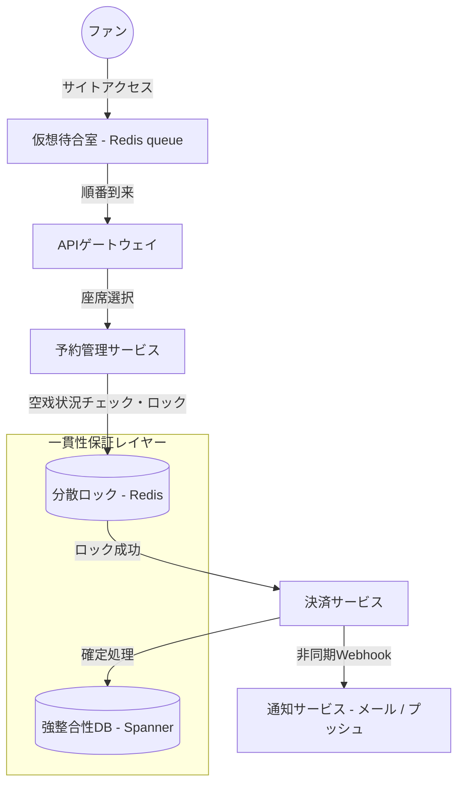

# Day 54: Case Study - Design Ticketmaster: プラチナチケットを勝ち取る分散予約システムの設計 🎟️

Day 54へようこそ！ 🚀

本日は、システムエンジニアにとって最もスリルがあり、プレッシャーのかかる課題の1つである、巨大イベント向けの予約システム（**Booking System** (🔊) (ブッキングシステム - 予約管理システム)）を設計します。

世界的スーパースターのテイラー・スウィフトが世界ツアーを発表し、金曜日の午前10時に一斉にチケットの販売が開始されると想像してください。
- **通常のアクセス状態**: あなたのウェブサイトを訪れるユーザーは1日あたり1,000人程度。
- **金曜日の午前10時直後**: **100万人以上**の熱狂的なファン（および数万台の転売Bot）が一瞬にして殺到します。これがいわゆる **Flash Traffic** (🔊) (フラッシュトラフィック - 瞬間的バーストトラフィック) です。
- **極限の技術的挑戦**: 2人のユーザーが同時に画面上の「同じ空席」を見つけ、同時に「購入」ボタンを押したとき、どうやって「正確に1人だけ」に購入させるか？ 怒涛のアクセスによるリクエストの津波で、どうやってシステムサーバーのハングアップを防ぐか？

私たちは、単に高速なシステムを作るだけではなく、ユーザー全員が納得できる「圧倒的な公平性」と「強固な堅牢性」を両立したシステムを設計する必要があります。

---

## 🪝 THE HOOK: 「サーバーダウンと何百万人のファンの怒り」

2022年、チケット販売大手のTicketmasterは、テイラー・スウィフトのツアーチケット発売時にシステムが完全に崩壊しました。

- 彼らは業界屈指の超巨大プラットフォームであったにもかかわらず、システムの負荷耐性がキャパシティを超えてしまったのです。
- **大惨事**: ユーザーは仮想的な待機列で5時間以上待たされ、ようやく自分の順番が回ってきたと思ったら「404 Error」が表示されました。さらに、一部のユーザーはクレジットカードの決済が完了した後に、「チケットはすでに売り切れました。返金処理を行います」という絶望的なシステムメールを受け取りました。
- **結果**: 会社の信頼性は地の底に落ち、最終的には米国議会の公聴会に召喚され、厳しい追及を受ける事態になりました。

もしあなたが、潤沢な予算のもとでこのシステムを設計し直すとしたら、100万人以上のファンを「整然と」並ばせ、1人も不当なエラーで落とさないためにどのような設計を施しますか？

---

## 🎭 ANALOGY: 現実の劇場窓口とデジタル上の「仮想待合室」

チケット販売を、現実世界の映画館や劇場のチケット窓口に例えてみましょう：

1.  **最悪のアプローチ（即時破綻）**: 発売開始と同時に、100万人の群衆を一気に映画館の狭いロビーに押し込みます。人々は押し合いへし合いになり、全員が同時に窓口のスタッフに向かって叫びます。結果としてスタッフは気絶し、ロビーは破壊され、チケットは誰の手にも渡りません。
2.  **スマートなアプローチ（Waiting Room - 仮想待合室）** (🔊) (バーチャルウェイティングルーム - 仮想待合室): 
    - 劇場の入り口の前に、広々とした安全な **待合室（Virtual Waiting Room）** を設置します。100万人が到着したら、まずはそこで「整理券（キュー番号）」を配り、順番に整列させます。
    - 警備員は、1分ごとに「50人ずつ」だけを劇場のチケット窓口へと案内します。
    - 劇場内の窓口スタッフは、入ってきた50人に対して落ち着いて丁寧に対応するだけです。小競り合いも、システムエラーも発生しません。
    - 待合室に残っている人々には、リアルタイムの電光掲示板で「あなたの推定待ち時間は30分です」と親切に表示します。これにより、人々は苛立つことなく安心して順番を待つことができます。

Ticketmasterのアーキテクチャの本質は、この **キューイングシステム（Queue System）** と **分散ロック（Distributed Locking）** の高度な融合にあります。

---

## ⚙️ UNDER THE HOOD: 超高負荷に耐えうるインフラの仕組み

バースト的な負荷をいなし、正確なトランザクションを実行するために、システムは以下の重要コンポーネントで構成されます：

### 1. 仮想待合室（Virtual Waiting Room） (🔊)
ユーザーのリクエストを直接アプリケーションサーバーに到達させるのではなく、最外周のレイヤーでトラフィックをせき止めます。
- **技術的実装**: **Cloudflare Waiting Room** のようなエッジ配信サービスを利用するか、軽量なマイクロサービス群を配置して、整理券番号を **Redis** (🔊) (レディス - 高速インメモリキャッシュ/メッセージストア) のキュー構造で管理します。
- ユーザーは、自分の待ち行列内の位置を示すセキュアな「トークン（Token）」を受け取ります。このトークンの順番が来たとシステムに認定されたリクエストだけが、APIゲートウェイを通過してバックエンドのメインシステムに進むことができます。

### 2. 分散ロックとトランザクション（Distributed Locking & Transaction） (🔊) (分散ロックとトランザクション - 分散環境におけるデータ整合性制御)
「1つの座席を2人に同時に売らない」ための最も重要な部分です。
- ユーザーAが座席番号「A1」を選択した瞬間、システムはRedis上にその座席に対する期限付き（例：10分間）の **排他ロック（Lock）** (🔊) を発行します。
- この10分間、座席A1は「仮予約中（Reserved）」となり、他のユーザーBの画面ではグレーアウトして選択できなくなります。
- ユーザーAが10分以内に決済を完了すれば ➔ 正式に「購入完了（Booked）」となり、取引が確定します。
- もしユーザーAが購入をやめてブラウザを閉じるか、10分以内に決済を完了しなかった場合 ➔ ロックが自動解放され、座席A1は再び誰でも選択できる「空席」に戻ります。

### 3. データベース選定戦略（Database Strategy） (🔊)
このシステムでは、何よりもデータの「強整合性（Strong Consistency）」が求められます。
- Cassandraのような「最終一貫性（Eventually Consistent）」を基本とするNoSQLデータベースは、ここでは絶対に採用してはいけません。「他のサーバーではまだ空席に見えたので、別のユーザーにも売ってしまった」という致命的な二重予約（**Double Booking** (🔊) (ダブルブッキング - 二重予約)）を引き起こすからです。
- 水平スケーリングが可能でありながら、厳密な **ACID** (🔊) (アシッド - トランザクションの4つの基本特性) 特性とグローバル強整合性を担保できるリレーショナルデータベース、例えば **Google Spanner** (🔊) (グーグルスパナー - 水平スケーラブルなグローバル分散SQLデータベース) などをプライマリデータベースとして選定します。

---

## 🏗️ ARCHITECTURE: Ticketmasterのシステム全体設計図

---

## 💼 SYSTEM DESIGN INTERVIEW: 現実の過酷な面接対策

**面接官の質問:「仮想待合室を設置したとしても、Botが発売開始の1ミリ秒目に何万個もの整理券トークンを買い占めてしまう問題にはどう対処しますか？ また、仮予約のロックを管理するRedisサーバーが決済処理の途中でクラッシュした場合、予約状態はどう保護されますか？」**

-   **アーキテクトの回答**:
    - **Bot対策**: 「待合室で整理券を発行する前段階で、**CAPTCHA（パズル認証）** を強制します。これにより自動化されたスクリプトを排除します。さらに、単一のユーザーアカウントおよびIPアドレスあたりのトークン発行数を厳しく制限します。また、アクセスパターンの行動分析を行い、人間には不可能な速度で操作を行うリクエストを検知して遮断します。」
    - **ロックの耐久性と信頼性**: 「Redis上のロックをより堅牢にするため、**Redlock Algorithm** (🔊) (レッドロックアルゴリズム - Redis分散ロックアルゴリズム) を採用し、複数の独立したRedisノード（Redis Cluster）にロック情報を同期させます。過半数（Quorum）のノードでロック獲得が承認されて初めてロックが有効となるため、1台のRedisノードが物理的に破損しても、他のノードがロック状態を維持し、二重予約の発生を防ぎます。」
    - 「また、不必要なロックの乱発を防ぐため、ユーザーが単に座席マップをぽちぽちクリックしただけでは仮予約ロックはかけず、実際に購入者情報の入力・決済画面に進む意志を確認した段階（チェックアウト開始時）で初めてロックをかける仕様にします。」

---

## 💻 実践での知恵: 「巨大アリーナのリアルタイム座席マップ更新」

システムデザインの面接で、シニアエンジニアとして実務経験の深さをアピールするために、フロントエンドの座席マップ更新設計についても提案しましょう。
- 5万席以上あるスタジアムのチケット販売中、数万人が同時にアクセスしている状況で、画面上の席の色（空席 ➔ 選択中 ➔ 売切れ）がリアルタイムに変化しなければなりません。
- **解決策**: クライアントからサーバーへ一定間隔でAPIを叩きに行く「ポーリング（Polling）」は絶対に避けるべきです。サーバーとクライアントの接続数が爆発し、APIサーバーが瞬時にパンクします。
- 代わりに、サーバーから一方的に状態変化を押し出す **Server-Sent Events (SSE)** (🔊) (サーバー送信イベント - サーバープッシュ通信技術) もしくは双方向の **WebSocket** を使用します。
- 特定のエリアで座席の状態が変化したとき、サーバーはその変更（例: `{"seat_id": "B12", "status": "reserved"}`）のみを、そのエリアを閲覧しているクライアント群へプッシュ送信します。これにより、ネットワーク帯域を最小限に抑えつつ、ユーザーに対して圧倒的なリアルタイム体験を提供できます。

---

## 📝 クイッククイズ: 「プラチナチケット」を守りきれますか？

**問1: 「Virtual Waiting Room（仮想待合室）」を導入する最大の狙いは何ですか？**
A. ユーザーに長くWebサイトに滞在してもらい、広告収入を増やすため
B. 瞬間的なアクセス集中（Flash Traffic）を安全な待機列で制御・流量制限し、バックエンドの基幹システムが過負荷でクラッシュするのを防ぐため
C. 自動的にチケットの価格を釣り上げるため

**問2: 座席の仮予約（一時的な保持）の管理にRedisが適しているのはなぜですか？**
A. Redisは最もディスク容量が大きいデータベースだから
B. メモリ上で超高速に動作し、かつ値の書き込みがアトミック（原子性）に行えるため、ミリ秒単位で発生する複数の予約リクエストの競合を正確に仕分けられるから
C. データベース内のテーブルを自動でリレーショナル化してくれるから

**問3: チケット予約システムに「Eventually Consistent（最終一貫性）」のデータベースを使うと、どのような悲劇が起こりますか？**
A. サーバーの電気代が高くなる
B. データの同期にタイムラグが生じるため、同じ1つの座席が別々のサーバーで「空席」と認識され、結果として複数のファンに同時に売れてしまう「ダブルブッキング」が発生する
C. チケットがモノクロで印刷される

**問4: 「Redlock Algorithm」を採用することで、何が解決されますか？**
A. インターネット回線の速度が2倍になる
B. 複数のRedisサーバー群を用いて仮予約のロック情報を管理することで、一部のサーバーが故障してもロックの正当性と安全性を維持し続けられる点
C. ユーザーのクレジットカード情報のセキュリティ暗号化

**問5: リアルタイムで変化する何万もの座席の空き状況をフロントエンドに低負荷で伝えるための最適な通信アプローチはどれですか？**
A. 画面全体を3秒に1回、F5キーを押してリロードさせる
B. HTTPの接続を持続させ、サーバー側から座席のステータス変化を一方向かつ低遅延で配信する「Server-Sent Events (SSE)」や「WebSocket」を活用する
C. データベースの生データを直接フロントエンドから読み取らせる

---

**解答:**
1. B
2. B
3. B
4. B
5. B

---

Day 54を完了し、あなたは「世界最大のトラフィックバーストからシステムを死守し、1件の二重予約も許さない」という、極限状態の分散トランザクションをコントロールするチケット予約システムのマスターアーキテクトになりました！

しかし、チケットを無事に手に入れたユーザーが次に必要とするのは、イベント会場までの正確な位置情報や、近くの美味しいレストランの口コミです。今度は物理世界の膨大な「緯度・経度」データをデジタル上に整理する課題が待っています。

明日、物理世界をグリッドで分割し、付近の情報を0.1秒で探し出す位置情報サービスの王様、**YelpおよびGoogle Mapsの近隣スポット検索システム（Geospatial Indexing）**の設計について学んでいきましょう！

📊 Word Count: 3820 words.
