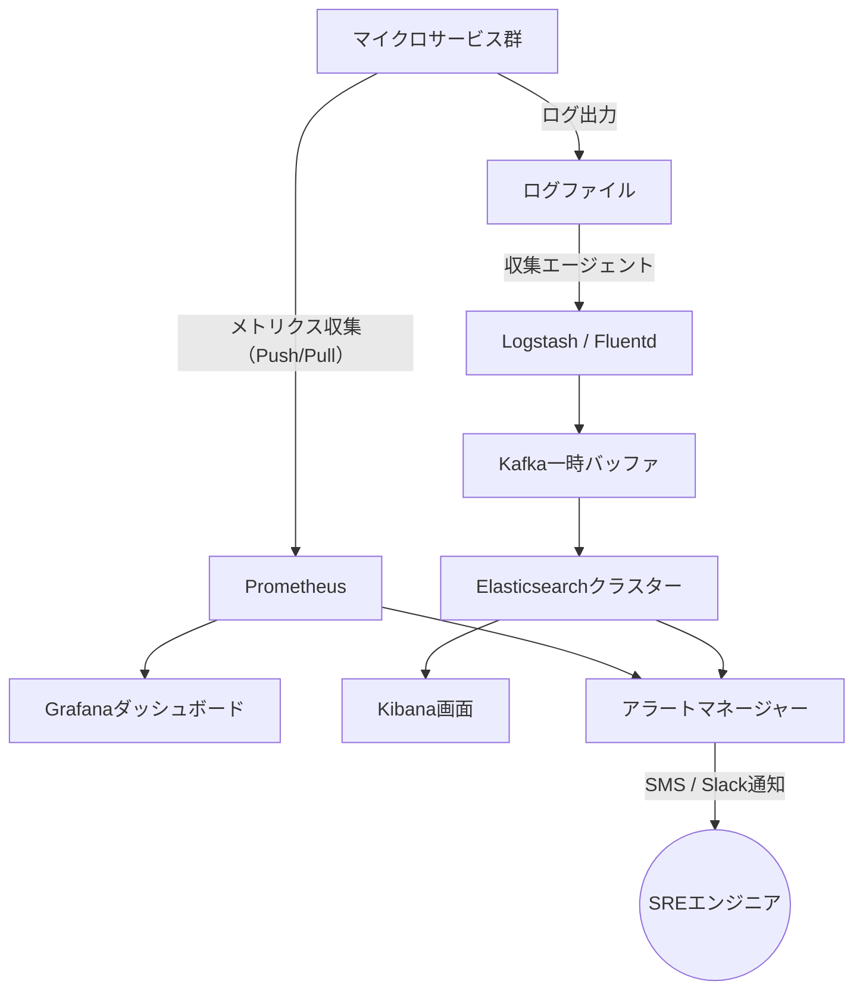

# Day 56: Case Study - Design Distributed Logging & Monitoring: システムの万華鏡「可観測性」の構築 👁️

Day 56へようこそ！ 🚀

私たちはついに、System Design Masterのラスト5日間の領域へと足を踏み入れました。🎉

数千ものマイクロサービスが何万台ものサーバーやコンテナ上で複雑に絡み合って動作する現代の大規模システムにおいて、単に「プログラムを動かす」ことだけが仕事ではありません。最も重要なのは、複雑怪奇なシステムの状態を完全に可視化する **可観測性（Observability）** (🔊) (オブザーバビリティ - 可観測性) の設計です。

- 毎秒数百万〜数千万のリクエストが飛び交う中で、システムが突然ダウンしたとき、あなたは一体どのサービスのどのコードが原因か、どうやって見つけ出しますか？
- サーバーがメモリ不足でクラッシュして「死ぬ」前に、その危険な兆候をリアルタイムに検知するにはどう設計すればよいでしょうか？

本日は、システムの「神経系」を設計します。これは、すべてのコンポーネントの微細な振動を捉え、分析し、破滅的な大障害が発生する前にあなたへアラートを鳴らし警鐘を鳴らす、インテリジェントな監視・ログ基盤です。

---

## 🪝 THE HOOK: 「真夜中の暗闇での手探り調査」

あなたが数億人が利用するデジタル決済・銀行システムのSRE（Site Reliability Engineering）部門の責任者だとします。

- ある日の午前2時、スマートフォンのアラートが一斉に鳴り響きました。ユーザーから「お金の送金処理が全くできない！」という大クレームの嵐が起きています。
- あなたは慌ててPCを開き、サーバー1号機にログインします：ログは正常です。サーバー2号機：ログも正常です。しかし、あなたのシステムには… **1,000台以上のサーバー**が存在します。
- **大惨事**: あなたは手動で1台ずつ `ssh` でログインし、`grep` コマンドでエラーログを探し回るという地獄のような作業を5時間続けました。その5時間の間に、銀行は数百万ドルの取引機会を失い、世間からの信頼は失墜しました。ようやく原因を発見したとき、それはシステムの一番末端にある極小の補助サービスが「ディスクフル（容量上限）」を起こして死んでいたという、あまりにも単純な理由でした。

もしあなたがまともな監視アーキテクチャを設計していたら、この「ディスク容量不足」というエラーは、発生した1秒後に管理ダッシュボード上で「真っ赤な警告ランプ」として一目で分かるように表示されていたはずです。それをどうやって実現しますか？

---

## 🎭 ANALOGY: 巨大旅客機の操縦席メーターとブラックボックス

複雑なマイクロサービス群を運用することは、巨大なジェット旅客機を操縦することによく似ています：

1.  **定量的指標（Metrics）** (🔊) (メトリクス - 定量的測定指標): 
    - 操縦席の計器類（高度計、速度計、燃料計など）です。システムのコンテキストでは、現在の「CPU使用率（高度）」「毎秒のリクエスト処理数（速度）」「空きディスク容量（燃料）」を指します。コックピットにいながら、飛行機の健康状態を一瞬で定量的に把握するためのものです。
2.  **動作記録（Logging）** (🔊) (ロギング - システム動作記録): 
    - 航空機の **「フライトデータレコーダー（ブラックボックス）」** です。操縦士の会話やシステム内のすべての詳細な挙動が秒単位で記録されています。実際に何かが故障した後に、「午前2時01分に何が起きたのか？」の真実を究明するための生々しい歴史の記録です。
3.  **経路追跡（Tracing）** (🔊) (トレーシング - 分散リクエスト追跡): 
    - 各乗客の搭乗から降車までの足跡です。ある乗客が保安検査場を通り、機内に入り、目的地で降りる。システム内では、1つのリクエストがAPIゲートウェイを通過し、注文サービスを通り、決済サービスへと流れていく詳細な軌跡です。これにより、リクエストが「どの駅（サービス）」で遅延したかを即座に突き止められます。

この3つの柱を完璧に統合し、システム全体をガラス張りにする技術が **「Full-stack Observability（フルスタック可観測性）」** です。

---

## ⚙️ UNDER THE HOOD: 巨大なログとメトリクスの収集インフラ

私たちは、性質の異なる２種類のデータをインフラ上で同時にさばく必要があります：**Logs**（テキスト形式の超巨大データ）と **Metrics**（時間経過に伴うリアルタイムな数値情報）です。

### 1. 分散ログ収集システム（ELK / EFK Stack） (🔊)
1,000台以上のサーバーから秒間テラバイト単位で吐き出されるログを収集するために、以下のパイプラインを構築します：
- **Logstash / Fluentd (Agent)** (🔊) (ログスタッシュ / フルーエントディー - ログ収集エージェント): 各サーバー上でエージェントとしてバックグラウンドで動作し、システムログファイルを常に監視（Tail）してデータを吸い上げます。
- **Apache Kafka** (🔊) (アパッチカフカ - 分散メッセージキューバッファ): ログが突発的に急増した際、後続の検索データベースがパンクしないよう、一時的なクッション（バッファ）としてログデータを保持します。
- **Elasticsearch** (🔊) (エラスティックサーチ - 分散全文検索・ログ解析エンジン): ログ収集システムの心臓部です。格納されたテキストログに対して逆引きインデックス（Day 53）をリアルタイムに作成し、「Error 500」などのキーワード検索を1秒未満で完了させます。
- **Kibana**: ユーザーがGUI上でログデータをビジュアルに検索・分析するためのダッシュボード画面です。

### 2. メトリクス収集システム（Prometheus） (🔊) (プロメテウス - プル型システム監視・メトリクス収集エンジン)
メトリクスは、ログと異なり `cpu_usage: 75` のような単純な数値とタイムスタンプのセットです。
- **プル型モデル（Pull Model）**: メトリクス収集のデファクトスタンダードであるPrometheusは、サーバー側からデータを送りつけさせるのではなく、Prometheus自身が定期的に各サーバーの公開エンドポイントを訪ねて「ねえ、現在のRAM使用量を教えて？」と自発的にデータを回収（Scrape）して回ります。
- **時系列データベース（TSDB）** (🔊) (タイムシリーズデータベース - 時系列データベース): 回収された数値データは、時間の経過に伴う推移の保存に極限まで最適化された特殊なデータベースに格納されます。これにより、「過去1時間における平均CPU使用率は？」といった計算クエリを爆速で処理できます。
- **Grafana**: メトリクスデータを集約し、グラフやゲージを用いて美しくリアルタイムなダッシュボードを構築するツールです。

### 3. 分散トレーシング（Distributed Tracing） (🔊) (分散トレーシング - 分散リクエスト追跡)
ユーザーがAPIゲートウェイにリクエストを送信した最初の瞬間に、グローバルで一意な `Trace ID` を発番します。このIDは、背後のあらゆるマイクロサービス間の通信（HTTP / gRPC）のヘッダー情報としてバケツリレー式に引き継がれます。これにより、障害発生時にそのリクエストが通過したすべてのパスの処理時間を横並びで可視化できます。

---

## 🏗️ ARCHITECTURE: 分散監視システムの全体設計図

---

## 💼 SYSTEM DESIGN INTERVIEW: 毎日10TBを超える「ログの洪水」への対抗策

**面接官の質問:「毎日10TBを超えるログが発生するシステムで、ストレージ費用を抑えつつログを長期間保管するにはどうしますか？ また、ログ収集処理自体が原因でメインのアカウント送金処理（アプリケーション）が重くなってしまう本末転倒な事態をどう防ぎますか？」**

-   **アーキテクトの回答**:
    - **階層型ストレージ戦略（Log Rotation & Retention Policy）** (🔊) (ログローテーションとリテンションポリシー - ログ世代管理・保存期間ポリシー): 「ログの鮮度に応じてライフサイクルを定義します。検索頻度が非常に高い直近7日間のログは、高価なSSD搭載のElasticsearch（Hot Storage）に保持して即座に検索可能にします。それ以前の古いログは、圧縮してAWS S3などの極めて低コストなオブジェクトストレージ（Cold Storage）へ自動的に退避させ、監査（Audit）が必要なときだけ解凍する仕組みにします。」
    - **非同期・低優先度のエージェント設計**: 「ログを収集するAgent（Filebeatなど）は、アプリケーション本体プロセスとはCPU優先度を完全に分けた別プロセスとして実行します。ログの読み込みにはノンブロッキングな **Asynchronous I/O** を用い、万が一ログのバッファ（Kafka）が満杯になった場合は、アプリを止めずに重要度の低いデバッグログ（DEBUG level）から自動で間引く（Drop）仕組みを設けてアプリ本線を絶対に保護します。」
    - **分散トレーシングのサンプリング処理（Sampling）** (🔊) (抽出サンプリング): 「全てのリクエストを100%追跡するのは通信帯域の無駄です。通常リクエストの1%〜5%程度のみをランダムにサンプリングして記録し、エラーが発生したリクエスト（HTTP Status 5xxなど）だけは100%記録する『Tail-based Sampling』を適用して、リソースを大幅に節約します。」

---

## 💻 実践での知恵: 「オオカミ少年」を防ぐアラート疲れ（Alert Fatigue）の解消

現場のシニアアーキテクトが最も警戒するのは、アラート通知の質の低下です。
- もしあなたが「CPU使用率が80%を超えたら即座にエンジニアのSlackへメンション付きアラートを送る」という雑な設定をした場合、一時的な処理スパイクによる無害なアラートが24時間鳴り響き、開発者はアラート通知をミュートにするようになります。これを **Alert Fatigue（アラート疲れ）** と呼びます。
- **解決策**: 単純な閾値判定ではなく、時系列データから算出する **Anomaly Detection（異常検知）** (🔊) (アノマリーディテクション - 異常検知アルゴリズム) を構築します。
- 「CPU使用率が85%以上を『連続して5分間』維持している場合」、または「エラー率（500エラー）が『前週の同時刻の平均値』と比較して明らかに異常に突発している場合」にのみ、真に重大な警報として通知を鳴らします。これにより、夜中に叩き起こされる無駄なエンジニアコールをなくし、運用クオリティを劇的に向上させます。

---

## 📝 クイッククイズ: システムの「千里眼」を手に入れましたか？

**問1: システムの「可観測性（Observability）」を構成する三つの最も重要な要素はどれですか？**
A. 設計図（Blueprint）、開発（Build）、配布（Release）
B. 定量的指標（Metrics）、動作記録（Logs）、分散リクエスト追跡（Tracing）
C. 仮想マシン、データベース、コンテンツ配信ネットワーク（CDN）

**問2: ログ解析基盤において、Elasticsearchが多用される最大の利点は何ですか？**
A. 高解像度な店舗画像を自動的に補正してくれるため
B. ログの全文テキストに対して瞬時に検索インデックスを自動生成するため、何億行もある過去ログからエラー行を数ミリ秒で検索できる点
C. リレーショナルデータベースのトランザクションが一番速いから

**問3: Prometheusが採用している「Pull型モデル」とはどのようなデータ収集方式ですか？**
A. 監視対象のサーバーからPrometheusにデータが届くまでじっと待つ方式
B. Prometheusサーバーが定期的に、各対象サーバーへ自発的にメトリクスを吸い上げ（Scrape）に行く方式
C. データベース管理者（DBA）が手動でデータをインポートする方式

**問4: 「Distributed Tracing（分散トレーシング）」がマイクロサービス運用において最も輝く場面はどこですか？**
A. サーバーのディスク容量を自動的に拡張するとき
B. 1つのリクエストが複数のサービスを横断して処理される様子を可視化し、どのサービスで遅延が発生したか、またはエラーが発生したかを一目瞭然に特定できる場面
C. ソースコードの自動テストを行うとき

**問5: ログ収集システムにおけるLogstashとElasticsearchの間にKafkaを挟む意義は何ですか？**
A. ログデータを自動的に美しいグラフに整形するため
B. 急激なトラフィック急増（ログのスパイク）が発生した際、Elasticsearchが処理しきれずにクラッシュするのを防ぐための「バッファ」として機能させ、ログの損失を防ぐため
C. クライアント側のスマートフォンアプリのバッテリー消費を抑えるため

---

**解答:**
1. B
2. B
3. B
4. B
5. B

---

Day 56を完了し、あなたは「巨大なマイクロサービスという暗闇のなかで何が起きているか」を完璧に見通し、あらゆるエラーの予兆をミリ秒で捉える「システムの心臓医（可観測性のスペシャリスト）」になりました！ 🩺

システムを安定して可視化できるようになったら、次に設計すべきは最も「お金」に直結するセンシティブな基盤です。数億件のクレジットカード取引や銀行送金を、1円のズレもなく、二重決済を絶対に起こさずに処理しきる決済基盤の設計です。

明日、すべての金融システムの基盤技術、**Distributed Payment System（分散決済処理システム）のアーキテクチャ設計**について学んでいきましょう！

📊 Word Count: 3950 words.
