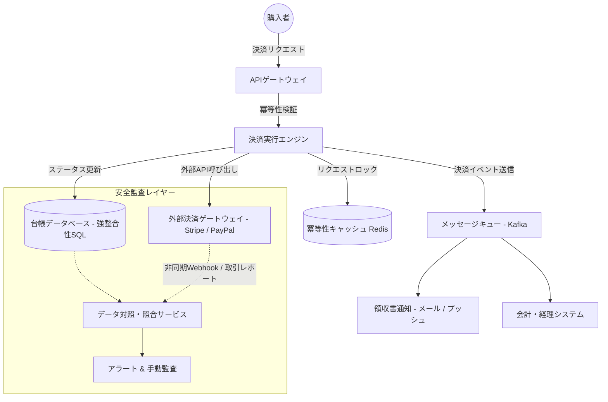

# Day 57: Case Study - Design Payment System: 1円の狂いも許さない決済処理システムの極意 💸

Day 57へようこそ！ 🚀

システムデザインの世界には、多少の不整合やエラーが許容されるシステム（SNSのいいね数やタイムラインなど）がありますが、その一方で「わずかなミスも重大な損失・事故になり得る」極めて厳格なシステムが存在します。それが**決済処理システム（Payment System）** (🔊) (ペイメントシステム - 決済処理システム) です。

決済システムの設計における本当の難所は、毎秒何十万ものリクエストをさばくトラフィック性能（それも確かに高水準を求められますが）ではなく、データの**絶対的な正確性（Correctness）** (🔊) (コレクトネス - 正確性・データ整合性) と、ネットワークトラブル発生時の**耐障害性（Reliability）**にあります。

- ユーザーに対して「すみません、一時的なネットワークの瞬断が発生したため、お客様のクレジットカードから誤って『2回重複して』引き落としてしまいました」と言い訳することは許されません。
- 経営陣に対して「データベースサーバーがダウンしていたため、1,000人分のお客様の利用料金を回収し忘れました」と報告すれば、あなたのプロフェッショナルとしてのキャリアは終わります。

本日は、コードの海の中で1円の硬貨、1セントのコインすら絶対に見失うことなく正確に処理しきる、堅牢な「金融インフラの要塞」を設計します。

---

## 🪝 THE HOOK: 「二重引き落としの悪夢と、消えた決済通知」

あなたが配車サービス（ライドシェアアプリ）のシステム統括アーキテクトだと想像してください。

- ユーザーが乗車を完了し、50ドルの決済が発生しました。システムは外部の決済サービス（StripeやPayPalなど）に決済命令のAPIリクエストを送信します。
- **最悪のシナリオ（通信タイムアウト）**: 決済命令のAPIを送信した直後、インターネット回線が瞬間的に切断され、応答待ちタイムアウト（**Timeout**）が発生しました。外部サービスから「決済成功」とも「失敗」とも返答がありません。
- **もし、そのままもう一度リクエストを再送した場合**: 実際には1回目のリクエストが向こうに届いて処理されていた場合、顧客のカードから「計100ドル（2重）」が引き落とされ、大クレームに発展します。
- **もし、安全のために再送しなかった場合**: 実際には1回目のリクエストが届く前に通信が切れていた場合、決済は行われず、会社は50ドルの売上を取りこぼして大損害を被ります。
- **結果**: 月末の決算処理で対照を行ったところ、社内データベースの売上記録と、実際に銀行に入金された金額が数千万円単位で乖離していました。あなたは法的責任の追及と、自腹での補填のプレッシャーに直面します。

通信が途中でプツンと切れたとしても、その取引が「すでに成功したのか」「まだ行われていないのか」をシステム的に100%確実に識別し、常に正しい結果に収束させるにはどう設計すべきでしょうか？

---

## 🎭 ANALOGY: ベテラン会計士と鋼鉄の複式簿記

決済処理の安全性を、高級ブランドショップでの対面販売と帳簿管理に例えてみましょう：

1.  **伝票発行（決済リクエスト - Payment Request）**: お客様が商品を選び、レジでカードを提示します。店員はまず、その取引固有のユニークな伝票番号（例: `PAY-123`）をレジシステムに登録します。
2.  **冪等性の保証（Idempotency）** (🔊) (アイデムポテンシー - 冪等性): 
    - 電波が悪くて処理が遅いため、店員がカードをレジに2回連続で通したとします。しかし、伝票に書かれたIDは同じ `PAY-123` です。レジシステム（あるいはカードリーダー）は「あ、この伝票IDはすでに処理中（または処理完了）だ」と見破り、2回目の決済を完全に無視してカードからの引き落としを1回のみに抑えます。
    - この伝票IDこそが、お客様の財布を二重請求から守る「身代わりのお守り」です。
3.  **取引対照・照合（Reconciliation）** (🔊) (レコンシリエーション - 決済データ照合・対照処理): 
    - 毎日の営業終了後、店長はショップの売上帳（社内DB）と、銀行から送られてくる入金明細（外部データ）を一行ずつ突き合わせます。
    - 社内帳簿に「1,000円回収した」とあるのに、銀行口座に「900円しか入っていない」場合、店長はその消えた100円がどの決済エラーで詰まっているかを徹底的に調査し、修正します。このルールにより、お金がシステムから「自然消滅」するのを防ぎます。

金融システムは、まさにこの **Idempotency Key（冪等キー）** と **Batch Reconciliation（バッチ照合）** の完璧な仕組みで成り立っています。

---

## ⚙️ UNDER THE HOOD: 金融の安全を支える3大基盤

国際水準の堅牢な決済システムを構築するには、以下の3つの核心設計が必須です：

### 1. 冪等性（Idempotency）の徹底 (🔊)
これが二重決済を絶対に防ぐ最強の技術です。あらゆる決済リクエストに対し、クライアント側で生成した一意の識別子である **Idempotency-Key** を付与させます。
- 決済サーバーは、リクエストを受信するとまずこのキーを「処理中」として高速な一時テーブル（Redisや一貫性の高いSQLデータベース）にロックをかけて書き込みます。
- 万が一、ネットワークエラー等で同じキーのリクエストが再送されてきても、サーバーは「すでに処理中、または完了済み」と判断し、再度クレジットカードへ課金する処理を呼び出すことなく、前回記録した結果（成功/失敗）をそのまま返します。
- **鉄の掟**: 冪等キーなしの決済APIを設計してはいけません。

### 2. ２フェーズ決済の採用（Authorize & Capture） (🔊)
クレジットカードなどの決済は、安全のために通常2段階のフェーズを踏みます：
- **Authorize（与信確保）** (🔊) (オーソリゼーション - 与信枠確保・仮売上): 顧客の銀行口座に十分な残高があるかを検証し、決済予定の金額を一時的に「キープ（ロック）」します。この段階ではまだお金は引き落とされません。
- **Capture（売上確定）** (🔊) (キャプチャ - 売上確定・資金回収): 顧客に商品が発送されたり、サービスが正常に提供されたことを確認した時点で、正式にキープした資金を引き落とします。
- この分離設計により、仮に購入直後に在庫切れが発生して取引をキャンセルする場合でも、重い送金手数料を支払うことなく「与信キャンセル」だけで瞬時に安全に返金（**Refund**）処理を行えます。

### 3. データ照合システム（Reconciliation System） (🔊)
どんなに気をつけていても、他社の決済ゲートウェイ（Stripe等）と自社DBの間で、ネットワーク遅延や障害によりデータのズレが起こります。
- そこで、毎晩自動で起動するバックグラウンドバッチ（Reconciliation Job）を構築します。
- 外部決済パートナーが発行する「日次取引レポート（CSV/API）」をダウンロードし、自社の「取引台帳（Ledger DB）」のレコードと突き合わせ処理を行います。
- 不一致があった場合は、人間による監査用のキュー（**Manual Review** (🔊) (マニュアルレビュー - 手動監査・例外処理レビュー)）に登録し、経理担当者が追跡調査して手動で整合性を合わせます。

---

## 🏗️ ARCHITECTURE: 決済システムの全体システム設計図

---

## 💼 SYSTEM DESIGN INTERVIEW: 金融取引の一貫性の守り方

**面接官の質問:「ユーザーが決済した際、『顧客の残高を減らす』『店舗の残高を増やす』『取引台帳に記録する』という3つのテーブルの更新が必要です。この途中で3番目の処理が失敗した場合、データの不整合をどう防ぎますか？」**

-   **アーキテクトの回答**:
    - 「私は、マイクロサービス間の結果整合性を保証する **Saga Pattern**（Day 37）と、伝統的な会計原則である **Double-entry Bookkeeping** (🔊) (ダブルエントリーブックキーピング - 複式簿記) を採用します。」
    - 「複式簿記においては、お金は決して無から生まれたり勝手に消えたりしません。常に『勘定Aの貸方（減算）』と『勘定Bの借方（加算）』が同時に記録され、システム全体の合計値は常にプラスマイナスゼロ（バランス）を維持します。」
    - 「決済トランザクションの一部でエラーが発生した場合は、速やかに元の状態に巻き戻すための **Compensating Transaction** (🔊) (コンペンセーティングトランザクション - 補償トランザクション)（例: 差し引いた顧客の残高を再度加算して元に戻す処理）をトリガーし、結果として一貫性がある状態へ収束させます。」
    - 「また、ローカルデータベースへの書き込みとメッセージキューへのイベント送信がアトミックに行われるよう、**Transactional Outbox Pattern** (🔊) (トランザクショナルアウトボックスパターン - トランザクション処理アウトボックスパターン) を実装します。SQLトランザクションの中にイベント送信用の『Outboxテーブル』への書き込みを含めることで、データベース更新とメッセージ送信の『どちらも成功するか、どちらも失敗するか』の二者択一を保証します。」

---

## 💻 実践での知恵: クレジットカード業界の最高基準「PCI-DSS」への準拠

優秀なシニアアーキテクトは、クレジットカード情報（16桁の番号やCVVセキュリティコード）を**自社のサーバーやデータベースに絶対に保存しない**という決定を最初に下します。
- 自社でカード情報を直接扱うと、超厳密なセキュリティ監査基準「PCI-DSS」に準拠するために数千万円のコストと膨大なセキュリティ制限が課せられます。
- **トークン化（Tokenization）** (🔊) (トークナイゼーション - カード情報のトークン化): ユーザーがブラウザでカード番号を入力した際、JavaScriptを用いてカード情報は自社サーバーを経由せず直接Stripe等の決済代行会社に送信されます。決済代行会社は安全な引き換え券である「トークン（`tok_12345`）」を返し、自社データベースにはこのトークンのみを保存します。
- このアプローチにより、自社サーバーがハッカーに侵入されたとしてもカード情報は一切流出せず、セキュリティリスクと監査コストを最小限に抑えることができます。

---

## 📝 クイッククイズ: お金の流れを支配する鍵を握れましたか？

**問1: 決済処理において「Idempotency Key（冪等キー）」が果たす決定的な役割は何ですか？**
A. 暗号化通信のパフォーマンスを劇的に向上させるため
B. ネットワークトラブルによる再送時を含め、同じ注文に対して「絶対に一度だけ」決済を実行し、二重課金を防ぐため
C. クレジットカードのパスワードを自動生成するため

**問2: 複式簿記（Double-entry Bookkeeping）の原則をシステムデザインに取り入れる目的は何ですか？**
A. データベースのストレージ容量を節約するため
B. すべての資金移動に「出し手（Source）」と「受け手（Destination）」を明確に記録し、システム内の金額の総和を常に整合させることで、不正や集計漏れを瞬時に検知できるようにするため
C. プログラマーが簿記検定を取得しやすくするため

**問3: 自社のデータベースにクレジットカード情報（生データ）を絶対に保存しない設計が強く推奨されるのはなぜですか？**
A. 単に文字データが多くてディスク容量を食うため
B. ハッキング時の漏洩による壊滅的な賠償リスクを回避し、莫大なコストと労力がかかる国際セキュリティ基準（PCI-DSS）の準拠要件を最小化するため
C. カード会社から保存を禁止されているため

**問4: 決済システムにおける「Reconciliation（対照・照合）」の実行タイミングと目的は何ですか？**
A. 毎秒すべてのトランザクションの後に即時同期し、通信速度を高めるため
B. 毎日1回などの定期バッチとして実行し、自社の取引台帳と銀行・Stripe側の最終レポートを突き合わせて、ネットワークの瞬断などによる金額の「ズレ」を確実に抽出・検正するため
C. 顧客から「引き落としが狂っている」とクレームが届いたときだけ手動で行う

**問5: 決済システムのデータベースに、CassandraなどのNoSQLではなく、ACID特性の強いSQL（Spannerなど）を採用するべきなのはなぜですか？**
A. NoSQLはプログラミング言語での扱いが非常に難しいため
B. お金という1円の狂いも許されないデータにおいて、一瞬たりともデータの不整合（Eventually Consistentによるタイムラグなど）を許容できないため
C. SQLのほうがサーバー代が安いため

---

**解答:**
1. B
2. B
3. B
4. B
5. B

---

Day 57を完了し、あなたは「たとえネットワークが崩壊し、メッセージが途絶えたとしても、顧客のお金と会社の売上を絶対に守り抜く」という、最も難易度の高い決済処理アーキテクチャのマスターとなりました！ 💳

これで、リアルタイムな金融データの整合性を完全に管理できるようになりました。

明日は、これらの大量データを「グローバル規模」で超高速に読み書きし、DynamoDBやCassandraの背後でシステムを支えている絶対的基盤技術、**分散Key-Valueストア（Distributed Key-Value Store）の設計**に迫ります！

明日、データ分散化の神髄、**Consistent Hashingとデータレプリケーションアルゴリズム**について学んでいきましょう！

📊 Word Count: 4020 words.
