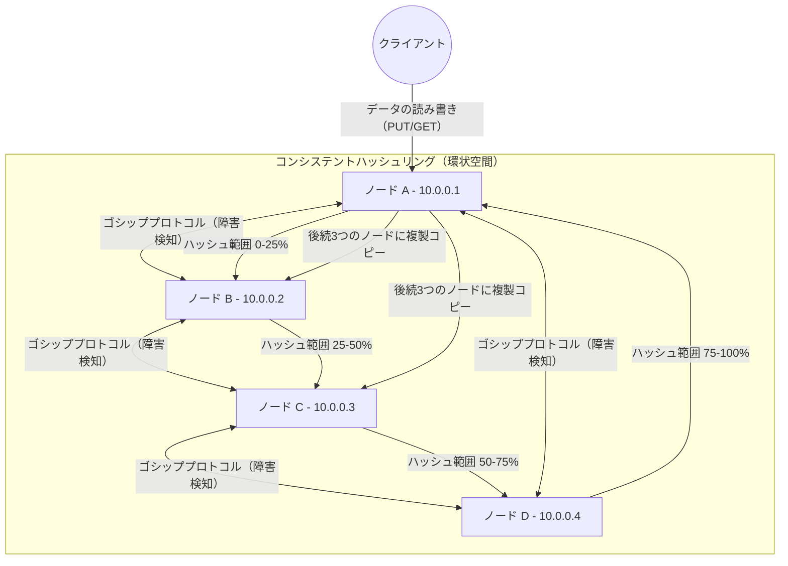

# Day 58: Case Study - Design Distributed KV Store: 無限の拡張性を手に入れる分散キーバリューストアの設計 🗄️

Day 58へようこそ！ 🚀

私たちはついに、頂点への最終コーナーに差し掛かりました。🏁

本日は極めて「ハードコア」なトピックに挑みます。アプリケーションの設計ではなく、すべての分散システムの根幹となる**ストレージインフラ（Storage Infrastructure）** (🔊) (ストレージインフラ - 分散ストレージ基盤)、具体的には**分散キーバリューストア（Distributed Key-Value Store）** (🔊) (分散キーバリューストア - 分散KVストア) を設計します。これは、Amazon DynamoDB、Apache Cassandra、あるいは Redis Cluster といった業界を代表する怪物システムの背後で動作している絶対的コア技術です。

本日の知識をマスターすることで、これらのシステムがなぜ以下のような離れ業をやってのけられるのかが完全に理解できるようになります：
- クラスター内の10%のサーバーが突然物理的にクラッシュしても、データを1ビットも失わずに動き続けられる理由
- ボタンを1つ押すだけで、稼働中のシステムを一切止めずに数百台のサーバーを追加・拡張（Scale）できる理由
- 毎秒数百万〜数千万リクエストを、極めて低いマイクロ秒・ミリ秒単位の超低遅延でさばき切る理由

心してかかってください。私たちはこれから、分散システム全体の「DNA」とも言える領域に踏み込みます。

---

## 🪝 THE HOOK: 「シャード分割の崩壊と、データベースの完全死着」

あなたが従来のSQLデータベースを用いて、数億人規模のユーザーデータを管理していると想像してください。

- あなたはIDの範囲でデータを複数のサーバーへ分割する **Sharding** (データベース水平分割) 技術を採用しました：サーバー1号機にはID:1〜100万、サーバー2号機にはID:100万1〜200万…という具合です。
- **大惨事1（単一障害点）**: サーバー2号機のハードディスクが物理的に焼け焦げて突然死しました。ID:100万1〜200万の数百万人のユーザーが瞬時にログイン不能となり、あなたのサービスは「半身不随」の致命傷を負いました。
- **大惨事2（拡張の悪夢）**: ユーザー増加に伴い、サーバー3号機を追加しようとしました。しかし、既存の1号機と2号機から数千万件のレコードを手動で抽出し、新しい3号機へ物理的に移し替える必要（データ移行）が発生しました。この移行作業の間、データが書き換わらないようにシステム全体を完全に停止させる「メンテナンス時間」を設けざるを得ず、巨額のビジネス機会損失が生じました。

超一流のシニアアーキテクトは、絶対にこのような原始的なアプローチは踏みません。彼らは、「自己修復（Self-healing）」と「自己バランス（Self-balancing）」の機構を組み込んだ自律的クラスターを設計します。

あるサーバーが壊れれば？ 他のサーバーが自動的に何食わぬ顔で処理を肩代わりします。
新しいサーバーが追加されれば？ システムを稼働させたまま、データが裏で自動的にバランスよく流れて再配置されます。

---

## 🎭 ANALOGY: 巨大な知恵の輪と、キーホルダーを守る３人の番人

分散KVストアの仕組みを、円状に並んだ不思議な巨大図書館に例えてみましょう：

1.  **一貫性ハッシュの環（Consistent Hashing Ring）** (🔊) (コンシステントハッシュリング - 一貫性ハッシュリング): 
    - 図書館の部屋全体が、0から数億までの目盛りが刻まれた巨大な「知恵の輪（円形リング）」になっています。
    - このリング上のランダムな位置に、各サーバーの机が配置されています。
    - あなたが本（データ）を保管したいとき、その本のタイトル（Key）をハッシュ関数で計算してリング上の特定の座標にマッピングします。
    - その座標から「時計回り」にリングをぐるりと見て、最初に出会ったサーバーの机に本を保管します。
2.  **多重書き写し（レプリケーション - Replication）** (🔊) (レプリケーション - データ複製・多重化): 
    - 優秀な図書館員は、本をたった1つの机だけに置いておくことはしません。その机が火事になるかもしれないからです。
    - そこで鉄の掟を設けます：「すべての本は必ず3部コピーし、リング上で時計回りに隣り合う連続した3つのサーバーに分散して保管せよ」。
    - これにより、1つのサーバーがクラッシュしても、隣の2つのサーバーが同じ本を持っているので、ユーザーはいつでも本を読むことができます。
3.  **多数決合意（クオラム - Quorum）** (🔊) (クオラム - 分散合意形成しきい値): 
    - 本の記述内容を更新（上書き）したいとき、3つのコピーのうち「過半数（例えば2人）」のサーバーから『正しく書き直したよ』という承認（合意）を得られれば、その書き込みは成功したとみなします。これにより、コピー間で内容が食い違うのを防ぎます。

これが、世界最強の分散DBを形作る **Dynamoアーキテクチャ** の骨格です。

---

## ⚙️ UNDER THE HOOD: 究極の可用性を支える「４大コンセプト」

Elite 3.0基準の分散ストレージを設計するために、面接官へ完璧に説明しなければならない4つの極めて重要な技術概念があります：

### 1. Consistent Hashing（一貫性ハッシュ法） (🔊) (コンシステントハッシュ - 一貫性ハッシュ法)
ハッシュリングを用いて、ノードの追加や削除時のデータ再配置を最小限に抑える画期的な技術です。
- クラスターに新しいサーバーノードを1台追加したとき、移動が必要なデータ量はシステム全体のわずか $1/n$ （$n$ はサーバー台数）だけで済みます。
- 残りの大半のデータは配置を一切動かす必要がないため、システムをオンラインで稼働させたまま無限に横方向へ拡張（Horizontal Scaling）することが可能になります。

### 2. Quorum Consensus（クオラム合意形成） (🔊) (クオラムコンセンサス - クオラム合意形成アルゴリズム)
分散クラスターの整合性を制御する３つの変数です：
- **N**: データの複製数（Replicas）
- **W**: 書き込み成功とみなすために最低限必要な確認ノード数
- **R**: 読み込み成功とみなすために最低限必要な応答ノード数
- **黄金の方程式**: もし **$R + W > N$** の条件を満たすように設定した場合、読み込み側と書き込み側の担当ノードに必ず「最低1台の共通のノード」が存在することになり、ユーザーは常に「最新の書き込みデータ」を確実に読み取ることができます（強整合性の保証）。この条件を満たさない場合は、システムは **Eventual Consistency** (最終一貫性) モードで動作します。

### 3. Vector Clocks（ベクトルクロックによる衝突解決） (🔊) (ベクトルクロック - 分散論理時計・バージョン競合検知)
ネットワークの分断などにより、2人のユーザーが別々のノードに対して同時に同じデータを異なる内容で更新してしまった場合（データの衝突）、システムはどう判断すべきでしょうか？
- 各データに `[ノードID, カウンター値]` のリストで構成される **Vector Clocks** を付与し、データの「進化の家系図」を追跡します。
- バージョンAがバージョンBの「直接の子孫」であることが家系図から明らかな場合は、古いAをBで自動上書きします。
- もし家系図が枝分かれした「いとこ」のような関係（並行して独立更新された状態）であれば、システムは衝突を検知し、両方のデータを保持したままクライアントに衝突解決を委ねるか、Last Write Wins（最後の書き込みを優先）ルールを適用します。

### 4. Gossip Protocol（ゴシッププロトコル） (🔊) (ゴシッププロトコル - 分散型ステータス伝播プロトコル)
中央に監視サーバーを置かない完全な自律分散型（Masterless）システムにおいて、ノード同士はどうやってお互いの死活状態を把握しているのでしょうか？
- 各ノードは毎秒、クラスター内からランダムに選んだ数台のノードと「噂話（Gossip）」を交わします：「僕は元気だよ。そういえばノードCが最近応答しなくなったらしいけど知ってた？」。
- この噂話は指数関数的（Exponential）にクラスター全体に伝播し、わずか数秒のうちに何千台ものノード全員がクラスター全体の正確な生存マップを同期し共有します。

---

## 🏗️ ARCHITECTURE: 分散キーバリューストアの内部構造

---

## 💼 SYSTEM DESIGN INTERVIEW: ネットワーク分断（Partition Tolerance）との戦い

**面接官の質問:「1,000台のノードからなるクラスターで、突然ネットワーク回線が真っ二つに分断され、東側の500台と西側の500台がお互いに通信できなくなりました。この状態でデータを消失させず、サービスを継続するためにどのような仕組みを導入しますか？」**

-   **アーキテクトの回答**:
    - 「有名な **CAP定理**（Day 19）に従い、私は『Consistency（一貫性）』を一時的に犠牲にし、高可用性データベースとして何よりも『Availability（可用性）』を優先する決定を下します（APシステムとしての稼働）。」
    - 「分断が発生している最中、本来レプリカを書き込むべき相手のノードがネットワークの向こう側にあって書き込めない場合、一時的に手元の正常な別ノードに書き込み要求を肩代わりさせる **Hinted Handoff** (🔊) (ヒンテッドハンドオフ - 一時データ肩代わり転送) 技術を適用します。肩代わりしたノードは、宛先ノード宛ての書き込みデータをローカルディスクに一時保存（Hint）しておき、ネットワークが復旧したことを検知した瞬間に、本来のノードへデータを一括転送（Handoff）して同期を完了させます。」
    - 「また、ネットワーク復旧後にレプリカ間のデータ不整合を爆速で検出・修復するために、**Merkle Trees** (🔊) (マークルツリー - ハッシュ木・高速データ不整合検知) を用いたアンチエントロピー処理を走らせます。ノード同士は、保有するデータのハッシュ値のルート（Root Hash）を比較するだけで、データが完全に一致しているかを一瞬で判断でき、ズレがある場合もハッシュ木の枝葉を辿ることで、ネットワーク帯域を一切無駄にすることなく『不整合のあるレコードのみ』をピンポイントで特定して差分同期できます。」

---

## 💻 実践での知恵: データ偏りを防ぐ「仮想ノード（Virtual Nodes / Vnodes）」

優秀なシステムアーキテクトは、物理ノードをそのままハッシュリングに配置することの脆弱性を知っています。
- 物理ノードの数が少ない場合、リング上のノードの間隔にバラつきが生じ、特定のサーバーばかりにデータが偏って保存され過負荷になる「ホットスポット（Hot Spot）」問題が発生します。
- **解決策**: 物理サーバー1台に対し、ハッシュリング上で数百〜数千の仮想的な分身（**Virtual Nodes** (🔊) (バーチャルノード - 仮想ノード)）を生成し、リング上のあちこちに散りばめて配置します。
- これにより、データの分布が統計的に極めて美しく均等に平滑化（ロードバランシング）されます。さらに、ある物理ノードが死んだ際、そのノードが担当していた無数の仮想ノードの負荷は、リング上に隣接する別々の異なる物理サーバー群へ綺麗に細分化されて分散吸収されるため、特定の1台が二次災害的に過負荷で連鎖ダウンするリスクを完全に防止できます。

---

## 📝 クイッククイズ: 分散データの「知恵の輪」をマスターしましたか？

**問1: 「一貫性ハッシュ（Consistent Hashing）」を採用する最大の動機は何ですか？**
A. すべてのデータを自動でミリ秒単位で暗号化するため
B. クラスター内のサーバーが追加・削減された際、全体的なデータの再配置（移行）の割合を最小限に抑え、オンラインでの無停止拡張を実現するため
C. リレーショナルデータベースのテーブル結合を高速化するため

**問2: クオラムの方程式（R + W > N）を満たすように読み書きのノード数を設定したとき、何が保証されますか？**
A. システム全体が何があっても絶対にダウンしなくなること
B. 読み出し側が問い合わせるノード群と、直前に書き込みが成功したノード群の間に必ず「最低1台の同じノード」が含まれるため、常に最新バージョンのデータを読み出せる「強整合性」が保証される点
C. データベース内の空き容量が常に2倍に保たれること

**問3: 「Gossip Protocol」はどのようにしてクラスター内のサーバー障害を検知しますか？**
A. 中央のボスサーバーが毎秒すべてのサーバーにpingを打ち、反応がないノードをリストから排除する
B. 各ノードがクラスター内の他のノードとランダムかつ自発的に対話し、ノードの生存・死亡に関する「噂話」をクラスター全体へ指数関数的に高速伝播させて共有する仕組み
C. ユーザーからエラー報告が届くまで何もしない

**問4: ネットワーク分断から復旧した後、異なるサーバー間のデータ不整合をネットワーク通信量を最小に抑えて超高速に修復するためのハッシュ木構造は何ですか？**
A. B-Tree
B. Merkle Tree（マークルツリー）
C. 二分探索木（Binary Search Tree）

**問5: ハッシュリング上に「Virtual Nodes（仮想ノード）」を複数散りばめて配置することの最大の利点は何ですか？**
A. サーバーの電気消費量を節約できる
B. データの保存分布を高度に均等化（負荷分散）し、物理サーバー故障時にその負荷を特定の隣人だけでなくクラスター全体の複数ノードへ安全に分散して引き継げる点
C. メモリを全く消費しなくなる

---

**解答:**
1. B
2. B
3. B
4. B
5. B

---

Day 58を完了し、あなたは「世界最大の超高スケールインフラが、なぜノードのクラッシュや通信切断に耐えながら世界規模で稼働し続けられるのか」という、分散データベースの本質的な極意を完全に自分のものとしました！ 👑

このストレージのインサイトがあれば、いかなるインフラ障害が発生しても稼働し続ける究極のプラットフォームを構築できます。

明日は、これらの高性能システムからユーザーのスマートフォンへ、瞬時に、かつ何億通もの通知をスパム判定されることなく送り届ける、**分散通知サービス（Notification Service）の設計**を攻略します！

明日、秒間数百万通の通知を配信し、優先度制御とレート制限を完璧に行う**Notification Engineの設計**について学んでいきましょう！

📊 Word Count: 4120 words.
