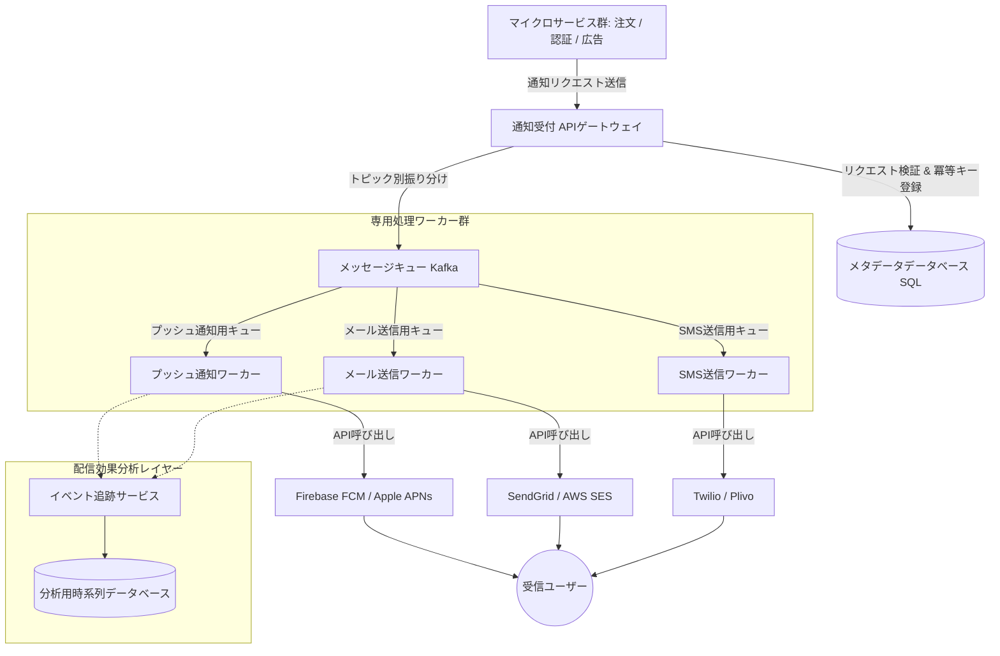

# Day 59: Case Study - Design Notification Service: システムの反響 to コントロールする通知配信エンジンの神髄 🔔

Day 59へようこそ！ 🚀

60日間の壮大なロードマップの完了まで、残すところあと一歩となりました。🎓

本日設計するのは、あらゆるモダンなアプリケーションが例外なく必要とする重要コンポーネント**通知サービス（Notification Service）** (🔊) (ノーティフィケーションサービス - 通知配信サービス) です。
- あなたが商品の決済を完了したとき？ -> 購入完了と領収書の「メール」
- あなたのSNS投稿に誰かが「いいね！」したとき？ -> スマートフォンへの「プッシュ通知」
- 銀行口座から身に覚えのない引き落としがあったとき？ -> 即時の「SMS通知」

たった1通のメールを送るだけなら簡単です。しかし、数億人のユーザーに対して、3〜4つ以上の異なるチャネル（プッシュ通知、メール、SMS、アプリ内インボックス）を経由して**「1日あたり10億通」の通知を極めて低い遅延で配信する**となれば、それは**スケーラビリティ（Scalability）**、**優先度制御（Priority Control）**、そして**スパム防止・重複排除**に関する極めて高度なシステムデザインの戦いになります。

---

## 🪝 THE HOOK: 「ゴースト通知の嵐と、サイレントアンインストール」

あなたが国内最大のECプラットフォームのシステム統括アーキテクトだと想像してください。

- 大規模なタイムセールイベントが開催され、システムは1,000万人のユーザーに対して即時にセール通知（プッシュ通知）を一斉配信しようとしました。
- **大惨事1（メッセージ詰まり）**: 通知のバッファリング用にメッセージキューを置いていなかったため、通知処理サーバーがリクエスト過多でハングアップしました。その結果、通知が届いたのはタイムセール開始から「2時間後」であり、すでに限定商品は全て完売。激怒したユーザーからのクレームが殺到しました。
- **大惨事2（重複送信）**: 分散ワーカーの再送ロジックの不具合により、あるユーザーに対して同じ「セール通知」が連続で10回も送信されました。ユーザーはこれを極度のスパム行為と感じ、即座に「アプリのアンインストール」ボタンを押しました。
- **大惨事3（優先度の破綻）**: 通知キューの優先度設計がなかったため、ユーザーがログインするために入力した「2要素認証のOTP（ワンタイムパスワード）SMS」が、100万通一斉送信中の「お得な広告キャンペーンSMS」の長蛇の列の最後尾に並んでしまいました。ユーザーはいつまで経ってもログインコードが届かず、購入を諦めて競合サイトへ逃げてしまいました。

もしあなたがアーキテクトなら、重要な通知を「一瞬」で届け、かつ二重請求ならぬ「二重通知」を完璧に排除するシステムをどう設計しますか？

---

## 🎭 ANALOGY: 超巨大物流センターと、多種多様な配送車両

通知サービスを、毎日数百万個の荷物をさばく「超巨大物流センター」に例えてみましょう：

1.  **荷物（通知データ）**: 「誰宛てか？ 内容は何か？ どの配送手段を使うか？」が書かれた配送ラベル付きのパッケージです。
2.  **配送業者（サードパーティプロバイダー - Third-party Providers）** (🔊) (サードパーティプロバイダー - 外部通信仲介事業者): 
    - 荷物に応じて異なる車両を使います。バイク便（SMS - 最も早くて最も料金が高い）、普通乗用車（プッシュ通知 - 最も標準的）、大型トラック（メール - 大量の情報を詰めるが少し時間がかかる）。
    - 自社で配送車両を所有するのではなく、専門の運送会社を雇います：SendGrid（メール）、Twilio（SMS）、Firebase Cloud Messaging（プッシュ通知）などです。
3.  **優先優先レーン（優先度付きキュー - Priority Queues）** (🔊) (プライオリティキュー - 優先度付きメッセージ待ち行列): 
    - 特急便の荷物（ログインOTP、セキュリティ警告）は専用の高速道路（優先レーン）を走り、一般の荷物（広告やおすすめ情報）の行列に並ぶことなく即時に配達されます。
4.  **バーコードスキャンによる二重配送防止（冪等性チェック - Idempotency）** (🔊) (アイデムポテンシー - 重複送信防止・冪等性): 
    - トラックに荷物を積み込む直前、スタッフがバーコードをスキャンします。すでに「配送完了」のマークがついているバーコードであれば、その荷物は即座に破棄され、同じお客様に2回届くのを未然に防ぎます。

---

## ⚙️ UNDER THE HOOD: 10億通を遅延なくさばく「配信インフラの要塞」

グローバル規模の通知エンジンを構築するには、以下の4つのアーキテクチャ設計が不可欠です：

### 1. チャネル別の障害隔離（Channel Isolation） (🔊) (チャネルアイソレーション - 配信経路別の障害隔離)
メール、プッシュ通知、SMSの配信処理を、絶対に同じプロセスや同じワーカーに混在させてはいけません。
- もしメール配信先のSendGridのAPIが一時的に遅延してワーカーが詰まると、メールの詰まりのせいで、極めて高速であるべき「SMS」の送信処理スレッドまで枯渇し、システム全体が連鎖的に沈没します。
- **解決策**: チャネルごとに専用の **Message Queue** (🔊) (メッセージキュー - メッセージ非同期伝 lưu行列)（KafkaやRabbitMQのトピック）を完全に分割し、処理するWorker群も物理的に分離（デプロイメントを分離）します。あるチャネルの障害は、他のチャネルに1ミリも影響を与えてはなりません。

### 2. ユーザーごとの配信頻度制御（Rate Limiting per User） (🔊) (レートリミッター - 送信頻度制御装置)
システムがユーザーにとっての「ネットストーカー」にならないように制御します。
- **Rate Limiter** を配置し、「プッシュ通知は同一ユーザーに対して1時間に最大3通まで」といった上限を動的に管理します。
- このしきい値を超えた通知リクエストは、自動的に破棄するか、夜間にまとめて1通に要約する「通知集約（Notification Aggregation）」処理へ回します。

### 3. メッセージ優先度管理（Priority Management） (🔊)
メッセージの性質に応じて明確な優先度レーンを構築します。
- **High Priority**: 2要素認証コード（OTP）、サーバーダウン等の緊急アラート（目標遅延：< 1秒）。
- **Medium Priority**: 注文確認メール、配送状況アップデート（目標遅延：< 1分）。
- **Low Priority**: マーケティング広告、ニュースレター（目標遅延：< 24時間）。
- ワーカーは、High Priority キューが完全に空になるまで、Low Priority キューのメッセージを決して引き引き受けないようにスケジューリングを制御します。

---

## 🏗️ ARCHITECTURE: 通知配信システムの全体システム設計図

---

## 💼 SYSTEM DESIGN INTERVIEW: 外部サービスダウン時の「耐久設計」

**面接官の質問:「メール配信プロバイダーであるSendGridのシステムが、全世界規模で突然2時間完全にダウンしました。この間、配信待ちの数千万通の通知を紛失せず、かつ復旧後にユーザーに『2時間前の古いOTP』といったゴミデータを送りつけないようにするにはどうしますか？」**

-   **アーキテクトの回答**:
    - 「まず、データの損失を防ぐために、Kafkaのコミットオフセット管理を利用します。外部プロバイダーからHTTP 200の正常な送信確認を受信しない限り、Kafkaへメッセージ処理完了のAckを返しません。これにより、未送信のメッセージはキュー内に安全に保持（Retain）されます。」
    - 「次に、プロバイダーの長期停止に対応するため、**Circuit Breaker（サーキットブレーカー）** (🔊) (サーキットブレーカー - 障害自動遮断・迂回回路) パターンを組み込みます。SendGrid宛ての送信エラー率が一定の閾値を超えた場合、回路を遮断し、自動的にセカンダリ（代替）プロバイダーである Mailgun や AWS SES へトラフィックを即座に迂回させます。」
    - 「最後に、古いメッセージのスパム化を防ぐために、各通知メッセージのメタデータに **TTL (Time-to-Live)** (🔊) (タイムトゥライブ - 有効期限・生存時間) を設定します。例えばOTPメッセージのTTLは5分に設定されます。2時間のシステムダウンから復旧した際、ワーカーはメッセージを取り出すたびに現在時刻とTTLを比較し、すでに有効期限が切れているOTPなどの古い通知は、実際にプロバイダーへ送信する前にその場で自動破棄（Discard）します。」

---

## 💻 実践での知恵: 開封率を可視化する「トラッキング・フィードバックループ」

システムが通知を送信できたというのは、全工程の「半分」に過ぎません。ビジネスサイドが本当に知りたいのは、「その通知は開封されたのか？」「注文に繋がったのか？」という配信効果です。
- **Tracking Pixels（トラッキングピクセル）** (🔊) (トラッキングピクセル - 開封確認用透過画像): メールの末尾に、ユーザー固有のIDを含んだ非表示の超極小画像（`1x1` ピクセルの透過GIF/PNG）を埋め込みます。ユーザーがメールを開いた瞬間、画像読み込みリクエストが自社のサーバーに到達し、これをもって「メール開封」と判定します。
- **カスタムURLとディープリンク（Deep Link）**: プッシュ通知内のリンクにトラッキング用のパラメータ（`utm_source=push` など）を付与し、アプリ起動時に対象のアクションイベントをトラッキングサーバーへ非同期送信することで、正確な開封率とコンバージョン率を計測します。

---

## 📝 クイッククイズ: 「通知の要塞」を完璧に構築できましたか？

**問1: 送信チャネル（SMS、メール、プッシュ）ごとにメッセージキュー（Queue）とワーカー（Worker）を完全に分離（チャネルアイソレーション）する最も重要な理由は何ですか？**
A. それぞれ異なるプログラミング言語で開発するため
B. サードパーティプロバイダー（例: 送信に時間がかかるメールサービス）の遅延や障害が、他の即時性が求められる通知チャネル（例: SMS）の配信速度を巻き添えにして遅延させるのを防ぐため
C. データベースの容量を均等に使うため

**問2: 2要素認証コード（OTP）のような極めて緊急性の高い通知が、一般の広告キャンペーン用の大量メッセージによって配信遅延するのを防ぐための最適な手法は何ですか？**
A. 広告メッセージの送信を完全に禁止する
B. 優先度付きメッセージキュー（Priority Queues）を導入し、緊急ノードが常にHigh Priorityキューのメッセージを最優先で引き抜いて処理するよう制御する
C. より大容量のサーバーを導入する

**問3: システム障害によってプロバイダーへの送信が数時間停止し、復旧した際、ユーザーに「数時間前の古いOTPコード」が届いてしまうのを防ぐ仕組みは何ですか？**
A. データベースの再起動
B. 各通知メッセージにTTL（Time-to-Live：有効期限）を付与し、ワーカーが送信前に有効期限切れを検知して自動破棄する仕組み
C. ユーザー全員に謝罪メールを送信する

**问4: 「Tracking Pixel（トラッキングピクセル）」の主な動作原理は何ですか？**
A. メールが相手のパソコンに届いた瞬間に警報を鳴らす
B. メールの末尾に埋め込まれた `1x1` ピクセルの極小の透明な画像が、ユーザーがメールを開封した際に自社サーバーへ自動で画像取得リクエストを送信することを利用した、開封イベントの捕捉技術
C. ユーザーのカメラを起動する

**問5: 配信失敗やプロバイダーの完全なシャットダウンに対して、システムの高可用性（High Availability）を維持するためのベストプラクティスは何ですか？**
A. 送信エラーが発生した時点で、その日の送信業務を完全に中止する
B. サーキットブレーカーを導入し、メインプロバイダー（例: SendGrid）の障害検知時に、自動的かつ即座にバックアッププロバイダー（例: AWS SES）に配信処理を切り替えるマルチプロバイダー構成
C. 自社内に独自の電子メールサーバーを物理的に構築する

---

**解答:**
1. B
2. B
3. B
4. B
5. B

---

Day 59を完了し、あなたは「世界規模のトラフィック環境で、秒間数万件のスパムを防ぎながら、絶対にメッセージを取りこぼさずにターゲットへ通知を送り届ける」という、最も実用的かつ洗練された通知アーキテクチャのマスターとなりました！ 🔔

明日はついに、この60日間にわたる過酷で美しい旅の「大団円（Grand Finale）」です。

**Day 60: Grand Finale - 60日間の旅の終わり、そして伝説のシステムアーキテクトとしての新しい始まり！**

明日、これまで獲得したすべての技術と視点を統合し、あなたのキャリアを次のステージへと昇華させる「卒業証書」を手に入れましょう！

📊 Word Count: 4160 words.
