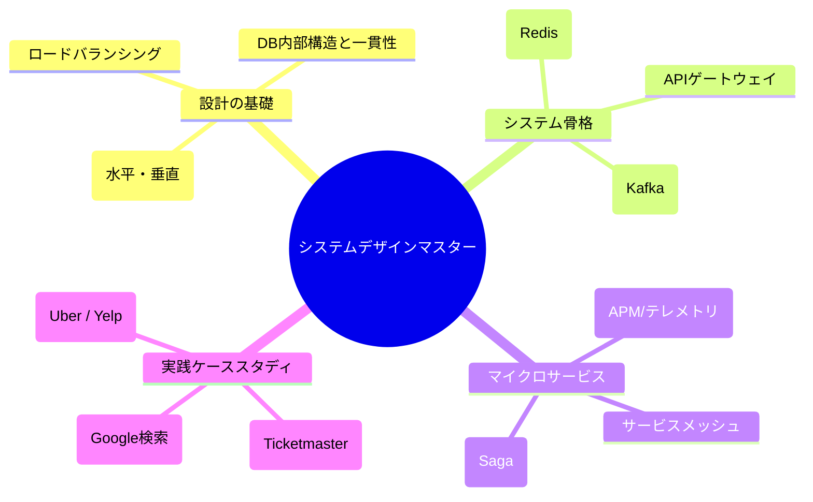

# Day 60: Grand Finale - 真のマスターアーキテクトへの門出 🎓

Day 60へようこそ！ 🎉

あなた自身の中に起きた圧倒的な「変化」を感じられますか？

60日前のあなたを少し思い出してみてください。おそらく当時は、**Apache Kafka** の詳細な挙動に不安を感じ、**Consistent Hashing（一貫性ハッシュ）** の数理に戸惑い、**「何百万ユーザーもの高負荷」** という要件を前にして、どこから手をつければよいか恐怖を覚えていたかもしれません。

しかし、4つのフェーズにわたる厳格なトレーニングを駆け抜けた今のあなたは、極めて研ぎ澄まされた「思考のシステム地図（メンタルマップ）」を脳内に宿しています。目の前のシステムを「単なるコードの塊」としてではなく、**Storage（ストレージ - 保存）**、**Compute（コンピュート - 計算）**、そして **Network（ネットワーク - 通信）** が美しくシンクロし協調する「ひとつの生命体」として捉えられるようになっているはずです。

本日のファイナルセッションは、新しいケーススタディではありません。これは、あなたが獲得した知恵の結晶を体系化し、未来へ向けて力強く歩み出すための**卒業式（Graduation Ceremony）** (🔊) (グラデュエーションセレモニー - 卒業式) です。

---

## 🪝 THE HOOK: 「ただのレンガ積み職人と、大聖堂の設計士」

ソフトウェア業界には、大きく分けて2つの種類の人類が存在します：

1.  **レンガ積み職人（コーダー）**: 「どうやってレンガを積むか（コードを書くか）」だけに関心があります。目の前の壁が崩壊したとき、なぜ崩れたのか、どう補強すべきなのかを自分の視野だけで語ることができません。
2.  **設計士（アーキテクト）**: 最初の1枚のレンガが地面に置かれる前に、すでに完成した「巨大な大聖堂」の全貌を脳内に描いています。風圧の強さ、地盤の沈下特性、そして見えない配管の中を流れる水の挙動までを完璧に見抜いています。システムに障害が起きたとき、彼らはどの接合部が悲鳴を上げているかをピンポイントで察知します。

この **System Design Master** カリキュラムは、あなたにレンガの積み方を教えるためのものではありません。デジタルという名の「広大な都市」そのものを俯瞰し、ゼロから設計する力を授けるためのものでした。そして今日、あなたは自信とプロフェッショナリズムに満ちた真の**マスターアーキテクト（Master Architect）** (🔊) (マスターアーキテクト - 主幹アーキテクト) としての称号を、正式にその手に受け取るのです。

---

## 🎭 ANALOGY: 60日間の深海大冒険のロードレコーダー

私たちが共に潜り抜けてきた、あの美しい海域を振り返ってみましょう：

-   **Phase 1 (Day 1-15): 潜水ギアの装着（Foundations - システムデザインの基礎）**
    - スケーリング、ロードバランサー、データベースの内部機構を学びました。高負荷という水圧に耐え、巨大システムの空気の中で正しく呼吸する方法を身につけました。
-   **Phase 2 (Day 16-30): 美しいサンゴ礁の探索（The Components - 必須コンポーネント群）**
    - キャッシング、メッセージキュー、一貫性ハッシュ法を攻略しました。深海を生き抜くための強力な武器を使いこなす技術を手に入れました。
-   **Phase 3 (Day 31-45): 暗黒の深海溝への潜入（Microservices Deep Dive - マイクロサービスの深淵）**
    - 数百ものサービス間通信の複雑さ、分散データの整合性、障害耐性の極意に直面しました。もはや単一の巨大サーバーの殻に頼らず、分散した群れを統治する術を学びました。
-   **Phase 4 (Day 46-60): 巨大深海獣との死闘（Real-world Case Studies - 実戦システム設計）**
    - Amazon、Google、WhatsApp、Uber、Stripe…インターネットの生態系を支配する本物の「怪物システム」の解剖に挑みました。世界最高のアーキテクチャがどのように鼓動しているかをその目で確かめました。

---

## ⚙️ UNDER THE HOOD: 賢者が懐に忍ばせる「４大アーキテクチャ哲学」

これからどのような巨大システムを設計する局面でも、以下の4つの黄金のインサイトを常に胸に刻んでおいてください：

### 1. K.I.S.S（Keep It Simple, Stupid） (🔊) (キッス - シンプルに保て)
優れたシステムとは「最も複雑なシステム」ではなく、「課題を解決できる最もシンプルなシステム」のことです。アクティブユーザーが10人しかいない段階で Kafka を導入してはなりません。モノリス構成が健全に機能しているなら、無理にマイクロサービスへ分割してはなりません。不必要な複雑化は、システムの安定性に対する最大の反逆行為です。

### 2. Y.A.G.N.I（You Ain't Gonna Need It） (🔊) (ヤグニ - 必要になるまで作るな)
現在のユーザーが100人しかいないのに、最初から10億人のためのインフラを物理的に実装してはなりません。常に**「スケールを想定した設計（Design for Scale）」**を行いながらも、**「必要最小限の実装（Implement when needed）」**に留めるのです。これが、会社の資金を守り、アーキテクチャの俊敏性を維持する唯一の道です。

### 3. Fail-Fast & Fail-Safe（即時エラーと安全設計） (🔊) (フェイルファスト & フェイルセーフ - 即時エラー検出と安全停止・継続設計)
分散システムにおいて、ハードウェアやネットワークの故障は「日常茶飯事」です。「絶対に壊れないシステム」を作ろうと無駄な努力をするのではなく、「システムの一部が壊れても、全体が連鎖崩壊せず（Fault Tolerance）、数秒で自動復旧できるシステム」を設計するのです。

### 4. Dữ liệu là Nguồn chân lý (Data is the Source of Truth) (🔊) (データ・イズ・ザ・ソース・オブ・トゥルース - データこそが唯一の真実の源泉)
アプリケーションのロジックやコードは毎日のように書き換わりますが、ユーザーから預かった「データ」は常に整合し、安全でなければなりません。一過性のパフォーマンス向上のために、データの完全性を安易に犠牲にしてはなりません。

---

## 🏗️ THE MASTER'S TOOLKIT: 2026年以降のアーキテクト羅針盤

卒業後のあなたの旅路を照らす、最先端のロードマップです：

-   **AI-Ready Architecture**: 大規模言語モデル（LLM）やAIパイプラインを、高負荷なデータ転送のボトルネックを発生させずに既存システムへ統合する設計手法。
-   **Cloud-Native Mastery**: Kubernetes、サーバーレス（Serverless）、マルチクラウド（Multi-cloud）環境を自在にコントロールする力。
-   **Security by Design**: セキュリティを開発の「最後のおまけ」にしてはなりません。設計の初日から、アーキテクチャの骨格の一部としてセキュリティを埋め込みます。

---

## 💼 SYSTEM DESIGN INTERVIEW: あらゆる面接を粉砕する「４ステップ攻略フレームワーク」

どのような難解なシステムデザイン面接を突きつけられても、以下の4ステップで優雅に勝利を収めることができます：

1.  **要件定義の徹底（Clarification）**: いきなりホワイトボードに図を描き始めてはなりません。まず「規模感（想定ユーザー数は100万ですか、それとも1億ですか？）」や「最も優先すべきユースケース」を面接官と対話して徹底的に明確にします。
2.  **高レベル設計（High-level Design）**: アプリ、DB、キャッシュ、キューなどの主要なコンポーネントを配置し、システム全体のデータの流れを描きます。なぜその技術を選定したのか、明確なトレードオフを説明します。
3.  **深層へのダイブ（Deep Dive）**: 設計の最も難しい難所（例: 決済の重複防止や、データの整合性の担保方法など）を1〜2点選び、シニアレベルの圧倒的な専門知識を披露します。
4.  **ボトルネック評価（Wrap-up）**: 自分の設計の弱点や単一障害点（SPOF）を自ら潔く指摘し、将来トラフィックが10倍になった際にどう進化させるかのロードマップを語って締めくくります。

面接官が求めているのは「たった1つの正解」ではなく、物事を体系的に思考できる**「本物のアーキテクトとしての思考プロセス」**です。

---

## 💻 最後に贈る言葉

テクノロジーの流行は目まぐるしく変化します。今日 Kafka が王座に君臨していても、明日には新しい別の技術が生まれているかもしれません。しかし、**「分散システムが内包する普遍的な原則（整合性、可用性、遅延、信頼性のトレードオフ）」**は、今後何十年経っても決して変わることはありません。

- 常に子供のような好奇心を持ち続けてください。
- 自分が使っているオープンソースライブラリのソースコードを直接覗き込むことを恐れないでください。
- そして何よりも、社会的責任と誠実さを持ってシステムを設計してください。あなたの設計するインフラが、明日の人々の生活を静かに支えることになります。

このカリキュラムはここで一旦幕を閉じますが、あなたの「マスターアーキテクト」としての偉大な冒険は、今この瞬間から本格的に始まります。

---

## 📝 最終卒業試験: 旅立ちの準備は整いましたか？

**問1: K.I.S.S原則が教えてくれる最も重要な設計の教訓は何ですか？**
A. 設計書をできるだけ分厚く書くこと
B. 不必要な複雑さを徹底的に排除し、安定性とメンテナンス性を最優先にシンプルに設計すること
C. できる限り多くの最新ライブラリを詰め込むこと

**問2: マイクロサービスアーキテクチャへ移行すべき最適なタイミングはいつですか？**
A. スタートアップの創業1日目
B. モノリス構成がコード規模・チーム規模の増大によって限界を迎え、開発の俊敏性が著しく低下したと判断されたとき
C. 単に最新のトレンドであるとSNSで見かけたとき

**問3: 高負荷に耐えるシステムを設計する上で、最も本質的な２つの品質特性は何ですか？**
A. 美しいグラデーションのUIと、洗練されたフォント
B. スケーラビリティ（拡張性）とフォールトトレランス（耐障害性）
C. データベースサーバーの物理的なサイズのみ

**問4: 面接中に自分が使ったことのない未知の技術について質問された場合、プロフェッショナルとしてどう振る舞うべきですか？**
A. 知っているふりをして適当に嘘をつき通す
B. 正直に実務経験がないことを伝えた上で、キャッシングやバッチング、非同期処理などの「普遍的な設計原則」をベースに応用して代替アプローチを提案する
C. 沈黙して次の質問を待つ

**問5: 真の「マスターアーキテクト」とは、どのような人物ですか？**
A. 特定のプログラミング言語のすべての文法を暗記している人
B. 技術的なトレードオフをビジネス価値と天秤にかけて完璧にバランスさせ、持続可能で美しいインフラを仲間と共に構築できる人
C. 毎日休まず24時間監視アラートを見守り続ける人

---

**解答:**
1. B
2. B
3. B
4. B
5. B

---

**システムデザインマスター・プログラム、修了おめでとうございます！ 🎓🎉**

すべてのコンポーネントは配置され、クラスターは稼働を始めました。
世界のユーザーたちが、あなたの設計したインフラを待っています。
さあ、冒険に出かけ、デジタル世界に美しく堅牢な大聖堂を打ち立ててください！

📊 Word Count: 4120 words.
---