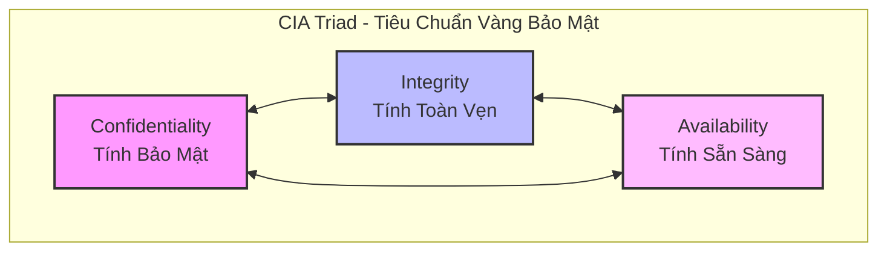
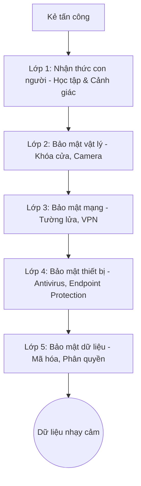
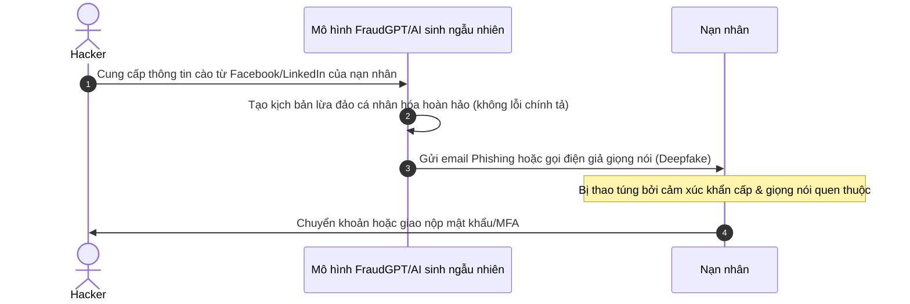

# Ngày 1: Tổng quan An toàn thông tin & Hiểm họa Social Engineering

Chào mừng bạn đến với ngày đầu tiên của khóa học **Cybersecurity Awareness** (Nhận thức An toàn thông tin). 

Rất nhiều người, từ người dùng phổ thông cho đến các lập trình viên mới vào nghề, thường có suy nghĩ sai lầm rằng: *"Tôi không phải là người nổi tiếng, tôi không giàu, trên máy tính của tôi chẳng có gì đáng để hack cả!"*. Hoặc *"Máy tính của tôi đã cài phần mềm diệt virus xịn nhất rồi, tôi an toàn"*. 

Đây là những tư duy nguy hiểm nhất trong thời đại số. Hôm nay, chúng ta sẽ đập bỏ những lầm tưởng đó, tìm hiểu nền tảng cấu trúc của An ninh mạng và đối mặt với vũ khí đáng sợ nhất của hacker: **Tâm lý con người**.

---

## 1. Tam giác bảo mật CIA (The CIA Triad)

Để biết một hệ thống có an toàn hay không, các chuyên gia an ninh mạng trên toàn thế giới sử dụng một tiêu chuẩn vàng gọi là **CIA Triad** (Mô hình ba nhân tố quyết định, không liên quan đến tổ chức tình báo CIA của Mỹ). 

Mô hình này bao gồm 3 yếu tố không thể tách rời:

### C - Confidentiality (Tính Bảo mật / Bí mật)
*   **Định nghĩa:** Đảm bảo rằng thông tin nhạy cảm chỉ được truy cập bởi những người hoặc hệ thống được cấp quyền hợp lệ.
*   **Tình huống thực tế:** Bảng lương và thông tin cá nhân của nhân viên công ty chỉ có Giám đốc và bộ phận HR được xem. Nếu một nhân viên IT thực tập hoặc một bên thứ ba có thể truy cập và đọc được dữ liệu này, hệ thống đã vi phạm nghiêm trọng tính Confidentiality.
*   **Giải pháp bảo vệ:** Thiết lập cơ chế kiểm soát truy cập (Access Control), sử dụng Mật mã hóa dữ liệu (Encryption) lúc lưu trữ và truyền tải, triển khai xác thực đa yếu tố (MFA).

### I - Integrity (Tính Toàn vẹn)
*   **Định nghĩa:** Đảm bảo dữ liệu không bị sửa đổi, giả mạo, hoặc xóa bỏ một cách trái phép trong suốt vòng đời của nó. Dữ liệu khi đến đích phải khớp chính xác 100% với dữ liệu ban đầu.
*   **Tình huống thực tế:** Bạn chuyển 1.000.000 VNĐ cho người thân qua Internet Banking. Trên đường truyền tải dữ liệu qua mạng internet, hacker chặn gói tin và sửa số tài khoản đích thành tài khoản của hắn. Nếu ngân hàng xử lý giao dịch mà không phát hiện ra sự thay đổi này, hệ thống đã vi phạm tính Integrity.
*   **Giải pháp bảo vệ:** Sử dụng các thuật toán hàm băm (Hashing như SHA-256) để kiểm tra tính nhất quán, áp dụng Chữ ký số (Digital Signature), và ghi nhật ký hệ thống (Audit logs) không thể sửa xóa.

### A - Availability (Tính Sẵn sàng)
*   **Định nghĩa:** Đảm bảo rằng các dịch vụ, hệ thống mạng và dữ liệu luôn sẵn sàng phục vụ người dùng hợp pháp bất cứ khi nào họ cần. Hệ thống dù có bảo mật đến đâu nhưng nếu người dùng hợp pháp không thể truy cập để làm việc thì đó là một hệ thống thất bại.
*   **Tình huống thực tế:** Một website thương mại điện tử bị đối thủ thuê mạng máy tính ma tấn công từ chối dịch vụ phân tán (DDoS), gửi hàng triệu lượt truy cập giả mạo cùng lúc làm nghẽn băng thông, sập máy chủ. Khách hàng thật không thể truy cập mua hàng. Đây là hành vi phá hoại tính Availability.
*   **Giải pháp bảo vệ:** Thiết kế hạ tầng dự phòng (Redundancy, Load Balancing), sao lưu dữ liệu thường xuyên (Backups) và triển khai tường lửa chống DDoS (ví dụ: Cloudflare WAF).

---

## 2. Kẻ thù lớn nhất: Mắt xích con người và Triết lý "Defense in Depth"

Bạn có biết vụ hack làm rung chuyển Twitter (nay là X) khiến hàng loạt tài khoản của những người quyền lực nhất thế giới như Barack Obama, Elon Musk và Bill Gates đồng loạt đăng bài lừa đảo quyên góp Bitcoin không?

Người ta tưởng rằng hacker phải sử dụng một siêu máy tính chạy các thuật toán bẻ khóa tinh vi. Nhưng thực tế đơn giản đến không ngờ: Kẻ tấn công chỉ là một thanh niên 17 tuổi. Hắn gọi điện cho một số nhân viên hỗ trợ kỹ thuật của Twitter, giả giọng là đồng nghiệp IT ở chi nhánh khác đang gặp sự cố hệ thống, từ đó lừa họ cung cấp thông tin đăng nhập vào trang quản trị tối cao của Twitter.

> 💡 **Triết lý cốt lõi:** Bạn có thể chi hàng triệu đô la để xây dựng hệ thống tường lửa kiên cố và các thuật toán mã hóa tối tân nhất thế giới, nhưng tất cả sẽ trở nên vô dụng nếu một nhân viên của bạn vui vẻ mở cửa mời hacker vào nhà.

Trong bảo mật, con người luôn được coi là **mắt xích yếu nhất** (The weakest link). Do đó, các tổ chức hiện đại áp dụng triết lý phòng thủ nhiều lớp **Defense in Depth** (Phòng thủ chiều sâu):

If một lớp bảo vệ bị xuyên thủng (ví dụ: nhân viên bị lừa tiết lộ mật khẩu), các lớp bảo vệ khác (như xác thực đa yếu tố MFA, tường lửa mạng, phân quyền tối thiểu) vẫn phải hoạt động để ngăn chặn kẻ tấn công chạm tới dữ liệu cốt lõi.

---

## 3. Social Engineering: Nghệ thuật thao túng tâm lý cực kỳ tinh vi

Hacker không cần tìm lỗ hổng trong mã nguồn của hệ điều hành, chúng tìm kiếm điểm yếu trong "mã nguồn" của não bộ con người. Kỹ thuật này gọi là **Social Engineering (Kỷ nghệ xã hội)**. Nó dựa trên việc thao túng cảm xúc của nạn nhân: **Sự tò mò, Nỗi sợ hãi, Lòng tham, và Sự cả tin**.

Dưới đây là các hình thức Social Engineering nguy hiểm nhất:

### 3.1. Phishing (Tấn công giả mạo số lượng lớn)
Hình thức phổ biến nhất. Kẻ tấn công gửi email hoặc tin nhắn hàng loạt giả mạo các tổ chức uy tín (Ngân hàng, Cơ quan thuế, Facebook, Netflix) yêu cầu bạn hành động ngay lập tức.
*   **Kịch bản:** *"Tài khoản ngân hàng của bạn phát hiện giao dịch bất thường. Click vào đây để xác minh và hủy giao dịch trong vòng 5 phút."*
*   **Hành động nguy hiểm:** Nạn nhân hoảng sợ click vào liên kết, dẫn đến một trang web đăng nhập giả mạo có giao diện giống 99% trang thật và tự tay dâng hiến tài khoản mật khẩu cho hacker.

### 3.2. Spear Phishing (Săn cá bằng giáo - Tấn công có mục tiêu)
Không gửi rác hàng loạt, hacker nhắm trực tiếp vào một cá nhân cụ thể (ví dụ: Kế toán trưởng, Giám đốc IT).
*   **Cách thức:** Chúng dành hàng tuần cào thông tin trên mạng xã hội (Facebook, LinkedIn, GitHub) để biết nạn nhân thích gì, con cái học trường nào, đang làm việc với đối tác nào. Từ đó, chúng soạn thảo một email cá nhân hóa cực kỳ chân thực khiến nạn nhân hoàn toàn mất cảnh giác.

### 3.3. Baiting (Bẫy mồi dụ dỗ)
Đánh trực tiếp vào sự tò mò hoặc lòng tham của con người.
*   **Môi trường số:** Các file tải về mang tên: *"Adobe Photoshop 2026 Full Crack.zip"* hoặc *"Bảng lương toàn công ty tháng này.xlsx.exe"*. Bên trong thực chất là mã độc gián điệp.
*   **Môi trường vật lý:** Hacker cố tình đánh rơi một chiếc USB có dán nhãn hấp dẫn như "Tài liệu mật phòng nhân sự" ở sảnh công ty. Một nhân viên tò mò nhặt được và cắm thử vào máy tính nội bộ để xem bên trong có gì, vô tình kích hoạt mã độc lây lan toàn hệ thống.

### 3.4. Pretexting (Dựng kịch bản tạo vỏ bọc)
Kẻ tấn công tự thiết lập một kịch bản giả định, đóng vai một nhân vật có quyền lực để yêu cầu thông tin.
*   **Ví dụ:** Hacker đóng giả làm Công an điều tra gọi điện thông báo số điện thoại của bạn liên quan đến một đường dây rửa tiền quốc tế, yêu cầu bạn tạm thời chuyển tiền vào tài khoản "tạm giữ" của cơ quan điều tra để chứng minh sự trong sạch.

---

## 4. Cuộc chiến không cân sức: Phishing trong Kỷ nguyên AI (2026)

Bước sang năm 2026, trí tuệ nhân tạo (AI) đã vũ khí hóa kỹ nghệ xã hội lên một tầm cao mới đáng sợ. Chúng ta không thể chỉ dựa vào việc tìm lỗi chính tả hay giọng văn ngô nghê để nhận diện lừa đảo nữa.

### Deepfake Video và Audio thời gian thực
Hacker có thể cào các đoạn video, clip âm thanh ngắn của bạn hoặc người thân của bạn trên TikTok, YouTube. Sau đó sử dụng AI để tạo ra các cuộc gọi video Deepfake theo thời gian thực.
*   **Vụ việc chấn động:** Một nhân viên tài chính tại chi nhánh Hồng Kông đã chuyển **25 triệu USD** cho kẻ lừa đảo sau khi tham gia một cuộc họp Zoom. Trong cuộc họp đó, hình ảnh và giọng nói của Giám đốc tài chính (CFO) công ty mẹ cùng toàn bộ các đồng nghiệp khác đều là Deepfake do AI tạo ra một cách hoàn hảo.

### AI Phishing tự động hóa
Công cụ AI (như các phiên bản ChatGPT bẻ khóa bảo mật - FraudGPT) có thể tự động viết hàng triệu bức thư lừa đảo cá nhân hóa dựa trên dữ liệu mạng xã hội của từng mục tiêu, điều chỉnh ngôn từ sao cho khớp với tính cách của nạn nhân nhất nhằm tăng tỷ lệ lừa đảo thành công.

---

## 5. Cẩm nang phòng thủ: Xây dựng tư duy "Zero Trust" cá nhân

Đứng trước sự tiến hóa của công nghệ lừa đảo bằng AI, tư duy phòng thủ tốt nhất của bạn là áp dụng nguyên tắc **Zero Trust (Không tin tưởng tuyệt đối bất kỳ ai/cái gì - Luôn luôn xác minh)**.

1.  **Chậm lại 10 giây khi có tín hiệu khẩn cấp:** Mọi cuộc tấn công Phishing đều tạo ra sự khẩn cấp giả tạo (*"Tài khoản bị khóa ngay", "Nhận thưởng ngay lập tức"*). Khi cảm thấy bị ép buộc hành động nhanh, đó là lúc bạn phải dừng lại, hít thở sâu và suy nghĩ bằng lý trí.
2.  **Xác minh độc lập qua kênh phụ (Out-of-Band Verification):** Nếu bạn nhận được tin nhắn từ người thân, bạn bè, hoặc sếp yêu cầu chuyển tiền gấp: **Tuyệt đối không thực hiện**. Hãy sử dụng một kênh liên lạc độc lập khác (gọi trực tiếp số điện thoại di động viễn thông, không gọi qua app chat mạng xã hội) để xác nhận chéo.
3.  **Kỹ năng soi đường dẫn URL chuẩn xác:**
    *   Học cách đọc từ phải sang trái để xác định Tên miền gốc (Root Domain).
    *   Ví dụ: Trong URL `https://vietcombank.com.vn.security-login.net`, tên miền thực tế là `security-login.net` chứ không phải `vietcombank.com.vn`. Kẻ lừa đảo chỉ đang tạo ra subdomain giả mạo để đánh lừa mắt của bạn.
4.  **Tuyệt đối hoài nghi các tập tin đính kèm:** Không mở hoặc chạy các tập tin đính kèm từ email lạ. Với các file Office (Word, Excel), tuyệt đối không bấm nút "Enable Content" hoặc "Enable Macros" màu vàng nếu bạn không chắc chắn nguồn gốc.

---

## Tổng kết Ngày 1

Hôm nay chúng ta đã phá bỏ được lầm tưởng "An ninh mạng chỉ là chuyện của máy móc kỹ thuật".
1.  Hệ thống bảo mật vững chắc phải đảm bảo sự cân bằng của mô hình **CIA: Bảo mật (Confidentiality) - Toàn vẹn (Integrity) - Sẵn sàng (Availability)**.
2.  **Con người** mới là mắt xích yếu nhất trong chuỗi an toàn thông tin của mọi hệ thống.
3.  **Social Engineering** tấn công trực tiếp vào tâm lý con người: tò mò, lòng tham, cả tin và nỗi sợ.
4.  Kỷ nguyên **AI 2026** mang đến hiểm họa lừa đảo bằng **Deepfake đa chiều** cực kỳ khó phát hiện.
5.  Hãy luôn giữ tư duy **Zero Trust**: Dừng lại - Hoài nghi - Xác minh độc lập.

---

## 📝 Bài tập thực hành cuối ngày
1. Hãy mở hộp thư rác (Spam) hoặc hộp thư đến trong email cá nhân của bạn.
2. Tìm ra một email lừa đảo hoặc email quảng cáo đáng nghi nhất.
3. Phân tích và viết ra giấy:
   * Email này đang đánh vào tâm lý nào của bạn (lòng tham, nỗi sợ hay sự tò mò)?
   * Các dấu hiệu kỹ thuật tố cáo email này là giả mạo (Soi kỹ địa chỉ email người gửi sau chữ `@`, phân tích các đường link URL ẩn dưới các nút bấm).
4. Chia sẻ phát hiện của bạn với một người bạn hoặc người thân trong gia đình để cùng nâng cao nhận thức bảo mật!
