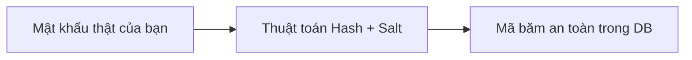
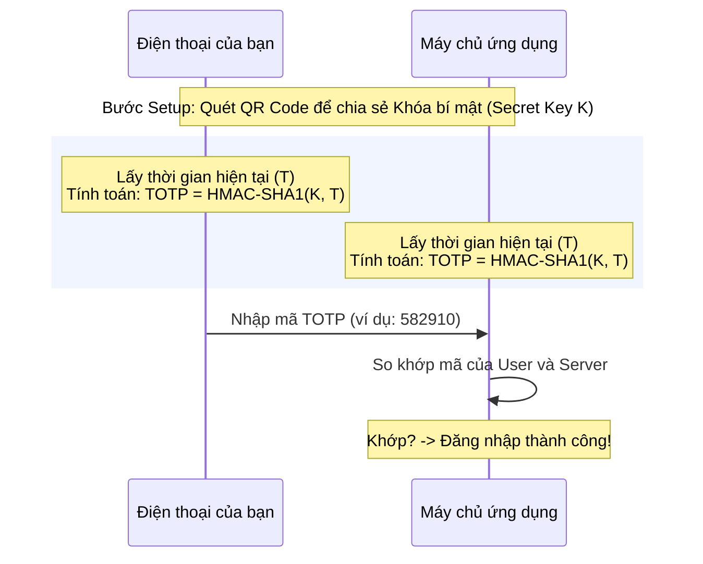
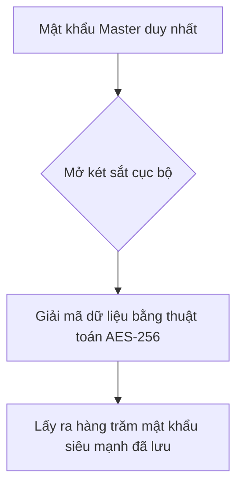
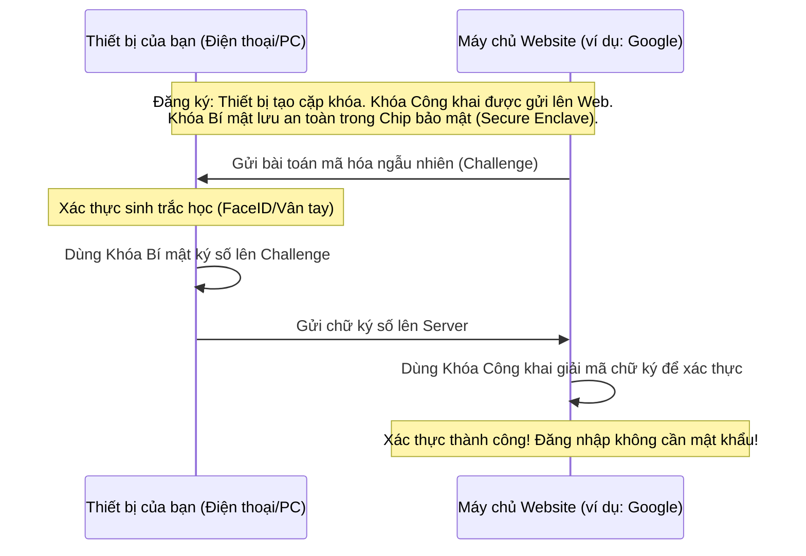

# Ngày 2: Quản lý Danh tính & Truy cập (Identity & Access Management)

Chào mừng bạn quay trở lại! Ngày hôm qua, chúng ta đã hiểu rằng con người là mắt xích yếu nhất trong hệ thống bảo mật. Vậy hacker thường "ghé thăm" chúng ta qua cửa ngõ nào nhiều nhất? Câu trả lời chính là: **Cửa sổ đăng nhập**.

Vào năm 2026, việc đặt mật khẩu kiểu `123456` hay `Anhyeuem123` không còn là hành vi "ngây thơ" nữa, mà là một hành động "tự sát kỹ thuật số". Hôm nay, chúng ta sẽ đi sâu vào bản chất kỹ thuật của việc xác thực danh tính, cách hacker bẻ khóa chúng, và cách xây dựng những thành trì vững chắc nhất bằng các công nghệ hiện đại.

---

## 1. Bản chất của Mật khẩu và Cách Hacker "Bẻ khóa"

Về mặt kỹ thuật, khi bạn nhập mật khẩu trên một trang web, máy chủ an toàn không bao giờ lưu trữ mật khẩu thuần túy (Plain text) của bạn. Nó chỉ lưu trữ một chuỗi **Hash (Mã băm)** được tạo từ mật khẩu của bạn thông qua thuật toán băm (như bcrypt, Argon2). 

Khi bạn đăng nhập, hệ thống sẽ băm mật khẩu bạn vừa nhập và so sánh kết quả mã băm đó với mã băm đã lưu trữ trong cơ sở dữ liệu. Nếu khớp nhau, bạn được quyền truy cập.

Tuy nhiên, hacker không cần biết thuật toán băm đó hoạt động tinh vi ra sao để bẻ khóa tài khoản của bạn. Chúng có những cách tấn công tàn bạo và hiệu quả hơn nhiều:

### 1.1. Brute Force (Tấn công vét cạn)
Hacker sử dụng các siêu máy tính chạy phần mềm chuyên dụng thử nghiệm mọi tổ hợp ký tự có thể xảy ra (ví dụ: aaaa, aaab, aaac... cho đến khi khớp mật khẩu).
*   **Thực tế kỹ thuật 2026:** Với sự phát triển vượt bậc của card đồ họa (GPU) và sức mạnh tính toán lượng tử phân tán, tốc độ đoán mã băm đạt hàng tỷ phép thử mỗi giây. Một mật khẩu gồm 8 ký tự (có cả chữ hoa, chữ thường và số) sẽ bị bẻ gãy chỉ trong chưa đầy **0.5 giây**. 
*   **Chiến thuật:** Nếu bạn tăng độ dài mật khẩu lên 12 ký tự, thời gian bẻ khóa tối thiểu sẽ tăng vọt lên khoảng **100 năm**. Do đó, **ĐỘ DÀI** của mật khẩu quan trọng hơn rất nhiều so với **ĐỘ PHỨC TẠP** của các ký tự đặc biệt.

### 1.2. Dictionary Attack (Tấn công từ điển) & Rainbow Tables
Thay vì dò tìm ngẫu nhiên tốn thời gian, hacker sử dụng một danh sách "Từ điển" chứa hàng triệu mật khẩu phổ biến nhất thế giới được thu thập từ các vụ rò rỉ trước đó (như `password123`, `qwerty`, `admin123`). 
*   **Rainbow Tables:** Là các bảng dữ liệu khổng lồ chứa hàng tỷ mã băm đã được tính toán sẵn cho hàng loạt mật khẩu thông dụng. Nếu cơ sở dữ liệu của một ứng dụng bị hack và không được áp dụng kỹ thuật **Salt** (thêm muối - chèn thêm ký tự ngẫu nhiên vào mật khẩu trước khi băm), hacker chỉ cần so khớp mã băm lấy được với Rainbow Table để dịch ngược ra mật khẩu gốc ngay lập tức.

### 1.3. Credential Stuffing (Nhồi nhét thông tin xác thực)
Đây là thảm họa trực tiếp đến từ thói quen **Dùng chung một mật khẩu cho nhiều dịch vụ**.
1.  Hacker tấn công một diễn đàn nhỏ (ví dụ: diễn đàn nuôi cá cảnh bạn từng đăng ký năm 2018). Do bảo mật lỏng lẻo, hacker lấy được email và mật khẩu của bạn.
2.  Hacker sử dụng các công cụ bot tự động (như Sentry MBA) để nhét cặp email/mật khẩu đó vào hàng ngàn trang web lớn khác như Gmail, Facebook, Binance, Paypal.
3.  Nếu bạn dùng chung mật khẩu, hacker sẽ chiếm đoạt tài khoản tài chính của bạn chỉ từ một diễn đàn không liên quan.

---

## 2. Xác thực đa yếu tố (MFA/2FA): Giải phẫu các lớp giáp phòng thủ

Vì mật khẩu truyền thống rất dễ bị rò rỉ, chúng ta bắt buộc phải triển khai lớp bảo vệ thứ hai. **MFA (Multi-Factor Authentication)** yêu cầu bạn cung cấp ít nhất 2 trong 3 loại bằng chứng xác thực khác nhau:
1.  **Thứ bạn BIẾT (Knowledge):** Mật khẩu, mã PIN, câu trả lời bí mật.
2.  **Thứ bạn CÓ (Possession):** Điện thoại di động nhận OTP, Token phần cứng vật lý.
3.  **Thứ bạn LÀ (Inherence):** Sinh trắc học (Vân tay, nhận diện khuôn mặt FaceID).

Tuy nhiên, các phương thức xác thực 2FA không có mức độ an toàn tương đương nhau. Dưới đây là phân tích từ yếu nhất đến mạnh nhất:

### Cấp độ 1: SMS OTP (Bảo mật Yếu - Rủi ro cao)
Mã số xác thực được gửi qua tin nhắn SMS truyền thống.
*   **Lỗ hổng SIM Swap:** Hacker sử dụng mạng xã hội để thu thập số điện thoại, ngày sinh và số CCCD của bạn. Sau đó, chúng đóng giả làm bạn, gọi điện lên tổng đài nhà mạng báo mất máy điện thoại và yêu cầu cấp lại một SIM mới. Khi SIM mới được kích hoạt trên máy của hacker, SIM thật trên điện thoại của bạn sẽ mất sóng. Mọi mã xác thực OTP ngân hàng từ đó sẽ tự động gửi thẳng vào máy của kẻ tấn công.

### Cấp độ 2: TOTP (Time-based One-Time Password - Bảo mật Khá)
Sử dụng các ứng dụng sinh mã như Google Authenticator, Microsoft Authenticator, hay Bitwarden. 

*   **Ưu điểm:** Mã OTP được tính toán cục bộ (Offline) ngay trên thiết bị của bạn dựa trên thời gian thực và một Khóa bí mật chung (Secret Key) được chia sẻ từ đầu qua mã QR. Không cần sóng mạng viễn thông nên miễn nhiễm hoàn toàn với tấn công SIM Swap.
*   **Lỗ hổng:** TOTP vẫn có thể bị vượt qua nếu bạn bị lừa nhập mã này vào một trang web Phishing giả mạo. Kẻ tấn công sẽ lấy mã đó và gửi lên trang web thật ngay lập tức trước khi mã hết hạn (30 giây).

### Cấp độ 3: FIDO2 / Security Keys (Bảo mật Tuyệt đối)
Các khóa bảo mật vật lý chuyên dụng (như YubiKey) cắm vào cổng USB hoặc kết nối NFC với điện thoại.
*   **Cơ chế WebAuthn:** Thiết bị sử dụng mật mã học khóa công khai. Khi bạn đăng nhập, trình duyệt sẽ gửi tên miền (Domain) của website hiện tại xuống khóa bảo mật. Khóa bảo mật sẽ kiểm tra tên miền này có đúng với tên miền đã đăng ký trong chip bảo mật hay không. Nếu phát hiện ra đây là tên miền giả mạo (ví dụ: `faceb00k.com` thay vì `facebook.com`), khóa sẽ từ chối ký số xác thực.
*   **Ưu điểm:** Kháng Phishing 100%. Ngay cả khi bạn hoàn toàn bị đánh lừa và muốn dâng hiến mã xác thực cho hacker, khóa bảo mật vật lý cũng sẽ tự động ngăn chặn điều đó.

---

## 3. Trình quản lý mật khẩu (Password Manager)

Con người không được thiết kế để ghi nhớ hàng trăm chuỗi ký tự ngẫu nhiên và phức tạp như `*uR8&pA$vW2!pQ` cho các tài khoản khác nhau. Hãy để máy móc đảm nhận công việc này.

Các ứng dụng uy tín như **1Password**, **Bitwarden** (mã nguồn mở và miễn phí), hay **Dashlane** hoạt động như một chiếc két sắt số an toàn nhất:

*   **Zero-Knowledge Architecture (Kiến trúc không tri thức):** Mọi mật khẩu của bạn đều được mã hóa bằng thuật toán quân đội **AES-256** ngay trên thiết bị của bạn trước khi đồng bộ lên máy chủ đám mây. Chìa khóa để giải mã duy nhất là **Master Password** nằm trong đầu bạn. Máy chủ của nhà cung cấp (như Bitwarden) có bị hack thì kẻ tấn công cũng chỉ lấy được các file đã mã hóa hoàn toàn vô nghĩa.
*   **Lợi ích:** Bạn chỉ cần nhớ duy nhất một mật khẩu Master siêu mạnh. Mọi tài khoản còn lại sẽ được tạo ngẫu nhiên 20+ ký tự và tự động điền (Autofill) khi bạn truy cập website, giúp ngăn ngừa Keylogger thu thập thông tin phím gõ.

---

## 4. Công nghệ Passkeys: Kỷ nguyên "Hậu mật khẩu" (2026)

Mật khẩu là một trong những thiết kế tồi tệ nhất của lịch sử công nghệ thông tin. Vào năm 2026, các liên minh công nghệ lớn (Apple, Google, Microsoft) đã bắt tay cùng FIDO Alliance để loại bỏ hoàn toàn mật khẩu bằng công nghệ **Passkeys**.

### Passkeys hoạt động như thế nào?
Passkeys được xây dựng trên nền tảng **Mật mã học bất đối xứng** (Asymmetric Cryptography):

1.  **Public Key (Khóa công khai):** Được lưu trữ công khai trên cơ sở dữ liệu của ứng dụng web.
2.  **Private Key (Khóa bí mật):** Được khóa chặt trong chip bảo mật phần cứng (Secure Enclave) trên điện thoại hoặc máy tính của bạn. Khóa này tuyệt đối không bao giờ rời khỏi thiết bị.
3.  **Đăng nhập cực kỳ đơn giản:** Bạn chỉ cần mở FaceID hoặc quét vân tay trên điện thoại, khóa bí mật tự động thực hiện phép tính ký số trên thiết bị và xác thực đăng nhập trong nháy mắt.

### Tại sao Passkeys là lá chắn bảo mật tuyệt đối?
*   **Không thể bị Phishing:** Không có mật khẩu nào để gõ vào ô nhập liệu, vì vậy bạn không thể vô tình tiết lộ thông tin cho các trang web giả mạo. Thiết bị của bạn chỉ đồng ý ký số khi URL của trang web khớp chính xác với URL đã đăng ký ban đầu.
*   **Không sợ rò rỉ dữ liệu máy chủ:** Nếu cơ sở dữ liệu của Facebook hay Google bị hacker đánh cắp, chúng chỉ thu được Khóa công khai. Khóa công khai này vô dụng nếu không có Khóa bí mật nằm vật lý trên chiếc điện thoại của bạn.

---

## 5. Quy tắc "Vệ sinh mật khẩu" (Password Hygiene) bắt buộc

Trong giai đoạn thế giới đang chuyển mình sang kỷ nguyên Passkeys, bạn vẫn phải sử dụng mật khẩu truyền thống ở nhiều nền tảng. Hãy tuân thủ nghiêm ngặt 3 quy tắc sau:

1.  **Quy tắc "Zero Reuse" (Không dùng chung):** Mỗi tài khoản là một mật khẩu duy nhất. Không bao giờ sử dụng mật khẩu Gmail cho Facebook hay tài khoản ngân hàng.
2.  **Triết lý "Passphrase" (Cụm mật khẩu dài):** Thay vì đặt mật khẩu phức tạp khó nhớ như `B@0m@t!123`, hãy dùng 4 từ tiếng Việt không dấu ngẫu nhiên ghép lại với nhau: `DuaHau-GheDa-XanhLa-NhảyMua`. Mật khẩu này có độ dài lên tới 28 ký tự, khiến máy tính mất hàng tỷ năm để bẻ khóa, nhưng bộ não con người lại ghi nhớ cực kỳ dễ dàng bằng cách liên tưởng hình ảnh.
3.  **Xác minh rò rỉ:** Truy cập trang web uy tín của chuyên gia bảo mật Troy Hunt: `haveibeenpwned.com`. Nhập địa chỉ email của bạn để kiểm tra xem thông tin tài khoản của bạn đã từng bị rò rỉ trong vụ hack nào trên thế giới chưa, từ đó chủ động đổi mật khẩu kịp thời.

---

## Tổng kết Ngày 2

1.  Độ dài của mật khẩu (Passphrase) quan trọng hơn nhiều so với độ phức tạp của ký tự.
2.  Tấn công **Credential Stuffing** sẽ đánh sập toàn bộ tài khoản của bạn nếu bạn có thói quen dùng chung một mật khẩu.
3.  **MFA** là lá chắn bắt buộc, trong đó **TOTP** (Authenticator App) và **FIDO2** (Khóa bảo mật vật lý) là những giáp bảo vệ đáng tin cậy nhất.
4.  **Password Manager** là công cụ tối thượng giúp lưu trữ và tạo mật khẩu mạnh ngẫu nhiên.
5.  **Passkeys** sử dụng mật mã học bất đối xứng để khai tử kỷ nguyên mật khẩu truyền thống, chống lừa đảo Phishing tuyệt đối.

---

## 📝 Bài tập thực hành cuối ngày
1.  Tải và cài đặt ứng dụng **Bitwarden** (bản miễn phí) trên điện thoại hoặc máy tính của bạn.
2.  Thiết lập một mật khẩu Master cực kỳ mạnh bằng phương pháp **Passphrase** (ghép 4-5 từ ngẫu nhiên, ví dụ: `TraSua-QuanCafe-MayBay-XinhDep`). Lưu mật khẩu Master này ra một cuốn sổ tay cất ở nơi an toàn (tuyệt đối không lưu Master Password trong file text điện thoại).
3.  Thử chuyển đổi mật khẩu của tài khoản mạng xã hội quan trọng nhất của bạn sang mật khẩu ngẫu nhiên dài 24 ký tự do Bitwarden tự sinh ra.
4.  Kích hoạt xác thực 2 bước 2FA bằng ứng dụng Authenticator, quét mã QR và lưu lại các "mã khôi phục dự phòng" (Backup Codes) an toàn.
