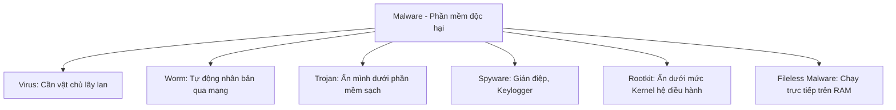
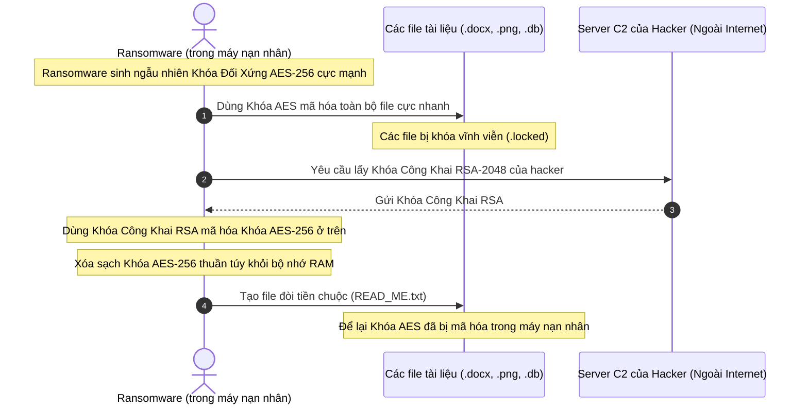
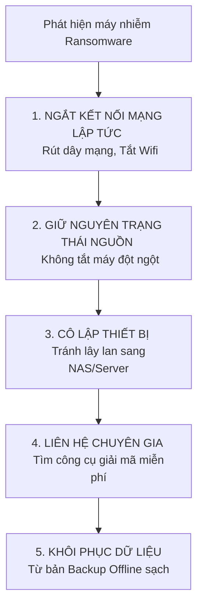

# Ngày 3: Malware & Ransomware - Đại dịch tống tiền kỹ thuật số

Chào mừng bạn đến với ngày thứ 3! Hôm nay chúng ta sẽ nói về những "vũ khí hủy diệt" nguy hiểm nhất mà hacker sử dụng để tấn công trực tiếp vào thiết bị và hệ thống của bạn: **Mã độc (Malware)**.

Bước sang kỷ nguyên số hiện đại, malware không còn chỉ đơn giản là làm chậm máy tính, hiện quảng cáo rác hay phá hoại hệ điều hành để "cho vui". Chúng đã tiến hóa thành các công cụ gián điệp tinh vi, âm thầm hoạt động dưới nền tảng hệ thống để thu thập tài sản trí tuệ, hoặc thậm chí là "bắt cóc" toàn bộ tệp tin quan trọng của các tập đoàn đa quốc gia nhằm mục đích tống tiền với số tiền lên đến hàng triệu USD.

---

## 1. Malware là gì? Phân loại "đội quân" mã độc chuyên sâu

**Malware** là viết tắt của **Malicious Software** (Phần mềm độc hại). Nó là thuật ngữ chung để chỉ bất kỳ chương trình hoặc mã nguồn nào được thiết kế có ý đồ gây hại cho máy tính, máy chủ, thiết bị di động hoặc toàn bộ mạng lưới hệ thống.

Dưới đây là các chủng loại mã độc nguy hiểm nhất được phân tích dưới góc nhìn kỹ thuật:

### 1.1. Virus & Worm (Sâu máy tính)
*   **Virus:** Là đoạn mã độc cần bám vào một "vật chủ" (một file thực thi hợp lệ như `.exe`, `.docx`, `.pdf`) để tồn tại. Virus chỉ có thể kích hoạt và lây lan khi người dùng thực hiện một hành động vô tình (như click đúp mở file nhiễm virus).
*   **Worm (Sâu mạng):** Nguy hiểm hơn virus rất nhiều. Worm là chương trình độc lập, có khả năng tự động nhân bản và tự động phát tán qua các lỗ hổng bảo mật mạng (như lỗ hổng EternalBlue khét tiếng) sang các máy tính khác trong cùng mạng LAN hoặc Wifi mà không cần bất kỳ sự tương tác nào của con người.

### 1.2. Trojan Horse (Ngựa thành Troy) và Backdoor
Đúng như tên gọi lấy từ thần thoại Hy Lạp, Trojan ẩn mình dưới lớp vỏ bọc là một phần mềm hữu ích, sạch sẽ (ví dụ: phần mềm crack game, công cụ chỉnh sửa ảnh miễn phí, file PDF hóa đơn giả). Khi người dùng cài đặt ứng dụng này, Trojan sẽ âm thầm mở một **Backdoor** (Cửa hậu) trên hệ thống, cho phép hacker từ xa kết nối và toàn quyền kiểm soát máy tính của bạn mà không hề bị phát hiện.

### 1.3. Spyware (Phần mềm gián điệp)
Chạy ẩn hoàn toàn dưới hệ thống để theo dõi mọi hoạt động của nạn nhân:
*   **Keylogger:** Ghi lại mọi ký tự bạn gõ từ bàn phím. Hacker sử dụng Keylogger để thu thập chính xác tên đăng nhập, mật khẩu và số thẻ tín dụng khi bạn gõ trên trình duyệt.
*   **Cam-jacking:** Bí mật chiếm quyền điều khiển webcam và microphone của thiết bị để quay lén, ghi âm hình ảnh, âm thanh nhạy cảm của nạn nhân nhằm mục đích tống tiền hoặc thu thập tình báo.

### 1.4. Rootkit - Kẻ tàng hình trong bóng tối
Rootkit là loại mã độc cực kỳ khó phát hiện. Nó tự cài đặt sâu vào nhân (Kernel) của hệ điều hành. Từ cấp độ đặc quyền cao nhất này, Rootkit có khả năng sửa đổi các lệnh của hệ điều hành, tự ẩn các tiến trình (Processes), tệp tin và cổng mạng của chính nó. Các phần mềm diệt virus thông thường chạy ở tầng người dùng (User space) hoàn toàn bị Rootkit qua mắt.

### 1.5. Fileless Malware (Mã độc không tệp tin)
Đây là xu hướng tấn công tối tân nhất hiện nay. Không giống như mã độc truyền thống ghi file độc hại vào ổ cứng để chạy, Fileless Malware tận dụng các công cụ hợp lệ có sẵn của hệ điều hành (như PowerShell, WMI trong Windows) để nạp trực tiếp mã độc vào bộ nhớ **RAM**. Vì không có bất kỳ file nào được ghi xuống đĩa cứng, các phần mềm quét virus dựa trên chữ ký tệp tin (Signature-based Antivirus) hoàn toàn vô hại trước Fileless Malware.

---

## 2. Ransomware: Giải phẫu cơ chế mã hóa kết hợp tống tiền

**Ransomware** (Mã độc tống tiền) là mối đe dọa tài chính nguy hiểm nhất đối với mọi cá nhân và doanh nghiệp. Khi xâm nhập vào hệ thống thành công, Ransomware sẽ quét toàn bộ ổ đĩa cứng, các thư mục mạng dùng chung và tiến hành mã hóa (khóa) toàn bộ các file dữ liệu quan trọng (ảnh, tài liệu văn phòng, cơ sở dữ liệu database) thành những chuỗi ký tự vô nghĩa không thể mở được.

### 🛠️ Kỹ thuật Mã hóa Kết hợp (Hybrid Encryption) của Ransomware:
Tại sao Ransomware có thể khóa hàng Terabyte dữ liệu của bạn cực kỳ nhanh chóng mà các chuyên gia mật mã học hàng đầu thế giới cũng không thể giải mã được nếu không có khóa của hacker? Chúng sử dụng quy trình mã hóa kết hợp vô cùng thông minh:

1.  **Mã hóa dữ liệu cực nhanh bằng thuật toán đối xứng (Symmetric Encryption):** Ransomware tự sinh ra một khóa đối xứng **AES-256** ngẫu nhiên ngay trên máy nạn nhân. Thuật toán AES cực kỳ nhanh, cho phép nó mã hóa hàng triệu file chỉ trong vài phút trước khi nạn nhân kịp phát hiện.
2.  **Bảo vệ chìa khóa bằng thuật toán bất đối xứng (Asymmetric Encryption):** Sau khi mã hóa xong, để nạn nhân không thể tìm thấy khóa AES này trong bộ nhớ máy tính, Ransomware lấy **Khóa công khai RSA-2048** của hacker (được nhúng sẵn trong mã nguồn hoặc tải về từ máy chủ điều khiển C2) để mã hóa khóa AES đó. 
3.  **Xóa dấu vết:** Khóa AES thuần túy lập tức bị xóa sạch khỏi bộ nhớ RAM của máy tính nạn nhân. Khóa đối xứng lúc này đã bị khóa chặt bên trong lớp mã hóa RSA. Chỉ có **Khóa bí mật RSA** (duy nhất nằm trên máy chủ bảo mật của hacker) mới có thể giải mã để lấy lại khóa AES giải cứu dữ liệu.

---

## 3. Cẩm nang phản ứng sự cố (Incident Response) khi bị nhiễm Ransomware

Nếu một ngày màn hình của bạn bỗng đen ngòm và hiện thông báo đòi tiền chuộc Bitcoin, hãy giữ bình tĩnh và thực hiện quy trình phản ứng khẩn cấp nghiêm ngặt sau:

1.  **CÔ LẬP MẠNG LẬP TỨC (Rút phích cắm mạng/Tắt Wifi):** Đây là bước quan trọng số 1. Ransomware sau khi ăn sạch máy của bạn sẽ quét mạng LAN để lây lan sang các máy tính khác, máy chủ Active Directory và các ổ đĩa sao lưu dùng chung (NAS). Hãy ngắt kết nối mạng ngay lập tức để khoanh vùng thiệt hại.
2.  **KHÔNG TẮT NGUỒN MÁY TÍNH ĐỘT NGỘT:** Rất nhiều người hoảng loạn đè nút nguồn để tắt máy. Điều này vô tình làm mất sạch dữ liệu trong bộ nhớ RAM - nơi chứa mã độc đang hoạt động và có thể đang lưu giữ khóa AES chưa kịp xóa. Các chuyên gia phản ứng sự cố cần bản Dump RAM này để tìm kiếm cơ hội trích xuất khóa giải mã miễn phí.
3.  **Tuyệt đối không trả tiền chuộc:** 
    *   Không có gì đảm bảo hacker sẽ gửi khóa giải mã cho bạn sau khi nhận tiền.
    *   Trả tiền sẽ biến bạn thành mục tiêu béo bở cho các đợt tấn công tiếp theo trong tương lai của chúng.
    *   Bạn đang trực tiếp tài trợ tài chính cho các tổ chức tội phạm mạng tiếp tục phát triển mã độc.

---

## 4. Chiến lược Sao lưu dữ liệu 3-2-1 kết hợp Immutable Backup

Cách duy nhất để bạn hoàn toàn bất bại trước bất kỳ cuộc tấn công Ransomware nào chính là thiết lập một chiến lược sao lưu dữ liệu khoa học: **Quy tắc sao lưu 3-2-1**.

*   **3 (Có ít nhất 3 bản sao dữ liệu):** Bao gồm 1 bản gốc đang làm việc và ít nhất 2 bản sao lưu dự phòng.
*   **2 (Lưu trữ trên 2 loại phương tiện khác nhau):** Ví dụ: Một bản lưu trên ổ cứng di động gắn ngoài (SSD/HDD), một bản lưu trên dịch vụ đám mây (Google Drive, AWS S3). Điều này bảo vệ dữ liệu khỏi hư hỏng vật lý của thiết bị.
*   **1 (Có ít nhất 1 bản lưu trữ hoàn toàn NGOẠI TUYẾN - Offline / Air-gapped):** Bản sao lưu này phải được rút kết nối vật lý hoàn toàn khỏi máy tính và internet sau khi hoàn thành. Nếu ổ cứng di động luôn cắm vào máy tính, Ransomware sẽ mã hóa luôn cả bản sao lưu đó khi máy bị nhiễm.
*   **Immutable Backup (Sao lưu bất biến):** Trong doanh nghiệp, áp dụng các giải pháp lưu trữ đám mây hỗ trợ tính năng WORM (Write Once, Read Many). Một khi dữ liệu được ghi lên bản backup, không ai (kể cả tài khoản Admin bị hack) có thể sửa đổi hoặc xóa bỏ dữ liệu đó trong một khoảng thời gian được thiết lập sẵn.

---

## Tổng kết Ngày 3

1.  **Malware** rất đa dạng về hình thức và phương thức lây lan: từ Virus cần vật chủ, Worm tự nhân bản mạng, Trojan ẩn mình, cho đến Rootkit ẩn sâu mức nhân Kernel và Fileless Malware chạy trực tiếp trên RAM.
2.  **Ransomware** sử dụng cơ chế **Mã hóa kết hợp (AES-256 + RSA-2048)** để khóa dữ liệu cực nhanh và bảo mật chìa khóa giải mã tuyệt đối trên server hacker.
3.  Khi phát hiện nhiễm độc, hành động đầu tiên bắt buộc phải là **Ngắt kết nối mạng ngay lập tức** để bảo vệ toàn hệ thống mạng.
4.  **Quy tắc sao lưu 3-2-1 với ít nhất 1 bản sao Offline** là phương thuốc miễn dịch duy nhất chống lại thảm họa Ransomware tống tiền.

---

## 📝 Bài tập thực hành cuối ngày
1.  Hãy kiểm tra lại toàn bộ ảnh gia đình, tài liệu học tập, đồ án tốt nghiệp hoặc mã nguồn dự án quan trọng nhất của bạn.
2.  Hãy chuẩn bị một thiết bị lưu trữ vật lý (USB hoặc ổ cứng di động HDD/SSD).
3.  Thực hiện sao chép toàn bộ dữ liệu quan trọng nói trên vào thiết bị lưu trữ này.
4.  Sau khi sao lưu hoàn tất, thực hiện **Eject** an toàn và **RÚT THIẾT BỊ RA** khỏi máy tính, cất vào ngăn kéo tủ. Bạn vừa hoàn thành xuất sắc bước xây dựng bản sao lưu **Offline Air-gapped** bảo vệ tài sản số của mình!
