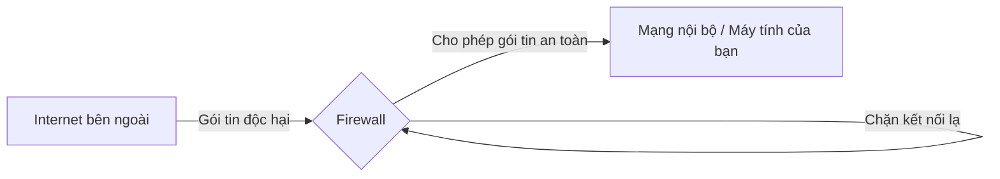

# Ngày 4: An toàn mạng & VPN - Bảo vệ dữ liệu trên đường truyền

Chào mừng bạn đến với ngày thứ 4! Sau khi đã học cách bảo vệ "bên trong" máy tính trước mã độc (Ngày 3) và quản lý danh tính đăng nhập an toàn (Ngày 2), hôm nay chúng ta sẽ bước ra thế giới bên ngoài: **Bảo mật dữ liệu khi truyền tải trên mạng Internet**.

Mỗi khi bạn truy cập một trang web, gửi một tin nhắn hoặc thanh toán hóa đơn trực tuyến, dữ liệu của bạn không bay thẳng tới đích. Nó được chia nhỏ thành các gói tin (Packets) và đi qua hàng chục trạm trung chuyển trung gian: từ router Wifi của quán cafe, hạ tầng của nhà cung cấp dịch vụ mạng (ISP), cho đến các máy chủ định tuyến quốc tế. Nếu không có các lớp bảo vệ mạng mạnh mẽ, dữ liệu của bạn hoàn toàn có thể bị nghe lén, chỉnh sửa hoặc đánh cắp dọc đường.

---

## 1. Hiểm họa từ mạng Wi-Fi công cộng và các kỹ thuật tấn công đường truyền

Mạng Wi-Fi miễn phí tại sân bay, khách sạn hay quán cafe là những môi trường cực kỳ kém an toàn, nơi hacker có thể dễ dàng thiết lập các bẫy chặn thu dữ liệu.

### 1.1. Tấn công Man-in-the-Middle (MitM - Người đứng giữa)
Hacker tìm cách chen vào giữa luồng giao tiếp giữa thiết bị của bạn và internet để nghe lén hoặc sửa đổi thông tin truyền qua.

```mermaid
graph TD
    User[Điện thoại của bạn] -->|Gửi mật khẩu & số thẻ| Hacker[Máy tính của Hacker <br> Man-in-the-Middle]
    Hacker -->|Chuyển tiếp thông tin| Web[Website Ngân Hàng thật]
    Web -->|Trả kết quả giao dịch| Hacker
    Hacker -->|Chuyển tiếp kết quả| User
    Note over Hacker: Hacker đọc sạch toàn bộ dữ liệu nhạy cảm đi qua
```

*   **Rogue Access Point (Trạm phát Wi-Fi giả mạo):** Hacker cấu hình một cục phát sóng Wi-Fi miễn phí của hắn và đặt tên trùng với tên quán cafe (ví dụ: `Highlands_Guest_Free`). Khi bạn kết nối điện thoại vào trạm phát này, mọi gói tin bạn gửi đi đều phải đi qua máy tính của hacker trước khi ra ngoài internet. Hắn có thể thu thập toàn bộ lịch sử duyệt web và mật khẩu của bạn.
*   **ARP Spoofing (Giả mạo giao thức phân giải địa chỉ):** Ngay cả khi bạn kết nối vào Wifi thật của quán, hacker ngồi cạnh bạn cũng có thể chạy phần mềm gửi các gói tin ARP giả mạo đến router, lừa router tin rằng máy tính của hacker chính là máy tính của bạn. Kết quả là router sẽ gửi toàn bộ gói tin lẽ ra phải gửi cho bạn sang máy tính của hacker.

### 1.2. Kỹ thuật Packet Sniffing (Ngửi gói tin)
Sử dụng các công cụ phân tích mạng chuyên dụng (như phần mềm **Wireshark**), hacker có thể bắt các gói tin đang bay tự do trong không trung từ các thiết bị xung quanh. Nếu trang web bạn truy cập sử dụng giao thức không mã hóa (HTTP thay vì HTTPS), mọi thông tin đăng nhập, nội dung chat, cookie phiên làm việc của bạn sẽ hiển thị dưới dạng văn bản thuần túy (Plain text) và hacker có thể đọc sạch không sót một chữ.

---

## 2. Firewall (Tường lửa) - Người gác cổng biên giới mạng

**Firewall** hoạt động giống như một nhân viên an ninh nghiêm ngặt đứng ở cổng nhà bạn, kiểm tra mọi gói tin đi ra và đi vào dựa trên một tập hợp các quy tắc bảo mật được định nghĩa sẵn.



Có 3 loại tường lửa phổ biến được áp dụng trong kỹ thuật bảo mật:
*   **Packet Filtering Firewall (Lọc gói tin):** Kiểm tra các thông tin cơ bản ở tầng mạng như địa chỉ IP nguồn, IP đích, cổng (Port) dịch vụ. Nếu phát hiện gói tin đến từ một IP nằm trong danh sách đen, nó sẽ chặn ngay lập tức.
*   **Stateful Inspection Firewall (Kiểm trạng):** Tường lửa thông minh hơn, nó ghi nhớ trạng thái của các kết nối mạng đang hoạt động. Nó chỉ cho phép gói tin đi từ ngoài internet vào máy bạn nếu gói tin đó là phản hồi hợp lệ cho một yêu cầu kết nối mà máy của bạn đã chủ động gửi ra trước đó.
*   **WAF (Web Application Firewall - Tường lửa ứng dụng web):** Tường lửa chuyên dụng nằm ở tầng ứng dụng (Lớp 7 OSI). WAF phân tích nội dung bên trong gói tin HTTP/HTTPS để phát hiện và ngăn chặn các cuộc tấn công nhắm vào website như SQL Injection, Cross-Site Scripting (XSS).

---

## 3. VPN (Virtual Private Network): Xây dựng đường hầm mã hóa an toàn

**VPN (Mạng riêng ảo)** là giải pháp tối thượng để bảo vệ dữ liệu khi bạn bắt buộc phải làm việc trong các môi trường mạng không an toàn (như Wi-Fi công cộng).

### Luồng truyền dữ liệu có VPN so với Không có VPN:

```mermaid
graph TD
    subgraph KHI KHÔNG DÙNG VPN
        User1[Máy tính của bạn] -->|Dữ liệu Plain Text / HTTPS dễ bị lộ IP thật| ISP1[Nhà mạng / Hacker quán cafe]
        ISP1 -->|Nghe lén lịch sử duyệt web| Web1[Website Đích]
    end

    subgraph KHI BẬT VPN
        User2[Máy tính của bạn] -->|1. Mã hóa đầu cuối cực mạnh| Tunnel[ĐƯỜNG HẦM VPN MÃ HÓA]
        Tunnel -->|2. Đi qua ISP/Hacker an toàn| VPN[Máy chủ VPN]
        VPN -->|3. Giải mã & ẩn địa chỉ IP thật| Web2[Website Đích]
    end
    
    style Tunnel fill:#e1f5fe,stroke:#039be5,stroke-width:2px
```



Khi bạn bật VPN:
1.  **Thiết lập đường hầm (Tunneling):** Phần mềm VPN tạo ra một kết nối trực tiếp, đóng gói toàn bộ gói tin dữ liệu của bạn vào trong một giao thức mạng an toàn khác.
2.  **Mã hóa đầu cuối (End-to-End Encryption):** Dữ liệu được mã hóa ngay tại máy tính của bạn trước khi gửi đi. Dọc đường truyền, từ hacker ở quán cafe cho đến nhà mạng ISP chỉ nhìn thấy một chuỗi ký tự đã được mã hóa hỗn độn.
3.  **Ẩn danh địa chỉ IP thật:** Khi gói tin tới máy chủ VPN, máy chủ này sẽ giải mã dữ liệu và chuyển tiếp tới website đích. Website đích chỉ nhìn thấy địa chỉ IP của máy chủ VPN chứ không hề biết IP thật và vị trí địa lý thực tế của bạn.

### Các giao thức VPN phổ biến năm 2026:
*   **WireGuard (Khuyến nghị cao):** Giao thức VPN hiện đại nhất hiện nay. Nó có mã nguồn cực kỳ tinh gọn (chỉ khoảng 4.000 dòng code so với 100.000 dòng của OpenVPN), chạy cực nhanh trên điện thoại nhờ tối ưu hóa phần cứng, sử dụng mật mã học tiên tiến (Curve25519, ChaCha20) mang lại độ bảo mật tối đa và tiết kiệm pin vượt trội.
*   **OpenVPN:** Giao thức truyền thống, rất linh hoạt và đáng tin cậy nhưng nặng nề và kết nối chậm hơn WireGuard.
*   **IPsec (IKEv2):** Thường được tích hợp sẵn trên các thiết bị di động, cung cấp khả năng tự động kết nối lại rất tốt khi bạn di chuyển giữa các trạm phát sóng.

---

## 4. HTTPS, SSL/TLS & Kỷ nguyên Post-Quantum Cryptography (2026)

Hầu hết các website uy tín ngày nay đều bắt buộc sử dụng giao thức an toàn **HTTPS** (thay vì HTTP cũ), hiển thị biểu tượng ổ khóa xanh trên trình duyệt. Chữ **S** viết tắt của **Secure**.

HTTPS vận hành dựa trên giao thức bảo mật **SSL/TLS** (phiên bản TLS 1.3 hiện đại). Khi bạn truy cập web, trình duyệt và máy chủ thực hiện một quy trình gọi là **TLS Handshake (Bắt tay TLS)** để trao đổi chứng chỉ số (Digital Certificate), xác minh danh tính máy chủ và tự động tạo ra một khóa mã hóa phiên làm việc độc bản.

### 🛡️ Bước ngoặt năm 2026: Post-Quantum Cryptography (PQC - Mã hóa kháng lượng tử)
Tại sao các tập đoàn công nghệ lớn và tổ chức an ninh mạng lại đang ráo riết thay đổi các thuật toán mã hóa HTTPS truyền thống (như RSA, ECC) trong năm 2026?

*   **Mối đe dọa từ máy tính lượng tử:** Các siêu máy tính lượng tử (Quantum Computers) đang phát triển cực nhanh. Với thuật toán Shor, máy tính lượng tử có khả năng bẻ gãy các thuật toán mã hóa khóa công khai hiện tại (RSA, ECDH) chỉ trong vài phút.
*   **Chiến dịch "Harvest Now, Decrypt Later" (Thu thập bây giờ, giải mã sau):** Các nhóm hacker quốc gia đang tiến hành nghe lén và thu thập lưu trữ hàng Terabyte dữ liệu HTTPS đã mã hóa của các chính phủ, doanh nghiệp ngày hôm nay. Dù hiện tại họ chưa thể giải mã, họ sẽ lưu lại dữ liệu đó để chờ đến khi máy tính lượng tử đủ mạnh trong tương lai sẽ đem ra bẻ khóa.
*   **Giải pháp Kyber / ML-KEM:** Vào năm 2026, các trình duyệt hiện đại (như Chrome, Firefox) và các nhà mạng phân phối nội dung (như Cloudflare) đã mặc định tích hợp thuật toán mã hóa kháng lượng tử **Kyber (ML-KEM)** vào quy trình bắt tay TLS, đảm bảo dữ liệu truyền tải hôm nay sẽ an toàn tuyệt đối trước sức mạnh bẻ khóa của kỷ nguyên lượng tử ngày mai.

---

## Tổng kết Ngày 4

1.  **Wi-Fi công cộng** là môi trường lý tưởng cho các cuộc tấn công nghe lén đường truyền như **Man-in-the-Middle (MitM)** và **Packet Sniffing**.
2.  **Firewall** là lá chắn lọc gói tin độc hại ở biên giới thiết bị, trong đó **WAF** bảo vệ chuyên sâu cho các ứng dụng web.
3.  **VPN** xây dựng một đường hầm mã hóa bảo vệ lưu lượng mạng và ẩn địa chỉ IP thật của bạn, giao thức **WireGuard** là lựa chọn tối ưu nhất năm 2026.
4.  **Kyber (ML-KEM)** là tiêu chuẩn mã hóa kháng lượng tử mới được tích hợp vào HTTPS nhằm đập tan chiến dịch nghe lén *"Thu thập bây giờ, giải mã sau"* của hacker.

---

## 📝 Bài tập thực hành cuối ngày
1.  Hãy kiểm tra trình duyệt web của bạn (Chrome, Edge hoặc Safari). Đảm bảo tính năng **"Always use secure connections (HTTPS)"** hoặc **"HTTPS-Only Mode"** đã được kích hoạt trong phần cài đặt bảo mật (Security Settings) của trình duyệt.
2.  Nếu bạn chưa có dịch vụ VPN, hãy tải và cài đặt ứng dụng **ProtonVPN** hoặc **Mullvad** (ProtonVPN cung cấp gói miễn phí không giới hạn dung lượng cực kỳ uy tín từ Thụy Sĩ).
3.  Truy cập trang web kiểm tra IP: `whatismyip.com` khi chưa bật VPN và ghi lại địa chỉ IP cũng như vị trí địa lý của bạn.
4.  Bật ứng dụng VPN lên, chọn kết nối đến một máy chủ tại quốc gia khác (ví dụ: Singapore hoặc Nhật Bản), sau đó tải lại trang `whatismyip.com`. Xác nhận xem địa chỉ IP của bạn đã thay đổi hoàn toàn và vị trí thực tế của bạn đã được ẩn giấu thành công chưa!
