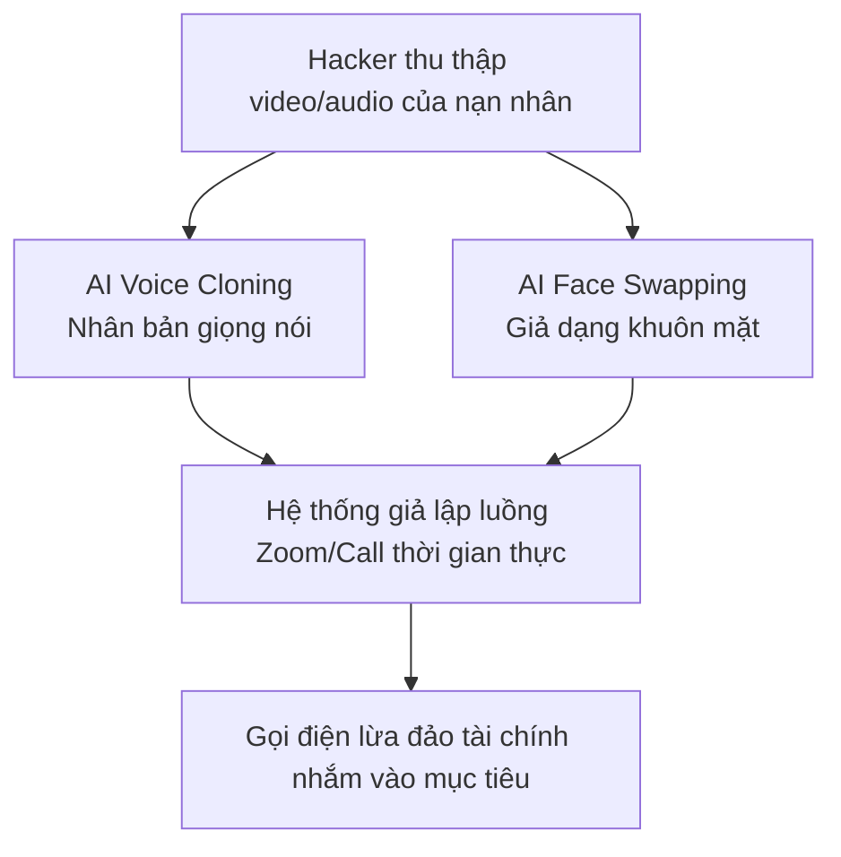
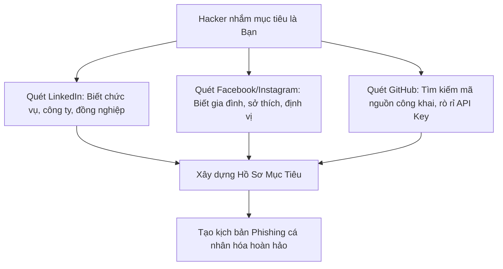
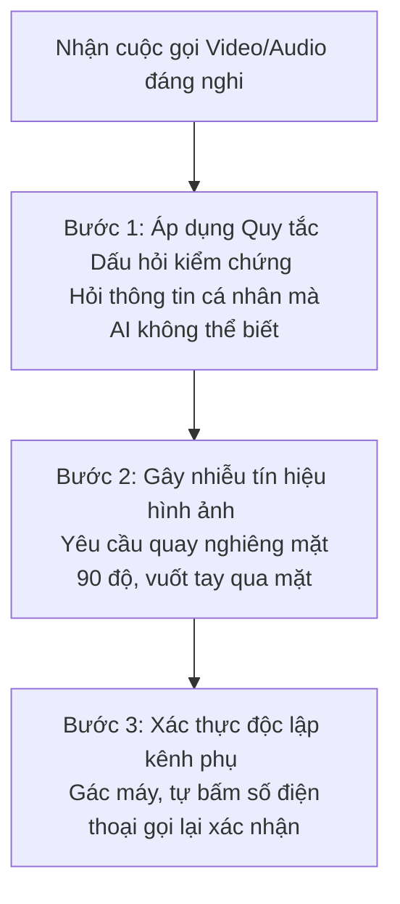

# Ngày 5: Kỹ nghệ Xã hội nâng cao & Tấn công Phishing bằng AI

Chào mừng bạn đến với ngày thứ 5! Ở Ngày 1, chúng ta đã làm quen với khái niệm Social Engineering (Kỹ nghệ xã hội) - nghệ thuật thao túng tâm lý con người. Hôm nay, chúng ta sẽ bước vào một chặng đường chuyên sâu hơn: **Khám phá cách hacker vũ khí hóa Trí tuệ nhân tạo (AI) và Tình báo nguồn mở (OSINT) để thực hiện các cuộc tấn công lừa đảo tinh vi không thể tin nổi trong năm 2026**.

Trong kỷ nguyên này, các email lừa đảo không còn ngô nghê hay chứa đầy lỗi chính tả. Các cuộc gọi mạo danh không chỉ đơn thuần là giả giọng nói lúng túng. Hacker giờ đây có thể bắt chước chính xác khuôn mặt, giọng điệu sinh học của sếp, người thân hay đối tác kinh doanh của bạn để giăng ra những chiếc bẫy hoàn hảo.

---

## 1. Giải phẫu kỹ thuật lừa đảo bằng AI Deepfake thời gian thực

Công nghệ **Deepfake** (sử dụng các mô hình học sâu sinh học - Generative AI) đã biến những kịch bản lừa đảo tưởng chừng chỉ có trên phim viễn tưởng thành hiện thực. 

### 1.1. AI Voice Cloning (Nhân bản giọng nói sinh học)
Chỉ cần thu thập một đoạn âm thanh ngắn khoảng 3 đến 5 giây của một người nói chuyện công khai (trích xuất từ video TikTok, Facebook Reel, YouTube hoặc một cuộc gọi khảo sát rác), AI có thể nhân bản hoàn chỉnh giọng nói của người đó. 
*   Hacker sử dụng giọng nói nhân bản này để gọi điện cho cha mẹ nạn nhân báo tin giả tai nạn giao thông khẩn cấp, hoặc đóng giả làm CEO gọi điện cho bộ phận kế toán yêu cầu thực hiện giao dịch chuyển tiền khẩn cấp. Giọng điệu, hơi thở và ngữ điệu giống bản gốc đến 99%.

### 1.2. Real-time Video Hijacking (Giả mạo cuộc gọi video thời gian thực)
Không dừng lại ở âm thanh, AI thế hệ mới cho phép hacker đè (overlay) một khuôn mặt giả lập của người khác lên khuôn mặt của chính hắn khi đang gọi video call qua Zoom, Microsoft Teams hoặc Zalo.
*   **Kịch bản tấn công:** Bạn nhận được cuộc gọi video từ sếp yêu cầu duyệt chi ngân sách cho một dự án mật. Bạn nhìn thấy mặt sếp chuyển động trên màn hình, nghe thấy giọng sếp nói trực tiếp. Bạn hoàn toàn tin tưởng và chuyển tiền. Chỉ đến khi sếp thật xuất hiện, bạn mới biết mình đã giao tiếp với một khuôn mặt AI do hacker điều khiển.

---

## 2. Các dạng tấn công lừa đảo mục tiêu cao trong doanh nghiệp

Để thực hiện các vụ tấn công trị giá hàng triệu USD, hacker không bao giờ rải email rác. Chúng nhắm vào các mắt xích có quyền lực cao nhất thông qua các kỹ thuật cá nhân hóa:

### 2.1. Spear Phishing (Săn cá bằng giáo)
Tấn công nhắm trực tiếp vào một cá nhân cụ thể. Email Spear Phishing được biên soạn tỉ mỉ dựa trên các thông tin cá nhân của bạn, sử dụng đúng văn phong của phòng ban bạn đang làm việc, đính kèm các tài liệu liên quan đến dự án thực tế của bạn.

### 2.2. Whaling (Săn cá voi)
Là biến thể của Spear Phishing nhưng đối tượng nhắm tới là **"Cá voi"** - những lãnh đạo cấp cao nhất của tổ chức như CEO (Giám đốc điều hành), CFO (Giám đốc tài chính), hoặc kế toán trưởng. 
*   **Kịch bản:** Hacker đóng giả làm cơ quan kiểm toán nhà nước gửi tối mật thư yêu cầu CEO cung cấp thông tin tài chính nội bộ của tập đoàn để phục vụ điều tra, nếu không sẽ đình chỉ hoạt động của doanh nghiệp.

### 2.3. Smishing & Vishing
*   **Smishing (SMS Phishing):** Lừa đảo qua tin nhắn SMS hoặc các ứng dụng chat (Zalo, Telegram, Viber). Điển hình là các tin nhắn mạo danh biến động số dư ngân hàng, trúng thưởng hoặc tin nhắn từ người thân mượn tiền gấp do tài khoản bị khóa.
*   **Vishing (Voice Phishing):** Lừa đảo qua cuộc gọi thoại trực tiếp, kết hợp với công nghệ AI Voice Cloning để giả danh cơ quan chức năng hoặc người quen.

---

## 3. OSINT: Cách hacker cào thông tin của bạn để thiết lập bẫy

Làm sao hacker biết bạn thích ăn gì, đang đi du lịch ở đâu, làm việc ở công ty nào để soạn thảo những email lừa đảo hoàn hảo như vậy? Chúng sử dụng kỹ thuật **OSINT (Open Source Intelligence - Tình báo nguồn mở)**.

OSINT là quá trình thu thập, phân tích thông tin từ các nguồn công khai công cộng trên internet (Mạng xã hội, diễn đàn, website doanh nghiệp, dữ liệu báo chí).

### Sơ đồ quy trình thu thập thông tin OSINT của hacker:

### 🚨 Những sơ hở vô ý dâng hiến thông tin cho hacker:
1.  **Metadata hình ảnh (Dữ liệu EXIF):** Khi bạn chụp một bức ảnh bằng điện thoại và đăng trực tiếp lên mạng xã hội, bức ảnh đó thường đính kèm dữ liệu EXIF ẩn chứa thông tin loại máy ảnh, thời gian chụp, và đặc biệt là **Tọa độ vị trí địa lý GPS chính xác** nơi bạn chụp bức ảnh đó. Hacker chỉ cần tải bức ảnh về và xem metadata là biết chính xác địa chỉ nhà riêng hoặc nơi bạn đang làm việc.
2.  **Thông tin tuyển dụng chi tiết của doanh nghiệp:** Công ty đăng tin tuyển dụng lập trình viên ghi rõ yêu cầu: *"Thành thạo AWS, cấu hình Kubernetes, sử dụng DB PostgreSQL"*. Vô tình, doanh nghiệp đã vẽ sẵn sơ đồ công nghệ nội bộ cho hacker biết hệ thống đang dùng những công cụ gì để tìm kiếm lỗ hổng khai thác tương ứng.
3.  **Khoe thẻ nhân viên, góc làm việc lên mạng:** Bức ảnh check-in góc làm việc mới tinh chứa màn hình máy tính đang mở mã nguồn hoặc dán giấy nhớ mật khẩu, hoặc để lộ mã vạch trên thẻ nhân viên. Hacker có thể scan mã vạch này để làm giả thẻ đột nhập vật lý vào công ty.

---

## 4. Lá chắn bảo mật: Quy trình ứng phó 3 bước tự vệ trước Deepfake và AI Phishing

Để an toàn trước những đòn tấn công công nghệ cao của năm 2026, bạn cần thiết lập các quy trình phòng thủ nghiêm ngặt cho bản thân và gia đình:

### 📌 Bước 1: Áp dụng Quy tắc "Dấu hỏi kiểm chứng"
Nếu nhận được cuộc gọi khẩn cấp từ người thân yêu cầu chuyển tiền gấp bằng giọng nói rất quen thuộc: Hãy hỏi một câu hỏi mang tính cá nhân cao mà chỉ hai người mới biết (ví dụ: *"Hôm qua mẹ nấu món gì cho con ăn?"* hoặc *"Tên chú cún đầu tiên nhà mình nuôi là gì?"*). AI Deepfake cào thông tin mạng xã hội không thể biết được những chi tiết đời sống chưa từng được chia sẻ công khai này.

### 📌 Bước 2: Kỹ thuật gây nhiễu tín hiệu hình ảnh của Deepfake
Nếu đang gọi video call qua ứng dụng mạng xã hội và nghi ngờ đầu cầu bên kia là Deepfake:
*   **Yêu cầu người đó quay nghiêng đầu góc 90 độ:** Thuật toán đè khuôn mặt AI (Facial overlay) hiện tại vẫn xử lý rất kém góc nghiêng 90 độ. Khi quay nghiêng, hình ảnh khuôn mặt giả sẽ bị vỡ, giật hình, hoặc lộ ra các điểm nối kỳ dị ở viền tai và cổ.
*   **Yêu cầu người đó đưa tay lên vuốt qua mặt:** Hành động tay cắt ngang khuôn mặt sẽ khiến thuật toán AI bị mất dấu mốc nhận diện mặt (landmarks) trong tích tắc, gây ra hiện tượng khuôn mặt giả bị méo mó, biến dạng rõ rệt.

### 📌 Bước 3: Xác thực độc lập kênh phụ (Out-of-band Verification)
*   Chủ động cúp máy.
*   Không gọi lại bằng nút "Gọi lại" trên ứng dụng mạng xã hội (vì tài khoản chat của người đó có thể đã bị hacker chiếm quyền điều khiển hoàn toàn).
*   Hãy tự tay bấm số điện thoại di động (số viễn thông SIM) hoặc sử dụng một ứng dụng liên lạc hoàn toàn khác để kết nối lại và kiểm chứng thông tin trực tiếp.

---

## Tổng kết Ngày 5

1.  **AI Deepfake** có khả năng nhân bản giọng nói sinh học và tạo cuộc gọi video giả mạo thời gian thực tinh vi, đe dọa các giao dịch tài chính doanh nghiệp.
2.  **OSINT** là công cụ thu thập tình báo từ dữ liệu công khai trên internet, biến các sơ hở vô ý của bạn thành vũ khí tấn công của hacker.
3.  Tuyệt đối không đăng tải hình ảnh nguyên bản chứa **Metadata GPS** hoặc các thông tin bảo mật nhạy cảm của tổ chức lên mạng xã hội.
4.  Khi gặp cuộc gọi đáng nghi, áp dụng quy trình tự vệ: **Hỏi câu hỏi bảo mật cá nhân - Yêu cầu quay mặt nghiêng 90 độ - Gọi lại xác nhận qua kênh độc lập**.

---

## 📝 Bài tập thực hành cuối ngày
1.  Hãy kiểm tra lại quyền cài đặt máy ảnh trên điện thoại của bạn (iOS hoặc Android). Thực hiện **Tắt quyền truy cập vị trí (GPS/Location)** đối với ứng dụng Máy ảnh (Camera) để ngăn điện thoại tự động nhúng tọa độ GPS vào metadata EXIF của các bức ảnh chụp trong tương lai.
2.  Sử dụng một bức ảnh bất kỳ bạn từng chụp, tải lên trang web phân tích metadata trực tuyến (ví dụ: `exifdata.com` hoặc các công cụ tương tự). Kiểm tra xem bức ảnh của bạn có đang để lộ thông tin loại thiết bị, thời gian và vị trí chụp chính xác hay không.
3.  Hãy tổ chức một cuộc trò chuyện ngắn với những thành viên trong gia đình bạn (đặc biệt là cha mẹ, người lớn tuổi). Cảnh báo họ về hiểm họa lừa đảo Deepfake bằng AI và thống nhất với gia đình **MỘT CÂU MẬT MÃ BÍ MẬT** (ví dụ: một từ khóa ngẫu nhiên) để làm công cụ xác thực chéo bất cứ khi nào có cuộc gọi khẩn cấp yêu cầu chuyển tiền.
