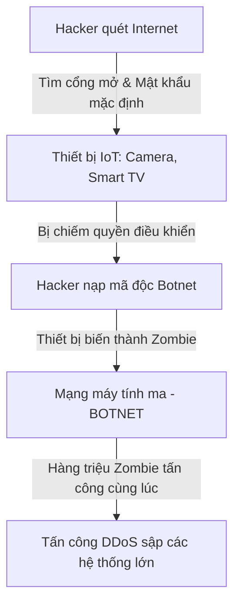
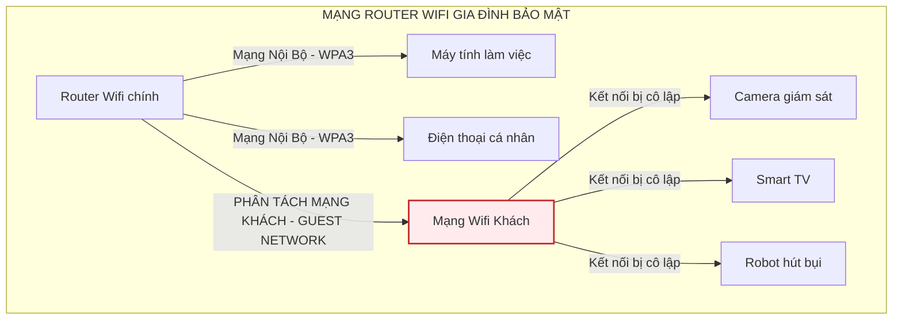

# Ngày 6: Bảo mật Thiết bị Di động & IoT trong kỷ nguyên Smart Home

Chào mừng bạn đến với ngày thứ 6! Trong thời đại ngày nay, ranh giới văn phòng làm việc đã hoàn toàn bị xóa nhòa. Chúng ta làm việc từ xa (Remote), kết nối với máy chủ công ty từ điện thoại cá nhân và đặt máy tính làm việc trong một mạng gia đình ngập tràn các thiết bị thông minh (Smart Home) từ camera an ninh, bóng đèn thông minh cho tới robot hút bụi. 

Hacker thừa hiểu rằng việc tấn công trực tiếp vào máy tính làm việc của bạn (vốn đã được cài đặt các phần mềm bảo mật xịn) là rất khó. Do đó, chúng chọn giải pháp thông minh hơn: **Tấn công vào điện thoại di động cá nhân hoặc các thiết bị IoT bảo mật lỏng lẻo trong nhà bạn để làm bàn đạp thâm nhập sâu vào mạng nội bộ**. Hôm nay, chúng ta sẽ học cách khóa chặt những con đường rò rỉ hiểm họa này.

---

## 1. Rủi ro bảo mật trên thiết bị di động (iOS & Android)

Điện thoại di động chứa toàn bộ cuộc sống số của bạn: từ tài khoản ngân hàng, email công việc cho tới mã xác thực 2FA. Tuy nhiên, hệ điều hành di động đối mặt với những lỗ hổng bảo mật cực kỳ đặc thù:

### 1.1. Thảm họa từ Quyền Ứng Dụng (App Permissions)
Khi cài đặt một ứng dụng mới, rất nhiều người dùng có thói quen bấm "Allow" (Cho phép) mọi yêu cầu cấp quyền mà không hề suy nghĩ. 
*   **Tư duy hoài nghi:** Tại sao một ứng dụng máy tính bỏ túi (Calculator) hoặc một ứng dụng đèn pin miễn phí lại yêu cầu quyền truy cập vào **Danh bạ điện thoại, Tin nhắn SMS, và Vị trí nền** của bạn? 
*   **Nguy cơ:** Nếu bạn cấp quyền, ứng dụng gián điệp sẽ âm thầm đọc toàn bộ tin nhắn SMS (chứa mã OTP ngân hàng) và gửi về máy chủ của hacker ở nước ngoài.

### 1.2. Hiểm họa từ Sideloading (Cài đặt ứng dụng ngoài cửa hàng)
Trên hệ điều hành Android (và gần đây là iOS ở một số thị trường), người dùng có thể tự tải và cài đặt các file ứng dụng trực tiếp từ internet (file `.apk` hoặc `.ipa` bẻ khóa, game crack).
*   **Cơ chế tấn công:** Hacker chỉnh sửa mã nguồn của một game nổi tiếng, nhúng vào đó một con **Trojan ngân hàng** tinh vi (như mã độc GoldDigger). Khi bạn tải và cài đặt file `.apk` bẻ khóa này, mã độc sẽ tự động chạy ẩn, theo dõi ứng dụng ngân hàng của bạn, chụp màn hình khi bạn nhập mật khẩu và âm thầm thực hiện các lệnh chuyển tiền tự động ngay trong đêm.

---

## 2. Thiết bị IoT (Internet of Things) - Tử huyệt của mạng gia đình

Thiết bị IoT là các thiết bị phần cứng được kết nối internet để phục vụ đời sống tiện ích: camera giám sát, bóng đèn thông minh, robot hút bụi, smart TV, hay thiết bị báo cháy.

### Tại sao thiết bị IoT lại cực kỳ kém an toàn?
1.  **Mật khẩu mặc định không được thay đổi:** Rất nhiều camera giám sát giá rẻ được cài đặt sẵn mật khẩu Admin mặc định là `admin`, `123456`, hoặc `password`. Người dùng mua về cắm điện là dùng ngay mà không hề đổi mật khẩu. Hacker chỉ cần dùng các công cụ quét cổng tự động là có thể truy cập và xem trực tiếp hình ảnh riêng tư từ hàng vạn camera gia đình trên khắp thế giới.
2.  **Hầu như không bao giờ được cập nhật bảo mật:** Nhà sản xuất thiết bị IoT giá rẻ thường bỏ rơi sản phẩm ngay sau khi bán ra. Các lỗ hổng bảo mật phần sụn (Firmware) không bao giờ được vá, biến chúng thành mồi ngon vĩnh viễn cho hacker.
3.  **Tạo dựng mạng Botnet hủy diệt:** Hacker không quan tâm đến việc xem robot nhà bạn hút bụi ra sao. Chúng muốn chiếm quyền điều khiển hàng triệu thiết bị IoT này để biến chúng thành những chiếc máy tính ma (**Zombies**). Chúng gom toàn bộ số Zombies này lại thành một mạng lưới gọi là **Botnet** (như mã độc Mirai khét tiếng) để thực hiện các cuộc tấn công từ chối dịch vụ phân tán (DDoS) khổng lồ đánh sập các cơ sở hạ tầng mạng toàn cầu.

---

## 3. Cấu hình bảo mật mạng gia đình (Home Network Hardening) cho Kỹ sư

Để bảo vệ máy tính làm việc của bạn an toàn trước các thiết bị thông minh dễ bị hack trong nhà, bạn bắt buộc phải tiến hành "gia cố" cấu hình Router Wifi gia đình theo các quy tắc chuyên nghiệp sau:

### 📌 Nguyên tắc 1: Thiết lập mạng Wifi khách (Guest Network) riêng biệt
Đây là kỹ thuật quan trọng nhất. Mọi Router Wifi hiện đại đều hỗ trợ tính năng tạo thêm một mạng Wifi phụ (Guest Network).
*   **Hành động:** Bạn hãy tạo một mạng Wifi khách riêng. Kết nối **TOÀN BỘ** các thiết bị thông minh IoT (camera, bóng đèn, robot, smart TV) vào mạng khách này. Máy tính làm việc và điện thoại cá nhân kết nối vào mạng Wifi chính.
*   **Lợi ích:** Mạng Wifi khách được cấu hình cô lập hoàn toàn. Nếu hacker có hack thành công vào chiếc bóng đèn thông minh hay camera giám sát của bạn, chúng cũng bị khóa chặt trong mạng khách, hoàn toàn không thể quét tìm hay thâm nhập sang máy tính làm việc đang chứa đầy mã nguồn và dữ liệu quan trọng của bạn ở mạng chính.

### 📌 Nguyên tắc 2: Tắt tính năng WPS (Wi-Fi Protected Setup)
WPS là tính năng cho phép bạn kết nối Wifi nhanh bằng cách bấm nút trên Router hoặc nhập một mã PIN 8 số.
*   **Nguy cơ:** Mã PIN 8 số của WPS cực kỳ dễ bị tấn công vét cạn (Brute force) bằng các phần mềm đơn giản trên điện thoại chỉ trong vài giờ. Hãy truy cập trang quản trị Router và **TẮT ngay tính năng WPS**.

### 📌 Nguyên tắc 3: Đổi thông tin quản trị mặc định của Router
Router của các nhà mạng viễn thông lắp cho bạn thường có nhãn dán phía sau ghi địa chỉ IP truy cập (ví dụ: `192.168.1.1`) kèm tài liệu đăng nhập mặc định (`admin` / `admin`).
*   **Hành động:** Hãy truy cập vào trang cấu hình này và thay đổi ngay mật khẩu quản trị mặc định thành một mật khẩu siêu mạnh. Đồng thời, thay đổi giao thức bảo mật Wifi từ **WPA2** cũ sang **WPA3** (nếu thiết bị hỗ trợ) để chống lại các cuộc tấn công bẻ khóa mật khẩu Wifi từ xa.

---

## Tổng kết Ngày 6

1.  **Quyền ứng dụng di động** cần được kiểm duyệt khắt khe theo nguyên tắc quyền hạn tối thiểu. Tuyệt đối tránh xa việc tự ý cài đặt ứng dụng ngoài (**Sideloading**) không rõ nguồn gốc.
2.  **Thiết bị IoT** là mục tiêu ưa thích của hacker để xây dựng mạng máy tính ma **Botnet** phá hoại nhờ vào lỗ hổng mật khẩu mặc định cực yếu.
3.  **Phân tách mạng (Network Segmentation)** bằng cách đẩy toàn bộ thiết bị IoT sang mạng **Wifi khách (Guest Network)** là lá chắn tối thượng bảo vệ máy tính làm việc tại gia đình.
4.  **Tắt WPS** và thay đổi thông tin quản trị mặc định của Router để chặn đứng các cuộc tấn công xâm nhập Wifi từ bên ngoài nhà.

---

## 📝 Bài tập thực hành cuối ngày
1.  Hãy cầm chiếc điện thoại của bạn lên, vào phần cài đặt quyền ứng dụng (App Permissions). Rà soát lại danh sách các ứng dụng đang có quyền truy cập vào **Vị trí (Location), Micro, Camera, và Tin nhắn (SMS)**. Thực hiện thu hồi quyền (Revoke) đối với bất kỳ ứng dụng nào bạn cảm thấy không thực sự cần những thông tin đó để hoạt động.
2.  Hãy lật mặt sau của cục Router Wifi trong nhà bạn lên để lấy thông tin đăng nhập quản trị. 
3.  Sử dụng máy tính hoặc điện thoại truy cập vào trang cấu hình Router (thường là `192.168.1.1` hoặc `192.168.0.1`).
4.  Thực hiện 3 thao tác bảo mật bắt buộc:
    *   Thay đổi mật khẩu đăng nhập Admin mặc định của Router.
    *   Tìm và **TẮT tính năng WPS**.
    *   Bật tính năng **Guest Network** (Mạng khách), cấu hình mật khẩu Wifi khách riêng biệt và chuyển kết nối của Smart TV hoặc các thiết bị thông minh trong nhà sang mạng này!
