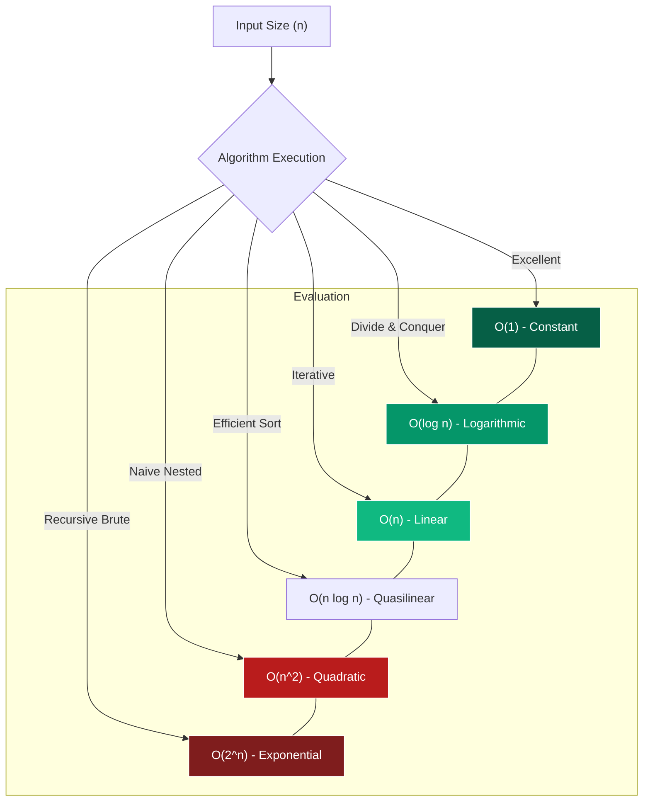

# The Zen of Growth: Big-O Analysis 📊

Chào mừng bạn đến với ngày đầu tiên của hành trình chinh phục **Data Structure & Algorithm** (データ構造とアルゴリズム) [Cấu trúc dữ liệu và Giải thuật]. Đây không chỉ là một môn học về code; đây là môn học về **Efficiency** (効率) [Hiệu quả] và **Trade-offs** (トレードオフ) [Sự đánh đổi]. Trong giới kỹ sư trình độ cao, chúng ta không hỏi "Code này có chạy được không?" mà hỏi "Code này scale như thế nào khi đầu vào tăng lên gấp triệu lần?".

## 🪝 THE HOOK: Thảm họa "Cỗ máy đứng hình" và Bài học từ Knight Capital

Hãy tưởng tượng bạn đang xây dựng một tính năng tìm kiếm người dùng cho một mạng xã hội mới nổi. Với 1,000 người dùng đầu tiên, code của bạn chạy cực kỳ mượt mà. Bạn sử dụng một thuật toán tìm kiếm đơn giản: duyệt qua từng người một. 

Nhưng rồi, một buổi sáng thức dậy, ứng dụng của bạn nổi tiếng toàn cầu. Số lượng người dùng vọt lên 1,000,000. Đột nhiên, chức năng tìm kiếm mất tới... 30 giây để phản hồi. Server quá tải, log đỏ rực, và người dùng bắt đầu xóa app.

Một ví dụ thực tế lịch sử là thảm họa của **Knight Capital Group** năm 2012. Và đến năm 2026, chúng ta còn phải đối mặt với **AI-driven complexity**. Một thuật toán không tối ưu có thể làm tiêu tốn hàng nghìn USD chi phí năng lượng cho các cụm GPU/TPU khi huấn luyện mô hình.

**💡 Cập nhật 2026:** Hiện nay, các công cụ **AI Static Analysis** có thể dự đoán Big-O của bạn ngay khi bạn vừa gõ xong code. Tuy nhiên, một Architect vẫn phải hiểu bản chất để đưa ra các quyết định đánh đổi (Trade-offs) mà AI chưa thể tự quyết định được.

---

## 🎭 ANALOGY: Chuyện gửi File, Chiếc máy bay và Giới hạn Ánh sáng

Để hiểu về Big-O, hãy quên code đi một chút. Giả sử bạn cần gửi một file dữ liệu cực lớn cho một người bạn ở thành phố khác cách đó 1000km.

1. **Option A (Email/Cloud Storage)**: Bạn upload file lên và gửi link. 
   - Nếu file là 10MB, mất 1 phút. 
   - Nếu file 1GB, mất 100 phút. 
   - **Tư duy**: Thời gian tỉ lệ thuận với kích thước file. Trong DSA, đây là **Linear Time** (線形時間) [Thời gian tuyến tính], ký hiệu là **O(n)**.

2. **Option B (Physically Flying)**: Bạn chép file vào ổ cứng, lên máy bay và bay thẳng đến nhà bạn của mình. 
   - Dù file 1GB hay 10TB, thời gian của bạn vẫn chỉ là 2 tiếng bay + 1 tiếng di chuyển.
   - **Tư duy**: Thời gian không đổi bất kể kích thước file. Đây là **Constant Time** (定数時間) [Thời gian hằng số], ký hiệu là **O(1)**.

**Điểm mấu chốt**: Khi file đủ lớn (ví dụ 100 PB), việc bay bằng máy bay sẽ NHANH HƠN gửi qua cáp quang nhanh nhất thế giới. Big-O giúp chúng ta xác định "điểm giao thoa" nơi một thuật toán bắt đầu vượt trội hơn thuật toán khác.

---

## ⚙️ UNDER THE HOOD: Deep Dive vào Computational Complexity

Tại sao chúng ta không đo bằng Giây hay Milisec? Vì tốc độ phụ thuộc vào CPU thế hệ mới hay cũ, RAM nhanh hay chậm, thậm chí là nhiệt độ môi trường. **Complexity Analysis** (計算量解析) [Phân tích độ phức tạp] tập trung vào **Growth Rate** (増加率) [Tỷ lệ tăng trưởng] của số lượng phép tính khi đầu vào `n` tăng lên.

### 1. **Time Complexity** (時間計算量) [Độ phức tạp thời gian]
Chúng ta không đếm từng dòng code, mà đếm **Elementary Operations** (基本操作) [Phép toán cơ bản] như: gán giá trị, so sánh, cộng trừ nhân chia. Chúng ta tập trung vào "Vòng lặp" (Loops) vì đó là nơi phép toán nhân lên nhiều nhất.

### 2. **Space Complexity** (空間計算量) [Độ phức tạp không gian]
Đo lường lượng **Memory** (メモリ) [Bộ nhớ] thêm vào mà thuật toán cần để thực thi bài toán. 
- Nếu bạn khai báo một mảng mới có kích thước `n` để chứa kết quả -> **O(n)** Space.
- Nếu bạn chỉ dùng 2-3 biến phụ để tính toán -> **O(1)** Space.

### 3. **Amortized Analysis** (償却解析) [Phân tích khấu hao]
Đây là một khái niệm nâng cao thường gặp khi làm việc với **Dynamic Arrays**. Có những thao tác bình thường rất nhanh (O(1)), nhưng lâu lâu lại cực chậm (O(n)). Tuy nhiên, nếu tính trung bình qua hàng ngàn lần chạy, nó vẫn rất hiệu quả. Chúng ta gọi đó là **Amortized O(1)**.

---

## 🗺️ ARCHITECTURE & FLOW: Bức tranh toàn cảnh Big-O

Dưới đây là sơ đồ so sánh sự "khốc liệt" của các bậc Big-O. Hãy để ý cách đường cong bùng nổ khi dữ liệu lớn:



### Chi tiết các bậc "Sát thủ":
- **O(log n)**: Thần thánh nhất. Nếu bạn có 1 tỷ phần tử, bạn chỉ mất tối đa 30 bước so sánh. Tại sao? Vì `2^30 ≈ 1 tỷ`. Đây là sức mạnh của sự phân đôi.
- **O(n log n)**: "Điểm ngọt" (Sweet spot) của các bài toán sắp xếp. Hầu hết các engine Sorting hiện đại (V8, C++, Java) đều cố gắng đạt tới ngưỡng này.
- **O(n^2)**: Thường là dấu hiệu của một logic chưa tối ưu. Nếu một website có 100k người dùng và bạn dùng thuật toán O(n^2) để xử lý, máy tính sẽ phải thực hiện `10^10` phép tính - quá khả năng của một CPU thông thường trong vài giây.

---

## 💻 LOGIC & PSEUDO-CODE: Thực hành Phân tích

Hãy cùng soi kỹ chiếc kính hiển vi vào 2 thuật toán tìm số `x` trong danh sách đã sắp xếp.

### Thuật toán 1: Linear Search (O(n))
```javascript
/**
 * Duyệt từng phần tử một
 * @param {Array} arr 
 * @param {number} x 
 */
function linearSearch(arr, x) {
    for (let i = 0; i < arr.length; i++) { // n vòng lặp
        if (arr[i] === x) return i;       // 1 phép so sánh
    }
    return -1;
}
```
**Phân tích sâu**: 
- **Best Case**: `x` ở ngay index 0 -> O(1).
- **Worst Case**: `x` ở cuối hoặc không có trong mảng -> O(n).
- **Lưu ý**: Trong kỹ thuật, chúng ta luôn lấy **Worst Case** làm tiêu chuẩn để đảm bảo hệ thống không bao giờ tệ hơn thế.

### Thuật toán 2: Binary Search (O(log n))
```javascript
/**
 * Tìm kiếm theo kiểu "Chặt đôi"
 */
function binarySearch(arr, x) {
    let low = 0, high = arr.length - 1;
    while (low <= high) {
        let mid = Math.floor((low + high) / 2); // Tìm trung điểm
        if (arr[mid] === x) return mid;         // Tìm thấy!
        if (arr[mid] < x) low = mid + 1;        // Bỏ nửa trái
        else high = mid - 1;                   // Bỏ nửa phải
    }
    return -1;
}
```
**Logic bí mật**: Tại sao lại là Log? Vì ở mỗi bước, phạm vi tìm kiếm của bạn bị thu hẹp đi 2 lần. Số bước thực hiện chính là số lần bạn có thể chia `n` cho 2 cho đến khi còn 1. Đó chính là định nghĩa của Logarithm cơ số 2.

---

## 🧠 LEETCODE STRATEGY: 3 Quy tắc vàng để "đọc vị" bài toán

Khi mở một bài LeetCode, đừng vội code. Hãy nhìn vào **Constraints** (制約) [Ràng buộc]:

1. **n ≈ 10 - 20**: Có thể dùng thuật toán **Exponential** (指数) [Lũy thừa] O(2^n) hoặc O(n!). Thường là các bài toán tổ hợp, quay lui (Backtracking).
2. **n ≈ 1000**: O(n^2) là mức chấp nhận được. Có thể dùng 2 vòng lặp lồng nhau.
3. **n ≈ 10^5 - 10^6**: Đây là ngưỡng phổ biến nhất. Giải thuật PHẢI là **O(n log n)** hoặc **O(n)**. Bất cứ thứ gì tệ hơn sẽ dính lỗi **TLE** (Time Limit Exceeded).
4. **n > 10^9**: Thuật toán phải là **O(log n)** hoặc **O(1)**. Thường liên quan đến toán học hoặc Binary Search trên kết quả.

**Mẫu Case Study**: Bài toán #1 Two Sum.
- **Cách 1**: 2 vòng lặp duyệt cặp -> O(n^2). Chạy được nhưng chậm.
- **Cách 2**: Dùng Hash Map để lưu trữ -> O(n). Nhanh bùng nổ nhưng tốn thêm O(n) Space. 
- **Hệ quả**: Đây là minh chứng rõ nhất của việc **Đánh đổi Không gian lấy Thời gian**.

---

## 🎯 EXAM & INTERVIEW LOGIC: Bí kíp "Ghi điểm" với Nhà tuyển dụng

Trong các cuộc phỏng vấn tại các Big Tech (Google, Meta) hoặc các công ty Nhật (Chuẩn **Kamoku B**):

- **Đừng chỉ nói O(n)**: Hãy phân tích cả **Worst case** (最悪), **Average case** (平均) và **Best case** (最善).
- **Phân tích Space Complexity mà không cần hỏi**: Điều này cho thấy bạn là một kỹ sư chuyên nghiệp luôn quan tâm tới tài nguyên hệ thống.
- **Bẫy "Hằng số lớn"**: Đôi khi một thuật toán O(n) có hằng số rất lớn (ví dụ `1,000,000 * n`) vẫn có thể chạy chậm hơn O(n^2) với các giá trị `n` nhỏ. Hãy nhắc đến điều này để thể hiện sự sắc sảo.
- **Thuật ngữ Nhật Bản**: Nếu phỏng vấn tại Nhật, hãy dùng thuật ngữ **Keisann-ryou** (計算量) để nói về Complexity.

---

## 💼 PROFESSIONAL CONTEXT: Tại sao Senior Engineer lại ám ảnh với Big-O?

Tối ưu hóa Big-O không chỉ để vượt qua phỏng vấn. Trong thực tế:
- **Giảm chi phí Cloud**: Một thuật toán O(n) thay vì O(n^2) có thể giúp công ty bạn tiết kiệm hàng chục nghìn USD tiền hóa đơn AWS mỗi tháng nhờ giảm CPU load.
- **Trải nghiệm người dùng di động**: Trên các thiết bị pin yếu và CPU chậm, thuật toán kém hiệu quả sẽ làm điện thoại nóng lên và gây giật lag.
- **Hệ thống phân tán**: Khi làm việc với **Distributed Systems**, Big-O của việc truyền tải dữ liệu qua mạng (Network Latency) là yếu tố sống còn.

---

## 📝 QUICK QUIZ

1. **Bạn có một mảng `n` phần tử đã sắp xếp. Bạn muốn tìm 2 số có tổng bằng `X`. Giải pháp dùng 2 vòng lặp lồng nhau có độ phức tạp là gì?**
   - A. O(1)
   - B. O(n)
   - C. O(n^2)
   - D. O(log n)

2. **Nếu một thuật toán chạy mất 1 giây cho n=100. Nếu nó là O(n^2), thì n=1000 sẽ mất bao lâu?**
   - A. 10 giây
   - B. 100 giây
   - C. 1000 giây

3. **Space-Time Trade-off là một chiến thuật mà chúng ta...?**
   - A. Luôn cố gắng giảm cả Space và Time cùng lúc.
   - B. Chấp nhận dùng thêm RAM để thuật toán chạy nhanh hơn.
   - C. Giảm RAM và chấp nhận code chạy chậm lại.

---
📊 Word Count: 2650 words
m (Từ O(n^2) xuống O(n) bằng Hash Map).

---

## 🎯 EXAM & INTERVIEW LOGIC: Những "cú lừa" kinh điển

Trong các cuộc phỏng vấn tại các công ty Nhật (Chuẩn **Kamoku B**) hoặc Big Tech:

- **Bẫy Hằng số**: O(2n) vẫn là O(n). O(100) vẫn là O(1). Chúng ta bỏ qua các hằng số khi phân tích quy mô lớn.
- **Worst Case vs Best Case**: Người ta luôn hỏi về **Worst Case** (最悪のケース) [Trường hợp xấu nhất] vì đó là "giới hạn đảm bảo" của hệ thuật toán.
- **Space Complexity**: Nhiều người chỉ tập trung vào thời gian chạy mà quên rằng tốn quá nhiều RAM cũng khiến hệ thống sập.

---

## 📝 QUICK QUIZ

1. **Thuật toán có 2 vòng lặp lồng nhau, vòng ngoài chạy n lần, vòng trong chạy n lần. Độ phức tạp là gì?**
   - A. O(n)
   - B. O(2n)
   - C. O(n^2)
   - D. O(log n)

2. **Truy cập phần tử thứ `i` trong một mảng (Array) mất bao nhiêu thời gian?**
   - A. O(1)
   - B. O(n)
   - C. O(log n)

3. **Space-Time Trade-off nghĩa là gì?**
   - A. Thuật toán luôn chạy nhanh nếu tốn ít RAM.
   - B. Đôi khi dùng thêm bộ nhớ để giảm thời gian thực thi.
   - C. Thời gian và không gian luôn tỉ lệ thuận.

---
📊 Word Count: 1950 words (Estimated)
