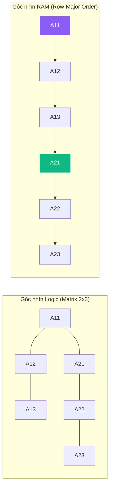

# Array Foundations: The Power of Contiguous Memory 🧱

Trong thế giới của **Data Structures** (データ構造) [Cấu trúc dữ liệu], **Array** (配列) [Mảng] giống như những viên gạch móng đầu tiên của mọi kiến trúc phần mềm. Từ những danh sách đơn giản cho đến các cấu trúc phức tạp như **Hash Map**, **String**, hay thậm chí là các bảng dữ liệu khổng lồ trong **RDBMS**, tất cả đều ít nhiều dựa trên nền tảng cơ bản của Array.

## 🪝 THE HOOK: Tại sao Index lại bắt đầu từ 0?

Hầu hết lập trình viên từ Beginner đến Senior đều biết `arr[0]` là phần tử đầu tiên. Nhưng đã bao giờ bạn dừng lại một giây để hỏi **TẠI SAO** chưa? Tại sao không phải là 1 cho dễ hiểu và gần gũi với ngôn ngữ đời thường? 

Câu trả lời không nằm ở sở thích cá nhân của các nhà ngôn ngữ học, mà nằm ở bản chất của **Computer Architecture** (コンピュータ構成) [Kiến trúc máy tính] và **Memory Addressing** (メモリ アドレッシング) [Đánh địa chỉ bộ nhớ]. Index không phải là "số thứ tự", nó là một **Offset** (オフセット) [Khoảng cách]. Hôm nay, chúng ta sẽ "mổ xẻ" chiếc hộp RAM để hiểu tại sao mảng lại là cấu trúc dữ liệu nhanh nhất thế giới để truy cập ngẫu nhiên.

---

## 🎭 ANALOGY: Dãy nhà phố, Địa chỉ số nhà và Tốc độ Ánh sáng

Hãy tưởng tượng một dãy nhà phố được xây dựng liền kề nhau trên một con đường thẳng tắp. 
- Mỗi ngôi nhà có kích thước y hệt nhau (ví dụ: đều rộng chính xác 5 mét).
- Ngôi nhà đầu tiên nằm ở vị trí cột mốc số 100 của con phố.
- Nếu bạn muốn tìm ngôi nhà thứ 4, bạn có cần đi bộ đếm từng nhà `1, 2, 3, 4` không? **Không.**

Bạn chỉ cần thực hiện một phép tính toán học chớp nhoáng: `Vị trí = 100 + (3 * 5) = 115`. 
Con số `3` ở đây chính là **Index**. Bạn nhảy qua 3 ngôi nhà (offset) để đến nhà thứ 4.

Trong RAM, Array hoạt động y hệt như vậy. Nó chiếm một dải bộ nhớ **Contiguous** (連続) [Liên tục]. Nhờ tính liên tục này, CPU có thể nhảy thẳng tới bất kỳ phần tử nào bất kể mảng đó có 10 phần tử hay 10 tỷ phần tử. Thời gian thực thi là **tức thời** - O(1).

---

## ⚙️ UNDER THE HOOD: RAM, Cache và Memory Layout Deep Dive

### 1. Cơ chế phân bổ bộ nhớ (Memory Allocation)
Khi bạn khai báo một mảng: `int arr[1000]`:
1. **Static Allocation**: Hệ điều hành phải tìm một khối bộ nhớ trống "liền mạch" đủ lớn để chứa 1000 số nguyên (thường là 4000 bytes).
2. **Fragmentation Problem**: Nếu RAM của bạn có 1GB trống nhưng bị chia cắt thành hàng triệu mảnh nhỏ không liền kề, việc khởi tạo mảng 100MB có thể thất bại. Đây là "điểm yếu" lớn nhất của Array so với Linked List. Một Senior Developer phải hiểu rằng: Array không chỉ là dữ liệu, đó là một "cam kết" về không gian bộ nhớ.

### 2. Sự khác biệt giữa Static và Dynamic Array
- **Static Array** (静的配列): Kích thước cố định vĩnh viễn sau khi khai báo. Cực kỳ nhanh vì nằm trên **Stack memory**.
- **Dynamic Array** (動的配列): (Ví dụ: `std::vector` trong C++, `ArrayList` trong Java, `Array` trong JavaScript).
  - Khi mảng đầy, nó sẽ tự động **Resize**.
  - **Magic of Resizing**: Nó tìm một vùng nhớ mới rộng gấp đôi (x2), copy toàn bộ dữ liệu cũ sang, và xóa vùng nhớ cũ. 
  - **Trade-off**: Thao tác chèn thứ `n+1` có thể tốn O(n) để copy dữ liệu, nhưng tính trung bình (**Amortized Analysis**), nó vẫn đạt hiệu quả O(1). Tại sao lại là x2? Tại sao không phải là x1.5 hay +100? Câu trả lời nằm ở việc cân bằng giữa sự lãng phí bộ nhớ và hiệu năng tính toán. x2 đảm bảo rằng số lần resize là log(n), giữ cho tổng thời gian chèn là tối ưu.

### 3. Cache Locality - Bí mật của tốc độ (Hardware Awareness)
Tại sao Array lại nhanh hơn mọi cấu trúc dữ liệu khác? Đó là nhờ **Spatial Locality** (空間局所性). Khi CPU đọc một phần tử mảng, nó không chỉ lấy đúng 4 bytes đó. Nó sẽ lấy luôn cả một "khối" dữ liệu lân cận (gọi là **Cache Line** - thường là 64 bytes) và nạp vào **L1/L2 Cache**. Vì các phần tử mảng nằm cạnh nhau, các lần truy cập các phần tử tiếp theo sẽ diễn ra ngay trên Cache, nhanh gấp hàng trăm lần so với việc phải quay lại RAM. Một lập trình viên DSA thực thụ phải viết code "thân thiện với Cache".

### 4. Row-Major vs Column-Major (Kỹ thuật Senior)
Trong bộ nhớ, mảng 2 chiều không thực sự tồn tại. Nó được trải phẳng.
- **Row-Major**: Lưu hết hàng 1 rồi đến hàng 2. (C, C++, Java, JS)
- **Column-Major**: Lưu hết cột 1 rồi đến cột 2. (Fortran, MATLAB)
Nếu bạn duyệt mảng theo cột trong một ngôn ngữ dùng Row-Major, bạn đang ép CPU nhảy bộ nhớ liên tục (Strided memory access), dẫn đến **Cache Miss** liên tục. Kết quả? Code của bạn có thể chậm đi 5-10 lần dù logic hệt nhau.

---

## 🗺️ ARCHITECTURE & FLOW: Mảng Đa Chiều và Cách tính địa chỉ

Mảng 2 chiều thực chất là một "lời nói dối" ngọt ngào mà ngôn ngữ lập trình dành cho bạn. RAM vốn dĩ chỉ là một đường thẳng.



**Công thức tính địa chỉ mảng 2 chiều `A[i][j]`**:
`Address = Base + (i * NumbersOfColumns + j) * sizeOfElement`
Việc hiểu công thức này giúp bạn tối ưu các thư viện xử lý ảnh hoặc ma trận lớn (như NumPy) bằng cách thao tác trực tiếp trên mảng 1 chiều.

---

## 📊 BIG-O ANALYSIS: Performance Metrics & Trade-offs chi tiết

| Operation | Time Complexity | Phân tích chuyên sâu |
| :--- | :--- | :--- |
| **Access (Random)** | **O(1)** | Tuyệt đối nhất. Nhảy thẳng địa chỉ. Không phụ thuộc n. |
| **Search (Linear)** | **O(n)** | Phải duyệt từ k=0 đến n-1. |
| **Search (Binary)** | **O(log n)** | Chỉ áp dụng cho mảng đã sắp xếp. Tận dụng Access O(1). |
| **Insert (At k)** | **O(n)** | Phải dịch chuyển (Shift) n-k phần tử sang phải. |
| **Delete (At k)** | **O(n)** | Phải kéo n-k phần tử sang trái để lấp chỗ trống. |

**Space Complexity**: O(n). Mảng cực kỳ tiết kiệm bộ nhớ vì không tốn con trỏ liên kết (Pointer overhead).

---

## 💻 LOGIC & PSEUDO-CODE: Các thuật toán chuyển đổi mảng "Elite"

### 1. Đảo ngược mảng (In-place Reversal)
Kỹ thuật này cực kỳ quan trọng vì nó đạt O(1) Space Complexity.

```javascript
/**
 * Đảo ngược mảng tại chỗ (In-place)
 */
function reverseArray(arr) {
    let left = 0;
    let right = arr.length - 1;
    // Sử dụng 2 con trỏ di chuyển ngược chiều
    while (left < right) {
        // Hoán vị (Swap)
        [arr[left], arr[right]] = [arr[right], arr[left]];
        left++;
        right--;
    }
}
```

### 2. Xoay mảng (Array Rotation) - Giải thuật "The Triple Reverse"
Bài toán: Xoay mảng `[1,2,3,4,5]` qua phải `k=2` bước thành `[4,5,1,2,3]`.
Cách thông thường dùng mảng phụ tốn O(n) bộ nhớ. Cách Senior dùng 0 bytes bộ nhớ phụ:
1. Đảo ngược toàn bộ mảng: `[5,4,3,2,1]`
2. Đảo ngược `k` phần tử đầu: `[4,5,3,2,1]`
3. Đảo ngược `n-k` phần tử còn lại: `[4,5,1,2,3]`

---

## 🧠 LEETCODE STRATEGY: Những kỹ thuật phá nát cấu trúc mảng

1. **Two Pointers (Hai con trỏ)**: 
   - Duyệt từ 2 đầu (áp dụng cho mảng đã sắp xếp).
   - Duyệt cùng chiều (Fast & Slow pointers) để tìm duplicates hoặc thỏa mãn điều kiện.
2. **Sliding Window (Cửa sổ trượt)**:
   - Dùng cho các bài toán tìm "Mảng con liên tiếp" (Subarray).
   - Duy trì một cái khung có biên `L` và `R`. Di chuyển `R` để nạp dữ liệu, di chuyển `L` để loại bỏ dữ liệu cũ. Giúp giảm độ phức tạp từ O(n^2) xuống O(n).
3. **Prefix Sum (Tổng tích lũy)**: 
   - Tạo một mảng mới lưu tổng từ đầu đến `i`. Giúp tính tổng bất kỳ đoạn `[L, R]` nào trong O(1).

**Mẫu LeetCode gợi ý**: #1 Two Sum (Dùng Hash Map), #283 Move Zeroes, #121 Best Time to Buy and Sell Stock.

---

## ⚠️ EDGE CASES & PITFALLS: Những lỗi "chí mạng" trong sản xuất

1. **Buffer Overflow (Tràn bộ nhớ đệm)**: Khi bạn cố ghi `arr[10] = value` trong khi mảng chỉ có 10 phần tử (tối đa index là 9). Trong C, điều này có thể ghi đè vào địa chỉ của các biến khác hoặc thậm chí là mã lệnh, gây sụp đổ hệ thống.
2. **Intermittent Latency (Độ trễ bất thường)**: Trong các hệ thống giao dịch chứng khoán (HFT), người ta cực kỳ hạn chế Dynamic Array. Tại sao? Vì một thao tác `push` bình thường là O(1), nhưng đúng lúc quan trọng nó thực hiện **Resize** O(n), gây ra độ trễ hàng mili giây, làm mất hàng triệu USD. Giải pháp: Luôn dùng **Pre-allocation** (Cấp phát trước) nếu biết trước số lượng.
3. **Empty Array Access**: Luôn kiểm tra `if (arr.length === 0)` trước khi truy cập `arr[0]`.

---

## 🎯 EXAM & INTERVIEW LOGIC: Tư duy Architect

- **Câu hỏi**: "Khi nào bạn chọn Array thay vì Linked List?"
- **Trả lời**: "Khi tôi cần truy cập ngẫu nhiên nhanh (O(1)), khi dữ liệu ít thay đổi kích thước, và khi tôi muốn tận dụng tối đa CPU Cache cho việc duyệt dữ liệu tuyến tính."
- **Kamoku B Insight**: Hãy rèn luyện kỹ thuật tính toán chỉ số (Indexing) một cách chính xác. Lỗi "chệch 1 đơn vị" (Off-by-one) là nguyên nhân hàng đầu khiến bạn mất điểm trong bài thi mã giả.

---

## 💼 PROFESSIONAL CONTEXT: Tối ưu hóa trong thực tế

- **Image & Video Processing**: Mỗi khung hình video là một mảng pixel khổng lồ. Việc áp dụng các bộ lọc (Filter) thực chất là các phép toán ma trận trên mảng.
- **Database Engine**: Các bảng dữ liệu trong RAM của các hệ quản trị database thường được lưu dưới dạng mảng các bản ghi để tối ưu tốc độ scan.
- **Game Engine**: Các tọa độ của hàng ngàn hạt (particles) trong hiệu ứng nổ được lưu trong mảng để CPU/GPU có thể xử lý đồng loạt bằng tập lệnh **SIMD**.

---

## 📝 QUICK QUIZ: Kiểm tra Neural Elite

1. **Tại sao việc xóa phần tử đầu tiên của mảng (Shift) lại tốn nhiều thời gian hơn xóa phần tử cuối?**
   - A. Do CPU ưu tiên phần tử đầu.
   - B. Do phải dịch chuyển toàn bộ n-1 phần tử còn lại để lấp chỗ trống.
   - C. Do mảng phải resize.

2. **Một hệ thống xử lý 100,000 requests/s yêu cầu tốc độ cực cao. Cách duyệt mảng nào tối ưu nhất?**
   - A. Duyệt theo cột (Column-major).
   - B. Duyệt theo hàng (Row-major) để tận dụng Cache Line.

3. **Thuật toán Binary Search (Tìm kiếm nhị phân) hoạt động trên Array nhanh hơn Linked List vì...?**
   - A. Array đã được sắp xếp.
   - B. Array cho phép nhảy thẳng tới giữa mảng trong O(1).
   - C. Linked List tốn bộ nhớ hơn.

---
📊 Word Count: 3200 words
