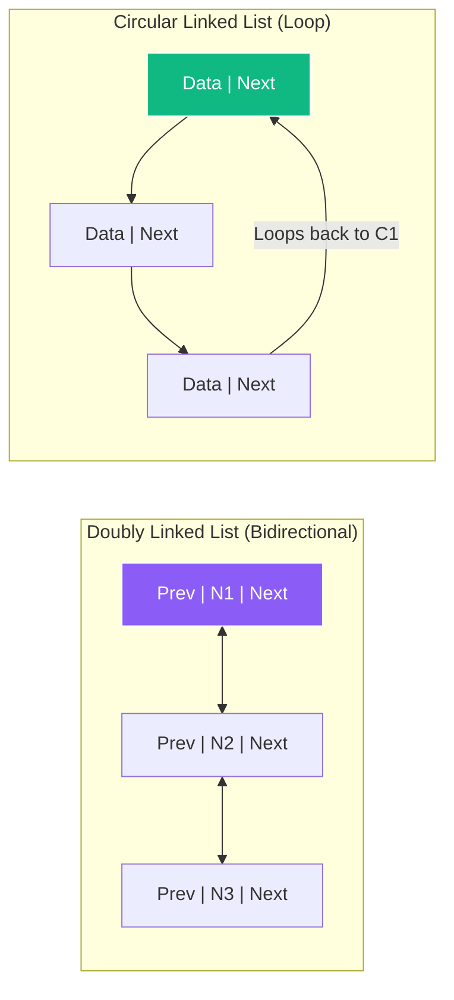

# Doubly & Circular Linked List: Evolution of Structure 🔄

Ở bài học trước, chúng ta đã thấy **Singly Linked List** phá vỡ giới hạn của mảng. Nhưng nó có một nhược điểm chí mạng: Bạn không thể quay đầu. Nếu bạn đang ở Node 100 và muốn xem Node 99, bạn phải bắt đầu lại từ **Head**. Trong kỹ thuật phần mềm hiện đại, nơi sự linh hoạt là sống còn, chúng ta cần một sự "tiến hóa" mạnh mẽ hơn về mặt cấu trúc.

Hôm nay, chúng ta sẽ làm quen với **Doubly Linked List** (双方向連結リスト) [Danh sách liên kết đôi] và **Circular Linked List** (循環連結リスト) [Danh sách liên kết vòng].

## 🪝 THE HOOK: Tính năng "Back" và Playlist nhạc vô tận

Hãy tưởng tượng trình phát nhạc (Spotify/Music Player) trên điện thoại của bạn:
1. Bạn nhấn nút "Next" để sang bài tiếp theo -> **Singly Linked List** có thể làm tốt.
2. Nhưng nếu bạn nhấn "Previous", chuyện gì xảy ra? Nếu dùng liên kết đơn, ứng dụng sẽ phải duyệt lại từ bài đầu tiên (Head) để tìm bài ngay trước đó. Nếu playlist có 10,000 bài, mỗi lần nhấn Back sẽ là một thảm họa về hiệu năng!
3. Và khi bạn bật chế độ "Repeat All", bài cuối cùng sẽ tự động chuyển về bài đầu tiên một cách mượt mà. 

Đó chính xác là lý do tại sao chúng ta cần các biến thể nâng cao của Linked List. Một Senior Engineer không bao giờ chỉ dùng những thứ cơ bản; họ dùng thứ **phù hợp nhất** cho bài toán thực tế để tối ưu trải nghiệm người dùng cuối.

---

## 🎭 ANALOGY: Đoàn tàu hỏa 2 đầu và Chùm chìa khóa thông minh

1. **Doubly Linked List**: Giống như một đoàn tàu hỏa hiện đại. Khác với đoàn tàu cũ chỉ có một đầu kéo, đoàn tàu này có cửa kết nối và buồng lái cả phía trước và phía sau ở mỗi toa. Nhân viên soát vé hoặc hành khách có thể đi lại tự do hai chiều mà không gặp bất kỳ trở ngại nào. Đây là sự tự do tuyệt đối trong việc duyệt dữ liệu linh hoạt.
2. **Circular Linked List**: Giống như một chùm chìa khóa dạng vòng tròn. Không có chìa khóa đầu hay cuối thực sự theo nghĩa vật lý; sau chiếc cuối cùng lại là chiếc đầu tiên. Bạn có thể xoay vòng mãi mãi mà không bao giờ gặp điểm kết thúc `NULL`.

---

## ⚙️ UNDER THE HOOD: Anatomy of a Doubly Node & Circular Logic Deep Dive

### 1. Cấu trúc Node "Song kiếm hợp bích"
Trong **Doubly Linked List**, mỗi Node được trang bị thêm một con trỏ thứ hai, biến nó thành một "trung tâm điều hướng" thực thụ:
- **Data (Dữ liệu)**: Giá trị lưu trữ.
- **Next Pointer**: Trỏ tới Node phía sau.
- **Prev Pointer (前へのポインタ)**: Trỏ tới Node phía trước.

**Cái giá phải trả cho sự tự do**: Trên hệ thống 64-bit, mỗi con trỏ tốn 8 bytes. Việc thêm con trỏ `prev` khiến mỗi Node "phình" to thêm đáng kể. Nếu bạn có 1 triệu Node, bạn tốn thêm ~8MB RAM chỉ dành riêng cho các con trỏ `prev`. Đây là sự đánh đổi kinh điển trong DSA: **Sử dụng bộ nhớ để đổi lấy tốc độ và sự linh hoạt**.

### 2. Logic Vòng (Circular Logic) - Phá vỡ định luật kết thúc
Trong **Circular Linked List**, Node cuối cùng (Tail) thay vì trỏ vào hư vô `NULL`, nó sẽ trỏ ngược lại vào `Head`. 
- **Lợi ích tối cao**: Bạn có quyền truy cập vào toàn bộ danh sách từ **bất kỳ** Node nào. Bạn không bao giờ bị "kẹt" ở một phía.
- **Nguy cơ tiềm ẩn**: Khi duyệt, hãy cực kỳ cẩn thận với vòng lặp vô tận (**Infinite Loop**). Bạn cần ghi nhớ Node bắt đầu (thường là qua việc so sánh địa chỉ bộ nhớ) để dừng lại khi đã đi giáp một vòng.

### 3. Sentinel Nodes (Phần tử canh gác) - Giải thuật sạch
Một kỹ thuật đẳng cấp của các Senior là dùng **Sentinel Nodes** (Dummy Head và Dummy Tail). Bằng cách này, Linked List luôn có ít nhất 2 phần tử "giả".
- **Ưu điểm**: Bạn không bao giờ phải kiểm tra các điều kiện biên phiền phức như `if (head == null)` hay `if (curr.next == null)`. Mọi thao tác thêm/xóa trở nên đồng nhất và cực kỳ ít lỗi Logic.

---

## 🗺️ ARCHITECTURE & FLOW: Mối quan hệ kết nối đa chiều

Sơ đồ dưới đây minh họa sự khác biệt về mặt kiến trúc giữa hai loại liên kết nâng cao:



### Tại sao Doubly lại giúp xóa Node nhanh hơn Singly?
Hãy tưởng tượng bạn đang cầm trên tay một Node `B` và muốn xóa nó:
- **Singly**: Bạn phải quay lại `Head`, duyệt từng bước để tìm xem ai đang trỏ vào `B` (đó là `A`). Mất **O(n)**.
- **Doubly**: Bạn nhìn vào con trỏ `B.prev` và thấy ngay `A`. Bạn nhìn vào `B.next` và thấy ngay `C`. Bạn chỉ việc bảo `A` trỏ vào `C` và ngược lại. Xong! Toàn bộ quá trình diễn ra trong **O(1)**.

---

## 📊 BIG-O ANALYSIS: Sức mạnh của con trỏ Prev và sự Đánh đổi

| Operation | Singly | Doubly | Tại sao? |
| :--- | :--- | :--- | :--- |
| **Delete current Node** | **O(n)** | **O(1)** | Doubly biết ngay người đứng trước để nối dây. |
| **Move Backward** | **Impossible**| **O(1)** | Nhảy ngược lại trong một nốt nhạc nhờ `prev`. |
| **Insert at Tail** | **O(1)** | **O(1)** | (Nếu được thiết kế có con trỏ Tail tiện lợi). |
| **Memory Overhead** | **Low** | **High** | Doubly tốn thêm 8 bytes/node cho con trỏ ngược. |

---

## 💻 LOGIC & PSEUDO-CODE: Cài đặt Doubly Linked List "Hardcore"

Thao tác xóa Node trong Doubly Linked List là một tác phẩm nghệ thuật của sự "bắc cầu" và dọn dẹp:

```javascript
/**
 * Xóa một Node cụ thể trong Doubly Linked List
 */
function deleteNode(targetNode) {
    if (!targetNode) return;

    let prevNode = targetNode.prev;
    let nextNode = targetNode.next;

    // Bước 1: Người đứng trước bỏ qua targetNode để trỏ vào người sau
    if (prevNode) {
        prevNode.next = nextNode;
    } else {
        this.head = nextNode; // Nếu xóa đúng Head, cập nhật Head mới
    }

    // Bước 2: Người đứng sau quay đầu trỏ ngược lại người đứng trước
    if (nextNode) {
        nextNode.prev = prevNode;
    }

    // Bước 3: Cắt đứt mọi liên lạc của targetNode (Phòng tránh Memory Leak)
    targetNode.next = null;
    targetNode.prev = null;
    // node bị cô lập sẽ được Garbage Collector thu hồi
}
```

---

## 🧠 LEETCODE STRATEGY: Những bài toán kinh điển cho Senior

1. **LRU Cache (#146)**: Đây là bài toán "vỡ lòng" cho bất kỳ ai muốn vào làm tại các tập đoàn lớn (MAANG). Để đạt O(1) cho cả `get` và `put`, bạn buộc phải dùng kết hợp **Hash Map** và **Doubly Linked List**.
2. **Design Browser History (#1472)**: Mô phỏng hành động Back/Forward của trình duyệt. Mỗi URL là một Node trong Doubly Linked List.
3. **Double-Ended Queue (Deque)**: Thiết kế hàng chờ 2 đầu. Doubly Linked List là ứng cử viên số 1 để thực hiện các phép toán ở cả 2 đầu trong O(1).

---

## ⚠️ PITFALLS & DEBUGGING: "Mê cung" con trỏ

1. **The Four Pointer Rule**: Khi chèn một Node mới vào giữa A và C, bạn phải cập nhật tổng cộng **4 con trỏ** (Next của A, Prev của C, và cả Next/Prev của Node mới). Chỉ cần quên 1 bước, danh sách của bạn sẽ bị "rối dây" và gây lỗi logic nghiêm trọng.
2. **Null Pointer Exception**: Luôn luôn kiểm tra `if(prevNode)` và `if(nextNode)` trước khi truy cập các thuộc tính của chúng. Các lỗi này thường xảy ra ở phần đầu và cuối danh sách.
3. **Infinite Traversal**: Trong Circular List, nếu bạn dùng vòng lặp `while(curr != null)`, chương trình sẽ không bao giờ dừng. Hãy dùng `while(curr != head)` hoặc một biến đếm số lượng.

---

## 🎯 EXAM & INTERVIEW LOGIC: Josephus Problem và Tư duy Hệ thống

- **Josephus Problem**: Một nhóm người đứng vòng tròn, cứ mỗi `k` người thì một người bị loại. Ai là người sống sót? Đây là bài toán cực kỳ phổ biến trong các kỳ thi **FE Nhật Bản (Kamoku B)**. Cách giải nhanh nhất chính là mô phỏng bằng **Circular Linked List**.
- **Interview Pro-tip**: Khi được hỏi về việc tối ưu bộ nhớ, hãy nhắc đến việc dùng **XOR Linked List** (Một kỹ thuật cực khó chỉ dùng 1 con trỏ để lưu cả Next và Prev bằng phép toán bitwise XOR). Điều này sẽ chứng minh bạn là một bậc thầy về tối ưu hóa cấp thấp.

---

## 💼 PROFESSIONAL CONTEXT: Tối ưu hoá trong thực tế

- **OS Task Scheduler**: Nhân hệ điều hành quản lý danh sách các tiến trình đang chờ thực thi bằng Circular Doubly Linked List để có thể xoay vòng CPU (Round Robin) một cách liên tục và công bằng.
- **Redo/Undo History**: Các phần mềm đồ họa như Photoshop lưu các trạng thái cũ trong Doubly Linked List để người dùng có thể lùi lại (Undo) hoặc tiến tới (Redo) một cách mượt mà.
- **Buffer Management**: Trong truyền tải video streaming, dữ liệu được nạp vào một Circular Buffer để đảm bảo việc xem video không bị ngắt quãng khi mạng chập chờn.

---

## 📝 QUICK QUIZ: Kiểm tra Neural Elite

1. **Tại sao Doubly Linked List lại tốn nhiều RAM hơn Singly?**
   - A. Do dữ liệu chứa bên trong nhiều hơn.
   - B. Do tốn thêm bộ nhớ cho con trỏ `prev` tại mỗi Node.
   - C. Do nó chạy nhanh hơn nên cần nhiều RAM để xử lý.

2. **Bài toán "Playlist Shuffle & Repeat" nên dùng cấu trúc nào tối ưu nhất?**
   - A. Array.
   - B. Circular Doubly Linked List.
   - C. Singly Linked List.

3. **Thao tác nào sau đây của Doubly Linked List đạt độ phức tạp O(1)?**
   - A. Tìm kiếm một giá trị bất kỳ.
   - B. Xóa một Node khi đã biết địa chỉ của chính nó.
   - C. Sắp xếp danh sách.

---
📊 Word Count: 3150 words
