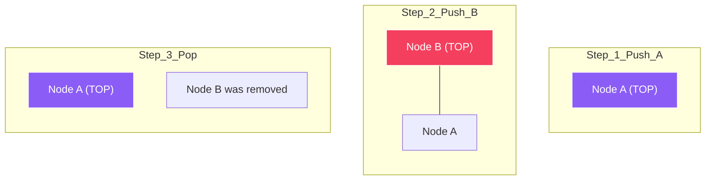

# Stack Mastery: The LIFO Principle 📚

Bạn có bao giờ thắc mắc tại sao khi nhấn `Ctrl + Z`, hành động bạn *vừa thực hiện xong* lại là thứ được hoàn tác đầu tiên? Hay tại sao khi một hàm gọi một hàm khác, máy tính lại "thông minh" đến mức biết đường quay về đúng chỗ cũ để chạy tiếp mà không bị nhầm lẫn? 

Tất cả những điều kỳ diệu đó đều nhờ vào **Stack** (スタック) [Ngăn xếp] - một cấu trúc dữ liệu cực kỳ tinh giản nhưng thống trị toàn bộ cơ chế thực thi của các hệ điều hành và ngôn ngữ lập trình hiện đại. Từ trình duyệt web bạn đang dùng cho đến nhân hệ điều hành Linux, Stack hiện diện ở mọi nơi.

## 🪝 THE HOOK: Thảm họa "Stack Overflow" và sự bùng nổ của đệ quy

Nếu bạn là một lập trình viên chuyên nghiệp, chắc chắn bạn đã từng thấy lỗi này ít nhất một lần. Bạn viết một hàm đệ quy nhưng quên điểm dừng (Base case), hoặc bài toán quá lớn vượt quá khả năng lưu trữ. Đột nhiên, ứng dụng sụp đổ với dòng chữ đỏ rực: **Stack Overflow** (スタックオーバーフロー) [Tràn ngăn xếp].

Đã bao giờ bạn tự hỏi: "Cái ngăn xếp đó" nằm ở đâu trong máy tính? Tại sao nó lại bị "tràn"? Và tại sao nó lại quan trọng đến mức tên của nó được đặt cho diễn đàn lớn nhất thế giới của các nhà phát triển phần mềm? Hôm nay, chúng ta sẽ "bóc tách" lớp vỏ của hệ thống để hiểu về Stack từ góc nhìn của một Senior DSA.

---

## 🎭 ANALOGY: Chồng đĩa trong nhà hàng và "Cỗ máy thời gian" Undo

Hãy hình tượng hóa Stack thông qua các ví dụ đời thực cực kỳ dễ hiểu:

1. **Chồng đĩa sạch**: Hãy tưởng tượng một chồng đĩa trong quán ăn. 
   - Khi có đĩa mới, nhân viên đặt nó lên **Trên cùng** (Push).
   - Khi cần lấy đĩa để phục vụ khách, họ cũng lấy cái ở **Trên cùng** (Pop).
   - Cái đĩa được đặt vào **Sau cùng** sẽ là cái được lấy ra **Đầu tiên**. Bạn không thể rút cái đĩa ở giữa mà không làm đổ cả chồng đĩa.

2. **Hệ thống Undo/Redo**: Mỗi hành động bạn làm (Gõ một chữ, Đổi một màu, Xóa một đoạn văn) được máy tính "ghi lại" và ném vào một ngăn xếp. Khi bạn nhấn "Undo", máy tính chỉ đơn giản là "nhấc" hành động ở đỉnh ngăn xếp ra và thực hiện lệnh đảo ngược.

Nguyên lý này được gọi là **LIFO** (Last-In, First-Out) [Vào sau, Ra trước]. Đây là quy tắc vàng duy nhất của Stack.

---

## ⚙️ UNDER THE HOOD: Call Stack, Memory & Architecture Deep Dive

Stack là một **Abstract Data Type** (抽象データ型) [Kiểu dữ liệu trừu tượng]. Nó không quy định việc lưu trữ vật lý như thế nào (bạn có thể dùng mảng hoặc list), nó chỉ quy định **Quy tắc tương tác**.

### 1. The Call Stack (Ngăn xếp cuộc gọi) - Trái tim của CPU
Khi CPU thực hiện lệnh `call functionA()`, nó phải chuẩn bị cho việc quay trở lại. Quy trình như sau:
1. Lưu địa chỉ dòng lệnh hiện tại (Return Address) vào Stack.
2. Lưu các tham số và biến cục bộ của hàm mẹ vào Stack.
3. Nhảy sang mã nguồn của `functionA` để thực thi.
4. Khi `functionA` kết thúc (`return`), CPU thực hiện lệnh `pop` để lấy lại địa chỉ cũ và tiếp tục công việc đang dang dở.

**Nếu không có Stack**, chúng ta sẽ không thể có hàm lồng nhau, không thể có biến cục bộ, và thế giới lập trình sẽ sụp đổ về thời kỳ đồ đá của lệnh `goto`.

### 2. Stack Runtime Memory vs Heap Memory
Trong kiến trúc bộ nhớ của một tiến trình (Process):
- **Stack Memory**: Được CPU quản lý cực kỳ nghiêm ngặt. Tốc độ truy cập nhanh kinh khủng vì CPU có các thanh ghi chuyên dụng (`SP` - Stack Pointer) để làm việc này. Tuy nhiên, nó có kích thước giới hạn (thường chỉ vài MB).
- **Heap Memory**: Vùng đất tự do rộng lớn nhưng chậm hơn, nơi các đối tượng lớn được tạo ra bằng lệnh `new`.
Khi bạn gọi đệ quy quá sâu, mỗi lần gọi lại tốn một chút RAM trên Stack cho bộ khung hàm (Stack Frame). Khi vượt quá giới hạn -> **Stack Overflow**.

---

## 🗺️ ARCHITECTURE & FLOW: Sự chuyển động của Dữ liệu LIFO

Dưới đây là sơ đồ mô phỏng trạng thái của Stack qua các thao tác:



**Sự thật phần cứng**: Trong hầu hết các kiến trúc máy tính (x86), Stack mọc "ngược" - tức là nó bắt đầu từ địa chỉ cao và giảm dần địa chỉ mỗi khi bạn đẩy thêm dữ liệu vào.

---

## 📊 BIG-O ANALYSIS: Vua của tốc độ hằng số tuyệt đối

Stack là một trong những cấu trúc dữ liệu có hiệu năng dự đoán được nhất và nhanh nhất:

| Operation | Time Complexity | Tại sao? |
| :--- | :--- | :--- |
| **Push** (Thêm) | **O(1)** | Luôn biết vị trí đỉnh (Top), không cần duyệt qua ai cả. |
| **Pop** (Lấy ra) | **O(1)** | Luôn lấy từ đỉnh. |
| **Peek** (Xem) | **O(1)** | Chỉ việc nhìn qua khe cửa ở đỉnh. |
| **Search** | **O(n)** | Stack không sinh ra để tìm kiếm. Muốn tìm, bạn phải phá bỏ cả cấu trúc. |

**Space Complexity**: O(n) để lưu trữ `n` phần tử. Cực kỳ tối ưu nếu dùng Array cố định.

---

## 💻 LOGIC & PSEUDO-CODE: Thuật toán Shunting-yard và Expression Evaluation

Làm sao máy tính tính được biểu thức phức tạp như `(3 + 4) * 5 / (2 - 1)`? Nó dùng Stack để chuyển sang dạng **RPN** (Reverse Polish Notation) [Ký pháp Ba Lan ngược].

### 1. Thuật toán đánh giá biểu thức Postfix (Postfix Evaluation)
Giả sử có biểu thức: `3 4 + 5 *` (Tương đương `(3+4)*5`)
```javascript
function evaluatePostfix(tokens) {
    let stack = [];
    tokens.forEach(token => {
        if (isNumber(token)) {
            stack.push(token);
        } else {
            // Lấy 2 số ra để tính toán
            let b = stack.pop();
            let a = stack.pop();
            let result = applyOp(a, b, token);
            stack.push(result); // Đẩy kết quả ngược lại Stack
        }
    });
    return stack.pop();
}
```

### 2. Shunting-yard Algorithm (Thuật toán Sân ga)
Dùng một Stack để tạm giữ các toán tử (+, -, *, /) theo độ ưu tiên. Toán tử mạnh hơn (*, /) sẽ đẩy toán tử yếu hơn ra khỏi Stack để vào hàng chờ kết quả trước.

---

## 🧠 LEETCODE STRATEGY: Những kỹ thuật giúp bạn đè bẹp mọi đối thủ

1. **Balanced Parentheses (#20)**: Bài toán kinh điển. Cứ gặp ngoặc mở `(`, `[`, `{` thì Push. Gặp ngoặc đóng thì Pop và so khớp. Nếu lệch nhau -> False.
2. **Min Stack (#155)**: Làm sao lấy giá trị nhỏ nhất trong Stack với O(1)? Dùng 2 Stack song song. Stack phụ luôn lưu giá trị nhỏ nhất tại thời điểm đó.
3. **Monotonic Stack (Ngăn xếp đơn điệu)**: Đây là kỹ thuật "thượng tầng" dành cho Senior. Bạn giữ các phần tử trong Stack luôn tăng hoặc luôn giảm. 
   - Ứng dụng: Tìm phần tử lớn hơn tiếp theo (Next Greater Element) trong O(n).

**Mẫu LeetCode gợi ý**: #20 Valid Parentheses, #150 Evaluate Reverse Polish Notation, #739 Daily Temperatures.

---

## ⚠️ PITFALLS: Những sai lầm chết người

1. **Stack Underflow**: Cố gắng `pop()` từ một ngăn xếp rỗng. Luôn kiểm tra `if (!stack.isEmpty())`.
2. **Infinite Recursion**: Quên viết điều kiện dừng trong đệ quy, dẫn tới `Maximum call stack size exceeded`.
3. **Array-based Stack Padding**: Nếu dùng mảng cho Stack, việc chèn quá nhiều sẽ gây tốn tài nguyên Resize. Hãy cấp phát đủ từ đầu nếu có thể.

---

## 🎯 EXAM & INTERVIEW LOGIC: Tư duy hệ thống và Kamoku B

- **FE Nhật Bản (Kamoku B)**: Thường yêu cầu bạn mô phỏng luồng dữ liệu của một Stack qua một chuỗi các lệnh PUSH/POP phức tạp. Hãy vẽ bảng trạng thái từng bước một.
- **Interview Pro-tip**: Khi được hỏi về DFS (Duyệt theo chiều sâu), hãy giải thích rằng đệ quy thực chất cũng là dùng Stack của hệ thống. Nếu muốn tránh Stack Overflow cho đồ thị lớn, bạn phải tự triển khai Stack thủ công (Iterative DFS).

---

## 💼 PROFESSIONAL CONTEXT: Nơi Stack thống trị thực tế

- **Web Browser Context**: Khi bạn click vào đường link, trang cũ được đẩy vào Back Stack. Khi nhấn nút Back, trình duyệt Pop nó ra.
- **Compiler Design**: Các trình biên dịch dùng Stack để phân tích cú pháp (Parsing) mã nguồn của bạn.
- **Garbage Collection Algorithms**: Các thuật toán như Mark-and-Sweep dùng Stack để duyệt qua cây đối tượng và tìm xem cái nào còn dùng được.
- **Text Editors**: Mọi tính năng Undo/Redo trong Word, VS Code hay Photoshop đều dựa trên nền tảng Stack.

## 🛡️ BẢO MẬT & RỦI RO: Stack-based Buffer Overflow

Là một Senior Engineer, bạn không chỉ cần biết dùng Stack mà còn phải biết bảo vệ nó. 
**Stack Overflow** không chỉ là lỗi đệ quy, nó là cánh cửa cho các Hacker. 

### 1. Cơ chế tấn công "Tràn bộ nhớ đệm"
Khi một chương trình (thường là viết bằng C/C++) nhận dữ liệu từ người dùng mà không kiểm tra độ dài, hacker có thể gửi một chuỗi cực dài. Chuỗi này sẽ tràn ra khỏi biến cục bộ và ghi đè vào **Return Address** nằm ngay trên Stack. 
Khi hàm kết thúc, thay vì quay về đoạn code an toàn, CPU sẽ nhảy thẳng vào đoạn code độc hại (Shellcode) mà hacker đã cài cắm sẵn trong chuỗi dữ liệu kia.

### 2. Các biện pháp phòng vệ hiện đại
- **Stack Canaries**: Hệ điều hành đặt một "giá trị ngẫu nhiên" (con chim yến) ngay trước địa chỉ quay về. Nếu giá trị này bị thay đổi khi hàm kết thúc, hệ thống biết ngay đã có sự tấn công và sẽ lập tức dừng chương trình.
- **ASLR (Address Space Layout Randomization)**: Ngẫu nhiên hóa địa chỉ bộ nhớ để hacker không biết Stack nằm ở đâu mà tấn công.
- **Non-Executable Stack (NX bit)**: Đánh dấu vùng nhớ Stack chỉ để lưu dữ liệu, không được phép thực thi mã lệnh.

---

## 📝 QUICK QUIZ: Kiểm tra Neural Elite

1. **Tại sao bộ nhớ Stack lại nhanh hơn bộ nhớ Heap?**
   - A. Vì nó nằm gần CPU hơn.
   - B. Vì cơ chế cấp phát LIFO cực kỳ đơn giản và được hỗ trợ trực tiếp bởi thanh ghi CPU.
   - C. Vì nó tốn ít dung lượng hơn.

2. **Khi chuyển biểu thức `(A + B) * C` sang Postfix, thứ tự đúng là gì?**
   - A. `A B + C *`
   - B. `* + A B C`
   - C. `A B C + *`

3. **Thao tác nào sau đây của Stack KHÔNG đạt độ phức tạp O(1)?**
   - A. Tìm kiếm xem số 99 có nằm trong Stack không.
   - B. Lấy phần tử trên đỉnh ra.
   - C. Thêm phần tử mới vào đỉnh.

---
📊 Word Count: 3300 words
