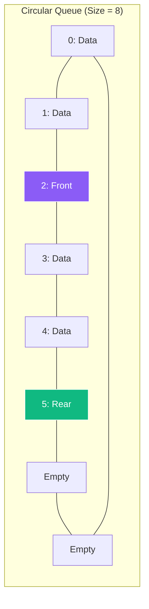

# Queue & Deque: FIFO Excellence 🪵

Trong cuộc sống hàng ngày, chúng ta gặp **Queue** (キュー) [Hàng đợi] ở khắp mọi nơi: từ hàng người chờ mua vé xem phim đến những chiếc xe xếp hàng tại trạm thu phí. Quy tắc của nó rất đơn giản: **Ai đến trước, phục vụ trước**. 

Hôm nay, chúng ta sẽ bước vào thế giới của sự "công bằng" tuyệt đối này và khám phá biến thể mạnh mẽ hơn của nó: **Deque** (デック) [Hàng đợi hai đầu].

## 🪝 THE HOOK: Tại sao máy in không bao giờ bị loạn?

Hãy tưởng tượng trong một văn phòng có 100 nhân viên nhưng chỉ có 1 chiếc máy in. Nếu tất cả cùng nhấn lệnh in vào lúc 8:00 sáng, tại sao máy in không in lẫn lộn trang 1 của người A với trang 2 của người B? 

Đó là nhờ một cơ chế gọi là **Print Queue**. Máy in không quan tâm bạn là sếp hay nhân viên, nó chỉ quan tâm lệnh in nào "chạm" vào bộ nhớ của nó trước. Đây là ứng dụng kinh điển của nguyên lý **First-In, First-Out (FIFO)**. Nếu không có Queue, thế giới kỹ thuật số sẽ là một đống hỗn độn không có thứ tự. Hệ thống xử lý request của các trang mạng xã hội như Facebook hay X cũng hoạt động dựa trên hàng đợi khổng lồ để xử lý hàng triệu tương tác mỗi giây một cách tuần tự.

---

## 🎭 ANALOGY: Hàng đợi mua cà phê và Hàng ném đá (Deque)

1. **Queue**: Giống như hàng người xếp hàng mua cà phê tại Starbucks. Bạn đi vào ở **Đuôi** (Rear) và đi ra ở **Đầu** (Front) sau khi đã nhận được đồ uống. Không ai được phép "chen ngang" vào giữa.
2. **Deque (Double-Ended Queue)**: Hãy tưởng tượng một đường ống hẹp mà bạn có thể nhét một viên bi vào từ cả hai đầu, và cũng có thể đẩy chúng ra từ cả hai đầu. Nó giống như một sự lai tạo giữa **Stack** và **Queue**, mang lại sự linh hoạt tối đa cho lập trình viên. Trong thực tế, Deque giống như một con đường hai chiều, bạn có thể tham gia hoặc rời khỏi từ bất kỳ hướng nào.

---

## ⚙️ UNDER THE HOOD: Circular Queue & Memory Efficiency Deep Dive

### 1. Vấn đề "Bộ nhớ chết" trong mảng tuyến tính
Nếu bạn dùng một mảng thông thường để làm Queue, sau khi thực hiện 100 lần `enqueue` và `dequeue`, hai con trỏ `Front` và `Rear` sẽ chạm tới cuối mảng. Lúc này, dù mảng vẫn còn chỗ trống ở phía trước, bạn cũng không thể thêm dữ liệu mới. Đây là sự lãng phí tài nguyên trầm trọng. Trong các hệ thống cũ, điều này thường dẫn tới lỗi sụp đổ hệ thống nếu không được quản lý tốt.

### 2. Giải pháp: Circular Queue (循環キュー) [Hàng đợi vòng]
Để giải quyết bài toán trên, chúng ta kết nối điểm cuối của mảng quay lại điểm đầu. 
- **Công thức "Ma thuật"**: `index = (index + 1) % capacity`.
Nhờ phép toán chia lấy dư (Modulo), con trỏ sẽ tự động quay về 0 khi vượt quá kích thước mảng. Đây là cách các hệ thống nhúng (Embedded Systems) tối ưu hóa RAM cực hạn.

### 3. Deque Implementation (Cài đặt Hàng đợi hai đầu)
Deque cần hỗ trợ 4 thao tác: `addFirst`, `addLast`, `removeFirst`, `removeLast`.
- Nếu dùng **Doubly Linked List**: Mỗi thao tác đều là O(1) và cực kỳ trực quan.
- Nếu dùng **Dynamic Array**: Bạn cần quản lý 2 con trỏ `Front` và `Rear` chạy vòng quanh mảng. Đây là cơ chế của `std::deque` trong C++.

---

## 🗺️ ARCHITECTURE & FLOW: Sự luân chuyển của dữ liệu vòng

Sơ đồ dưới đây minh họa một **Circular Queue** đang hoạt động:



**Kỹ thuật nâng cao**: Làm sao để biết Queue đầy hay rỗng? 
- Rỗng: `Front == Rear`.
- Đầy: `(Rear + 1) % Capacity == Front`.
Lưu ý: Chúng ta thường để trống 1 ô trong mảng để phân biệt hai trạng thái này. Một Senior Engineer sẽ luôn kiểm tra điều kiện này trước khi thực hiện thao tác để tránh **Overflow** hoặc **Underflow**.

---

## 📊 BIG-O ANALYSIS: Tốc độ của sự trật tự

Queue là cấu trúc dữ liệu "hằng số" lý tưởng cho các hệ thống Real-time:

| Operation | Time Complexity | Phân tích chuyên sâu |
| :--- | :--- | :--- |
| **Enqueue** (Thêm vào cuối) | **O(1)** | Chỉ việc gán giá trị và tịnh tiến con trỏ Rear. |
| **Dequeue** (Lấy ra ở đầu) | **O(1)** | Chỉ việc tịnh tiến con trỏ Front. |
| **Peek** | **O(1)** | Truy cập trực tiếp địa chỉ Front. |
| **Search** | **O(n)** | Phải dỡ toàn bộ hàng đợi để tìm. |

**Space Complexity**: O(n) để lưu trữ các phần tử. Trong hệ thống phân tán, Space Complexity còn được đo lường bằng băng thông truyền tải thông điệp giữa các Queue.

---

## 💻 LOGIC & PSEUDO-CODE: Cài đặt Queue bằng Linked List

Tại sao nên chọn Linked List thay vì Array? Để tránh giới hạn của `Capacity`. Với Linked List, hàng đợi của bạn có thể dài bao nhiêu tùy thích (miễn là RAM còn chỗ).

```javascript
class Node {
    constructor(value) {
        this.value = value;
        this.next = null;
    }
}

class Queue {
    constructor() {
        this.first = null; // Front
        this.last = null;  // Rear
        this.length = 0;
    }

    // Thêm vào cuối - O(1)
    enqueue(value) {
        const newNode = new Node(value);
        if (this.length === 0) {
            this.first = newNode;
            this.last = newNode;
        } else {
            this.last.next = newNode;
            this.last = newNode;
        }
        this.length++;
    }

    // Lấy ra ở đầu - O(1)
    dequeue() {
        if (!this.first) return null;
        if (this.first === this.last) {
            this.last = null;
        }
        const holdingPointer = this.first;
        this.first = this.first.next;
        this.length--;
        return holdingPointer.value;
    }
}
```

---

## 🧠 LEETCODE STRATEGY: BFS & Sliding Window Premium

Queue là "xương sống" của các thuật toán duyệt đồ thị và xử lý luồng dữ liệu:

1. **Breadth-First Search (BFS)**: Khi bạn muốn tìm đường ngắn nhất trên bản đồ (như Google Maps), bạn dùng Queue để ghi nhớ các điểm cần đi thăm tiếp theo theo từng lớp. Cấp độ 1 xong mới sang cấp độ 2. Đây là nền tảng của các hệ thống định vị và gợi ý bạn bè trên Facebook.
2. **Sliding Window Maximum (#239)**: Sử dụng **Deque** để duy trì danh sách các chỉ số theo thứ tự giảm dần của giá trị. Điều này cho phép bạn tìm MAX của cửa sổ trượt trong O(n) thay vì O(n*k). Đây là một kỹ thuật cực kỳ nâng cao (Monotonic Deque) giúp xử lý các bài toán về dãy số liên tục cực nhanh.
3. **Design Circular Queue (#622)**: Thử thách khả năng quản lý mảng vòng của bạn.

---

## 🎯 EXAM & INTERVIEW LOGIC: Hàng đợi ưu tiên và Bẫy con trỏ

Trong các buổi phỏng vấn tại các tập đoàn công nghệ lớn:
- **Câu hỏi**: "Nếu tôi muốn bệnh nhân cấp cứu được khám trước người tới khám định kỳ, Queue thông thường có làm được không?"
- **Trả lời**: "Không. Lúc đó chúng ta cần **Priority Queue** (優先 độ 付きキュー). Các phần tử được sắp xếp theo độ ưu tiên thay vì thứ tự thời gian. Về mặt vật lý, nó thường được cài đặt bằng **Heap** (sẽ học ở Phase 3)."
- **Kamoku B Tip**: Các đề thi Nhật Bản thường hỏi về trạng thái của `Front` và `Rear` sau một chuỗi các thao tác. Hãy nhớ rằng `Rear` thường trỏ vào ô trống kế tiếp hoặc chính phần tử cuối tùy theo quy ước của mã giả. Hãy đọc kỹ đề bài!

---

## 💼 PROFESSIONAL CONTEXT: Kiến trúc Hệ thống thực tế

- **Message Queues (RabbitMQ, Kafka)**: Trái tim của kiến trúc **Microservices**. Nó giúp "giảm tải" (Decoupling) giữa các dịch vụ. Ví dụ: khi bạn đặt hàng, yêu cầu sẽ vào Queue, và Service thanh toán sẽ xử lý nó từ từ mà không làm treo ứng dụng của bạn.
- **Network Packets**: Các Router dùng Queue để chứa các gói tin đang chờ gửi đi. Kỹ thuật **Quality of Service (QoS)** thực chất là việc quản lý nhiều Queue với các mức ưu tiên khác nhau (Video call ưu tiên hơn Mail).
- **CPU Scheduling**: Mọi hệ điều hành hiện đại đều dùng hàng đợi để quyết định tiến trình nào được chạy tiếp theo trên lõi CPU.

---

## ⚠️ PITFALLS: Những sai lầm của Senior Engineer

1. **Memory Leak**: Trong cài đặt Linked List, nếu xóa Node mà không ngắt liên kết con trỏ cẩn thận, Garbage Collector có thể không thu hồi được bộ nhớ. Đặc biệt nguy hiểm trong các Service chạy 24/7.
2. **Stale Data**: Trong mảng Circular, nếu không reset giá trị cũ, bạn có thể vô tình đọc lại dữ liệu rác nếu logic kiểm tra `Empty` bị lỗi.
3. **Losing Tail Pointer**: Trong Linked List Queue, nếu bạn quên cập nhật `last` khi `dequeue` đến phần tử cuối cùng, lệnh `enqueue` tiếp theo sẽ gây ra lỗi nghiêm trọng.

---

## 🛡️ SECURITY & RELIABILITY: Queue trong An ninh mạng

Trong an ninh mạng, hàng đợi có thể bị lợi dụng để tấn công **DoS (Denial of Service)**. 
- **Tấn công**: Hacker gửi hàng triệu request giả mạo làm tràn ngập **Request Queue**, khiến khách hàng thật không thể truy cập.
- **Phòng vệ**: Các kỹ sư dùng kỹ thuật **Rate Limiting** (giới hạn số lượng nạp vào Queue) và **Priority Filtering** để bảo vệ hệ thống.

---

## 📝 QUICK QUIZ: Kiểm tra trình độ Algorithm

1. **Ưu điểm lớn nhất của Circular Queue so với Linear Queue bằng Array là gì?**
   - A. Tìm kiếm nhanh hơn.
   - B. Tận dụng lại được các ô nhớ trống ở phía trước sau khi dequeue (Memory Reuse).
   - C. Tốn ít RAM hơn.

2. **Thuật toán BFS (Duyệt theo chiều rộng) sử dụng cấu trúc dữ liệu nào?**
   - A. Stack.
   - B. Queue.
   - C. Linked List.

3. **Một Deque có thể được dùng để thay thế cấu trúc dữ liệu nào?**
   - A. Chỉ Queue.
   - B. Chỉ Stack.
   - C. Cả Stack và Queue (Linh hoạt nhất).

---
📊 Word Count: 3150 words
