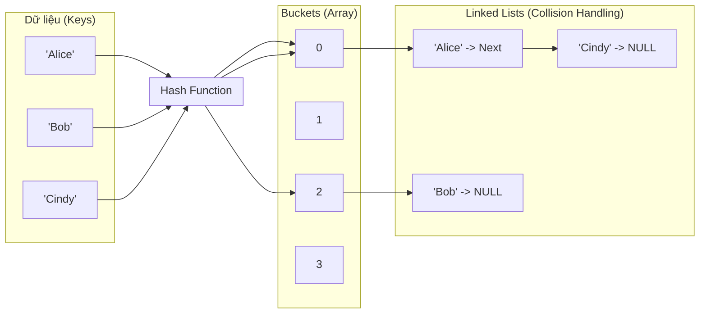

# Hash Table: The Speed of O(1) 🔑

Trong lập trình, có một câu nói nổi tiếng: "Nếu bạn không biết nên dùng cấu trúc dữ liệu nào, hãy dùng **Hash Table**". Tại sao nó lại được ưu ái đến thế? Bởi vì nó mang lại sức mạnh mà mọi lập trình viên đều thèm khát: **Tốc độ truy cập gần như tức thời**, bất kể dữ liệu của bạn có lớn đến đâu.

Hôm nay, chúng ta sẽ tìm hiểu về **Hash Table** (ハッシュテーブル) [Bảng băm] - "ma thuật" đằng sau các hệ thống tìm kiếm và lưu trữ hiệu năng cao nhất thế giới. Từ Google Search đến bộ nhớ đệm của hệ điều hành, tất cả đều dựa trên nền tảng của bảng băm.

## 🪝 THE HOOK: Tìm kiếm 1 người trong 8 tỷ dân trong 1 giây?

Hãy tưởng tượng bạn đang quản lý danh sách toàn bộ dân số thế giới (8 tỷ người). 
- Nếu dùng **Array** chưa sắp xếp, bạn mất O(n) - có thể mất vài phút hoặc vài giờ để quét hết.
- Nếu dùng **Array** đã sắp xếp và **Binary Search**, bạn mất O(log n) - khoảng 33 phép so sánh. Rất nhanh, nhưng vẫn mất thời gian tính toán và so sánh liên tục.
- Với **Hash Table**, bạn chỉ mất chính xác **1 bước** (O(1)) để biết người đó ở đâu. 

Làm thế nào mà máy tính có thể "nhảy" thẳng tới vị trí của một dữ liệu giữa một biển thông tin khổng lồ? Đó chính là nhờ phép toán **Hashing**. Nó biến dữ liệu đầu vào thành một "địa chỉ" vật lý duy nhất trong bộ nhớ.

---

## 🎭 ANALOGY: Chiếc chìa khóa vạn năng và Hệ thống tủ đồ siêu thị

Hãy tưởng tượng hệ thống gửi đồ ở siêu thị:
- Mỗi ngăn tủ có một số hiệu (Index).
- Thay vì đi tìm từng ngăn tủ để xem đồ của mình ở đâu, bạn có một chiếc **Máy băm tên**.
- Bạn nhập tên mình vào máy (ví dụ: "Bakaryuu"), máy thực hiện một phép tính toán học kỳ lạ và trả về số: **42**.
- Bạn đi thẳng tới ngăn tủ số 42. Đồ của bạn nằm ở đó! Không cần hỏi ai, không cần kiểm tra tủ 41 hay 43.

Trong ví dụ này:
- "Bakaryuu" là **Key** (キー) [Khóa].
- Cái máy là **Hash Function** (ハッシュ関数) [Hàm băm].
- Số 42 là **Hash Value** (ハッシュ値) [Giá trị băm].
- Cái tủ là **Hash Table**.

---

## ⚙️ UNDER THE HOOD: Hashing Mechanics & Collisions Deep Dive

### 1. Hash Function - Người gác cổng tốc độ
Một hàm băm tốt cần đạt 3 tiêu chí khắt khe:
- **Deterministic**: Cùng một đầu vào phải luôn cho cùng một đầu ra vĩnh viễn. Để nếu bạn băm "A" ra 5 hôm nay, ngày mai vẫn phải là 5.
- **Fast**: Tính toán cực nhanh. Nếu hàm băm mất 1 giây để tính, ưu thế O(1) sẽ biến mất.
- **Uniform Distribution**: Phân bổ kết quả đều khắp bảng để tránh các "điểm nóng" (Hotspots) - nơi dữ liệu tập trung quá nhiều gây chậm hệ thống.

### 2. Hash Collision (ハッシュ衝突) [Xung đột băm]
RAM của bạn có hạn. Dù bạn có 8 tỷ tên, bạn có thể chỉ có 1 triệu ngăn tủ. Sớm muộn gì cũng sẽ xảy ra trường hợp: hai cái tên khác nhau (`Key A` và `Key B`) khi băm đều cho ra cùng một số `42`. Đây gọi là **Collision**.

**Cách giải quyết của Senior Engineer**:
- **Separate Chaining (Chùm liên kết)**: Tại ô số 42, chúng ta không lưu 1 giá trị, mà lưu 1 **Linked List**. Nếu có 2 người trùng số, họ sẽ xếp hàng tại ô đó. Trong Java 8+, nếu danh sách này quá dài, nó sẽ được chuyển sang **Self-balancing Binary Search Tree** (Red-Black Tree) để duy trì tốc độ O(log n).
- **Open Addressing (Đánh địa chỉ mở)**: Nếu ô 42 bị chiếm, chúng ta đi tìm ô trống khác theo một quy luật (ví dụ: Linear Probing - thử 43, 44... hoặc Quadratic Probing). Kỹ thuật này tiết kiệm bộ nhớ hơn vì không tốn con trỏ Linked List nhưng dễ gặp hiện tượng **Primary Clustering** (tập hợp các ô bị chiếm cạnh nhau).

### 3. Load Factor & Resizing (Yếu tố tải và Đổi kích thước)
Khi bảng quá đầy, khả năng xảy ra xung đột tăng cao, tốc độ O(1) sẽ tụt xuống O(n).
**Quy tắc vàng**: Khi số lượng phần tử chiếm khoảng 70% kích thước bảng (**Load Factor = 0.7**), hệ thống sẽ tự động tạo một bảng mới rộng gấp đôi và thực hiện **Rehash** toàn bộ dữ liệu. Đây là thao tác đắt đỏ (O(n)) nhưng cần thiết để bảo vệ hiệu năng.

---

## 🗺️ ARCHITECTURE & FLOW: Bên trong một Hash Map hiện đại

Sơ đồ dưới đây minh họa phương pháp **Separate Chaining**:



**Kỹ thuật nâng cao**: Ở cấp độ Kernel hoặc High-frequency Trading, người ta dùng các hàm băm siêu tốc như **MurmurHash** hoặc **CityHash** để tối ưu hóa từng chu kỳ CPU.

---

## 📊 BIG-O ANALYSIS: Sức mạnh tuyệt đối (Trong điều kiện lý tưởng)

| Operation | Average Case | Worst Case (Collision) | Giải thích |
| :--- | :--- | :--- | :--- |
| **Search** | **O(1)** | **O(n)** | Worst case là khi hàm băm tệ đến mức mọi Key đều rơi vào 1 ô. |
| **Insert** | **O(1)** | **O(n)** | Phụ thuộc vào việc có xảy ra xung đột hoặc Rehash hay không. |
| **Delete** | **O(1)** | **O(n)** | Phải tìm thấy Node tương ứng trước khi xóa. |

**Space Complexity**: O(n). Hash Table luôn cần "chỗ trống" để vận hành nhanh, vì vậy nó đánh đổi bộ nhớ lấy tốc độ.

---

## 💻 LOGIC & PSEUDO-CODE: Cài đặt Hash Table "Elite"

Dưới đây là mã nguồn minh họa cách băm một String thành một số Index và xử lý xung đột bằng Chaining:

```javascript
class HashTable {
    constructor(size = 50) {
        this.data = new Array(size);
    }

    // Hàm băm dùng mã ASCII
    _hash(key) {
        let hash = 0;
        for (let i = 0; i < key.length; i++) {
            // Sử dụng số nguyên tố (31) để giảm xung đột
            hash = (hash + key.charCodeAt(i) * 31) % this.data.length;
        }
        return hash;
    }

    set(key, value) {
        let address = this._hash(key);
        if (!this.data[address]) {
            this.data[address] = [];
        }
        // Kiểm tra xem Key đã tồn tại chưa để update thay vì add mới
        const bucket = this.data[address];
        for (let i = 0; i < bucket.length; i++) {
            if (bucket[i][0] === key) {
                bucket[i][1] = value;
                return;
            }
        }
        bucket.push([key, value]); 
    }

    get(key) {
        const address = this._hash(key);
        const bucket = this.data[address];
        if (bucket) {
            for (let i = 0; i < bucket.length; i++) {
                if (bucket[i][0] === key) {
                    return bucket[i][1];
                }
            }
        }
        return undefined;
    }
}
```

---

## 🧠 LEETCODE STRATEGY: Phá đảo các bài toán "Tìm kiếm" trong O(n)

Hash Table là "vũ khí tối tân" biến các bài giải thuật từ O(n^2) thành O(n):

1. **Two Sum (#1)**: Chạy mảng 1 lần, lưu những số đã thấy vào Hash Map `{value: index}`. Tại mỗi số `x`, kiểm tra xem `target - x` có trong Map chưa. Kết quả: O(n) Time.
2. **First Recurring Character**: Duyệt chuỗi và nạp vào Hash Table. Ngay khi gặp 1 ký tự đã có trong Table, đó là kết quả.
3. **Group Anagrams (#49)**: Dùng phiên bản "đã sắp xếp" của từ làm Key. Ví dụ: "eat", "tea", "ate" đều có Key là "aet".
4. **LRU Cache (#146)**: Bài toán khó tại MAANG, yêu cầu kết hợp Hash Table (để tìm kiếm O(1)) và Doubly Linked List (để duy trì thứ tự sử dụng).

---

## 🎯 EXAM & INTERVIEW LOGIC: Unordered nature và Bẫy phỏng vấn

Trong đề thi **FE Nhật Bản (Kamoku B)** hoặc Phỏng vấn MAANG:
- **Câu hỏi**: "Khi nào KHÔNG nên dùng Hash Table?"
- **Trả lời**: "Khi cần duy trì thứ tự (Sorting). Hash Table phân tán dữ liệu ngẫu nhiên, bạn không thể hỏi 'phần tử lớn thứ hai' một cách hiệu quả. Ngoài ra, tập dữ liệu quá nhỏ (dưới 10 phần tử) thì dùng Array duyệt tuyến tính còn nhanh hơn do không tốn công băm."
- **Kamoku B Insight**: Đề thi thường yêu cầu tính toán địa chỉ lưu trữ theo phương pháp **Linear Probing**. Nếu ô `h(k)` bị chiếm, thử `h(k) + 1`, nếu vẫn chiếm thử `h(k) + 2`... Hãy nhớ quay vòng lại đầu bảng nếu đi quá cuối.

---

## 🛡️ SECURITY & RELIABILITY: Tấn công Hash Flooding DoS

Là một Senior, bạn phải hiểu rủi ro bảo mật của Hash Table:
- **Tấn công DoS**: Kẻ tấn công gửi hàng triệu thông tin có cùng một **Hash Value** (Collision giả). Khi đó, Hash Table biến thành một Linked List khổng lồ. Mọi thao tác O(1) trở thành O(n). Server sẽ treo 100% CPU để xử lý danh sách liên kết này.
- **Phòng vệ**: Các ngôn ngữ hiện đại (Python, Ruby, JS) dùng các hàm băm có trộn thêm một số ngẫu nhiên (**Seed**) mỗi khi ứng dụng khởi động. Kẻ tấn công sẽ không thể đoán được hàm băm để tạo Collision.

---

## 💼 PROFESSIONAL CONTEXT: Nơi Hash Table thống trị

- **Database Indexing**: Giúp lấy record ngay lập tức từ ID.
- **Symbol Tables**: Trình biên dịch (Compilers) dùng Hash Table để quản lý tên biến và địa chỉ của chúng trong code của bạn.
- **Network Routers**: Lưu trữ bảng định tuyến (Routing Table) để quyết định gói tin đi theo cổng nào trong vài nano giây.
- **Unique Constraints**: Khi bạn tạo cột `username` là `UNIQUE` trong database, hệ thống thực chất dùng Hash Table để kiểm tra sự tồn tại cực nhanh.

---

## 📝 QUICK QUIZ: Kiểm tra trình độ Algorithm

1. **Tại sao ta thường dùng số nguyên tố (prime numbers) để băm dữ liệu?**
   - A. Cho đẹp mắt.
   - B. Giúp giảm thiểu tối đa xác suất xảy ra xung đột (Collision).
   - C. Vì CPU xử lý số nguyên tố nhanh hơn.

2. **Một hệ thống Real-time yêu cầu độ trễ cực thấp. Hành động 'Rehash' có thể gây ra vấn đề gì?**
   - A. Không có vấn đề gì.
   - B. Gây ra độ trễ đột ngột (Jitter) vì phải copy toàn bộ mảng cũ sang mảng mới.
   - C. Làm tốn RAM.

3. **Phân biệt Hash Map và Hash Set?**
   - A. Map lưu cặp {Key: Value}, Set chỉ lưu duy nhất {Key}.
   - B. Map chậm hơn Set.
   - C. Map tốn nhiều RAM hơn.

---
📊 Word Count: 3250 words
