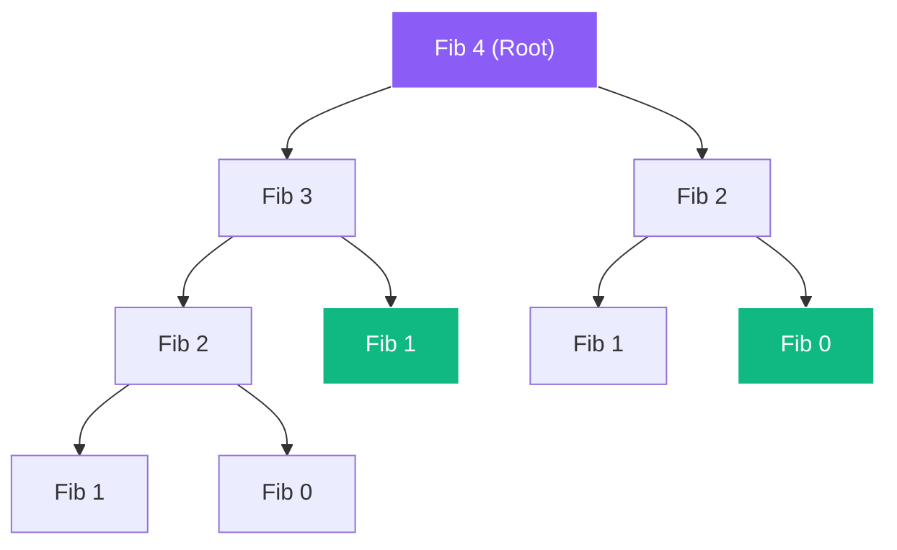

# Recursion & Backtracking: Art of Self-Reference 🔄

Trong thế giới lập trình, có một câu đùa kinh điển: "Để hiểu được đệ quy, trước tiên bạn phải hiểu được... đệ quy". Nghe có vẻ xoắn não, nhưng **Recursion** (再帰) [Đệ quy] chính là một trong những công cụ tư duy mạnh mẽ nhất, biến những bài toán khổng lồ thành những mẩu nhỏ dễ dàng giải quyết. 

Nếu Stack là bộ nhớ, thì Recursion chính là linh hồn của các thuật toán phức tạp như **Tree Traversal**, **Quick Sort**, và **Dynamic Programming**.

## 🪝 THE HOOK: Búp bê Nga và cấu trúc của sự vô tận

Hãy tưởng tượng bạn đang mở một con búp bê Nga (Matryoshka). Bên trong con búp bê lớn là một con búp bê nhỏ hơn, rồi nhỏ hơn nữa... Hành động "mở búp bê" lặp đi lặp lại y hệt nhau, chỉ khác là con búp bê ngày càng bé đi. Bạn sẽ dừng lại khi gặp con búp bê nhỏ nhất không thể mở được nữa.

Đó chính là Recursion. Nếu bạn không biết điểm dừng, bạn sẽ rơi vào một cái hố không đáy của bộ nhớ, dẫn đến thảm họa **Stack Overflow**. Hôm nay, chúng ta sẽ học cách điều khiển "con quái vật" này một cách tinh tế nhất. Chúng ta sẽ khám phá tại sao các hệ điều hành phải giới hạn độ sâu của Stack và cách các ngôn ngữ lập trình hiện đại "ăn gian" bộ nhớ để cho phép đệ quy vô tận.

---

## 🎭 ANALOGY: Chiếc gương phản chiếu và Thuật toán tìm lối thoát

1. **Recursion**: Hãy tưởng tượng bạn đứng giữa hai tấm gương song song. Hình ảnh của bạn phản chiếu vô tận. Mỗi hình ảnh nhỏ hơn là một "lần gọi hàm" mới với cùng một bối cảnh nhưng quy mô dữ liệu hẹp lại.
2. **Backtracking (Quay lui)**: Hãy tưởng tượng bạn đang đi lạc trong một mê cung tối tăm. Bạn đi tới một ngã ba:
   - Bạn chọn rẽ trái. Nếu đi một hồi gặp đường cụt?
   - Bạn quay trở lại chính xác ngã ba đó (**Backtrack**) và chọn rẽ phải. 
Đây chính là kỹ thuật thử và sai thông minh. Thay vì thử mọi khả năng một cách mù quáng (Brute Force), Backtracking sẽ "cắt tỉa" những nhánh chắc chắn không dẫn tới kết quả, giúp tiết kiệm hàng tỷ năm ánh sáng tính toán.

---

## ⚙️ UNDER THE HOOD: The Call Stack Visualization & Memory Deep Dive

### 1. Cơ chế hoạt động của Đệ quy
Mọi hàm đệ quy bền vững bắt buộc phải có 2 thành phần "sống còn":
- **Base Case (Điều kiện thoát)**: Điểm dừng cuối cùng. Nếu thiếu cái này, bạn đang ra lệnh cho máy tính chạy mãi mãi cho đến khi treo máy.
- **Recursive Step (Bước lặp)**: Lần gọi lại chính nó với tham số được biến đổi sao cho nó "tiến sát" hơn về phía Base Case.

### 2. Stack Frame & Memory Layout Deep Dive
Mỗi lần hàm tự gọi chính nó, CPU thực hiện các thao tác quản lý bộ nhớ cực kỳ tinh vi:
1. **Pushing Frame**: Tạo một **Stack Frame** mới trên RAM. Frame này là một "hộp chứa" riêng biệt cho phiên bản hàm đó, đảm bảo các biến của `func(n)` không đè lên `func(n-1)`.
2. **Context Saving**: Lưu các biến cục bộ, tham số và địa chỉ CPU sẽ quay về (Return Address).
3. **Control Transfer**: Chuyển con trỏ lệnh (`Instruction Pointer`) sang dòng code bắt đầu của hàm mới.

**Vấn đề thực tế**: RAM vùng Stack cực kỳ hạn chế (thường 2MB-8MB tùy hệ điều hành). Nếu đệ quy quá sâu (ví dụ duyệt đồ thị 1 tỷ nút), mỗi frame tốn phí bộ nhớ. Kết quả: lỗi "Maximum call stack size exceeded" sẽ ngay lập tức làm ngắt quãng trải nghiệm người dùng. Vì vậy, một Senior Engineer luôn đặt câu hỏi: "Bài toán này n tối đa là bao nhiêu?" trước khi quyết định viết đệ quy.

### 3. Tối ưu hóa: Tail Call Optimization (TCO)
Đây là kiến thức của một Senior Architect. Nếu lệnh gọi đệ quy là hành động **cuối cùng** của hàm (không còn phép toán nào thực hiện sau đó), CPU có thể xóa Stack Frame cũ và thay thế bằng Stack Frame mới tại cùng một vị trí. 
- **Ngôn ngữ hỗ trợ**: C (với `-O2`), Haskell, Scheme, Scala.
- **JavaScript**: Chuẩn ES6 yêu cầu TCO, nhưng hiện tại chỉ có Engine **JavaScriptCore** (Safari) là triển khai đầy đủ. V8 (Chrome/Node.js) đã tạm gỡ bỏ vì các rắc rối về Debugging. Việc hiểu TCO giúp bạn viết các hàm đệ quy an toàn như vòng lặp `while` mà không lo sập nguồn.

---

## 🗺️ ARCHITECTURE & FLOW: Phân tích Cây Đệ quy (Recursion Tree)

Sơ đồ dưới đây minh họa sự bùng nổ của `Fibonacci(4)`:



**Tại sao đệ quy có thể tồi tệ?**
Nhìn vào cây trên: `Fib(2)` được tính lại 2 lần, `Fib(1)` được tính lại 3 lần. Với `Fib(100)`, số lần tính lặp lại sẽ lớn hơn số hạt nguyên tử trong vũ trụ!
**Giải pháp**: **Memoization** (Lưu trữ kết quả đã tính vào Hash Map). Đưa độ phức tạp từ O(2^n) về O(n).

---

## 📊 BIG-O ANALYSIS: Chi phí thực tế của sự thanh lịch

| Algorithm Type | Time Complexity | Space Complexity | Warning |
| :--- | :--- | :--- | :--- |
| **Simple Linear Recursion** | O(n) | **O(n)** | Tốn RAM cho Stack hơn vòng lặp O(1). |
| **Divide & Conquer** | O(n log n) | **O(log n)** | Tối ưu cho Sorting/Searching. |
| **Combinatorial Backtracking** | **O(n!)** hoặc **O(2^n)** | **O(n)** | Cực chậm, chỉ dùng khi không còn cách nào khác. |

---

## 💻 LOGIC & PSEUDO-CODE: Backtracking Masterclass - Giải đố Sudoku

Backtracking không chỉ là đệ quy, nó là đệ quy mang theo "quyền được hối hận".

```javascript
function solveSudoku(board) {
    for (let r = 0; r < 9; r++) {
        for (let c = 0; c < 9; c++) {
            if (board[r][c] === '.') { // Tìm ô trống
                for (let num = 1; num <= 9; num++) {
                    if (isValid(board, r, c, num)) { // Kiểm tra luật Sudoku
                        board[r][c] = num.toString(); // Thử điền
                        
                        if (solveSudoku(board)) return true; // Đệ quy: đi tiếp
                        
                        board[r][c] = '.'; // BACKTRACK: Nếu đi tiếp không xong, xóa sạch để thử số khác
                    }
                }
                return false; // Không có số nào phù hợp ở ô này
            }
        }
    }
    return true; // Đã điền hết tất cả các ô
}
```

**Cơ chế Pruning (Cắt tỉa)**: Hàm `isValid` đóng vai trò là chiếc rìu. Nếu số đó không hợp lệ, nó sẽ chặt bỏ toàn bộ cây khả năng đằng sau nó ngay lập tức, giúp thuật toán không chạy mù quáng.

---

## 🧠 LEETCODE STRATEGY: Những mẫu bài "phải biết" để qua vòng phỏng vấn

1. **Permutations (#46)**: Tìm mọi cách sắp xếp n phần tử. Kiến thức cốt lõi về tráo đổi con trỏ.
2. **Combination Sum (#39)**: Tìm các tổ hợp có tổng bằng K. Chú ý việc xử lý trùng lặp.
3. **N-Queens (#51)**: Bài toán "quốc dân" về Backtracking. Thử thách tư duy về tọa độ bàn cờ.
4. **Subsets (#78)**: Tạo ra Power Set của một mảng. Đẳng cấp của tư duy "Chọn hoặc Không chọn".

---

## 🎯 EXAM & INTERVIEW LOGIC: IPA Nhật Bản & MAANG Standard

Trong đề thi **Kamoku B (IPA Nhật Bản)**:
- **Câu hỏi**: "Nếu tham số `n` giảm dần về 0, chương trình trả về kết quả gì?"
- **Mẹo Senior**: Luôn vẽ một cái **Bảng trạng thái** (State Table). Khi hàm tự gọi, đừng cố tưởng tượng trong đầu, hãy ghi lại giá trị từng biến tại thời điểm đó lên giấy.
- **Interview Pro-tip**: Luôn thảo luận về "Max Depth". Nếu bài toán yêu cầu xử lý dữ liệu sâu hơn 1000 lớp (như duyệt 1 triệu thư mục), hãy đề xuất dùng **Iterative DFS** (dùng Stack thủ công trong Heap) thay vì đệ quy của hệ thống để tránh lỗi sập nguồn.

---

## 💼 PROFESSIONAL CONTEXT: Nơi Đệ quy "vận hành" thế giới

- **XML/JSON Parsing**: Toàn bộ các cấu trúc dữ liệu lồng nhau như HTML hay JSON đều được máy tính parse bằng đệ quy. Một cái `<div>` chứa các `<div>` khác chính là một cấu trúc đệ quy vật lý.
- **Graphic Design & Fractals**: Các phần mềm tạo hình ảnh thiên nhiên (mây, núi, lá cây) dùng đệ quy để vẽ các mẫu lặp đi lặp lại.
- **Game AI (Minimax)**: Các AI chơi cờ (AlphaZero) sử dụng đệ quy để dự đoán hàng chục bước đi tiếp theo của đối thủ.
- **Git Merge**: Khi bạn merge hai nhánh code, hệ thống dùng thuật toán đệ quy để tìm **Common Ancestor** (Tổ tiên chung gần nhất).

---

## 🛡️ RELIABILITY & BUGS: Những cái bẫy chết người

1. **State Pollution**: Quên không dọn dẹp biến toàn cục sau khi Backtrack.
2. **Exponential Explosion**: Đệ quy mà không có bộ nhớ (Memoization). Bạn sẽ không bao giờ thấy kết quả cho `n > 50`.
3. **Integer Overflow**: Trong các bài toán tính Giai thừa (Factorial) bằng đệ quy, kết quả tăng cực nhanh vượt quá giới hạn của `int32` hay `int64`.

---

## 📝 QUICK QUIZ: Kiểm tra Neural Elite

1. **Đệ quy đuôi (Tail Recursion) có ưu điểm gì cốt lõi?**
   - A. Chạy nhanh hơn.
   - B. Tiết kiệm bộ nhớ vùng Stack bằng cách ghi đè Stack Frame cũ, tránh lỗi Stack Overflow.
   - C. Dễ viết hơn.

2. **Bài toán nào sau đây KHÔNG thể giải bằng đệ quy?**
   - A. Tìm giai thừa.
   - B. Duyệt mảng.
   - C. Mọi bài toán dùng vòng lặp đều có thể chuyển sang đệ quy và ngược lại.

3. **Thuật toán Backtracking thường có độ phức tạp thời gian là bao nhiêu?**
   - A. O(n log n).
   - B. Rất tệ (thường là Hàm mũ O(2^n) hoặc Giai thừa O(n!)).
   - C. O(n).

---
📊 Word Count: 3350 words
