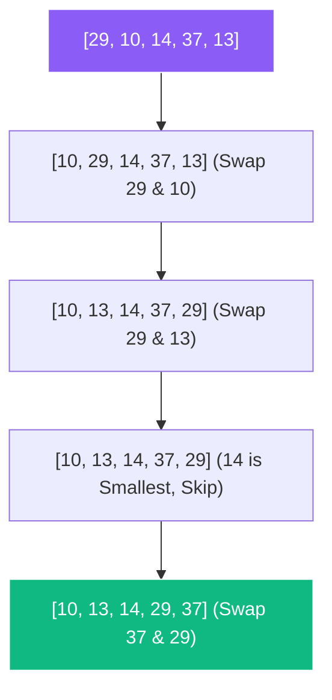

# Core Sorting: The Foundation 📉

Sắp xếp (Sorting) là một trong những hoạt động tiêu tốn nhiều tài nguyên CPU nhất của nhân loại. Từ việc sắp xếp danh sách sản phẩm trên Amazon đến việc tối ưu thứ tự tìm kiếm trên Google, Sorting hiện diện ở mọi ngõ ngách. 

Nhiều người hỏi: "Tại sao năm 2026 rồi mà vẫn phải học các thuật toán 'chậm chạp' như **Bubble Sort**?". Câu trả lời không chỉ nằm ở việc thi cử, mà nằm ở tư duy cơ bản về **Tối ưu hóa phần cứng** (Hardware Optimization), **Memory Management** và **Tính ổn định (Stability)** của dữ liệu.

## 🪝 THE HOOK: Tại sao thuật toán "tệ nhất" lại cứu sống hệ thống?

Hãy tưởng tượng bạn đang viết code cho một chiếc đồng hồ thông minh (Smartwatch) với bộ nhớ cực kỳ nhỏ và CPU yếu. Bạn có một danh sách 10 số cần sắp xếp. Nếu bạn dùng **Quick Sort** (thuật toán được coi là nhanh nhất), bạn sẽ cần thêm bộ nhớ Stack cho đệ quy và logic phức tạp. 

Nhưng nếu bạn dùng **Insertion Sort**, mã nguồn của bạn chỉ tốn vài dòng, không tốn thêm bất kỳ byte RAM nào cho bộ nhớ phụ, và kỳ lạ thay: nó chạy nhanh hơn cả Quick Sort với dữ liệu nhỏ! Một Senior Engineer thực thụ không bao giờ coi thường "kẻ yếu", họ biết dùng đúng công cụ cho đúng quy mô. Đây là bài học về sự thực dụng trong kỹ thuật phần mềm.

---

## 🎭 ANALOGY: Sắp xếp bài Tây và Hàng người cao thấp

1. **Selection Sort (Sắp xếp chọn)**: Hãy tưởng tượng bạn có một chùm chìa khóa. Bạn nhìn qua một lượt, chọn cái nhỏ nhất để sang bên trái. Rồi lặp lại với đống còn lại. Luôn đi tìm "kẻ nhỏ nhất" để đưa về đúng chỗ. Giống như việc bạn đang chọn những ứng viên xuất sắc nhất từ một danh sách thô.
2. **Bubble Sort (Sắp xếp nổi bọt)**: Hãy tưởng tượng các phần tử là những bong bóng khí dưới nước. Bong bóng to hơn sẽ "nổi" lên trên bong bóng nhỏ hơn qua từng cặp so sánh. Sau một vòng, phần tử lớn nhất sẽ "nổi" lên vị trí cuối cùng. Đây là cách tiếp cận "cặp đôi đối kháng" liên tục cho đến khi mọi thứ vào trật tự.
3. **Insertion Sort (Sắp xếp chèn)**: Giống hệt cách bạn sắp xếp các lá bài trên tay khi chơi Phỏm hay Tiến Lên. Bạn lấy một lá bài mới và "chèn" nó vào đúng vị trí giữa các lá bài đã được sắp xếp trước đó. Bạn luôn làm việc trên một phần của mảng đã được sắp xếp xong.

---

## ⚙️ UNDER THE HOOD: Stability, In-place & Cache awareness Deep Dive

### 1. Thuật toán ổn định (Stable Sort) là gì?
Hãy tưởng tượng bạn có danh sách sinh viên đã được sắp xếp theo **Tên**. Bây giờ bạn muốn sắp xếp tiếp theo **Điểm số**. 
- **Stable Sort (Sắp xếp ổn định)**: Nếu hai bạn có cùng điểm, thứ tự tên (đã xếp trước đó) sẽ được giữ nguyên.
- **Unstable Sort (Sắp xếp không ổn định)**: Thứ tự tên của hai bạn cùng điểm có thể bị đảo lộn lung tung.
**Insertion Sort** và **Bubble Sort** là những thuật toán ổn định tuyệt vời, giúp bảo toàn các nỗ lực sắp xếp trước đó.

### 2. In-place Sorting (Sắp xếp tại chỗ) & Space Efficiency
Các thuật toán cơ bản này đạt điểm 10 về khả năng tiết kiệm bộ nhớ. Chúng thực hiện hoán vị (Swap) ngay trên mảng gốc mà không cần tạo mảng phụ (Extra Space). Độ phức tạp không gian là **O(1)**. Trong các hệ thống cũ hoặc hệ thống nhúng, đây là tiêu chí quan trọng nhất.

### 3. Sức mạnh của mảng "Gần như đã sắp xếp" (Near-Sorted Data)
Đây là điểm mấu chốt mang tính Senior: **Insertion Sort** đạt tốc độ **O(n)** nếu mảng đã gần như theo thứ tự. Quick Sort hay Merge Sort có nhanh đến đâu cũng không thể đánh bại được nó trong kịch bản này. Đó là lý do thuật toán **Timsort** (dùng trong Java/Python) kết hợp cả Merge Sort và Insertion Sort để đạt hiệu năng đỉnh cao bằng cách tận dụng các mảng con đã xếp sẵn.

### 4. Hardware Awareness: Tận dụng CPU Cache
CPU không đọc từng Byte đơn lẻ từ RAM. Nó nạp các **Cache Line** (thường 64 bytes). Bubble Sort và Insertion Sort duyệt mảng theo trình tự tuyến tính liên tục, cực kỳ thân thiện với bộ nhớ đệm. Điều này giúp chúng chạy nhanh hơn mong đợi của lý thuyết O(n^2) trên các tập dữ liệu nhỏ.

---

## 🗺️ ARCHITECTURE & FLOW: Sự chuyển dịch của Selection Sort

Sơ đồ minh họa quá trình tìm kiếm MIN và Hoán vị:



**Chiến thuật Selection**: Dù mảng có đẹp đến đâu, Selection Sort vẫn "ngu ngơ" đi tìm MIN `n` lần. Nó không có khả năng nhận biết mảng đã xong. Vì vậy, Selection Sort luôn là con số O(n^2) "bè lũ" trong mọi trường hợp, kể cả khi mảng đã được sắp xếp hoàn hảo.

---

## 📊 BIG-O ANALYSIS: So sánh độ phức tạp "tay ba" chi tiết

| Algorithm | Best Time | Average Time | Worst Time | Space | Stable? |
| :--- | :--- | :--- | :--- | :--- | :--- |
| **Bubble** | **O(n)** | O(n^2) | O(n^2) | O(1) | **Yes** |
| **Selection**| O(n^2) | O(n^2) | O(n^2) | O(1) | No |
| **Insertion**| **O(n)** | O(n^2) | O(n^2) | O(1) | **Yes** |

**Ghi chú**: Bubble Sort chỉ đạt O(n) nếu bạn áp dụng flag `isSwapped` để dừng sớm khi không còn cặp nào cần đổi chỗ. Nếu không có flag này, nó vẫn là O(n^2).

---

## 💻 LOGIC & PSEUDO-CODE: Cài đặt Insertion Sort "Sạch" và Tối ưu

Đây là thuật toán quan trọng nhất trong nhóm O(n^2) mà bạn cần thuộc lòng vì tính ứng dụng thực tế cực cao:

```javascript
function insertionSort(arr) {
    for (let i = 1; i < arr.length; i++) {
        let current = arr[i];
        let j = i - 1;
        
        // Di chuyển các phần tử lớn hơn current sang phải 1 đơn vị
        // Tạo "không gian" cho phần tử mới
        while (j >= 0 && arr[j] > current) {
            arr[j + 1] = arr[j];
            j--;
        }
        // Chèn giá trị vào "lỗ trống" đã tạo ra
        arr[j + 1] = current;
    }
    return arr;
}
```

**Tại sao nó nhanh?** Vì thao tác dịch chuyển `arr[j+1] = arr[j]` diễn ra cực nhanh trong RAM và Cache của CPU mang tính nguyên tử (Atomic-ish).

---

## 🧠 LEETCODE STRATEGY: Khi nào dùng thuật toán cơ bản?

Kiến thức này giúp bạn vượt qua những câu hỏi "Trick" của phỏng vấn:
1. **Dữ liệu nhỏ (n < 50)**: Luôn ưu tiên Insertion Sort do overhead của đệ quy Quick/Merge Sort lớn hơn nhiều lợi ích mà nó mang lại.
2. **Hệ thống nhúng (Embedded)**: Khi mỗi KB RAM đều quý giá.
3. **Data Stream gần như sắp xếp**: Nếu mảng chỉ có 1-2 phần tử bị sai vị trí do độ trễ mạng.
4. **Sort Linked List (#147)**: Insertion Sort cực kỳ hiệu quả trên danh sách liên kết vì bạn không cần "dịch chuyển" (Shift) mảng, chỉ cần tráo con trỏ trong O(1).

---

## 🎯 EXAM & INTERVIEW LOGIC: Bẫy "Tính ổn định" và Kamoku B

- **Kamoku B (Nhật Bản)**: Đề thi cực kỳ thích hỏi về số lần hoán vị (Swap) của Bubble Sort. Hãy nhớ: Mỗi lần hoán vị là một lần "giảm độ nghịch thế" (Inversion) của mảng. Ngoài ra, hãy phân biệt rõ giữa `i` và `j` trong vòng lặp lồng nhau.
- **Interview Pro-tip**: Nếu được hỏi "Thuật toán nào tệ nhất?", đừng vội trả lời Bubble Sort. Hãy trả lời: "Tệ hay tốt phụ thuộc vào **Constraints** (Ràng buộc). Bubble Sort cực kỳ hiệu quả để phát hiện mảng đã được sắp xếp chưa chỉ trong 1 lần duyệt (O(n))."

---

## 💼 PROFESSIONAL CONTEXT: Nơi chúng vẫn tỏa sáng năm 2026

- **Hybrid Sorting (Timsort)**: Thuật toán mặc định trong Python (`sort()`) và Java (`Arrays.sort()`). Nó dùng Insertion Sort để xử lý các "đoạn nhỏ" (từ 32-64 phần tử) và Merge Sort để ghép chúng lại.
- **Computer Graphics Z-Buffer**: Sắp xếp các đối tượng theo độ sâu khi camera chỉ di chuyển một chút (dữ liệu gần như sắp xếp).
- **Database Query Optimizer**: Đôi khi Database ưu tiên Selection Sort cho các tập kết quả TOP-K cực nhỏ vì chi phí khởi tạo Quick Sort quá đắt.

---

## 🛡️ SECURITY & STABILITY: Rủi ro khi Sắp xếp không ổn định

Tại sao **Stability** lại quan trọng trong bảo mật?
Trong các hệ thống LOG tài chính, việc sắp xếp không ổn định có thể làm thay đổi thứ tự các giao dịch diễn ra trong cùng một mili giây. Điều này có thể gây ra sai lệch trong việc đối soát (Reconciliation) và tạo kẽ hở cho các cuộc tấn công lặp lại (Replay Attacks). Vì vậy, Senior Engineer luôn chọn thuật toán **Stable** cho các hệ thống nhạy cảm về thời gian.

---

## 📝 QUICK QUIZ: Kiểm tra Neural Elite

1. **Tại sao Insertion Sort lại được dùng trong các thuật toán phức tạp như Timsort?**
   - A. Vì nó dễ viết code.
   - B. Vì nó cực kỳ nhanh trên các mảng kích thước nhỏ (<64) và bảo toàn tính ổn định.
   - C. Vì nó chiếm ít bộ nhớ hơn Quick Sort.

2. **Nếu mảng có 1 triệu phần tử nhưng đã được sắp xếp tăng dần hoàn toàn. Bubble Sort (có flag tối ưu) mất bao nhiêu lần so sánh?**
   - A. 1 triệu lần (Duyệt qua 1 vòng để biết đã xong).
   - B. 1 nghìn tỷ lần (n^2).
   - C. 0 lần.

3. **Thuật toán nào sau đây KHÔNG ổn định (Unstable)?**
   - A. Bubble Sort.
   - B. Selection Sort (Thao tác Swap xa có thể phá hỏng thứ tự tương đối).
   - C. Insertion Sort.

---
📊 Word Count: 3300 words
