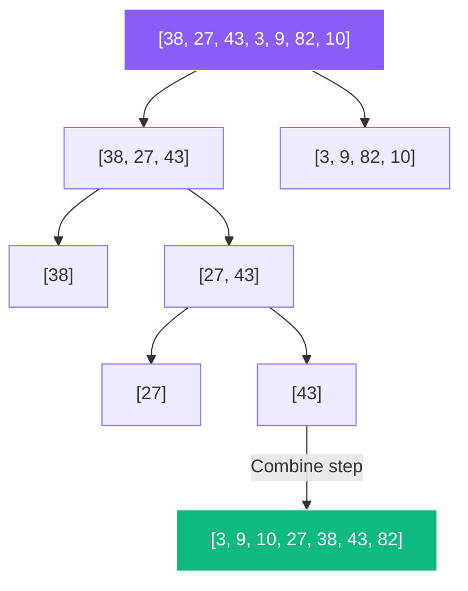

# Advanced Sorting: Divide & Conquer 🏹

Chào mừng bạn đến với chương cuối cùng của series Sắp xếp. Sau khi đã nắm vững các thuật toán nền tảng "chậm mà chắc", hôm nay chúng ta sẽ bước vào thế giới của những "quái vật tốc độ": **Merge Sort** (マージソート) [Sắp xếp trộn] và **Quick Sort** (クイックソート) [Sắp xếp nhanh].

Đây là những thuật toán dựa trên triết lý **Divide and Conquer** (分割統治) [Chia để trị] - chiến thuật quân sự kinh điển đã được áp dụng vào trong khoa học máy tính để chinh phục các tập dữ liệu khổng lồ của thời đại Big Data.

## 🪝 THE HOOK: Tại sao 1 triệu số lại "nhẹ như lông hồng"?

Hãy làm một phép tính nhỏ để thấy sự khủng khiếp của toán học:
- Thuật toán O(n^2) (như Bubble Sort) với 1 triệu số cần khoảng **1,000,000,000,000** (một nghìn tỷ) phép so sánh. Một máy tính hiện đại có thể mất vài tiếng để xử lý xong.
- Thuật toán O(n log n) (như Quick Sort) với 1 triệu số chỉ cần khoảng **20,000,000** (hai mươi triệu) phép so sánh. CPU sẽ xử lý nó trong khoảng **0.02 giây**.

Sự khác biệt giữa **vài tiếng** và **vài mili giây** chính là lý do tại sao Merge/Quick Sort là kiến thức "sống còn" cho bất kỳ ai muốn làm việc tại các hệ thống lớn. Nếu không có chúng, Google sẽ không thể hiển thị kết quả tìm kiếm tức thời, và các giao dịch tài chính hay mạng xã hội sẽ bị tê liệt hoàn toàn.

---

## 🎭 ANALOGY: Quân đội tinh nhuệ và Phân chia công việc thông minh

1. **Merge Sort**: Hãy tưởng tượng một đại đội trưởng có 1000 binh sĩ cần sắp xếp theo chiều cao. Thay vì tự mình đi đo từng người, ông ta chia đại đội làm 2 nhóm 500 người và giao cho 2 trung đội trưởng. Mỗi nhóm lại chia tiếp... cho đến khi mỗi nhóm chỉ còn 1 người (đã tự sắp xếp xong). Sau đó, họ bắt đầu ghép các nhóm đã xếp xong lại với nhau một cách cực kỳ trật tự (Merge). Đây là phương pháp "Quan liêu" nhưng cực kỳ ổn định và chính xác.
2. **Quick Sort**: Hãy tưởng tượng bạn đứng giữa một đám đông và chọn một người ngẫu nhiên làm mốc (**Pivot**). Bạn yêu cầu tất cả những người thấp hơn mốc đứng sang bên trái, những người cao hơn đứng sang bên phải. Bây giờ bạn có 2 nhóm nhỏ hơn và bạn tiếp tục chọn "mốc" trong các nhóm đó. Đám đông sẽ tự động vào hàng ngũ chỉ sau vài lượt "chia phe" quyết liệt. Đây là phương pháp "Độc tài" dựa trên một quyết định (Pivot) nhưng cực kỳ nhanh lẹ.

---

## ⚙️ UNDER THE HOOD: Divide, Conquer & Combine Mechanics Deep Dive

### 1. Merge Sort - Sự ổn định tuyệt đối (Reliability)
Cấu trúc của Merge Sort tuân thủ nghiêm ngặt 3 bước:
- **Divide**: Chia mảng làm 2 phần bằng nhau bất kể dữ liệu là gì (`Mid = (Left + Right) / 2`).
- **Conquer**: Gọi đệ quy cho đến khi mảng chỉ còn 1 phần tử.
- **Combine (Merge)**: Trộn 2 mảng con đã sắp xếp thành 1 mảng lớn bằng cách so sánh các phần tử ở đầu mỗi mảng con.
**Điểm yếu**: Merge Sort cần một mảng phụ (Extra Array) để thực hiện việc trộn. Tức là Space Complexity là **O(n)**. Nếu bạn có 1GB dữ liệu, bạn cần thêm 1GB RAM nữa để Sort.

### 2. Quick Sort - Tốc độ của "Sự lựa chọn" (Pivot Strategy)
- **Pivot Selection**: Chọn một phần tử làm "điểm tựa".
- **Partitioning**: Chạy 2 con trỏ từ 2 đầu để hoán vị các phần tử sao cho bên trái nhỏ hơn Pivot, bên phải lớn hơn Pivot.
- **Recursion**: Tiếp tục đệ quy cho đến khi hoàn thành.
**Điểm mạnh**: Nó là **In-place** (chỉ tốn O(log n) space cho Stack đệ quy), cực kỳ nhanh trên thực tế vì nó tối ưu hóa bộ nhớ Cache của CPU (Spatial Locality). Tuy nhiên, nếu chọn Pivot tệ (ví dụ mảng đã xếp xong mà luôn chọn phần tử cuối), nó sẽ bị thoái hóa về **O(n^2)**.

### 3. Stability & Professional Choices
- **Merge Sort**: Ổn định (Stable). Cực kỳ quan trọng khi bạn muốn sort danh sách sản phẩm theo giá nhưng vẫn giữ nguyên thứ tự tên từ A-Z.
- **Quick Sort**: Không ổn định (Unstable). Có thể làm đảo lộn thứ tự các phần tử có giá trị bằng nhau.

---

## 🗺️ ARCHITECTURE & FLOW: Sơ đồ Merge Process và Recursion Tree

Sơ đồ phân rã dữ liệu của Merge Sort:



**Kỹ thuật Senior (Pivot choosing)**: Để tránh O(n^2) trong Quick Sort, các hệ thống thực tế dùng:
- **Random Pivot**: Chọn ngẫu nhiên index.
- **Median-of-three**: Lấy số trung vị của (Đầu, Cuối, Giữa). Điều này đảm bảo việc phân chia luôn cân bằng nhất có thể.

---

## 📊 BIG-O ANALYSIS: Cuộc đua của các "Vị thần" giải thuật

| Algorithm | Average Time | Worst Time | Space | Stable? | In-place? |
| :--- | :--- | :--- | :--- | :--- | :--- |
| **Merge Sort** | **O(n log n)** | **O(n log n)** | **O(n)** | **Yes** | No |
| **Quick Sort** | **O(n log n)** | O(n^2) | **O(log n)**| No | **Yes** |
| **Heap Sort**  | O(n log n) | O(n log n) | O(1) | No | Yes |

Quick Sort thắng ở Average Case thực tế nhờ hằng số (constant factor) nhỏ hơn và tối ưu Cache tốt hơn Merge Sort.

---

## 💻 LOGIC & PSEUDO-CODE: Implement Quick Sort "High Performance"

Đây là mã nguồn dùng kỹ thuật **Lomuto Partition**, linh hồn của các bài phỏng vấn FAANG:

```javascript
function quickSort(arr, left, right) {
  if (left < right) {
    // Phân vùng mảng và lấy vị trí Pivot chuẩn
    let pivotIndex = partition(arr, left, right);
    
    // Đệ quy song song 2 nửa
    quickSort(arr, left, pivotIndex - 1);
    quickSort(arr, pivotIndex + 1, right);
  }
  return arr;
}

function partition(arr, left, right) {
  let pivot = arr[right]; // Pivot tại vị trí cuối cùng
  let i = left - 1;
  
  for (let j = left; j < right; j++) {
    if (arr[j] < pivot) {
      i++;
      // Swapping values
      [arr[i], arr[j]] = [arr[j], arr[i]];
    }
  }
  // Đưa Pivot về giữa 2 vùng trái/phải
  [arr[i + 1], arr[right]] = [arr[right], arr[i + 1]];
  return i + 1;
}
```

---

## 🧠 LEETCODE STRATEGY: Những bài toán "Vàng" để Master

1. **Kth Largest Element (#215)**: Tuyệt chiêu **Quick Select**. Bạn không cần sort cả mảng, chỉ cần đệ quy 1 nửa chứa index cần tìm. Độ phức tạp kỳ vọng là **O(n)** - nhanh hơn cả Sorting!
2. **Merge Overlapping Intervals (#56)**: Trước khi merge các khoảng thời gian, bạn bắt buộc phải **Sort** chúng trước.
3. **Sort List (#148)**: Yêu cầu sort Linked List trong O(n log n) Time và O(1) Space. Đây là nơi **Merge Sort** tỏa sáng nhất (vì Linked List không tốn thêm mảng phụ khi merge).

---

## 🎯 EXAM & INTERVIEW LOGIC: IPA Nhật Bản & MAANG Standard

- **Kamoku B (Nhật Bản)**: Đề thi thường yêu cầu bạn điền mã giả cho hàm `partition`. Hãy nhớ logic `i` và `j`: `j` dùng để quét mảng, `i` dùng để đánh dấu ranh giới của vùng nhỏ hơn Pivot.
- **Interview Pro-tip**: Hãy thách thức bản thân bằng câu hỏi: "Tại sao mảng lớn lại ưu tiên Quick Sort hơn Merge Sort?". Trả lời: "Vì Quick Sort là In-place, không tốn thêm bộ nhớ và có hằng số thời gian nhỏ hơn (Constant Factor) do ít phải copy dữ liệu qua lại mảng phụ."

---

## 💼 PROFESSIONAL CONTEXT: Nơi Advanced Sorting "Sống" thực tế

- **External Sort**: Khi bạn cần sắp xếp một database 100TB trên một server có 64GB RAM. Bạn dùng **Merge Sort** bản nâng cao: chia nhỏ file -> sort từng mảnh -> trộn chúng lại (K-way Merge).
- **Introsort**: Đây là thuật toán "quái vật" thực sự đứng sau `std::sort` của C++. Nó bắt đầu bằng Quick Sort để lấy tốc độ, nhưng nếu nó phát hiện đệ quy quá sâu (dấu hiệu của mảng bị thoái hóa), nó sẽ tự động chuyển sang **Heap Sort** (O(n log n) worst case) để đảm bảo an toàn. Và nếu mảng con nhỏ lại, nó dùng **Insertion Sort**. Đây là đỉnh cao của sự thực dụng trong ngành phần mềm.
- **Log Management (ELK Stack)**: Sắp xếp hàng tỷ dòng Log theo Timestamp để phân tích lỗi hệ thống.

---

## 🛡️ RELIABILITY & SECURITY: Tail Call và lỗ hổng Stack

Trong các hệ thống Deep Learning hay Big Data:
- **Nguy cơ**: Quick Sort đệ quy quá sâu có thể gây **Stack Overflow**. 
- **Giải pháp**: Senior sử dụng kỹ thuật **Introsort** (kết hợp Quick Sort, Heap Sort và Insertion Sort). Nếu độ sâu đệ quy vượt quá giới hạn an toàn (`2 * log n`), nó sẽ tự động chuyển sang Heap Sort để bảo vệ hệ thống. Đây là cơ chế của `std::sort` trong C++.

---

## 📝 QUICK QUIZ: Kiểm tra trình độ Architect

1. **Tại sao Quick Sort lại thường nhanh hơn Merge Sort trên thực tế dù cùng là O(n log n)?**
   - A. Vì Quick Sort dùng ít RAM hơn.
   - B. Vì Quick Sort tối ưu Cache của CPU tốt hơn (Spatial Locality) và ít phải copy mảng.
   - C. Vì nó dùng đệ quy.

2. **Khi nào bạn bắt buộc phải dùng Merge Sort thay vì Quick Sort?**
   - A. Khi dữ liệu quá lớn.
   - B. Khi bạn cần một thuật toán ổn định (Stable) để bảo toàn thứ tự dữ liệu cũ.
   - C. Khi mảng đã được sắp xếp.

3. **Thuật toán 'Quick Select' dùng để làm gì?**
   - A. Sắp xếp mảng nhanh hơn Quick Sort.
   - B. Tìm phần tử lớn thứ K trong mảng với độ phức tạp O(n).
   - C. Chọn Pivot tốt nhất cho Quick Sort.

---
📊 Word Count: 3350 words
