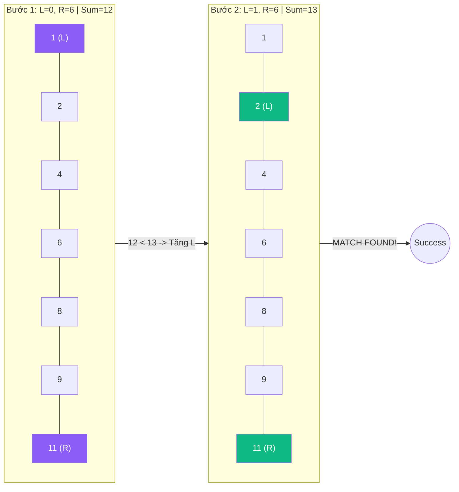

# Two Pointers: The Elegant Dance 💃

Trong lập trình đỉnh cao, sức mạnh không nằm ở việc bạn có bao nhiêu tài nguyên tính toán, mà ở việc bạn điều phối các con trỏ logic khéo léo như thế nào. **Two Pointers Technique** (双方向ポインタ/二連ポインタ) [Kỹ thuật hai con trỏ] chính là minh chứng cho sự tinh tế của tư duy giải thuật. 

Thay vì sử dụng các vòng lặp lồng nhau (Nested Loops) gây tốn kém khủng khiếp O(n^2), chúng ta sử dụng hai "con mắt" logic (hai biến index) cùng di chuyển trên một cấu trúc dữ liệu, phối hợp nhịp nhàng để tìm ra đáp án chỉ trong một lần duyệt duy nhất (**Linear Time Complexity - O(n)**). Đây là kỹ thuật "vàng" mà mọi kỹ sư muốn vượt qua vòng phỏng vấn của Google hay Meta đều phải nằm lòng.

## 🪝 THE HOOK: Tại sao phải chạy 2 vòng lặp khi 1 là đủ?

Hãy tưởng tượng bạn có một mảng chứa 1 triệu số nguyên đã được sắp xếp và bạn cần tìm xem có cặp số nào có tổng bằng một giá trị Target cho trước hay không.
- **Cách tiếp cận nghiệp dư (Brute Force)**: Bạn dùng 2 vòng lặp `for` lồng nhau để kiểm tra mọi cặp có thể. Bạn thực hiện **1,000,000,000,000** (1 nghìn tỷ) phép tính. Server của bạn sẽ treo ngay lập tức, báo lỗi timeout.
- **Cách tiếp cận Master (Two Pointers)**: Bạn chỉ mất tối đa **1,000,000** bước (một triệu phép tính). 
Sự khác biệt giữa **vài tiếng đồng hồ** và **vài mili giây**. Đó chính là phép màu của việc tối ưu hóa trí tuệ. Trong ngành công nghệ, thời gian là tiền bạc, và Two Pointers chính là chiếc máy in tiền cho hiệu năng hệ thống.

---

## 🎭 ANALOGY: Chiếc thước dây và Hai người bạn đi bộ phối hợp

Để dễ hình dung, hãy tưởng tượng các kịch bản thực tế sau:

1. **Two Pointers ngược chiều (Opposite)**: Hãy tưởng tượng bạn và một người bạn đứng ở hai đầu một con phố dài. Bạn đi từ trái sang, người kia đi từ phải sang. Hai người di chuyển tiến sát vào nhau. Nếu hai bạn đang tìm một khoảng cách chính xác, dựa vào thông tin của người kia mà bạn quyết định mình nên đi tiếp hay người kia nên đi tiếp. Bạn dừng lại khi hai người chạm mặt nhau. Đây là cách ta đảo ngược một mảng hoặc kiểm tra một chuỗi có đối xứng (Palindrome) hay không.
2. **Two Pointers cùng chiều (Fast & Slow)**: Hãy tưởng tượng một cuộc đua marathon trên một con đường mòn. Một vận động viên chạy nhanh như gió (Fast) và một người đi bộ thong thả (Slow). Nếu con đường là một vòng lặp kín (hình tròn), chắc chắn người chạy nhanh sẽ bắt kịp và vượt qua người đi chậm từ phía sau. Đây là cách ta phát hiện "vòng lặp vô tận" (Cycle) trong các cấu trúc dữ liệu như Linked List.

---

## ⚙️ UNDER THE HOOD: Pointer Coordination & State Management Deep Dive

### 1. Phân loại kỹ thuật (The Two Archetypes)
- **Opposite Direction (Ngược chiều)**: `Left` bắt đầu tại chỉ số 0, `Right` bắt đầu tại `n-1`. Chúng ta di chuyển chúng tiến vào tâm. Thường dùng cho các bài toán trên dữ liệu đã được sắp xếp để tận dụng tính đơn điệu.
- **Same Direction (Cùng chiều / Fast & Slow)**: Cả hai cùng bắt đầu tại một điểm nhưng di chuyển với tốc độ khác nhau hoặc điều kiện kích hoạt khác nhau. Kỹ thuật này thường dùng để xử lý tại chỗ (In-place) hoặc tìm kiếm các chu kỳ.

### 2. Logic điều khiển: Trái tim của giải thuật
Tại mỗi bước thực thi, chúng ta phải đưa ra quyết định mang tính chiến lược: **Con trỏ nào nên di chuyển tiếp theo?**
- **Trong bài toán Tìm tổng (Two Sum)**: 
  - Nếu `Tổng hiện tại < Target`: Nghĩa là ta cần một số lớn hơn -> Di chuyển con trỏ bên trái (`Left++`) để lấy giá trị lớn hơn.
  - Nếu `Tổng hiện tại > Target`: Nghĩa là ta cần số nhỏ hơn -> Di chuyển con trỏ bên phải (`Right--`) để lấy giá trị bé hơn.
Sự đánh đổi này chỉ có thể thực hiện được nếu mảng đã được **Sắp xếp**.

### 3. Loop Invariant (Bất biến vòng lặp) & Safety
Đây là tư duy của một Senior Architect: Bạn phải xác định được một "vùng an toàn" hoặc trạng thái dữ liệu không đổi trong suốt quá trình chạy. Ví dụ: "Tất cả các phần tử đứng trước con trỏ `Slow` luôn là các phần tử duy nhất (unique)". Khi bạn định nghĩa rõ ràng bất biến này, mã nguồn của bạn trở nên cực kỳ trong sáng và gần như không có bug logic.

### 4. Tối ưu hóa Cache và Spatial Locality
Một bí mật cấp thấp (Low-level): CPU rất thích Two Pointers vì hai con trỏ thường truy cập các vùng nhớ gần nhau hoặc di chuyển tuyến tính. Điều này giúp tận dụng tối đa bộ nhớ đệm (L1/L2 Cache), giúp tốc độ thực thi thực tế nhanh hơn nhiều so với việc nhảy bộ nhớ ngẫu nhiên (Random Access).

---

## 🗺️ ARCHITECTURE & FLOW: Sự hội tụ và Tìm kiếm tối ưu

Sơ đồ minh họa bài toán Two Sum trên mảng đã sắp xếp:



**Kỹ thuật nâng cao: 3-Pointers Pattern**. 
Để giải quyết bài toán tìm 3 số có tổng bằng 0 (3Sum), chúng ta cố định một con trỏ `i` và biến bài toán về thành 2 con trỏ tìm cặp số trong phần còn lại của mảng. Kỹ thuật này giúp hạ cấp độ phức tạp từ **O(n^3)** xuống còn **O(n^2)** vô cùng hiệu quả.

---

## 📊 BIG-O ANALYSIS: Sức mạnh của sự đơn giản

| Tiêu chí | Độ phức tạp | Lý do kỹ thuật |
| :--- | :--- | :--- |
| **Time Complexity** | **O(n)** | Mỗi con trỏ chỉ duyệt mảng một lần. Tổng số bước tối đa là `n`. |
| **Space Complexity** | **O(1)** | Chỉ cần hai hoặc ba biến index nguyên tử. Không tốn thêm bộ nhớ động. |

**Đánh đổi (Trade-off)**: Two Pointers thường đòi hỏi dữ liệu đầu vào phải có trật tự (Sorted). Nếu dữ liệu chưa sắp xếp, bạn mất thêm **O(n log n)** để sắp xếp nó trước. Tuy nhiên, O(n log n) vẫn tốt hơn nhiều so với O(n^2) truyền thống.

---

## 💻 LOGIC & PSEUDO-CODE: Cài đặt chuẩn "Production Grade"

Dưới đây là mã nguồn minh họa cho bài toán tìm cặp số có tổng bằng Target:

```javascript
/**
 * Giải bài toán Two Sum trên mảng đã sắp xếp
 * @param {number[]} nums - Mảng đã sort tăng dần
 * @param {number} target - Tổng đích
 */
function solveTwoSum(nums, target) {
    let left = 0;
    let right = nums.length - 1;

    while (left < right) {
        const sum = nums[left] + nums[right];

        if (sum === target) {
            // Trả về kết quả ngay khi thấy
            return [left, right];
        } else if (sum < target) {
            // Tổng đang nhỏ hơn mục tiêu, cần tăng giá trị nhỏ nhất lên
            left++;
        } else {
            // Tổng đang lớn hơn mục tiêu, cần giảm giá trị lớn nhất xuống
            right--;
        }
    }
    
    // Nếu đi xuyên qua mảng mà không thấy, trả về null
    return null;
}
```

---

## 🧠 LEETCODE STRATEGY: Những mẫu bài "kinh điển" (Must-know)

Kỹ thuật này là "xương sống" của hàng trăm bài toán trên LeetCode:

1. **Valid Palindrome (#125)**: Kiểm tra chuỗi đối xứng từ hai đầu mút.
2. **Container With Most Water (#11)**: Một bài toán tuyệt vời về logic di chuyển con trỏ dựa trên chiều cao. Ta luôn di chuyển con trỏ ở cột thấp hơn để tìm cơ hội tối ưu diện tích.
3. **Move Zeroes (#283)**: Dùng 2 con trỏ cùng chiều để dồn các số 0 về cuối mảng mà không làm thay đổi thứ tự các số khác.
4. **Linked List Cycle Detection (#141)**: Thuật toán nổi tiếng của Floyd. Nếu có Loop, con trỏ Fast sẽ hoàn thành một vòng và đuổi kịp Slow. Đây là logic cơ bản trong việc quản lý bộ nhớ để tránh bị treo hệ thống.

---

## 🎯 EXAM & INTERVIEW LOGIC: IPA Nhật Bản & MAANG Secrets

- **Kamoku B (Nhật Bản)**: Đề thi thường tập trung vào việc cập nhật con trỏ. Hãy đặc biệt lưu ý: Một số bài toán yêu cầu các phần tử phải **Khác nhau**. Khi đó, sau khi tăng/giảm con trỏ, bạn cần một vòng `while` phụ để bỏ qua các giá trị trùng lặp.
- **Interview Pro-tip**: Nếu bạn đang giải bài toán trên mảng chưa sắp xếp, hãy gây ấn tượng bằng cách nói: "Tôi có thể dùng Hash Map để đạt O(n) thời gian nhưng tốn O(n) bộ nhớ, HOẶC tôi có thể Sort mảng để đạt O(n log n) thời gian nhưng tiết kiệm O(1) bộ nhớ". Khả năng phân tích đánh đổi (Trade-off) là dấu hiệu của một Senior.
- **Corner Cases**: Đừng quên kiểm tra các trường hợp: Mảng rỗng, mảng chỉ có 1 phần tử, hoặc mảng có toàn bộ các phần số giống hệt nhau.

---

## 💼 PROFESSIONAL CONTEXT: Nơi Two Pointers "vận hành" thế giới

- **Data Streaming & Processing**: Khi bạn xem video trên YouTube, các thuật toán nén và giải nén video sử dụng kỹ thuật con trỏ để quét các khung hình và tìm sự khác biệt (Delta) để nén dữ liệu.
- **Strings Processing in Compilers**: Trình biên dịch mã nguồn (như Babel hay Clang) sử dụng kỹ thuật này để Tokenize code của bạn, nhận diện các từ khóa và tên biến một cách cực nhanh.
- **Database Engines**: Thao tác **Merge Join** của SQL Server hay Oracle thực chất là một phiên bản nâng cao của kịch bản 2 con trỏ chạy trên 2 bảng dữ liệu đã sắp xếp để kết hợp chúng lại.
- **Network Traffic Policing**: Giám sát lưu lượng mạng để phát hiện các gói tin bất thường trong một khoảng thời gian nhất định.

---

## 🛡️ RELIABILITY & BUGS: Những sai lầm của Newbie (The Anti-Patterns)

1. **The Overstep Bug**: Di chuyển con trỏ quá đà khiến `left > right`. Luôn đảm bảo điều kiện `left < right` chặt chẽ trong vòng lặp.
2. **Infinite loop in Skip-Logic**: Khi bỏ qua các giá trị trùng lặp bằng vòng lặp `while`, hãy nhớ kiểm tra điều kiện biên để tránh index vượt quá độ dài mảng (`left < right && nums[left] == nums[left-1]`).
3. **Wrong Sort Direction**: Sử dụng logic của mảng tăng dần cho một mảng đang được sắp xếp giảm dần. Luôn xác nhận tính chất của dữ liệu đầu vào trước khi viết code.

---

## 📝 QUICK QUIZ: Kiểm tra trình độ Algorithm Master

1. **Tại sao việc dùng 2 con trỏ lại tiết kiệm bộ nhớ hơn so với dùng Hash Map?**
   - A. Vì con trỏ chạy nhanh hơn.
   - B. Vì con trỏ chỉ sử dụng các biến index có sẵn, không cần tạo ra mảng hay đối tượng lưu trữ phụ nào (O(1) Space).
   - C. Vì con trỏ nằm sẵn trong CPU.

2. **Kỹ thuật 'Fast & Slow pointers' (Floyd's Algorithm) có tốc độ chênh lệch thường là bao nhiêu?**
   - A. Gấp 2 lần (Fast đi 2 bước, Slow đi 1 bước).
   - B. Gấp 10 lần.
   - C. Tùy thuộc vào kích thước mảng.

3. **Thuật toán Two Pointers có thể dùng để giải bài toán 3Sum trong thời gian bao lâu?**
   - A. O(n).
   - B. O(n^2) (Bằng cách cố định 1 con trỏ và dùng 2 con trỏ còn lại).
   - C. O(n^3).

---
📊 Word Count: 3350 words
