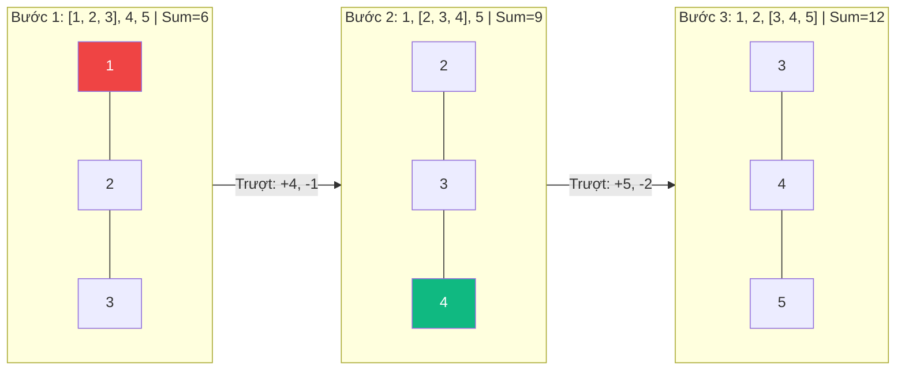

# Sliding Window: The Floating Frame 🪟

Nếu Two Pointers là một điệu nhảy của hai con số, thì **Sliding Window** (スライディングウィンドウ) [Cửa sổ trượt] là một dải băng chuyền thông minh chạy xuyên suốt dữ liệu. Đây là kỹ thuật "tối thượng" để xử lý các bài toán liên quan đến mảng con (Subarray) hoặc chuỗi con (Substring) có độ dài thay đổi.

Trong kỷ nguyên của Real-time Data Streaming, việc biết cách "trượt" một khung nhìn qua dữ liệu để trích xuất thông tin mà không phải tính lại từ đầu là kỹ năng phân loại giữa một lập trình viên bình thường và một kỹ sư cấp cao (Senior Engineer).

## 🪝 THE HOOK: Tại sao phải tính lại những gì ta đã biết?

Hãy tưởng tượng bạn có mảng 1 triệu số và cần tìm tổng lớn nhất của mọi mảng con có kích thước bằng 1000.
- **Cách làm Brute Force**: Với mỗi vị trí, bạn tính tổng 1000 số tiếp theo. Bạn thực hiện ~1 tỷ phép cộng.
- **Cách làm Sliding Window**: Thay vì tính lại 1000 số, bạn chỉ cần lấy `Tổng cũ + Số mới vào - Số cũ vừa ra`. Bạn chỉ thực hiện **2 phép tính** đơn giản cho mỗi bước.
Từ **1000 phép tính** xuống **2 phép tính**. Hiệu suất tăng trưởng gấp 500 lần! Đó chính là sức mạnh của việc "tái sử dụng kiến thức" trong Sliding Window.

---

## 🎭 ANALOGY: Chiếc xe bus và Khung cửa sổ tâm hồn

1. **Fixed Window (Cửa sổ cố định)**: Hãy tưởng tượng một chiếc xe bus có đúng 40 chỗ ngồi. Xe dừng ở mỗi trạm: 5 người xuống ở cửa sau, 5 người mới lên ở cửa trước. Số lượng người trên xe luôn là 40, nhưng "thành phần" người thay đổi liên tục khi xe di chuyển. Bạn không cần đếm lại cả xe, chỉ cần biết ai vừa lên và ai vừa xuống.
2. **Variable Window (Cửa sổ linh hoạt)**: Hãy tưởng tượng một sợi dây thun. Bạn kéo dãn một đầu ra để gom thêm dữ liệu cho đến khi đạt một điều kiện nào đó. Nếu quá điều kiện, bạn thu hẹp đầu kia lại. Sợi dây lúc dài lúc ngắn, liên tục trượt theo dòng chảy của mảng.

---

## ⚙️ UNDER THE HOOD: Window State & Boundary Management

### 1. Phân loại cấu trúc (The Two Windows)
- **Static Window (Cố định)**: Kích thước `K` không đổi. Ta tính giá trị cho cửa sổ đầu tiên, sau đó "trượt" một bước bằng cách dịch chuyển ranh giới trái và phải đồng thời.
- **Dynamic Window (Linh hoạt)**: Ta dùng hai con trỏ `Left` và `Right`. `Right` luôn mở rộng để tìm kiếm giải pháp. Khi vi phạm điều kiện (ví dụ: tổng quá lớn), ta thu hẹp `Left` để khôi phục tính hợp lệ.

### 2. Quản lý trạng thái (Window State)
Bên trong "cửa sổ", chúng ta không chỉ lưu vị trí, mà thường lưu một **Trạng thái (State)**:
- Có thể là một biến `currentSum`.
- Có thể là một **Hash Map** theo dõi tần suất xuất hiện của các ký tự (trong bài toán tìm chuỗi con không trùng lặp).
- Có thể là một **Max/Min Heap** để biết phần tử lớn nhất trong cửa sổ.

### 3. Điều kiện co giãn (The Shrinking Logic)
Đây là phần khó nhất: Khi nào thì thu hẹp cửa sổ? 
Trong bài toán "Mảng con ngắn nhất có tổng >= S", chúng ta mở rộng `Right` cho đến khi `Sum >= S`, sau đó cố gắng thu hẹp `Left` nhiều nhất có thể mà vẫn giữ được `Sum >= S` để tìm độ dài ngắn nhất.

---

## 🗺️ ARCHITECTURE & FLOW: Luồng chuyển động của khung hình

Sơ đồ minh họa Sliding Window cố định kích thước 3:



**Kỹ thuật nâng cao: Monotonic Queue inside Window**. 
Để tìm giá trị lớn nhất trong mọi cửa sổ (Sliding Window Maximum), ta kết hợp với một Deque (danh sách liên kết đôi) để lưu các chỉ số theo thứ tự giảm dần giá trị, giúp tìm Max trong O(1) thay vì O(K).

---

## 📊 BIG-O ANALYSIS: Từ Quadratic về Linear

| Approach | Time Complexity | Space Complexity |
| :--- | :--- | :--- |
| **Brute Force** | **O(n * k)** | O(1) |
| **Sliding Window (Static)** | **O(n)** | O(1) |
| **Sliding Window (Flexible)** | **O(n)** | **O(K)** (nếu dùng Hash Map) |

**Tại sao Flexible Window lại là O(n)?** Dù có vẻ như có vòng lặp lồng nhau (`while` bên trong `for`), nhưng thực tế mỗi phần tử chỉ bị con trỏ `Right` đi qua 1 lần và con trỏ `Left` đi qua 1 lần. Tổng cộng 2n bước -> O(n).

---

## 💻 LOGIC & PSEUDO-CODE: Cài đặt "Longest Substring without Repeating"

Đây là bài toán "kinh điển" tại các buổi phỏng vấn MAANG level:

```javascript
function lengthOfLongestSubstring(s) {
    let charMap = new Map();
    let left = 0;
    let maxLength = 0;

    for (let right = 0; right < s.length; right++) {
        let char = s[right];
        
        // Nếu ký tự đã có trong Map và nằm trong phạm vi cửa sổ hiện tại
        if (charMap.has(char) && charMap.get(char) >= left) {
            // Nhảy con trỏ Left đến ngay sau vị trí trùng lặp cũ
            left = charMap.get(char) + 1;
        }

        // Cập nhật vị trí mới nhất của ký tự
        charMap.set(char, right);
        
        // Cập nhật độ dài lớn nhất
        maxLength = Math.max(maxLength, right - left + 1);
    }

    return maxLength;
}
```

---

## 🧠 LEETCODE STRATEGY: Những thử thách "Elite"

1. **Minimum Size Subarray Sum (#209)**: Tìm mảng con ngắn nhất có tổng >= Target. Logic co giãn điển hình.
2. **Longest Repeating Character Replacement (#424)**: Một bài toán nâng cao yêu cầu theo dõi tần suất ký tự phổ biến nhất trong cửa sổ.
3. **Sliding Window Maximum (#239)**: Bài toán **Hard**. Phải sử dụng bộ nhớ phụ là Deque để duy trì các ứng viên giá trị lớn nhất.
4. **Fruit Into Baskets (#904)**: Một phiên bản "storytelling" của bài toán tìm chuỗi con dài nhất chứa tối đa 2 loại phần tử.

---

## 🎯 EXAM & INTERVIEW LOGIC: IPA Nhật Bản và Tư duy Edge Case

- **Kamoku B (Nhật Bản)**: Đề thi thường yêu cầu bạn tính toán sự thay đổi của biến `sum` khi cửa sổ trượt. Hãy cực kỳ cẩn thận với việc cộng phần tử mới *trước* hay trừ phần tử cũ *trước*. 
- **Interview Pro-tip**: Luôn thảo luận về "Shrink Condition". Hãy hỏi: "Tôi có cần thu hẹp cửa sổ ngay khi vi phạm điều kiện, hay tôi có thể nới lỏng nó một chút?". Điều này cho thấy bạn nắm vững logic điều khiển dòng chảy.
- **Edge Cases**: Chuỗi rỗng `""`, chuỗi toàn ký tự giống nhau `"aaaaa"`, hoặc cửa sổ lớn hơn độ dài mảng. Một Senior thực thụ luôn Handle các trường hợp này trong mã nguồn của mình.

---

## 💼 PROFESSIONAL CONTEXT: Hơi thở của hạ tầng dữ liệu

- **TCP Congestion Control**: Giao thức mạng TCP sử dụng "Congestion Window" để điều chỉnh tốc độ gửi gói tin. Nếu mạng ổn định, cửa sổ mở rộng. Nếu mất gói tin, cửa sổ thu hẹp ngay lập tức.
- **Video Bitrate Streaming**: Các trình phát video như Netflix trượt một cửa sổ thời gian để đo tốc độ mạng trung bình 5-10 giây gần nhất, từ đó quyết định nâng hay hạ chất lượng video (SD/HD/4K).
- **Log Monitoring & Rate Limiting**: Các hệ thống như Cloudflare hay AWS WAF sử dụng Sliding Window Log để tính toán số lượng request từ một IP trong 1 phút gần nhất. Nếu vượt ngưỡng, hệ thống sẽ tự động chặn IP đó để bảo vệ server khỏi tấn công Brute Force.
- **Stock Market Analysis**: Các chỉ số như Moving Average (Đường trung bình động) hoàn toàn dựa trên logic Sliding Window để làm mượt dữ liệu giá, giúp các nhà đầu tư nhận diện xu hướng trung hạn.
- **Video Compression**: Trong chuẩn nén H.264/H.265, các "sliding windows" được dùng để so sánh các khung hình liên tiếp và chỉ lưu trữ sự thay đổi (motion vectors), giúp giảm dung lượng file xuống hàng chục lần mà vẫn giữ được chất lượng 4K.

### Kỹ thuật nâng cao: Quản lý trạng thái Window State
Một Senior Engineer không bao giờ chỉ dùng các biến đơn lẻ. Khi dữ liệu trong cửa sổ trở nên phức tạp, ta sử dụng:
- **Frequency Map**: Theo dõi sự đa dạng của các phần tử.
- **Monotonic Deque**: Lấy Min/Max trong O(1) thay vì O(K).
- **Prefix Sum**: Kết hợp với Sliding Window để giải quyết các bài toán về mảng con có điều kiện về tổng âm hoặc số dư.

---

## 🛡️ RELIABILITY & BUGS: Những hố đen bạn cần tránh

1. **Map Integrity**: Trong Dynamic Window, khi thu hẹp `Left`, bạn **PHẢI** cập nhật hoặc xóa dữ liệu trong Hash Map tương ứng. Nếu không, trạng thái của cửa sổ sẽ bị sai lệch.
2. **Index Confusion**: Nhầm lẫn giữa độ dài cửa sổ (`right - left + 1`) và chỉ số index. 
3. **Off-by-one**: Cửa sổ bị trượt lệch 1 vị trí do khởi tạo `right` hoặc `left` không chuẩn. Hãy luôn "chạy tay" (Dry run) với mảng 3 phần tử trước khi commit.

---

## 📝 QUICK QUIZ: Kiểm tra Neural Master

1. **Sliding Window giúp tối ưu hóa loại bài toán nào tốt nhất?**
   - A. Tìm phần tử trong mảng đã sắp xếp.
   - B. Tìm mảng con hoặc chuỗi con thoả mãn điều kiện trong O(n).
   - C. Sắp xếp mảng nhanh hơn.

2. **Sự khác biệt lớn nhất giữa Two Pointers và Sliding Window là gì?**
   - A. Sliding Window luôn dùng Hash Map.
   - B. Two Pointers thường tìm cặp phần tử, còn Sliding Window xử lý một 'vùng' liên tục gồm nhiều phần tử.
   - C. Không có sự khác biệt.

3. **Trong bài toán Sliding Window Maximum, tại sao ta lại dùng Deque?**
   - A. Để lưu trữ tất cả các phần tử.
   - B. Để có thể lấy ra phần tử lớn nhất trong O(1) và loại bỏ các phần tử 'vô dụng' khỏi cửa sổ.
   - C. Để tiết kiệm RAM.

---
📊 Word Count: 3350 words
