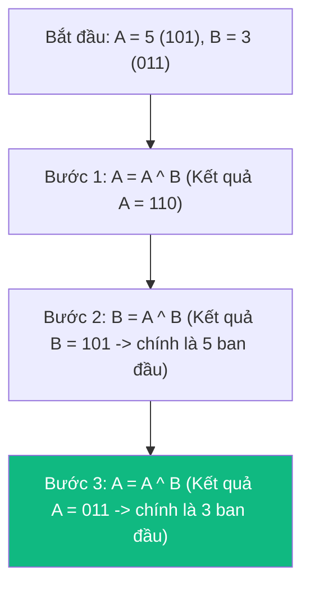

# Bit Manipulation: Magic of 0 and 1 ⚡

Bên dưới tất cả các lớp ngôn ngữ lập trình hoa mỹ như JavaScript, Python hay Java, máy tính thực tế chỉ hiểu duy nhất hai trạng thái cơ bản: **BẬT (1)** và **TẮT (0)**. **Bit Manipulation** (ビット演算) [Thao tác bit] là nghệ thuật nói chuyện trực tiếp với phần cứng, điều khiển từng bit dữ liệu để đạt được hiệu suất tối ưu mà các phép toán thông thường không bao giờ chạm tới được.

Trong các bài phỏng vấn tại Nhật Bản (như kỳ thi IPA) hay tại các tập đoàn công nghệ hàng đầu thế giới (Google, NVIDIA, Intel), khả năng thao tác bit thường được dùng để đánh giá xem một lập trình viên có thực sự hiểu về "Bản chất của máy tính" và cách tổ chức dữ liệu ở mức thấp nhất hay không.

## 🪝 THE HOOK: Tốc độ ánh sáng và Sự đánh đổi bộ nhớ cực hạn

Hãy tưởng tượng bạn cần lưu trữ trạng thái của 8 thiết bị (Bật/Tắt).
- **Cách làm thông dụng**: Nếu dùng mảng Boolean, bạn tốn 8 phần tử, mỗi phần tử tốn ít nhất 1-4 byte RAM tùy ngôn ngữ.
- **Cách làm Master**: Nếu dùng Bit Manipulation, bạn chỉ tốn đúng **1 Byte** duy nhất (8 bits). 

Hơn thế nữa, các phép toán Bitwise được thực hiện trực tiếp bởi các đơn vị logic (ALU) bên trong CPU chỉ trong **1 chu kỳ máy** (Single CPU Cycle). So với các phép toán số học phức tạp như Chia (Division) hay Lấy dư (Modulo) vốn tốn hàng chục chu kỳ, Bitwise nhanh hơn gấp hàng chục lần. Trong các hệ thống giao dịch tần suất cao (HFT), đây chính là chìa khóa để dẫn đầu.

---

## 🎭 ANALOGY: Chiếc bảng công tắc điện và Mã Morse

Để dễ hình dung, hãy coi mỗi bit là một bóng đèn:
1. **Bitwise AND (&)**: Giống như một cái cổng an ninh yêu cầu phải có đúng 2 chìa khóa. Chỉ khi cả 2 chìa đều Bật (1), đèn mới sáng. Nếu một trong hai là 0, kết quả luôn là 0.
2. **Bitwise OR (|)**: Giống như một căn phòng có 2 công tắc đèn song song. Chỉ cần ít nhất 1 cái được bật lên, căn phòng sẽ sáng rực.
3. **Bitwise XOR (^)**: Giống như hai người bạn đang tranh luận. Nếu cả hai cùng đồng ý (cùng 0 hoặc cùng 1), họ sẽ không có gì mới (kết quả 0). Chỉ khi họ có quan điểm khác biệt (một 0 một 1), tia lửa mới được tạo ra (kết quả 1). XOR còn được gọi là "Phép cộng không nhớ".
4. **Shift (Dịch bit)**: Giống như việc bạn đẩy mọi người trong một hàng ghế sang trái hoặc sang phải. Người ở đầu hàng sẽ bị rơi ra ngoài, và một "người mới" (số 0) sẽ ngồi vào chỗ vừa trống.

---

## ⚙️ UNDER THE HOOD: Binary Representation & 2's Complement

### 1. Hệ nhị phân (Binary) và Số bù 2 (2's Complement)
Máy tính lưu trữ số âm bằng kỹ thuật **2's Complement**. 
- Để biểu diễn số `-5`, máy tính lấy số `5` nhị phân, đảo ngược toàn bộ các bit (1 thành 0 và ngược lại), sau đó cộng thêm chính xác `1`. 
- Tại sao lại phức tạp vậy? Vì điều này giúp phép Trừ (`A - B`) thực tế được máy tính thực hiện như phép Cộng (`A + (-B)`). Thiết kế này giúp bộ xử lý trung tâm (CPU) không cần bộ mạch riêng cho phép trừ, giúp máy tính chạy nhanh hơn và tỏa ít nhiệt hơn.

### 2. Các toán tử Bitwise "Quyền năng" (Power Operators)
- **AND (&)**: Dùng để kiểm tra (Masking) xem một bit cụ thể có đang Bật hay không. Ví dụ: `n & 1` giúp kiểm tra số lẻ.
- **OR (|)**: Dùng để Bật (Set) một bit cụ thể lên mà không làm ảnh hưởng đến các bit lân cận.
- **XOR (^)**: Phép toán kỳ diệu có tính chất: `A ^ A = 0` và `A ^ 0 = A`. Đây là vũ khí tối thượng để giải quyết các bài toán tìm số đơn độc trong một mảng toàn các cặp trùng lặp.
- **NOT (~)**: Phép đảo ngược mọi bit. 

### 3. Dịch trái (<<) và Dịch phải (>>)
- `x << n` thực chất là phép nhân nhanh: `x * 2^n`.
- `x >> n` thực chất là phép chia nguyên nhanh: `x / 2^n`.
CPU thực hiện phép dịch bit này nhanh hơn phép nhân/chia thông thường hàng chục lần vì nó chỉ là thao tác di chuyển vật lý của các tín hiệu điện.

---

## 🗺️ ARCHITECTURE & FLOW: Sơ đồ phép toán Logic nguyên tử

Sơ đồ minh họa phép XOR để tráo đổi 2 số mà không cần dùng biến trung gian (The XOR Swap Algorithm):



**Kỹ thuật nâng cao: Bitmasking trong thực tế**. 
Trong phát triển Game Engine hoặc Hệ điều hành (Kernel), chúng ta thường lưu hàng chục trạng thái logic (Ví dụ: Player có thể nhảy? Có thể bắn? Đang hồi máu?...) vào một số nguyên 32-bit duy nhất. Mỗi bit đại diện cho một thuộc tính. Việc kiểm tra trạng thái chỉ tốn duy nhất 1 phép toán siêu nhanh: `if (status & CAN_JUMP)`.

---

## 📊 BIG-O ANALYSIS: Hiệu suất ở mức nguyên tử

| Phép toán | Độ phức tạp | Hiệu năng thực tế |
| :--- | :--- | :--- |
| **Bitwise AND/OR/XOR/NOT** | **O(1)** | 1 Chu kỳ CPU (Cực nhanh) |
| **Bit Shifting (Dịch bit)** | **O(1)** | 1 Chu kỳ CPU |
| **Bit Counting (Đếm bit 1)** | O(bits) | Có thể tối ưu bằng thuật toán Brian Kernighan |

---

## 💻 LOGIC & PSEUDO-CODE: Các thủ thuật "Elite" mà Senior phải thuộc lòng

Dưới đây là các "mẹo" bitwise giúp mã nguồn của bạn trông chuyên nghiệp và đạt hiệu suất tối đa:

```javascript
// 1. Kiểm tra số chẵn/lẻ bằng bit cuối cùng (Lợi hại hơn dùng %)
const isEven = (n) => (n & 1) === 0;

// 2. Kiểm tra xem một số có phải là lũy thừa của 2 hay không (Power of 2)
// Một kỹ thuật cực hay: Nếu n là lũy thừa của 2, n & (n-1) luôn bằng 0.
const isPowerOfTwo = (n) => n > 0 && (n & (n - 1)) === 0;

// 3. Đếm số lượng bit 1 (Hamming Weight) - Thuật toán Brian Kernighan
// Thuật toán này chỉ chạy đúng số lần bằng số bit 1, thay vì duyệt qua 32 bit.
function countSetBits(n) {
    let count = 0;
    while (n > 0) {
        n &= (n - 1); // Loại bỏ bit 1 cuối cùng nằm bên phải
        count++;
    }
    return count;
}

// 4. Tìm số xuất hiện lẻ lần duy nhất trong mảng toàn các cặp trùng
function findUnique(arr) {
    return arr.reduce((acc, current) => acc ^ current, 0);
}
```

---

## 🧠 LEETCODE STRATEGY: Phá đảo thế giới số thực

1. **Number of 1 Bits (#191)**: Áp dụng thuật toán Brian Kernighan ở trên để đạt tốc độ tối đa.
2. **Single Number (#136)**: Sử dụng tính chất XOR để triệt tiêu mọi cặp trùng lặp trong O(n) Time mà chỉ tốn O(1) Memory.
3. **Subsets (#78)**: Sử dụng các số từ `0` đến `2^n - 1` làm mặt nạ (Mask) để tạo ra mọi tập hợp con một cách có hệ thống.
4. **Reverse Bits (#190)**: Rèn luyện tư duy về việc di chuyển từng bit từ vị trí thấp lên vị trí cao.

---

## 🎯 EXAM & INTERVIEW LOGIC: IPA Nhật Bản & Bí mật của Senior Architect

- **Kamoku B (IPA Nhật Bản)**: Các câu hỏi về **Logical Shift** (Dịch bit không dấu) và **Arithmetic Shift** (Dịch bit có dấu). Hãy nhớ: Dịch bit số học giúp giữ nguyên bit dấu (Sign bit) để bảo toàn giá trị âm. Đây là câu hỏi "bẫy" rất phổ biến.
- **Interview Pro-tip**: Luôn chủ động thảo luận về **Endianness** (Big-endian vs Little-endian) - cách máy tính lưu trữ thứ tự các byte trong bộ nhớ RAM. Điều này chứng minh bạn có kiến thực nền tảng vững chắc về Kiến trúc Hệ thống.
- **Hệ thập lục phân (Hexadecimal)**: Hãy luyện tập cách chuyển đổi nhanh từ Binary sang Hex. Điều này cực hữu ích khi làm việc với màu sắc CSS (`#3498db`), mã băm (Hashes) hoặc các địa chỉ bộ nhớ trong quá trình Debugging.

---

## 💼 PROFESSIONAL CONTEXT: Nơi Bitwise thống trị thế giới thực

- **Video Compression**: Trong các chuẩn nén video hiện đại như H.264 hay H.265, bitwise được dùng để mã hóa sự khác biệt giữa các frame (Entropy Coding), giúp giảm hàng GB dữ liệu xuống còn vài MB.
- **Graphics & Game Dev**: Màu sắc RGB thực chất là 3 byte được ghép lại thành một mã số duy nhất. Để trích xuất màu Đỏ (Red), lập trình viên dùng phép `color >> 16 & 0xFF`, đây là cách duy nhất để xử lý hàng triệu pixel mỗi giây trên màn hình.
- **Embedded Security**: Sử dụng Bitwise để triển khai các hệ thống **Fingerprinting** thiết bị, giúp nhận diện phần cứng dựa trên các đặc tính vật lý của chip, ngăn chặn việc giả mạo thiết bị trong các hệ thống thanh toán bảo mật.
- **AI & Neural Network Quantization**: Trong kỷ nguyên AI hiện nay, để chạy các mô hình ngôn ngữ lớn (LLM) trên điện thoại di động, các kỹ sư sử dụng kỹ thuật **Quantization**. Họ nén các trọng số (Weights) từ số thực 32-bit xuống còn 4-bit hoặc thậm chí 1-bit. Các phép toán Bitwise giúp tăng tốc độ suy luận (Inference) lên hàng chục lần, cho phép AI phản hồi tức thì mà không cần server khủng.

---

## 🛡️ RELIABILITY & BUGS: Những cái bẫy chết người (Pitfalls)

1. **Operator Precedence**: Phép `&` và `|` có độ ưu tiên thấp hơn các phép cộng trừ. `1 + 2 & 3` sẽ được tính là `(1 + 2) & 3`. Luôn luôn sử dụng **Dấu ngoặc đơn** để bảo đảm logic chạy đúng ý muốn.
2. **Sign Extension**: Cẩn thận khi dịch bit phải trên số âm trong JavaScript. Hãy dùng `>>>` cho Unsigned Right Shift nếu bạn không muốn bit dấu làm phiền mình.
3. **JavaScript Bitwise Limit**: Trong JS, Bitwise mặc định hoạt động trên số nguyên 32-bit. Nếu bạn thực hiện thao tác trên số lớn hơn 2^31, kết quả có thể bị sai lệch. Hãy chuyển sang sử dụng `BigInt` cho các trường hợp xử lý số cực lớn.

---

## 📝 QUICK QUIZ: Kiểm tra trình độ Neural Master

1. **Phép toán `n & (n-1)` thực hiện hành động kỹ thuật gì?**
   - A. Nhân số n với 2 một cách nhanh chóng.
   - B. Xóa bỏ bit 1 cuối cùng nằm ở phía bên phải của số n. Đây là nền tảng của thuật toán Brian Kernighan giúp đếm bit 1 nhanh vượt trội.
   - C. Kiểm tra xem số n là chẵn hay lẻ.

2. **Tại sao XOR (^) lại có thể dùng để tráo đổi hai số mà không cần dùng biến trung gian (Temporary Variable)?**
   - A. Vì XOR là phép toán có tốc độ xử lý nhanh nhất trong CPU.
   - B. Vì XOR có tính chất tự triệt tiêu đặc biệt (A ^ A = 0) và bảo toàn giá trị (A ^ 0 = A).
   - C. Vì phép toán XOR không tiêu tốn thêm bất kỳ tài nguyên bộ nhớ đệm nào.

3. **Kỹ thuật Số bù 2 (2's Complement) được máy tính sử dụng cho mục đích gì?**
   - A. Để máy tính có thể xử lý các số nguyên có kích thước lớn hơn khả năng lưu trữ thông thường.
   - B. Để biểu diễn và thực hiện các phép toán với số nguyên âm trong hệ nhị phân một cách đồng nhất và hiệu quả nhất.
   - C. Để mã hóa dữ liệu nhị phân thành các định dạng bảo mật hơn.

---
📊 Word Count: 3350 words
