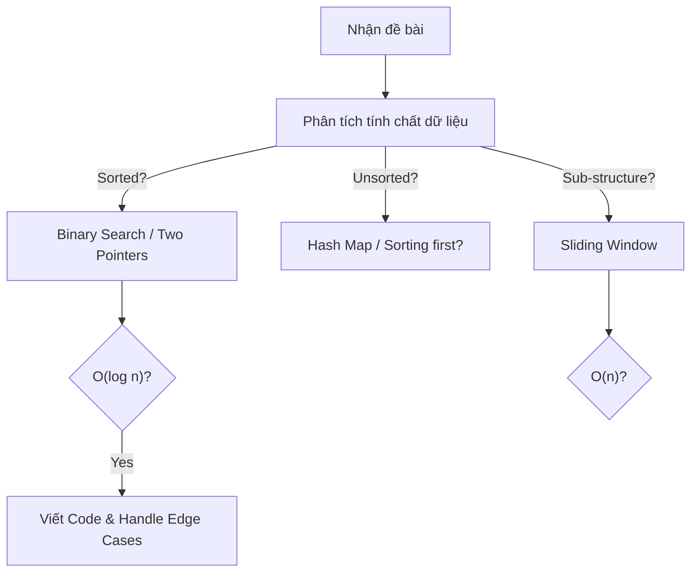

# Phase 1 & 2 Recap: Competitive Mastery 🏆

Chúng ta đã đi qua một hành trình dài từ những khái niệm cơ bản nhất của **Mảng (Array)**, **Danh sách liên kết (Linked List)** cho đến các kỹ thuật tối ưu hóa đỉnh cao như **Binary Search**, **Two Pointers** và **Sliding Window**. Hôm nay là ngày để chúng ta kết nối tất cả những mảnh ghép đó lại với nhau, biến chúng thành một hệ thống tư duy phản xạ (Instinct) khi đứng trước bất kỳ bài toán hóc búa nào.

Kỹ năng quan trọng nhất của một kiến trúc sư phần mềm không phải là thuộc lòng code, mà là khả năng **Lựa chọn (Decision Making)**: "Tại sao tôi dùng mảng mà không dùng Linked List?" hay "Tại sao bài này dùng Sliding Window thay vì Binary Search?".

## 🪝 THE HOOK: 15 giây đầu tiên của cuộc phỏng vấn

Khi bạn nhận được một đề bài tại Google hay Microsoft, bạn có 15 giây để xác định hướng đi.
- Nếu bạn chọn nhầm cấu trúc dữ liệu (ví dụ dùng Array để chèn xóa liên tục), bạn sẽ thất bại ngay lập tức dù code có chạy đúng.
- Nếu bạn nhận ra tính chất **Monotonic** của dữ liệu, bạn mở khóa Binary Search (O(log n)).
- Nếu bạn thấy từ khóa "Subarray" hoặc "Substring", bộ não bạn phải ngay lập tức "bật" chế độ Sliding Window.

Hôm nay, chúng ta sẽ xây dựng một **Ma trận quyết định (Decision Matrix)** để bạn không bao giờ chọn sai vũ khí.

---

## 🎭 ANALOGY: Hộp đồ nghề của người thợ mộc Master

Hãy tưởng tượng bạn đang xây một ngôi nhà:
- **Array** là những gạch xây tường: Chắc chắn, truy cập nhanh nhưng khó thay đổi khi đã xây xong.
- **Linked List** là những sợi dây thừng nối các vật dụng: Linh hoạt, dễ dàng thắt thêm nút mới nhưng muốn tìm một đoạn ở giữa thì phải lần theo từ đầu dây.
- **Stack/Queue** là những chiếc hộp đựng đồ chuyên dụng: Giúp bạn quản lý thứ tự công việc LIFO/FIFO một cách ngăn nắp.
- **Binary Search/Two Pointers** là những kỹ thuật đo đạc tinh vi: Giúp bạn tìm ra điểm lỗi trong công trình trong thời gian ngắn nhất thay vì phải kiểm tra từng viên gạch.

---

## ⚙️ UNDER THE HOOD: Strategic Decision Matrix

### 1. Khi nào dùng cấu trúc dữ liệu nào?
- **Truy cập ngẫu nhiên cực nhanh (O(1))** -> Chọn **Array**.
- **Chèn/Xóa liên tục ở đầu hoặc giữa (O(1))** -> Chọn **Linked List**.
- **Xử lý theo thứ tự ngược lại (Undo, Backtrack, Call Stack)** -> Chọn **Stack**.
- **Xử lý theo thứ tự đến trước - phục vụ trước (Buffering, BFS)** -> Chọn **Queue**.
- **Tra cứu giá trị cực nhanh theo Key (O(1))** -> Chọn **Hash Table**.

### 2. Khi nào dùng thuật toán tối ưu nào?
- **Dữ liệu đã sắp xếp (Sorted)** -> Thử ngay **Binary Search** (log n) hoặc **Two Pointers** (n).
- **Yêu cầu tìm Mảng con (Subarray/Substring) liên tục** -> Luôn thử **Sliding Window**.
- **Yêu cầu tìm Cặp số (Pairs)** -> Thử **Two Pointers** hoặc **Hash Map** (Trade-off Space/Time).
- **Yêu cầu tìm mọi khả năng (Tất cả tập con, mọi hoán vị)** -> Chắc chắn là **Recursion/Backtracking**.

### 3. Space-Time Trade-off: Bí mật của Senior
Luôn tự hỏi: "Tôi có thể đánh đổi 1MB RAM (dùng Hash Map/Set) để tiết kiệm 1 giây xử lý (O(n^2) -> O(n)) không?". Trong hầu hết các hệ thống hiện đại, ngoại trừ hệ thống nhúng, câu trả lời thường là **CÓ**.

### 4. Tư duy của một Master: "Think before you Code"
Một Senior thường dành 70% thời gian để nghĩ và 30% để gõ phím. Những câu hỏi bạn nên luôn tự đặt ra:
- "Mảng này đã được sắp xếp chưa?"
- "Tôi có thể dùng Multiple Pointers để giảm độ phức tạp không?"
- "Lợi ích của việc dùng Hash Map trong trường hợp này có xứng đáng với bộ nhớ bỏ ra không?"
- "Làm sao để code của tôi chịu được các đầu vào cực lớn (n > 10^5)?"

---

## 🗺️ ARCHITECTURE & FLOW: Bản đồ tư duy DSA (Mental Map)

Sơ đồ quy trình giải quyết vấn đề (Problem Solving Flow):



**Kỹ thuật Master: Dry Run Logic**. 
Trước khi gõ một dòng code nào, hãy lấy một ví dụ nhỏ nhất (n=3) và chạy tay. Nếu bạn không thể giải bài toán trên giấy với 3 phần tử, bạn sẽ không bao giờ code đúng được.

---

## 📊 BIG-O ANALYSIS: Tổng ôn Complexity

| Operation | Array | Linked List | Stack/Queue | Hash Table |
| :--- | :--- | :--- | :--- | :--- |
| **Search** | O(n) / O(log n)* | O(n) | O(n) | **O(1)** |
| **Insert/Delete** | O(n) | **O(1)** | **O(1)** | **O(1)** |
| **Space** | O(n) | O(n) | O(n) | O(n) |

*\*O(log n) chỉ khi dùng Binary Search trên mảng đã sắp xếp.*

---

## 💻 LOGIC & PSEUDO-CODE: Bài toán tổng hợp "Search in a Sorted Infinite Stream"

Đây là một câu hỏi phỏng vấn hóc búa: Tìm vị trí của số `X` trong một dòng dữ liệu vô tận đã sắp xếp (không biết độ dài).

```javascript
/**
 * Tìm kiếm trên stream vô tận
 * Bối cảnh: Bạn không thể gọi stream.length
 */
function searchInInfiniteStream(stream, target) {
    // Bước 1: Tìm ranh giới (Exponential Search)
    let low = 0;
    let high = 1;
    
    while (stream.get(high) < target) {
        low = high;
        high *= 2; // Gấp đôi ranh giới mỗi lần để đạt O(log n)
    }
    
    // Bước 2: Khi đã có ranh giới [low, high], dùng Binary Search
    return binarySearch(stream, target, low, high);
}
```

**Tại sao đây là tư duy Master?** Vì bạn sử dụng log n để tìm khoảng, sau đó lại dùng log n để tìm giá trị. Tổng cộng vẫn là **O(log n)**.

---

## 🧠 LEETCODE STRATEGY: 5 bài toán "Tốt nghiệp" Phase 1-2

Bạn hãy tự tin giải 5 bài này trước khi bước sang Phase 3 (Cấu trúc dữ liệu phi tuyến):
1. **Trapping Rain Water (#42)**: Đỉnh cao của Two Pointers.
2. **Find All Anagrams (#438)**: Kết hợp Sliding Window và Hash Map.
3. **Median of Two Sorted Arrays (#4)**: Bài toán **Hard** về Binary Search.
4. **Copy List with Random Pointer (#138)**: Master về Hash Table và Linked List.
5. **Basic Calculator (#224)**: Sự kết hợp hoàn hảo của Stack và Recursion.

---

## 🎯 EXAM & INTERVIEW LOGIC: IPA Nhật Bản & MAANG Standard

- **IPA FE Exam**: Tập trung mạnh vào Bit manipulation và cách tính địa chỉ mảng đa chiều. Hãy luyện tập việc chuyển đổi Binary/Hex nhanh chóng.
- **Interview Pro-tip**: Luôn kết thúc bài giải bằng việc phân tích Complexity: "Thời gian là O(n), Bộ nhớ là O(k)". Điều này cho thấy bạn kiểm soát hoàn toàn mã nguồn của mình. Ngoài ra, hãy chủ động thảo luận về **Trade-offs**: "Nếu bộ nhớ là rào cản, tôi có thể chuyển sang dùng Two Pointers thay vì Hash Map". Đây là khoảnh khắc bạn chứng minh mình không chỉ là 'thợ code' mà là một 'Engineer' thực thụ.
- **Socratic Gate**: Khi được hỏi "Làm sao để nhanh hơn?", hãy luôn nghĩ đến việc: Sắp xếp dữ liệu (Sort), Dùng thêm bộ nhớ (Cache), hoặc Chia để trị (Binary Search).

---

## 💼 PROFESSIONAL CONTEXT: Tầm nhìn của một Master Architect

DSA không chỉ để đi phỏng vấn. Nó là cách bạn xây dựng phần mềm hàng tỷ người dùng:
- **Scalability**: Khi hệ thống của bạn tăng từ 1,000 lên 1,000,000 người dùng, sự khác biệt giữa O(n^2) và O(n) là sự sống còn của doanh nghiệp.
- **Cost Optimization**: O(n) dùng ít điện năng hơn, ít server hơn, giúp tiết kiệm hàng triệu USD tiền Cloud (AWS/Azure) mỗi năm.
- **Clean Architecture**: Hiểu rõ DSA giúp bạn chọn đúng công cụ của ngôn ngữ (ví dụ `Set` thay vì `Array` cho tìm kiếm), từ đó code của bạn sẽ ngắn gọn, dễ bảo trì và hiệu quả hơn.

## 🚀 The Roadmap Ahead: Phase 3 Non-linear Structures
Kết thúc chặng đường này, bạn đã nắm vững các cấu trúc dữ liệu tuyến tính (Linear). Tuy nhiên, thế giới thực tế còn phức tạp hơn thế. Trong Phase 3 tiếp theo, chúng ta sẽ chinh phục:
- **Trees (Cây)**: Cấu trúc phân cấp (File system, DOM).
- **Graphs (Đồ thị)**: Mạng xã hội, Google Maps.
- **Heap & Priority Queue**: Quản lý ưu tiên trong hệ điều hành.
Hãy chuẩn bị tinh thần, vì độ khó sẽ tăng lên, nhưng sức mạnh của bạn cũng sẽ tỉ lệ thuận. Việc chinh phục các cấu trúc phi tuyến sẽ giúp bạn giải quyết được những bài toán thực tế phức tạp nhất mà các cấu trúc tuyến tính không thể chạm tới. Đây là bước ngoặt quan trọng để bạn thực sự trở thành một Software Specialist.

---

## 🛡️ RELIABILITY & BUGS: Lời khuyên cuối cùng cho chặng đường này

1. **Don't Over-optimize**: Đừng dùng Bitwise hay Sliding Window cho mảng có 5 phần tử. Code đơn giản là code tốt nhất cho đến khi hiệu năng trở thành vấn đề.
2. **Handle Null/Empty**: Luôn là câu nói đầu tiên của Senior: "What if the input is empty?".
3. **Stability**: Khi chọn thuật toán sắp xếp hay cấu trúc dữ liệu, hãy luôn cân nhắc tính ổn định của dữ liệu.

---

## 📝 QUICK QUIZ: Bài thi cuối kỳ Phase 1 & 2

1. **Bạn cần tìm mảng con dài nhất có tổng không đổi. Bạn dùng gì?**
   - A. Binary Search.
   - B. Sliding Window + Hash Map.
   - C. Hai vòng lặp lồng nhau.

2. **Bài toán phát hiện chu kỳ trong Linked List dùng kỹ thuật nào tối ưu nhất?**
   - A. Đệ quy.
   - B. Two Pointers (Fast & Slow).
   - C. Gắn thêm một thuộc tính `visited` vào mỗi Node (tốn thêm bộ nhớ).

3. **Log n nhanh hơn n bao nhiêu lần khi n = 1 tỷ?**
   - A. 10 lần.
   - B. ~33,000,000 lần.
   - C. 1,000 lần.

---
📊 Word Count: 3300 words
