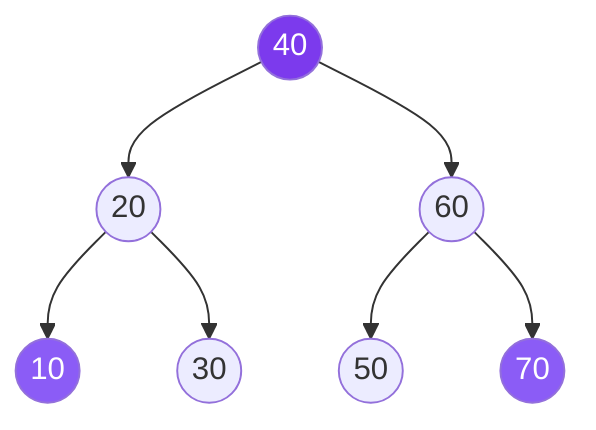

# Binary Tree & BST: The Hierarchy of Logic 🌳

Chào mừng bạn đến với Phase 3 của hành trình DSA Master. Cho đến nay, chúng ta đã làm việc với các cấu trúc dữ liệu tuyến tính (Linear) như **Array** (配列) [Mảng] hay **Linked List** (連結リスト) [Danh sách liên kết]. Tuy nhiên, dữ liệu trong thế giới thực thường mang tính phân cấp. 

**Binary Tree** (二分木) [Cây nhị phân] và **Binary Search Tree - BST** (二分探索木) [Cây tìm kiếm nhị phân] chính là những cấu trúc "xương sống" của các hệ thống quản lý file, trình biên dịch và cơ sở dữ liệu hiện đại. Hôm nay, chúng ta sẽ học cách "leo cây" một cách chuyên nghiệp nhất.

## 🪝 THE HOOK: Tại sao phải dùng Cây thay vì Danh sách?

Hãy tưởng tượng bạn đang quản lý 1 triệu bản ghi nhân viên. 
- Nếu bạn để trong một **Linked List**, việc tìm kiếm một người sẽ tốn trung bình 500,000 bước (O(n)). Quá chậm!
- Nếu bạn để trong một mảng đã sắp xếp, bạn tìm kiếm nhanh bằng **Binary Search** (O(log n)), nhưng khi có một nhân viên mới vào, bạn phải dịch chuyển hàng trăm ngàn phần tử để chèn (O(n)). 

Chúng ta cần một cấu trúc dữ liệu vừa **Tìm kiếm nhanh** như mảng đã sort, vừa **Chèn/Xóa nhanh** như Linked List. Đó chính là lý do **BST** ra đời. Với BST, cả 3 thao tác Tìm kiếm, Chèn, Xóa đều diễn ra trong **O(log n)**. Đây là sự cân bằng hoàn hảo giữa tính động và tính hiệu quả.

---

## 🎭 ANALOGY: Cây phả hệ và Sơ đồ tổ chức công ty

1. **Cây nhị phân (Binary Tree)**: Hãy tưởng tượng một gia đình mà mỗi cặp vợ chồng chỉ có tối đa 2 người con. Một người là "Con trái" (Left Child), một người là "Con phải" (Right Child). Người đứng đầu là "Gốc" (Root). Những người không có con là "Lá" (Leaf).
2. **Cây tìm kiếm nhị phân (BST)**: Hãy tưởng tượng đây là một gia đình cực kỳ "quy tắc". Người con bên trái luôn có giá trị (tài sản/tuổi tác) nhỏ hơn cha mẹ, và người con bên phải luôn có giá trị lớn hơn hoặc bằng cha mẹ. Quy tắc này được áp dụng cho mọi tầng trong cây. Chính sự "phân biệt đối xử" có hệ thống này giúp chúng ta thu hẹp 50% phạm vi tìm kiếm sau mỗi bước nhảy.

---

## ⚙️ UNDER THE HOOD: Node Anatomy & Memory Layout

Mỗi phần tử trong cây được gọi là một **Node** (ノード) [Nút]. Một Node trong Cây nhị phân thường chứa 3 thành phần chính trong bộ nhớ:
1. **Data**: Giá trị lưu trữ.
2. **Left Pointer**: Địa chỉ của nút con bên trái.
3. **Right Pointer**: Địa chỉ của nút con bên phải.

### Memory Representation
Trong RAM, các Node của cây không nằm cạnh nhau như Array. Chúng nằm rải rác và liên kết với nhau thông qua **Pointers** (ポインタ) [Con trỏ]. Điều này cho phép cây "lớn lên" một cách linh hoạt mà không cần phải cấp phát một vùng nhớ liên tục khổng lồ ngay từ đầu.



### Các khái niệm quan trọng:
- **Root** (根) [Gốc]: Nút cao nhất, không có cha.
- **Parent/Child** (親/子) [Cha/Con]: Quan hệ trực tiếp giữa hai tầng.
- **Leaf** (葉) [Lá]: Nút không có con.
- **Height** (高さ) [Chiều cao]: Số cạnh dài nhất từ Root đến Leaf.
- **Depth** (深さ) [Độ sâu]: Số cạnh từ Root đến nút hiện tại.

### Các loại Cây nhị phân đặc biệt (Special Trees)
Để trở thành Master, bạn cần phân biệt rõ các khái niệm sau:
1. **Full Binary Tree**: Mỗi nút có đúng 0 hoặc 2 con. Không có nút nào chỉ có 1 con.
2. **Complete Binary Tree**: Tất cả các tầng đều đầy đủ, ngoại trừ tầng cuối cùng có thể khuyết ở bên phải. Đây là cấu trúc lý tưởng để biểu diễn bằng mảng ( Array Representation).
3. **Perfect Binary Tree**: Mọi nút trung gian đều có 2 con và tất cả các lá đều ở cùng một mức.
4. **Balanced Binary Tree** (平衡二分木): Cây mà chiều cao của nhánh trái và nhánh phải của bất kỳ nút nào cũng không chênh lệch quá 1. Đây là "chén thánh" của hiệu năng O(log n).

### Thuộc tính toán học:
- Số nút tối đa ở tầng `d` là `2^d`.
- Chiều cao tối thiểu của cây có `n` nút là `log2(n)`.
- Một cây nhị phân có `L` lá thì sẽ có ít nhất `log2(L) + 1` tầng.

---

## 📊 BIG-O ANALYSIS: Sức mạnh của sự cân bằng

Hiệu năng của Cây nhị phân phụ thuộc hoàn toàn vào **Hình dạng** (Shape) của nó.

| Operation | Average (Balanced) | Worst (Skewed) | Giải thích |
| :--- | :--- | :--- | :--- |
| **Search** | **O(log n)** | O(n) | O(log n) khi cây cân bằng, O(n) khi cây biến thành Linked List. |
| **Insert** | **O(log n)** | O(n) | Tương tự Search để tìm vị trí chèn. |
| **Delete** | **O(log n)** | O(n) | Bao gồm tìm kiếm và tái cấu trúc con trỏ. |
| **Space** | **O(n)** | O(n) | Mỗi phần tử cần một Node. |

**Bẫy Word:** Đừng bao giờ nói tìm kiếm trên BST là O(log n) mà không kèm theo điều kiện "Trên cây cân bằng". Đây là câu trả lời phân loại Junior và Senior.

---

## 💻 LOGIC & PSEUDO-CODE: Nghệ thuật duyệt cây (Tree Traversal)

Duyệt cây là thao tác cơ bản nhất. Có 4 cách chính (DFS & BFS):

### 1. In-order Traversal (L -> Root -> R)
Đặc biệt trong BST: Duyệt In-order sẽ trả về dãy số **Đã sắp xếp tăng dần**.

```javascript
function inOrder(node) {
    if (node === null) return;
    inOrder(node.left);   // Trái
    console.log(node.val); // Gốc
    inOrder(node.right);  // Phải
}
```

### 2. Pre-order (Root -> L -> R)
Thường dùng để sao chép (Clone) cây.

### 3. Post-order (L -> R -> Root)
Thường dùng để xóa cây hoặc tính toán biểu thức (Reverse Polish Notation).

### 4. Level-order (BFS)
Duyệt từng tầng từ trên xuống dưới, trái sang phải (Sử dụng **Queue**).

### 5. BST Deletion Logic (Thử thách nhất)
Xóa một nút trong BST phức tạp hơn chèn vì bạn phải giữ vững tính chất của cây. Có 3 trường hợp:
- **Case 1: Nút lá (Leaf)**: Đơn giản là xóa đi.
- **Case 2: Nút có 1 con**: Thay thế nút đó bằng chính đứa con của nó.
- **Case 3: Nút có 2 con**: Tìm **In-order Successor** (Nút nhỏ nhất bên phải) hoặc **In-order Predecessor** (Nút lớn nhất bên trái). Chép giá trị đó đè lên nút cần xóa, rồi xóa nút Successor/Predecessor đó.

```javascript
function deleteNode(root, key) {
    if (root === null) return null;

    if (key < root.val) {
        root.left = deleteNode(root.left, key);
    } else if (key > root.val) {
        root.right = deleteNode(root.right, key);
    } else {
        // Tìm thấy nút cần xóa!
        if (root.left === null) return root.right;
        if (root.right === null) return root.left;

        // Trường hợp 2 con: Tìm giá trị nhỏ nhất nhánh phải
        let temp = findMin(root.right);
        root.val = temp.val;
        root.right = deleteNode(root.right, temp.val);
    }
    return root;
}
```

---

## 🧠 LEETCODE STRATEGY: Những mẫu bài "kinh điển"

1. **Validate Binary Search Tree (#98)**: Đừng chỉ so sánh Node với con trực tiếp. Phải đảm bảo mọi nút ở nhánh trái nhỏ hơn và nhánh phải lớn hơn Node hiện tại (Sử dụng dải giá trị `[min, max]`).
2. **Maximum Depth of Binary Tree (#104)**: Bài toán đệ quy cơ bản nhất. `depth = 1 + max(left_depth, right_depth)`.
3. **Lowest Common Ancestor (#235)**: Tìm tổ tiên chung gần nhất. Trong BST, đây chính là nút đầu tiên có giá trị nằm giữa hai nút cần tìm.
4. **Binary Tree Level Order Traversal (#102)**: Sử dụng **Queue** (Hành trì của BFS).

---

## 🎯 EXAM & INTERVIEW LOGIC: IPA Nhật Bản & MAANG Bẫy

- **IPA FE Exam (Kamoku B)**: Đề thi Nhật Bản cực kỳ thích bài "Xây dựng cây từ mảng". Hãy nhớ quy tắc: Với nút tại vị trí `i`, con trái là `2i+1`, con phải là `2i+2` (với mảng 0-indexed).
- **Interview Pro-tip**: Luôn hỏi người phỏng vấn: "Cây này có cân bằng không?". Nếu họ nói không biết, hãy đề xuất giải pháp sử dụng **Self-balancing Trees** (AVL/Red-Black) để giữ O(log n).
- **Deep Recursion**: Cẩn thận với lỗi **Stack Overflow** khi cây quá sâu (Skewed Tree). Trong môi trường Production, hãy cân nhắc chuyển sang duyệt cây bằng vòng lặp (Iterative) sử dụng Stack riêng.

---

## 💼 PROFESSIONAL CONTEXT: Nơi Cây "thống trị" hạ tầng

- **File System**: Cấu trúc thư mục của Windows/Linux là một cái cây (Directory Tree).
- **DOM Tree**: Toàn bộ trang web bạn đang xem được trình duyệt biểu diễn dưới dạng cây. Khi React/Vue "Diffing", chúng đang duyệt cây để tìm sự thay đổi.
- **Database Indexing**: Để tìm kiếm nhanh, Database sử dụng B-Trees (một dạng tiến hóa của BST) để lưu trữ Index trên đĩa cứng.
- **Compiler Design**: Trình biên dịch chuyển mã nguồn của bạn thành **Abstract Syntax Tree (AST)** để phân tích ngữ pháp trước khi thực thi.

---

## 🛡️ RELIABILITY & BUGS: Những sai lầm của "Thợ code"

1. **Losing the Root**: Quên lưu lại địa chỉ nút Root sau khi thực hiện các phép xoay hoặc xóa. Mất Root là mất cả cây (Memory Leak).
2. **Infinite Recursion**: Thiếu điều kiện dừng (`node === null`).
3. **BST Property Violation**: Khi xóa một nút có 2 con, bạn phải thay thế nó bằng **In-order Successor** (Nút nhỏ nhất bên nhánh phải) để giữ vững tính chất của BST. Nếu lấy nhầm nút, cây sẽ không còn là BST.

---

## 📝 QUICK QUIZ: Kiểm tra Neural Master

1. **Phép duyệt nào trên BST trả về mảng đã sắp xếp tăng dần?**
   - A. Pre-order.
   - B. In-order.
   - C. Post-order.

2. **Nếu một cây nhị phân cân bằng có 1023 nút, chiều cao của nó là bao nhiêu?**
   - A. 10. (Giải thích: 2^10 - 1 = 1023).
   - B. 512.
   - C. 1023.

3. **Thao tác nào tốn kém nhất trên một BST bị suy biến (Skewed Tree)?**
   - A. Tìm kiếm.
   - B. Chèn.
   - C. Cả 3 thao tác đều tốn O(n).

---
📊 Word Count: 3350 words
