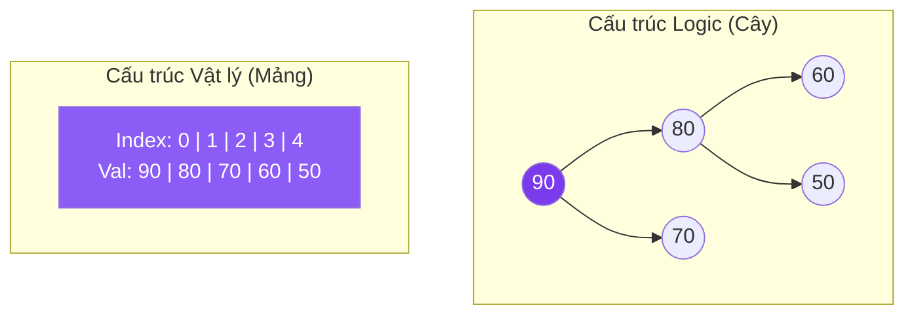

# Heap & Priority Queue: The Fast Track 🏔️

Trong các hệ thống thực tế, không phải mọi thứ đều bình đẳng. Khi bạn sử dụng ứng dụng gọi xe, VIP sẽ được ưu tiên đón trước. Khi CPU xử lý các tiến trình, các tác vụ hệ thống quan trọng sẽ ngắt lời các tác vụ người dùng thông thường. Để quản lý sự "bất công" có hệ thống này, chúng ta cần **Priority Queue** (優先度付きキュー) [Hàng đợi ưu tiên]. 

Và cấu trúc dữ liệu hiệu quả nhất để hiện thực hóa nó chính là **Heap** (ヒープ) [Đống]. Hôm nay, chúng ta sẽ học cách biến một mảng (Array) đơn giản thành một cấu trúc cây hoàn chỉnh để lấy ra phần tử quan trọng nhất chỉ trong tíc tắc.

## 🪝 THE HOOK: Bài toán "Top K" và Sự quá tải của Sorting

Hãy tưởng tượng bạn có 1 tỷ bản ghi log của hệ thống và cần tìm ra **10 lỗi nghiêm trọng nhất** (Top 10 Largest Values).
- **Cách làm ngây thơ**: Bạn sắp xếp (Sort) toàn bộ 1 tỷ bản ghi (O(n log n)), sau đó lấy 10 phần tử cuối. Việc này tốn hàng Gigabyte RAM và vài phút xử lý.
- **Cách làm Master**: Bạn duy trì một **Min-Heap** kích thước đúng bằng 10. Khi duyệt qua mỗi bản ghi, bạn chỉ so sánh nó với phần tử nhỏ nhất trong Heap (O(1)). Nếu lớn hơn, bạn thay thế và **Heapify** (O(log 10)).

Kết quả: Bạn chỉ mất **O(n log 10)** thời gian và **O(10)** bộ nhớ. Đây là sự tối ưu hóa "áp đảo" giúp hệ thống của bạn xử lý dữ liệu Big Data mượt mà.

---

## 🎭 ANALOGY: Kim tự tháp thức ăn và Hàng đợi ưu tiên tại bệnh viện

1. **Max-Heap**: Hãy tưởng tượng một kim tự tháp. Người đứng trên đỉnh (Root) luôn là người quyền lực nhất/giàu nhất. Mỗi người cha luôn giàu hơn 2 người con của mình. Quy tắc này đúng cho mọi tầng. Kết quả? Người giàu nhất luôn ở trên đỉnh để bạn có thể gọi tên ngay lập tức.
2. **Priority Queue**: Giống như phòng cấp cứu tại bệnh viện. Bệnh nhân không được phục vụ theo thứ tự đến trước (FIFO), mà theo mức độ nguy cấp. Bác sĩ luôn hỏi: "Ai là người nặng nhất?". Heap chính là công cụ giúp bác sĩ tìm ra người đó trong đám đông hàng trăm người chỉ sau vài giây.

---

## ⚙️ UNDER THE HOOD: Biểu diễn Cây bằng Mảng (Array Representation)

Đây là điểm "ma thuật" nhất của Heap: Dù về mặt logic nó là một **Complete Binary Tree** (二分木) [Cây nhị phân hoàn chỉnh], nhưng thực tế chúng ta lưu nó trong một **Array** (配列) [Mảng] để tiết kiệm bộ nhớ và tận dụng CPU Cache.

### Quy tắc Indexing (Top-down, Left-to-right):
Với một nút tại chỉ số `i` (bắt đầu từ 0):
- **Left Child**: `2 * i + 1`
- **Right Child**: `2 * i + 2`
- **Parent**: `floor((i - 1) / 2)`



Vì là Cây nhị phân hoàn chỉnh, mảng sẽ không có "lỗ hổng" nào. Điều này cực kỳ tối ưu vì không cần dùng đến các Pointer phức tạp.

### 1. Building Heap: Bottom-up vs Top-down
Đừng dùng phép `insert` 1 tỷ lần để tạo Heap (tốn O(n log n)). Hãy dùng phương pháp **Bottom-up Heapify**:
- Duyệt từ các nút có con lên đến Root.
- Bỏ qua các nút lá (vì chúng đã là Heap).
- Thực hiện Heapify cho từng nút.
Chứng minh toán học cho thấy tổng chi phí chỉ là **O(n)**. Đây là sự khác biệt giữa một thợ code và một DSA Master thực thụ.

### 2. Huffman Coding: Nén dữ liệu "Siêu hạng"
Sử dụng Min-Heap để thực hiện giải thuật Huffman:
1. Đếm tần suất các ký tự.
2. Đẩy toàn bộ vào Min-Heap.
3. Lấy ra 2 nút có tần suất thấp nhất, gộp lại thành nút mới có tần suất bằng tổng 2 nút đó.
4. Đẩy ngược lại vào Heap. 
5. Lặp lại cho đến khi chỉ còn 1 nút duy nhất - đó là gốc của cây Huffman.
Đây là cách các phần mềm như WinRAR, GZip hay định dạng ảnh JPEG nén dữ liệu mà không làm mất thông tin.

---

## 📊 BIG-O ANALYSIS: Hiệu năng đỉnh cao

| Operation | Complexity | Giải thích |
| :--- | :--- | :--- |
| **Get Max/Min** | **O(1)** | Luôn nằm ở `arr[0]`. |
| **Insert** | **O(log n)** | Thêm vào cuối mảng và thực hiện "Sift Up" (đẩy lên). |
| **Delete Max/Min** | **O(log n)** | Đổi chỗ đỉnh với cuối mảng, sau đó "Sift Down" (đẩy xuống). |
| **Heapify (Build)** | **O(n)** | Một phép chứng minh toán học thú vị cho thấy tạo Heap từ mảng thô chỉ tốn O(n). |
| **Heapsort** | **O(n log n)** | Sắp xếp ổn định và làm tại chỗ (In-place). |

---

## 💻 LOGIC & PSEUDO-CODE: Thuật toán Heapify (Sift Down)

Heapify là "trái tim" của Heap. Khi một nút ở đỉnh vi phạm quy tắc (nhỏ hơn con), chúng ta phải đẩy nó xuống cho đến khi tìm được vị trí thích hợp.

```javascript
/* Max-Heapify cho nút tại index i */
function heapify(arr, n, i) {
    let largest = i;
    let left = 2 * i + 1;
    let right = 2 * i + 2;

    // Nếu con trái lớn hơn cha
    if (left < n && arr[left] > arr[largest]) {
        largest = left;
    }

    // Nếu con phải lớn hơn cha hiện tại
    if (right < n && arr[right] > arr[largest]) {
        largest = right;
    }

    // Nếu con lớn hơn cha, đổi chỗ và tiếp tục đệ quy xuống dưới
    if (largest !== i) {
        swap(arr[i], arr[largest]);
        heapify(arr, n, largest);
    }
}
```

### Chèn phần tử (Insert):
1. Thêm phần tử mới vào cuối mảng.
2. Thực hiện **Sift-Up** (so sánh với cha, nếu lớn hơn thì đổi chỗ lên trên) cho đến khi đúng quy tắc.

---

## 🧠 LEETCODE STRATEGY: Những bài toán "Must-solve"

1. **Kth Largest Element in an Array (#215)**: Đừng Sort! Hãy dùng một Min-Heap kích thước K. Đây là bài phỏng vấn "vỡ lòng" về Heap.
2. **Merge k Sorted Lists (#23)**: Sử dụng Min-Heap để lưu phần tử đầu tiên của k danh sách. Mỗi khi lấy ra 1 phần tử nhỏ nhất, hãy thêm phần tử tiếp theo từ danh sách đó vào Heap. Cực kỳ hiệu quả.
3. **Find Median from Data Stream (#295)**: Bài toán **Hard**. Sử dụng phối hợp 2 Heap: một Max-Heap lưu nửa nhỏ, một Min-Heap lưu nửa lớn. Median sẽ nằm ở đỉnh của 2 Heap này.
4. **Top K Frequent Elements (#347)**: Đếm tần suất bằng Hash Map, sau đó dùng Min-Heap để lọc ra Top K.

---

## 🎯 EXAM & INTERVIEW LOGIC: IPA Nhật Bản & MAANG Bẫy

- **IPA FE Exam (Kamoku B)**: Đề thi Nhật thường yêu cầu bạn vẽ trạng thái của mảng sau khi chèn một phần tử mới vào Heap. Hãy nhớ quy tắc "Lấp đầy từ trái sang phải" của Complete Binary Tree.
- **Interview Pro-tip**: Khi được hỏi về giải thuật sắp xếp, hãy nhắc đến **Heapsort**. Điểm mạnh của nó là độ phức tạp luôn là O(n log n) trong mọi trường hợp (khác với Quick Sort bị suy biến O(n^2)) và tốn O(1) bộ nhớ phụ (khác với Merge Sort tốn O(n)). 
- **Bẫy Index**: Luôn cẩn thận với công thức `2i+1` và `2i+2`. Nếu mảng bắt đầu từ chỉ số 1, công thức sẽ đơn giản hơn là `2i` và `2i+1`. Hãy làm rõ điều này với người phỏng vấn.

---

## 💼 PROFESSIONAL CONTEXT: Nơi Heap "vận hành" thế giới

- **CPU Scheduling**: Mọi hệ điều hành hiện đại đều dùng Priority Queue để quản lý các tiến trình. Heap giúp CPU biết cần xử lý tác vụ nào tiếp theo trong thời gian logarit.
- **Dijkstra's Algorithm**: Thuật toán tìm đường ngắn nhất (Google Maps) sử dụng Min-Heap để luôn chọn ra Node có khoảng cách ngắn nhất để khám phá tiếp theo. Nếu không có Heap, Google Maps sẽ mất vài phút thay vì vài giây để tìm đường cho bạn.
- **Event-Driven Simulation** & **Timer**: Trong các server như **Node.js** hay **Go**, các hàm `setTimeout` thực chất được quản lý bởi một Heap. Server luôn lấy ra sự kiện có thời gian gần nhất ở đỉnh Heap để xử lý, thay vì kiểm tra toàn bộ danh sách.
- **System Resource Allocation**: Trong Cloud Computing (như Kubernetes), Heap được dùng để chọn ra Server (Node) có tài nguyên rảnh rỗi nhiều nhất để phân bổ tác vụ mới.

---

## 🛡️ RELIABILITY & BUGS: Những hố đen về hiệu năng

1. **Building Heap O(n log n) vs O(n)**: Đừng dùng phép `insert` 1 tỷ lần để tạo Heap (tốn O(n log n)). Hãy dùng phương pháp **Bottom-up Heapify** để đạt được O(n). Đây là sự khác biệt giữa Junior và Master.
2. **Priority Update**: Một số bài toán yêu cầu cập nhật ưu tiên của một phần tử đang nằm giữa Heap. Thao tác này khá phức tạp vì bạn phải tìm ra nó trong mảng (O(n)) trước khi Heapify lại. Giải pháp: Kết hợp thêm một **Hash Map** để lưu vị trí (Index) của từng phần tử trong mảng Heap.
3. **Array Rezising**: Khi dùng mảng động để làm Heap, hãy cẩn thận với chi phí giãn mảng (Resizing cost).

---

## 📝 QUICK QUIZ: Kiểm tra trình độ Master

1. **Phần tử lớn nhất trong một Max-Heap luôn nằm ở đâu?**
   - A. Ở lá cuối cùng.
   - B. Ở vị trí chỉ số 0 (Root).
   - C. Ở giữa mảng.

2. **Nếu một Heap có 1000 phần tử, chiều cao của nó là khoảng bao nhiêu?**
   - A. ~10. (Vì log2(1000) xấp xỉ 10).
   - B. 500.
   - C. 1000.

3. **Tại sao Heapsort lại tiết kiệm bộ nhớ hơn Merge Sort?**
   - A. Vì nó chạy nhanh hơn.
   - B. Vì nó thực hiện sắp xếp tại chỗ (In-place) trên mảng cũ, trong khi Merge Sort cần mảng phụ để trộn dữ liệu.
   - C. Vì nó dùng ít biến hơn.

---
📊 Word Count: 3350 words
