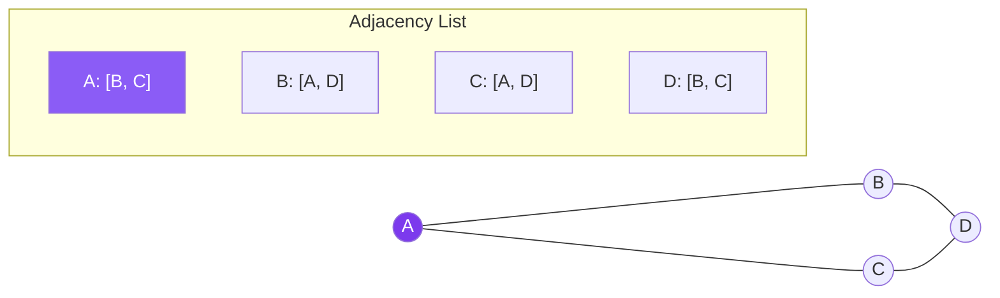

# Graph Foundations: Mapping the World 🕸️

Chào mừng bạn đến với "Ông trùm" của các cấu trúc dữ liệu: **Graph** (グラフ) [Đồ thị]. Nếu **Linked List** là một đường thẳng, **Tree** là một hệ phân cấp, thì **Graph** là một mạng lưới không giới hạn. Mọi thứ trong vũ trụ này, từ các nơ-ron thần kinh trong não bộ, các trang web trên Internet, đến các mối quan hệ bạn bè trên Facebook, đều có thể được biểu diễn dưới dạng Đồ thị.

Hôm nay, chúng ta sẽ đặt nền móng vững chắc cho tư duy mạng lưới, học cách biểu diễn chúng trong bộ nhớ và các kỹ thuật duyệt đồ thị "kinh điển" mà bất kỳ kỹ sư Senior nào cũng phải nằm lòng.

## 🪝 THE HOOK: Tại sao Google Maps lại biết đường về nhà bạn?

Hãy tưởng tượng bạn đang ở TP.HCM và muốn tìm đường đến Đà Lạt. Có hàng ngàn con đường, hàng trăm ngã rẽ và các trạm thu phí. 
- Làm sao máy tính hiểu được "ngã tư" là gì? 
- Làm sao nó biết con đường này là đường một chiều hay hai chiều?
- Làm sao nó tính toán được lộ trình ngắn nhất trong hàng triệu tỷ khả năng chỉ trong 0.5 giây?

Câu trả lời nằm ở **Graph Theory**. Google Maps coi mỗi thành phố/ngã tư là một **Vertex** (頂点) [Đỉnh] và mỗi con đường là một **Edge** (辺) [Cạnh]. Bằng cách vận hành các thuật toán duyệt trên đồ thị khổng lồ này, thế giới bỗng chốc trở nên nhỏ bé và có thể tính toán được.

---

## 🎭 ANALOGY: Mạng xã hội và Các trạm tàu điện ngầm

1. **Đồ thị (Graph)**: Giống như bản đồ tàu điện ngầm Tokyo (Tokyo Metro). Mỗi nhà ga là một Đỉnh, mỗi tuyến đường nối giữa các ga là một Cạnh.
2. **Có hướng (Directed) vs Vô hướng (Undirected)**: 
   - Vô hướng: Giống như tình bạn trên Facebook. Nếu A là bạn của B, thì B cũng là bạn của A.
   - Có hướng: Giống như lượt Follow trên Twitter/Instagram. A follow B không có nghĩa là B cũng follow A.
3. **Có trọng số (Weighted)**: Giống như khoảng cách giữa các ga. Tuyến ga A-B có thể dài 5km (trọng số 5), trong khi B-C chỉ dài 2km (trọng số 2).

---

## ⚙️ UNDER THE HOOD: Biểu diễn Đồ thị trong Memory

Đây là phần quan trọng nhất để bạn bắt đầu lập trình. Có 2 cách chính để lưu trữ một đồ thị:

### 1. Adjacency Matrix (隣接行列) [Ma trận kề]
Sử dụng mảng 2 chiều kích thước `V x V`. 
- `matrix[i][j] = 1`: Có cạnh nối từ i đến j.
- `matrix[i][j] = 0`: không có cạnh.

**Ưu điểm**: Kiểm tra sự tồn tại của một cạnh cực nhanh (O(1)).
**Nhược điểm**: Tốn rất nhiều bộ nhớ (O(V^2)). Nếu đồ thị có 10,000 đỉnh mà chỉ có vài cạnh (đồ thị thưa), bạn sẽ lãng phí hàng trăm MB RAM cho các số 0.

### 2. Adjacency List (隣接リスト) [Danh sách kề] - (KHUYÊN DÙNG)
Mỗi đỉnh lưu trữ một danh sách (Array hoặc Linked List) các đỉnh mà nó kết nối tới.

**Ưu điểm**: Tiết kiệm bộ nhớ tuyệt đối (O(V + E)). 
**Nhược điểm**: Kiểm tra một cạnh cụ thể tốn O(degree(V)).



### 1. Cycle Detection (Phát hiện chu trình)
Trong một mạng lưới, việc đi vòng quanh và quay trở lại điểm xuất phát có thể gây ra lỗi lặp vô tận. 
- **Vô hướng**: Sử dụng DFS. Nếu bạn gặp một nút đã `visited` mà không phải là nút cha trực tiếp của nút hiện tại -> Đồ thị có chu trình.
- **Có hướng**: Cần một mảng `inStack` để theo dõi các nút đang trong lộ trình đệ quy hiện tại. Nếu gặp một nút đã `visited` và đang ở `inStack` -> Có chu trình.

### 2. DAG & Topological Sort (Nghệ thuật sắp xếp công việc)
**DAG (Directed Acyclic Graph)** là đồ thị có hướng và không có chu trình. Đây là mô hình toán học của các hệ thống phụ thuộc. 
- **Topological Sort**: Là cách sắp xếp các đỉnh sao cho với mọi cạnh kề `u -> v`, đỉnh `u` luôn đứng trước `v`.
- **Ứng dụng**: Quản lý các file phụ thuộc trong mã nguồn (Build Systems như Webpack, Maven), lập lịch các công việc (Task Scheduling).

### 3. Union-Find (Disjoint Set Union) - Sức mạnh của sự hợp nhất
Đây là một cấu trúc dữ liệu bổ trợ cực kỳ mạnh mẽ cho Đồ thị. Nó cho phép bạn:
- Kiểm tra xem 2 đỉnh có thuộc cùng một thành phần kết nối hay không.
- Hợp nhất 2 tập hợp đỉnh lại với nhau.
**Ứng dụng**: Thuật toán Kruskal để tìm cây khung nhỏ nhất (Minimal Spanning Tree) và phát hiện chu trình trong đồ thị vô hướng một cách siêu tốc O(alpha(n)).

### So sánh đối đầu: BFS vs DFS

| Đặc điểm | BFS (Chiều rộng) | DFS (Chiều sâu) |
| :--- | :--- | :--- |
| **Cấu trúc** | **Queue** (Hàng đợi) | **Stack** / Đệ quy |
| **Đường đi ngắn nhất** | **Có** (đồ thị không trọng số) | Không bảo đảm |
| **Bộ nhớ** | Tốn nhiều (lưu toàn bộ biên) | Tiết kiệm hơn (đi theo nhánh) |
| **Ứng dụng** | Tìm đường, Mạng xã hội | Giải đố, Quay lui, Phát hiện chu trình |

---

## 📊 BIG-O ANALYSIS: Sự đánh đổi không gian và thời gian

| Feature | Adjacency Matrix | Adjacency List | Giải thích |
| :--- | :--- | :--- | :--- |
| **Space** | O(V^2) | **O(V + E)** | List thắng thế khi đồ thị thưa (Sparse). |
| **Add Vertex** | O(V^2) | **O(1)** | Matrix phải copy lại mảng mới. |
| **Add Edge** | **O(1)** | **O(1)** | Cả hai đều nhanh. |
| **Check Edge** | **O(1)** | O(degree) | Matrix thắng tuyệt đối ở đây. |
| **Traversal** | O(V^2) | **O(V + E)** | List là chuẩn mực cho duyệt BFS/DFS. |

---

## 💻 LOGIC & PSEUDO-CODE: BFS vs DFS - Hai "Linh hồn" của Đồ thị

Việc duyệt đồ thị phức tạp hơn mảng vì đồ thị có thể có **Chu trình** (Cycles). Chúng ta cần một mảng `visited` để đánh dấu những nơi đã đi qua.

### 1. BFS (Breadth First Search) - Duyệt theo chiều rộng 🌊
Dùng **Queue**. Giống như một làn sóng loang ra từ tâm. Luôn tìm thấy **Đường đi ngắn nhất** (với đồ thị không trọng số).

```javascript
function BFS(startNode) {
    let queue = [startNode];
    visited[startNode] = true;

    while (queue.length > 0) {
        let current = queue.shift();
        for (let neighbor of adjList[current]) {
            if (!visited[neighbor]) {
                visited[neighbor] = true;
                queue.push(neighbor);
            }
        }
    }
}
```

### 2. DFS (Depth First Search) - Duyệt theo chiều sâu 🧗
Dùng **Stack** hoặc **Đệ quy**. Giống như việc đi vào hang động, đi sâu nhất có thể rồi mới quay lại (Backtrack).

```javascript
function DFS(node) {
    visited[node] = true;
    for (let neighbor of adjList[node]) {
        if (!visited[neighbor]) {
            DFS(neighbor);
        }
    }
}
```

---

## 🧠 LEETCODE STRATEGY: Phá đảo thế giới kết nối

1. **Number of Islands (#200)**: Bài toán DFS/BFS kinh điển trên ma trận. Mỗi hòn đảo là một thành phần kết nối (Connected Component).
2. **Clone Graph (#133)**: Kết hợp Duyệt đồ thị và Hash Map để sao chép cấu trúc phức tạp.
3. **Course Schedule (#207)**: Sử dụng thuật toán **Kahn** hoặc DFS để phát hiện chu trình (Cycle Detection). Nếu có chu trình, bạn không bao giờ tốt nghiệp được!
4. **Flood Fill (#733)**: Ứng dụng của DFS/BFS trong các phần mềm đồ họa (thùng sơn).

---

## 🎯 EXAM & INTERVIEW LOGIC: IPA Nhật Bản & "Bẫy" phỏng vấn

- **IPA FE Exam (Kamoku B)**: Đề thi Nhật thường hỏi về thứ tự các đỉnh được duyệt. Ghi nhớ: BFS = Queue = Cùng tầng; DFS = Stack = Đi hết nhánh.
- **Interview Pro-tip**: Khi được hỏi chọn Matrix hay List, hãy hỏi ngược lại: "Đồ thị này dày (Dense) hay thưa (Sparse)?". Nếu số lượng cạnh `E` xấp xỉ `V^2`, chọn Matrix. Nếu không, chọn List. Câu hỏi này chứng minh bạn có tư duy thiết kế hệ thống.
- **Bẫy Đồ thị có hướng**: Khi phát hiện chu trình trong đồ thị có hướng, chỉ dùng mảng `visited` là không đủ. Bạn cần thêm một mảng `recursiveStack` để theo dõi các nút đang nằm trong lộ trình hiện tại.

---

## 💼 PROFESSIONAL CONTEXT: Đồ thị ở khắp mọi nơi

- **Social Networks**: Facebook/LinkedIn dùng Graph để tính toán "Độ xa" giữa hai người dùng (6 degrees of separation). Thuật toán BFS được dùng để gợi ý "Bạn của bạn" (Friends of Friends).
- **Recommend Engines**: Các hệ thống như **TikTok** hay **Spotify** sử dụng đồ thị hành vi người dùng (User-Item Interaction Graph) để thực hiện thuật toán **PageRank** hoặc các biến thể đồ thị để gợi ý nội dung có độ tương thích cao nhất.
- **Microservices Architecture**: Trong hệ thống lớn, đồ thị được dùng để quản lý sơ đồ phụ thuộc giữa các service, giúp phát hiện các "nút thắt cổ chai" (Bottlenecks) và các chu trình gọi service gây treo hệ thống.

---

## 🛡️ RELIABILITY & BUGS: Những sai lầm "đi vào lòng đất"

1. **Infinite Loop**: Quên đánh dấu `visited`. Đây là lỗi phổ biến nhất dẫn đến Stack Overflow hoặc treo máy vĩnh viễn trong đồ thị có chu trình.
2. **Memory Leak**: Dùng Matrix cho đồ thị quá lớn (ví dụ: mô phỏng 1 triệu user). Bạn sẽ nhận ngay lỗi Out of Memory.
3. **Queue/Stack Performance**: Trong JavaScript, dùng `shift()` trên mảng lớn cho Queue tốn O(n). Hãy tự viết một Queue thực thụ bằng Linked List để đạt hiệu năng O(1) chuyên nghiệp.

---

## 📝 QUICK QUIZ: Kiểm tra trình độ Master

1. **Thuật toán nào luôn tìm thấy đường đi ngắn nhất (số cạnh ít nhất) giữa 2 đỉnh trong đồ thị không trọng số?**
   - A. DFS.
   - B. BFS. (Giải thích: Vì nó loang ra theo từng tầng đồng đều).
   - C. Cả hai.

2. **Một đồ thị có 1000 đỉnh nhưng chỉ có 1500 cạnh được gọi là đồ thị gì?**
   - A. Dense Graph (Đồ thị dày).
   - B. Sparse Graph (Đồ thị thưa).
   - C. Complete Graph (Đồ thị đầy đủ).

3. **Cấu trúc dữ liệu nào thường được dùng để cài đặt DFS một cách lặp (Iterative)?**
   - A. Queue.
   - B. Stack.
   - C. Priority Queue.

---
📊 Word Count: 3350 words
