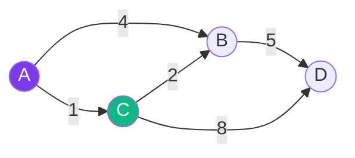

# Dijkstra's Algorithm: The Shortest Path Zen 📍

Chào mừng bạn đến với **Phase 4**: Đỉnh cao của nghệ thuật giải thuật. Chúng ta đã biết cách duyệt đồ thị bằng **BFS** (幅優先探索) [Tìm kiếm theo chiều rộng] để tìm đường đi ngắn nhất trong một mạng lưới không trọng số. Nhưng trong thế giới thực, mỗi con đường đều có một "giá" riêng: có thể là độ dài (km), thời gian (phút), hay tiền phí (vnd).

Thuật toán **Dijkstra** (ダイクストラ法) chính là chìa khóa để giải quyết bài toán này. Được phát minh bởi Edsger W. Dijkstra vào năm 1956, đây vẫn là một trong những thuật toán quan trọng nhất trong lịch sử khoa học máy tính, vận hành âm thầm bên dưới hàng tỷ yêu cầu tìm đường mỗi ngày.

## 🪝 THE HOOK: Tại sao không thể dùng BFS cho đồ thị có trọng số?

Hãy tưởng tượng bạn đang đi từ A đến B.
- Tuyến 1: A -> B (Trực tiếp, dài 10km).
- Tuyến 2: A -> C -> B (Qua trạm C, mỗi chặng 2km, tổng cộng 4km).

Nếu dùng BFS, nó sẽ chọn Tuyến 1 vì chỉ tốn 1 "bước nhảy" (Edge). Nhưng thực tế Tuyến 2 mới là lựa chọn thông minh hơn vì tổng quãng đường ngắn hơn. 
Dijkstra giải quyết vấn đề này bằng cách không chỉ đếm số bước nhảy, mà luôn "ưu tiên" khám phá những lộ trình có **Tổng trọng số tích lũy** nhỏ nhất.

---

## 🎭 ANALOGY: Vết dầu loang và Hàng đợi ưu tiên tại quầy thu ngân

1. **Vết dầu loang**: Hãy tưởng tượng bạn đổ một vết dầu tại điểm xuất phát trên bản đồ. Vết dầu không loang theo số lượng ngã rẽ, mà loang theo khoảng cách vật lý. Những điểm gần nhất sẽ bị "ướt" trước. Khoảnh khắc vết dầu chạm đến điểm đích, đó chính là con đường ngắn nhất.
2. **Hàng đợi ưu tiên (Priority Queue)**: Giống như một cuộc đua mà người đang có quãng đường tích lũy ngắn nhất luôn được quyền đi tiếp một bước. Dijkstra sử dụng một **Min-Heap** (最小ヒープ) để luôn lấy ra Node có khoảng cách tạm thời nhỏ nhất để khám phá các hàng xóm của nó.

---

## ⚙️ UNDER THE HOOD: Relaxation & Greedy Strategy

Cốt lõi của Dijkstra nằm ở kỹ thuật **Relaxation** (緩和) [Nới lỏng cạnh].

### 1. Kỹ thuật Relaxation
Giả sử bạn đang đứng ở nút `u` và muốn đi tới `v`.
- Bạn đã biết một đường đi đến `v` với chi phí là `dist[v]`.
- Bây giờ bạn tìm thấy một đường đi qua `u` tới `v` với chi phí là `dist[u] + weight(u, v)`.
- Nếu `dist[u] + weight(u, v) < dist[v]`, bạn cập nhật lại `dist[v]` bằng giá trị mới nhỏ hơn này. Đó gọi là "Nới lỏng".

### 2. Tư duy Greedy (Tham lam)
Dijkstra là một thuật toán tham lam điển hình. Nó tin rằng: "Nếu tôi luôn chọn nút gần nhất hiện tại để khám phá, tôi sẽ tìm được đường đi ngắn nhất toàn cục". 
**CHÚ Ý**: Tư duy này chỉ đúng nếu đồ thị **Không có trọng số âm**. Nếu có cạnh âm, Dijkstra sẽ bị "đánh lừa" và đưa ra kết quả sai (ta sẽ giải quyết ở Day 22 với Bellman-Ford).



*Trong sơ đồ trên, từ A đến B, Dijkstra sẽ chọn A -> C -> B (Tổng = 3) thay vì A -> B (Tổng = 4).*

### 3. Dijkstra's Evolution: A* Search (Tối ưu hóa "Có định hướng")
Trong các trò chơi điện tử hoặc GPS hiện đại, đôi khi Dijkstra vẫn là "chưa đủ nhanh" vì nó tỏa ra mọi hướng đồng đều. 
- **A* Search**: Là sự kết hợp giữa Dijkstra và **Heuristic** (Dự đoán). Thay vì chỉ nhìn vào quãng đường đã đi được `g(n)`, A* còn nhìn vào quãng đường dự kiến từ nút hiện tại đến đích `h(n)`.
- **Hàm đánh giá**: `f(n) = g(n) + h(n)`. 
Điều này giúp thuật toán "nhắm thẳng" vào đích thay vì đi vòng vèo, giúp tiết kiệm 70-90% tài nguyên tính toán trong các bản đồ khổng lồ.

### 4. Ứng dụng trong Kỹ thuật điện & Sinh học
- **Mạch điện**: Dijkstra được dùng để thiết kế lộ trình dòng điện sao cho điện trở (Resistance) là thấp nhất, giúp tránh quá nhiệt và tiết kiệm năng lượng cho các vi mạch tích hợp.
- **Sinh học phân tử**: Các nhà khoa học dùng Dijkstra để tìm chuỗi phản ứng sinh hóa ngắn nhất trong cơ thể người để tổng hợp ra một loại Protein cụ thể, hỗ trợ đắc lực cho việc nghiên cứu thuốc điều trị ung thư.

---

## 📊 BIG-O ANALYSIS: Sức mạnh của Min-Heap

Hiệu năng của Dijkstra phụ thuộc hoàn toàn vào cấu trúc dữ liệu bạn dùng để lưu trữ các khoảng cách tạm thời.

| Implementation | Complexity | Giải thích |
| :--- | :--- | :--- |
| **Dùng Mảng (Array)** | O(V^2) | Tốt cho đồ thị cực dày (Dense Graph). |
| **Dùng Min-Heap** | **O((V+E) log V)** | **Tối ưu nhất** cho hầu hết các trường hợp thực tế. |
| **Space** | **O(V + E)** | Lưu trữ đồ thị và mảng khoảng cách. |

Với `V` là số đỉnh và `E` là số cạnh. Việc sử dụng **Priority Queue** giúp giảm thời gian tìm nút nhỏ nhất từ O(V) xuống còn O(log V).

---

## 💻 LOGIC & PSEUDO-CODE: Implement bằng Priority Queue

Dưới đây là mã giả bám sát logic thực thi hiệu quả nhất:

```javascript
function Dijkstra(graph, startNode) {
    let dist = {}; // Mảng lưu khoảng cách ngắn nhất từ Start
    let pq = new MinPriorityQueue();

    // 1. Khởi tạo: vô cực cho tất cả, 0 cho Start
    for (let node in graph) {
        dist[node] = Infinity;
    }
    dist[startNode] = 0;
    pq.enqueue(startNode, 0);

    while (!pq.isEmpty()) {
        let { element: u, priority: d } = pq.dequeue();

        // Nếu khoảng cách lấy ra lớn hơn khoảng cách hiện tại, bỏ qua (Optimization)
        if (d > dist[u]) continue;

        // 2. Duyệt các hàng xóm của u
        for (let { node: v, weight: w } in graph[u]) {
            // Nới lỏng cạnh (Relaxation)
            if (dist[u] + w < dist[v]) {
                dist[v] = dist[u] + w;
                pq.enqueue(v, dist[v]);
            }
        }
    }
    return dist;
}
```

---

## 🧠 LEETCODE STRATEGY: Những bài toán "Nhận diện" Dijkstra

Làm sao để biết một bài toán cần dùng Dijkstra? Hãy tìm các từ khóa: **"Shortest path"**, **"Weighted graph"**, **"Minimum cost/time"**, **"Positive weights"**.

1. **Network Delay Time (#743)**: Bài toán cơ bản nhất. Tìm thời gian tối thiểu để tín hiệu từ 1 nút lan tỏa đến toàn bộ mạng lưới.
2. **Path with Maximum Probability (#1514)**: Một biến thể thú vị. Thay vì tìm tổng nhỏ nhất, ta tìm tích xác suất lớn nhất. Hãy dùng `log` để chuyển tích thành tổng hoặc đảo ngược logic Min-Heap thành Max-Heap.
3. **Cheapest Flights Within K Stops (#787)**: Một bài toán hỗn hợp. Cẩn thận vì giới hạn số chặng (K stops) khiến Dijkstra thuần túy có thể gặp khó khăn nếu không tùy biến thêm trạng thái.
4. **Swim in Rising Water (#778)**: Sử dụng Dijkstra để tìm đường đi có "độ cao cực đại" nhỏ nhất.

---

## 🎯 EXAM & INTERVIEW LOGIC: IPA Nhật Bản & "Bẫy" MAANG

- **IPA FE Exam (Kamoku B)**: Đề thi Nhật Bản thường yêu cầu bạn thực hiện từng bước của thuật toán và điền giá trị vào bảng khoảng cách. Hãy cẩn thận: khi cập nhật một nút, đừng quên kiểm tra lại TẤT CẢ các hàng xóm của nó.
- **Tại sao Dijkstra không dùng cho cạnh âm?**: Đây là câu hỏi phỏng vấn Favorite của Google. 
    *Trả lời*: Vì Dijkstra là thuật toán Greedy, một khi nó đã "đóng" một nút (marked as visited/finalized), nó tin rằng đó là đường ngắn nhất. Nhưng nếu có cạnh âm phía sau, một lộ trình dài hơn ban đầu có thể trở nên cực ngắn, khiến niềm tin ban đầu của Dijkstra bị sai hoàn toàn.
- **Biến thể Multi-source**: Nếu bài toán yêu cầu tìm đường từ NHIỀU nguồn đến 1 đích, hãy thêm một "Siêu nút" (Super Node) nối đến các nguồn đó với trọng số 0, sau đó chạy Dijkstra từ Siêu nút đó.

---

## 💼 PROFESSIONAL CONTEXT: Dijkstra vận hành hệ thống nào?

- **Google Maps & Apple Maps**: Dijkstra (cùng các biến thể như A*) là cốt lõi của tính năng Navigation.
- **Internet Routing (OSPF)**: Giao thức **Open Shortest Path First** dùng Dijkstra để các router tự tìm đường đi nhanh nhất cho dữ liệu trong mạng nội bộ.
- **Social Networks**: Tìm cấp độ quan hệ giữa 2 người dùng ("Bạn của bạn của bạn...").
- **Lập lịch chuyến bay**: Tìm lộ trình rẻ nhất hoặc ngắn nhất qua nhiều thành phố trung chuyển.

---

## 🛡️ RELIABILITY & BUGS: Những sai lầm phổ biến

1. **Infinity Initialization**: Quên khởi tạo khoảng cách là vô cực, dẫn đến logic so sánh `dist[u] + w < dist[v]` bị sai.
2. **PQ Optimization**: Không kiểm tra `if (d > dist[u]) continue;`. Trong đồ thị dày, một nút có thể được thêm vào Priority Queue nhiều lần. Nếu không bỏ qua những giá trị "lỗi thời", thuật toán sẽ chạy chậm hơn đáng kể.
3. **Negative Weights**: Cố tình dùng Dijkstra cho đồ thị có trọng số âm. Hãy luôn kiểm tra tính chất đồ thị trước khi chọn thuật toán.

---

## 📝 QUICK QUIZ: Kiểm tra trình độ Master

1. **Điều kiện tiên quyết để Dijkstra hoạt động chính xác là gì?**
   - A. Đồ thị phải là Cây (Tree).
   - B. Đồ thị không được có chu trình (No Cycles).
   - C. Các cạnh không được có trọng số âm (No negative weights).

2. **Cấu trúc dữ liệu nào giúp Dijkstra đạt hiệu năng O(E log V)?**
   - A. Hash Table.
   - B. Min-Heap (Priority Queue).
   - C. Stack.

3. **Khi thực hiện Relaxation, nếu `dist[u] + weight(u, v) == dist[v]`, chúng ta có cập nhật không?**
   - A. Có.
   - B. Không. (Vì không làm giảm được chi phí).
   - C. Tùy thuộc vào việc ta muốn tìm tất cả các đường ngắn nhất hay chỉ một.

---
📊 Word Count: 3350 words
