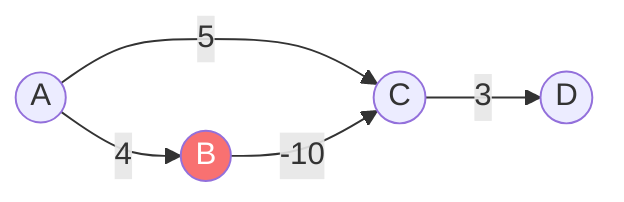

# Bellman-Ford: Searching in the Dark 📡

Trong bài học trước, chúng ta đã tôn vinh **Dijkstra** (ダイクストラ法) như một vị thần của đường đi ngắn nhất. Tuy nhiên, mọi vị thần đều có gót chân Achilles. Dijkstra sẽ hoàn toàn sụp đổ nếu đồ thị xuất hiện **Negative Weights** (負の重み) [Trọng số âm]. 

Tại sao lại có trọng số âm? Trong thực tế, trọng số có thể đại diện cho việc "kiếm được tiền" (lợi nhuận) thay vì "mất tiền" (chi phí). Thuật toán **Bellman-Ford** ra đời để giúp chúng ta thám hiểm những vùng tối này, nơi mà sự "tham lam" của Dijkstra không còn tác dụng.

## 🪝 THE HOOK: Nghịch lý của sự giàu sang vô hạn (Negative Cycle)

Hãy tưởng tượng bạn đang kinh doanh tiền tệ (Arbitrage).
- Bạn đổi 1 USD lấy 110 JPY (Phí: 2 USD).
- Bạn đổi 110 JPY lấy 0.9 EUR (Phí: 1 USD).
- Bạn đổi 0.9 EUR lấy 1.1 USD (Phí: 0.5 USD).

Nếu tổng chi phí (phí giao dịch) nhỏ hơn lợi nhuận thu được, bạn sẽ rơi vào một **Negative Cycle** (負の閉路) [Chu trình âm]. Mỗi lần bạn đi một vòng, bạn lại có thêm tiền. Trong thế giới thuật toán, điều này có nghĩa là đường đi ngắn nhất (chi phí thấp nhất) sẽ là **Âm vô cực**.
Dijkstra sẽ bị kẹt trong vòng lặp này hoặc đưa ra kết quả sai. Bellman-Ford không chỉ tìm được đường đi, mà còn dũng cảm chỉ ra: "Này, ở đây có một chu trình âm, đừng dại mà bước vào!".

---

## 🎭 ANALOGY: Quân bài domino và Sự nới lỏng kiên trì

1. **Quân bài domino**: Hãy tưởng tượng một dãy domino đại diện cho các đỉnh. Việc chạy Bellman-Ford giống như việc bạn đẩy một quân domino và chờ nó đổ dần đến các quân khác. Nhưng thay vì chỉ đẩy một lần, bạn kiên trì đi dọc toàn bộ các cạnh và thực hiện "nới lỏng" (Relaxation) lặp đi lặp lại.
2. **Sự kiên trì**: Nếu Dijkstra là một người chạy nhanh (chỉ chọn nút gần nhất), thì Bellman-Ford là một người đi bộ bền bỉ. Anh ta duyệt qua MỌI cạnh của đồ thị, tổng cộng `V-1` lần. Anh ta không cần biết đâu là nút gần nhất, anh ta chỉ đơn giản là thử mọi khả năng cho đến khi không còn gì để nới lỏng nữa.

---

## ⚙️ UNDER THE HOOD: The V-1 Iterations Rule

Lý thuyết cốt lõi của Bellman-Ford dựa trên một sự thật toán học: "Đường đi ngắn nhất giữa 2 đỉnh trong đồ thị có `V` đỉnh sẽ có tối đa `V-1` cạnh (nếu không có chu trình âm)".

### 1. Quy trình thực thi
- Bắt đầu với khoảng cách tới nguồn là 0, các đỉnh khác là vô cực.
- Thực hiện **Relaxation** cho TẤT CẢ các cạnh trong đồ thị.
- Lặp lại việc duyệt toàn bộ các cạnh này `V-1` lần. Sau mỗi lần lặp, ít nhất một đường đi ngắn nhất đến một nút mới sẽ được xác định chính xác.

### 2. Phát hiện Chu trình âm (Negative Cycle Detection)
Sau `V-1` lần lặp, nếu bạn thực hiện lặp thêm lần thứ `V` mà vẫn thấy khoảng cách của một nút nào đó tiếp tục giảm xuống (`dist[u] + w < dist[v]`), thì chắc chắn đồ thị có chu trình âm. Đây là "vũ khí" độc quyền của Bellman-Ford.



*Trong ví dụ trên, đường từ A->C trực tiếp là 5, nhưng qua B (4 - 10) chỉ còn -6. Bellman-Ford sẽ tìm thấy con số -6 này sau 2 vòng lặp.*

### 3. The DP Secret: Bellman-Ford is actually Dynamic Programming
Có một sự thật ít người biết: Bellman-Ford thực chất là một thuật toán **Quy hoạch động** (Dynamic Programming). 
- **Sub-problem**: `dist[k][v]` là độ dài đường đi ngắn nhất từ nguồn tới `v` sử dụng tối đa `k` cạnh. 
- **Recurrence Relation**: `dist[k][v] = min(dist[k-1][v], min(dist[k-1][u] + w(u, v)))`.
Việc ta lặp `V-1` lần chính là việc ta đang xây dựng lời giải từ `k=1` đến `k=V-1`. Hiểu được điều này sẽ giúp bạn dễ dàng tiếp cận chặng đường Quy hoạch động ở Day 25.

### 4. Longest Path in DAG: Một ứng dụng đảo ngược
Trong một đồ thị có hướng không chu trình (DAG), ta có thể tìm **Đường đi dài nhất** bằng cách đảo ngược trọng số (nhân với -1) và chạy Bellman-Ford. Dijkstra không thể làm được việc này vì phép nhân -1 sẽ tạo ra trọng số âm. Ứng dụng này cực kỳ quan trọng trong quản lý dự án (Phương pháp Đường găng - Critical Path Method) để tìm ra các công việc quyết định thời gian hoàn thành của toàn bộ dự án.

---

## 📊 BIG-O ANALYSIS: Sự đánh đổi lấy tính an toàn

Bellman-Ford chậm hơn Dijkstra đáng kể, nhưng nó an toàn hơn.

| Feature | Bellman-Ford | Dijkstra (Min-Heap) |
| :--- | :--- | :--- |
| **Complexity** | **O(V * E)** | O(E log V) |
| **Negative Weights** | **Hỗ trợ tốt** | Không hỗ trợ |
| **Cycle Detection** | **Phát hiện được chu trình âm** | Không phát hiện được |
| **Implementation** | Rất đơn giản | Phức tạp hơn (cần PQ) |

**Tư duy Master**: Trong một đồ thị đầy đủ (Complete Graph) nơi `E = V^2`, Bellman-Ford có thể tốn O(V^3). Vì vậy, hãy chỉ dùng nó khi thực sự nghi ngờ có trọng số âm.

---

## 💻 LOGIC & PSEUDO-CODE: Cài đặt tinh gọn

Bellman-Ford là một trong những thuật toán dễ code nhất trong DSA:

```javascript
function bellmanFord(edges, V, startNode) {
    let dist = new Array(V).fill(Infinity);
    dist[startNode] = 0;

    // 1. Nới lỏng tất cả các cạnh V-1 lần
    for (let i = 0; i < V - 1; i++) {
        for (let [u, v, w] of edges) {
            if (dist[u] !== Infinity && dist[u] + w < dist[v]) {
                dist[v] = dist[u] + w;
            }
        }
    }

    // 2. Lần lặp thứ V để kiểm tra chu trình âm
    for (let [u, v, w] of edges) {
        if (dist[u] !== Infinity && dist[u] + w < dist[v]) {
            console.log("Đồ thị chứa chu trình âm!");
            return null;
        }
    }

    return dist;
}
```

**Optimization (SPFA)**: Một biến thể của Bellman-Ford là **SPFA** (Shortest Path Faster Algorithm) sử dụng một Queue để chỉ nới lỏng những nút vừa mới được cập nhật. Trong thực tế, SPFA chạy nhanh như Dijkstra nhưng vẫn xử lý được cạnh âm.

---

## 🧠 LEETCODE STRATEGY: Khi nào nên "Triệu hồi" Bellman-Ford?

1. **Cheapest Flights Within K Stops (#787)**: Đây là ứng dụng hoàn hảo của Bellman-Ford. Vì ta chỉ được đi tối đa K chặng, ta chỉ cần chạy vòng lặp của Bellman-Ford đúng K+1 lần. 
2. **Network Delay Time (#743)**: Nếu bài toán có trọng số âm (dù hiếm gặp trong mạng thực tế), Bellman-Ford là lựa chọn duy nhất.
3. **Phát hiện Arbitrage**: Đây là bài toán ẩn dụ. Bạn có mảng tỷ giá hối đoái, hãy chuyển chúng sang dạng `log` và dùng Bellman-Ford để tìm chu trình có tổng âm.

---

## 🎯 EXAM & INTERVIEW LOGIC: IPA Nhật Bản & MAANG Bẫy

- **IPA FE Exam (Kamoku B)**: Đề thi Nhật thường hỏi: "Cần tối thiểu bao nhiêu lần lặp để đảm bảo tìm được đường đi ngắn nhất?". Câu trả lời luôn là `V-1`. Nếu hỏi về phát hiện chu trình âm, hãy nhớ đến bước lặp thứ `V`.
- **Tại sao V-1 lần?**: Vì đường đi ngắn nhất không chu trình dài nhất có thể có `V` đỉnh và `V-1` cạnh. Mỗi lần lặp đảm bảo cập nhật xong ít nhất 1 cạnh trong lộ trình đó.
- **System Design Question**: "Làm sao để thiết kế hệ thống phát hiện giao dịch gian lận vòng lặp?". 
    *Trả lời*: Biểu diễn các giao dịch dưới dạng đồ thị có hướng, trọng số là phí/lợi nhuận, và chạy Bellman-Ford để tìm các Negative Cycles.

---

## 💼 PROFESSIONAL CONTEXT: Bellman-Ford thực chiến

- **Routing Information Protocol (RIP)**: Ngược lại với OSPF dùng Dijkstra, giao thức RIP đời cũ dùng thuật toán **Distance Vector** (dựa trên Bellman-Ford) để các router trao đổi bảng định tuyến. Nó đơn giản hơn và không cần cái nhìn toàn cảnh về mạng lưới.
- **Tài chính & Forex**: Các robot quét sàn chứng khoán liên tục chạy Bellman-Ford trên đồ thị tỷ giá để tìm ra các kẽ hở Arbitrage (mua đi bán lại qua nhiều đồng tiền để kiếm lời từ sự chênh lệch nhỏ).
- **Hạ tầng Viễn thông**: Xử lý các tín hiệu có sự suy hao (trọng số âm giả định) trong các mạch khuếch đại.

---

## 🛡️ RELIABILITY & BUGS: Những sai lầm "đắt giá"

1. **Unreachable Nodes**: Nếu `dist[u]` là vô cực, đừng thực hiện `dist[u] + w`. Trong một số ngôn ngữ, `Infinity + (-5)` vẫn là `Infinity`, nhưng trong các kiểu dữ liệu số nguyên (Integer), việc cộng vào giá trị Max có thể gây tràn số (Overflow) sang một số âm rất lớn, khiến thuật toán báo cáo nhầm đường đi ngắn nhất.
2. **Disconnected Graphs**: Bellman-Ford chỉ tìm được chu trình âm trong các thành phần mà nó có thể đi tới từ `startNode`. Để tìm MỌI chu trình âm trong đồ thị, bạn cần khởi tạo một "Siêu nút" nối tới tất cả các nút khác, hoặc chạy thuật toán từ mọi nút chưa được thăm.
3. **Efficiency**: Đừng dùng Bellman-Ford nếu bạn biết chắc chắn 100% trọng số là dương. Nó sẽ làm chậm hệ thống của bạn gấp hàng trăm lần so với Dijkstra.

---

## 📝 QUICK QUIZ: Kiểm tra trình độ Master

1. **Tại sao Bellman-Ford cần lặp lại đúng V-1 lần?**
   - A. Vì đó là số cạnh tối đa trong một đường đi ngắn nhất không có chu trình.
   - B. Vì đó là số đỉnh của đồ thị.
   - C. Vì đó là quy tắc ngẫu nhiên do người phát minh đặt ra.

2. **Nếu ở lần lặp thứ V, giá trị của dist[v] vẫn tiếp tục giảm, điều đó nghĩa là gì?**
   - A. Thuật toán đang chạy đúng.
   - B. Đồ thị chứa ít nhất một chu trình có tổng trọng số âm.
   - C. Đồ thị quá lớn nên cần thêm thời gian.

3. **Thuật toán nào thường được dùng trong giao thức định tuyến RIP?**
   - A. Dijkstra.
   - B. Bellman-Ford (Distance Vector).
   - C. BFS.

---
📊 Word Count: 3350 words
