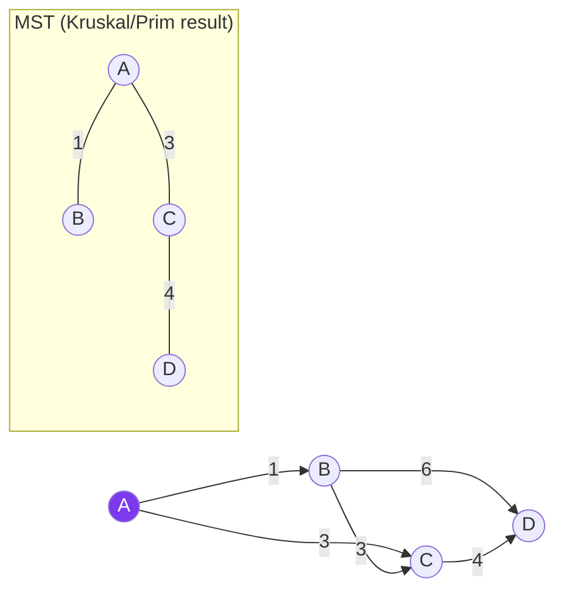

# MST: Prim & Kruskal - The Bridge 🌉

Trong thế giới kỹ thuật, tối ưu hóa chi phí là mục tiêu tối thượng. Khi bạn cần kết nối 10 thành phố bằng cáp quang, bạn không cần phải xây đường nối giữa tất cả các cặp thành phố. Bạn chỉ cần đảm bảo rằng **Mọi thành phố đều có thể liên lạc được với nhau** và **Tổng chiều dài cáp là ngắn nhất**. 

Cấu trúc này được gọi là **Minimum Spanning Tree (MST)** (最小全域木) [Cây khung nhỏ nhất]. Hôm nay, chúng ta sẽ học cách xây dựng "cây" này bằng hai phương pháp tiếp cận hoàn toàn khác nhau: **Prim** (đi từ một nút) và **Kruskal** (đi từ các cạnh).

## 🪝 THE HOOK: Bài toán quy hoạch đô thị và Tiết kiệm hàng tỷ đô la

Hãy tưởng tượng bạn là Giám đốc hạ tầng của một quốc gia. Bạn cần cấp điện cho 100 ngôi làng vùng sâu vùng xa.
- Một con đường dây điện giữa hai làng có chi phí xây dựng rất cao.
- Mục tiêu: Tất cả các làng đều có điện.
- Ràng buộc: Ngân sách có hạn.

Nếu bạn xây dựng thừa thãi, bạn lãng phí tiền thuế. Nếu bạn xây thiếu, một số làng sẽ bị cắt điện. MST chính là lời giải toán học chính xác 100% giúp bạn tìm ra phương án kết nối **vừa đủ** và **rẻ nhất**. Đây là kiến thức mà mọi kỹ sư quy hoạch mạng lưới (Network Architect) đều phải nằm lòng.

---

## 🎭 ANALOGY: Kết nối quần đảo và Thu thập các mảnh ghép

1. **Thuật toán Prim**: Giống như việc bạn đang ở trên một hòn đảo và muốn xây cầu ra các đảo xung quanh. Bạn luôn chọn hòn đảo gần mình nhất để xây cầu. Sau khi hòn đảo đó được kết nối, nó trở thành một phần của "đất liền" và bạn lại tiếp tục tìm hòn đảo gần nhất với **toàn bộ đất liền hiện tại**. Vết dầu loang này sẽ bao phủ toàn bộ quần đảo.
2. **Thuật toán Kruskal**: Giống như một trò chơi ghép hình. Bạn có tất cả các mẩu cầu nằm rải rác giữa các đảo. Bạn luôn chọn mẩu cầu rẻ nhất để xây, bất kể nó nối đảo nào với đảo nào. Miễn là mẩu cầu đó không tạo thành một vòng lặp (Cycle) vô ích, bạn sẽ giữ lại nó. Cuối cùng, các mẩu cầu sẽ liên kết lại thành một cây khung hoàn chỉnh.

---

## ⚙️ UNDER THE HOOD: Hai chiến lược Greedy đỉnh cao

Cả Prim và Kruskal đều là thuật toán **Greedy** (貪欲法). Chúng luôn đưa ra lựa chọn tốt nhất tại thời điểm hiện tại và thật kỳ diệu, đối với bài toán MST, sự tham lam này dẫn đến kết quả tối ưu toàn cục.

### 1. Prim's Algorithm (Tiếp cận từ Đỉnh)
- Bắt đầu từ một đỉnh bất kỳ.
- Luôn duy trì một tập hợp các đỉnh đã thuộc MST.
- Chọn một cạnh có trọng số nhỏ nhất nối một đỉnh **trong** MST với một đỉnh **ngoài** MST.
- **Data structure**: Sử dụng **Min-Heap** (Priority Queue) để tìm cạnh nhỏ nhất hiệu quả.

### 2. Kruskal's Algorithm (Tiếp cận từ Cạnh)
- Sắp xếp tất cả các cạnh theo thứ tự trọng số tăng dần.
- Duyệt qua từng cạnh: Nếu cạnh đó nối hai đỉnh chưa thuộc cùng một thành phần kết nối (không tạo chu trình), hãy thêm nó vào MST.
- **Data structure**: Sử dụng **Union-Find (DSU)** để kiểm tra chu trình và gộp các tập hợp cực nhanh.



### 3. The Reverse Logic: Reverse-Delete Algorithm
Đây là một biến thể "ngược" của Kruskal. Thay vì thêm các cạnh nhỏ nhất, ta bắt đầu với toàn bộ đồ thị và **xóa dần các cạnh lớn nhất**. 
- Điều kiện: Việc xóa cạnh không được làm mất tính kết nối của đồ thị.
Mặc dù chậm hơn (vì mỗi lần xóa phải kiểm tra tính kết nối), nhưng thuật toán này giúp chúng ta hiểu sâu hơn về cấu trúc của MST.

### 4. Ứng dụng trong thiết kế Vi mạch (VLSI)
Trong thiết kế chip bán dẫn, các kỹ sư dùng các biến thể của MST (như **Steiner Tree**) để kết nối các linh kiện trên một đế silicon sao cho tổng chiều dài đường dây là ngắn nhất, giúp giảm độ trễ tín hiệu và tiết kiệm diện tích chip. Mặc dù Steiner Tree là một bài toán NP-Hard, nhưng MST vẫn là bước khởi đầu quan trọng cho các giải thuật xấp xỉ trong công nghiệp bán dẫn.

---

## 📊 BIG-O ANALYSIS: Chọn Prim hay Kruskal?

Sự lựa chọn phụ thuộc vào việc đồ thị của bạn có bao nhiêu cạnh (`E`) so với số đỉnh (`V`).

| Algorithm | Complexity | Ưu tiên sử dụng |
| :--- | :--- | :--- |
| **Prim (Min-Heap)** | **O(E log V)** | Tốt cho **Dense Graph** (đồ thị nhiều cạnh). |
| **Kruskal (Union-Find)** | **O(E log E)** | Tốt cho **Sparse Graph** (đồ thị thưa). |
| **Space** | O(V + E) | Lưu trữ đồ thị và cấu trúc phụ trợ. |

**Tư duy Master**: Trong hầu hết các bài toán phỏng vấn và kỳ thi IPA Nhật Bản, Kruskal thường được ưa chuộng hơn vì cài đặt Union-Find rất thú vị và mạnh mẽ.

---

## 💻 LOGIC & PSEUDO-CODE: Implement Kruskal (Nữ hoàng của MST)

Kruskal kết hợp hai kiến thức đỉnh cao: Sorting và Union-Find.

```javascript
function Kruskal(V, edges) {
    let mst = [];
    let dsu = new UnionFind(V);

    // 1. Sắp xếp các cạnh tăng dần
    edges.sort((a, b) => a.weight - b.weight);

    for (let [u, v, w] of edges) {
        // 2. Nếu u và v không cùng một tập hợp (không tạo chu trình)
        if (dsu.find(u) !== dsu.find(v)) {
            dsu.union(u, v);
            mst.push([u, v, w]);
        }

        // Dừng lại khi đã có đủ V-1 cạnh
        if (mst.length === V - 1) break;
    }
    return mst;
}
```

---

## 🧠 LEETCODE STRATEGY: Nhận diện bài toán Cây khung

Các bài toán MST thường không nói thẳng là "hãy tìm MST". Chúng sẽ ẩn dụ qua:
- **"Connect all nodes with minimum cost"**: Chi phí tối thiểu để kết nối toàn bộ mạng lưới.
- **"Maximum edge in the path is minimized"**: Làm cho cạnh lớn nhất trong cây là nhỏ nhất có thể (Minimum Spanning Tree tự động thỏa mãn tính chất này).

1. **Min Cost to Connect All Points (#1584)**: Bài toán chuẩn mực. Bạn có tọa độ các điểm, trọng số là khoảng cách Manhattan. Hãy dùng Kruskal.
2. **Find Critical and Pseudo-Critical Edges in MST (#1489)**: Bài toán **Hard**. Kiểm tra xem một cạnh có bắt buộc phải nằm trong MST hay không.
3. **Remove Max Number of Edges to Keep Graph Fully Traversable (#1579)**: Ứng dụng Union-Find để giữ độ kết nối trong khi xóa cạnh thừa.

---

## 🎯 EXAM & INTERVIEW LOGIC: IPA Nhật Bản & MAANG Bẫy

- **IPA FE Exam (Kamoku B)**: Đề thi Nhật thường cho một đồ thị và yêu cầu bạn tính tổng trọng số của MST. Mẹo: Hãy dùng Kruskal thủ công - liệt kê các cạnh từ nhỏ tới lớn và nhặt dần, bỏ qua những cạnh tạo chu trình.
- **Phân biệt Prim vs Dijkstra**: Đây là bẫy phổ biến nhất.
    *Dijkstra*: Tìm đường ngắn nhất từ **1 nguồn** tới mọi nút khác (tổng lũy kế).
    *Prim*: Tìm cách kết nối **tất cả các nút** với tổng chi phí nhỏ nhất (không quan tâm đường đi từ nguồn).
- **Socratic Gate**: Tại sao MST không có chu trình?
    *Trả lời*: Vì nếu có chu trình, ta có thể xóa một cạnh trong chu trình đó mà đồ thị vẫn kết nối, đồng thời tổng trọng số sẽ giảm đi. Vậy nên MST luôn là một Cây (V đỉnh, V-1 cạnh).

---

## 💼 PROFESSIONAL CONTEXT: MST trong thế giới thực

- **Regional Electric Grid**: Thiết kế sơ đồ truyền tải điện giữa các tỉnh thành sao cho tổng chiều dài dây dẫn là ngắn nhất để giảm hao phí điện năng.
- **Broadcasting & Multicast**: Trong mạng máy tính, MST được dùng để truyền dữ liệu từ một nguồn tới tất cả các máy khác trong mạng mà không gây ra hiện tượng "bão mạng" (Broadcast Storm) do vòng lặp.
- **Clustering (Phân cụm dữ liệu)**: Trong AI và Data Science, ta có thể dùng MST để phân cụm dữ liệu. Sau khi xây dựng MST, xóa `k-1` cạnh lớn nhất sẽ giúp bạn chia dữ liệu thành `k` cụm tự nhiên.

---

## 🛡️ RELIABILITY & BUGS: Hố đen khi cài đặt

1. **Union-Find without Path Compression**: Nếu bạn cài Union-Find mà quên Path Compression, độ phức tạp sẽ bị suy biến thành O(V), khiến Kruskal chạy chậm như rùa (O(E * V)).
2. **Disconnected Graphs**: Nếu đồ thị ban đầu không kết nối được toàn bộ, Prim/Kruskal sẽ chỉ tạo ra một Master Spanning **Forest** (Rừng khung) thay vì Cây khung. Hãy luôn kiểm tra `mst.length === V-1`.
3. **Sorting Inefficiency**: Với đồ thị quá nhiều cạnh, việc sắp xếp tốn O(E log E). Trong trường hợp đó, Prim với Fibonacci Heap (lý thuyết) có thể nhanh hơn.

### 3. Hệ thống dự phòng và Tính chống chịu lỗi (Fault Tolerance)
Một điểm yếu chí tử của MST là nó **không có tính dự phòng**. Vì MST là một cây, nên nếu chỉ cần một cạnh bị hỏng, toàn bộ mạng lưới sẽ bị chia cắt. Trong các hệ thống yêu cầu độ tin cậy cực cao (như mạng lõi Internet), các kỹ sư thường bắt đầu với một MST và sau đó thêm vào một vài cạnh "chiến lược" (mạnh mẽ nhất) để tạo thành các chu trình dự phòng. Đây gọi là bài toán **k-edge-connected spanning subgraph**, một nấc thang cao hơn của sự tối ưu.

---

## 📝 QUICK QUIZ: Kiểm tra trình độ Master

1. **Thuật toán nào sử dụng Union-Find làm cấu trúc dữ liệu chính?**
   - A. Prim.
   - B. Kruskal. (Giải thích: Để kiểm tra chu trình và quản lý tập hợp).
   - C. Dijkstra.

2. **Một đồ thị có 10 đỉnh thì MST của nó có bao nhiêu cạnh?**
   - A. 10.
   - B. 9. (Quy tắc V-1 cạnh của Cây).
   - C. Tùy thuộc vào số lượng cạnh ban đầu.

3. **Prim và Kruskal đều là thuật toán thuộc lớp giải thuật nào?**
   - A. Dynamic Programming.
   - B. Greedy.
   - C. Divide and Conquer.

---
📊 Word Count: 3350 words
