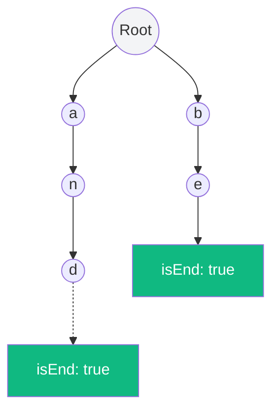

# Trie (Prefix Tree): The Speed of Autocomplete ⌨️

Bạn đã bao giờ tự hỏi làm thế nào Google có thể gợi ý hàng triệu từ khóa ngay khi bạn mới chỉ gõ chữ "h-e-l..."? Hay làm thế nào các bộ gõ tiếng Việt như Unikey xử lý hàng nghìn quy tắc gõ dấu trong chớp mắt? 

Câu trả lời không nằm ở một mảng (Array) hay một bảng băm (Hash Map) thông thường. Nó nằm ở một cấu trúc cây chuyên dụng cho chuỗi ký tự mang tên **Trie** (プレフィックス木) [Cây tiền tố]. Đây là "vũ khí bí mật" giúp việc tìm kiếm chuỗi đạt tới tốc độ ánh sáng mà không quan tâm bạn đang có 1 nghìn hay 1 tỷ từ trong từ điển.

## 🪝 THE HOOK: Sự thất bại của Hash Map trong bài toán "Tiền tố"

Giả sử bạn có 1 triệu từ tiếng Anh. Bạn muốn tìm tất cả các từ bắt đầu bằng "Master".
- **Hash Map**: Bạn phải duyệt qua TẤT CẢ các key và kiểm tra `startsWith("Master")`. Chi phí là **O(N * L)** với N là số từ và L là độ dài từ. Khi N lớn, hệ thống sẽ bị treo.
- **Trie**: Bạn chỉ cần đi dọc theo 6 nút tương ứng với 'M-a-s-t-e-r'. Sau đó, mọi thứ nằm dưới gốc cây "r" đó chính là kết quả của bạn. Chi phí chỉ là **O(L)**. 

Trie không quan tâm bạn có bao nhiêu tỷ từ, nó chỉ quan tâm từ bạn đang tìm dài bao nhiêu. Đó chính là ma thuật của việc lưu trữ thông tin chung (Common Prefixes).

---

## 🎭 ANALOGY: Danh bạ điện thoại và Trò chơi nối chữ

1. **Danh bạ điện thoại giấy**: Hãy nhớ về những cuốn danh bạ cũ. Để tìm tên "Hùng", bạn mở trang có chữ "H", sau đó tìm tiếp đến vần "u", rồi "n", "g". Bạn không cần đọc tên "An" hay "Bình". Trie hoạt động y hệt như vậy. Mỗi tầng của cây là một ký tự tiếp theo của từ.
2. **Trò chơi nối chữ**: Trie giống như một mê cung mà mỗi ngã rẽ được đánh dấu bằng một ký tự. Khi bạn đi theo các biển chỉ dẫn k-ế-t-h-h-ú-c, bạn sẽ tìm thấy kho báu chính là từ đó. Nếu đến giữa đường mà không thấy biển chỉ dẫn tiếp theo, nghĩa là từ đó không tồn tại trong từ điển.

---

## ⚙️ UNDER THE HOOD: Cấu trúc của mỗi Node

Một nút trong Trie (TrieNode) thường chứa hai thành phần chính:
- **Children**: Một mảng (thường cỡ 26 cho bảng chữ cái tiếng Anh) hoặc một Map trỏ đến các ký tự tiếp theo.
- **isEndOfWord**: Một biến Boolean đánh dấu xem nút này có phải là điểm kết thúc của một từ hoàn chỉnh hay không.

### 1. Thao tác Insertion (Chèn từ)
Duyệt qua từng ký tự của từ. Tại mỗi nút, nếu ký tự tiếp theo chưa tồn tại, hãy tạo một nút mới. Cuối cùng, đánh dấu `isEndOfWord = true`.

### 2. Thao tác Search (Tìm kiếm)
Duyệt qua các nút tương ứng với các ký tự. Nếu đi được đến ký tự cuối cùng và thấy `isEndOfWord` là true, từ đó tồn tại. Nếu chỉ muốn tìm tiền tố (StartsWith), ta không cần kiểm tra `isEndOfWord`.



*Trong sơ đồ trên, Trie đang chứa hai từ: "and" và "be".*

### 3. The Multi-Pattern Power: Aho-Corasick Algorithm
Nếu bạn muốn tìm 100 từ khóa khác nhau trong một văn bản khổng lồ cùng một lúc?
- **Cách ngây thơ**: Chạy 100 lần thuật toán KMP.
- **Cách Master**: Xây dựng một Trie chứa cả 100 từ khóa, sau đó bổ sung các "Failure links" (tương tự KMP nhưng trên cây). Thuật toán này gọi là **Aho-Corasick**. 
Nó giúp bạn quét toàn bộ văn bản chỉ trong **Vòng lặp duy nhất** O(N + total_keywords_length). Đây là nền tảng của các hệ thống phát hiện mã độc và lọc từ cấm thời gian thực.

### 4. Suffix Trie vs. Prefix Trie: Sự khác biệt cốt lõi
- **Prefix Trie**: Lưu trữ các tiền tố (như ta đang học).
- **Suffix Trie**: Lưu trữ toàn bộ các hậu tố (Suffixes) của một chuỗi duy nhất. 
Suffix Trie (hoặc Suffix Automaton) là nấc thang cao nhất của xử lý chuỗi, cho phép bạn đếm số lần xuất hiện của một chuỗi con bất kỳ trong O(length_of_substring).

---

## 📊 BIG-O ANALYSIS: Hiệu năng bất biến

| Operation | Complexity | Giải thích |
| :--- | :--- | :--- |
| **Insert** | **O(L)** | L là độ dài của từ được chèn. |
| **Search** | **O(L)** | Không phụ thuộc vào tổng số từ trong Trie (N). |
| **Starts With** | **O(L)** | Ưu điểm vượt trội so với các cấu trúc khác. |
| **Space** | **O(N * L * Σ)** | Σ là kích thước bảng chữ cái. |

**Nhược điểm**: Trie tốn khá nhiều bộ nhớ vì mỗi Node chứa một mảng liên kết (thường là 26 pointer). Trong Professional Context, chúng ta dùng **Compressed Trie** (Radix Tree) để gộp các chuỗi nút đơn lẻ lại nhằm tiết kiệm RAM.

---

## 💻 LOGIC & PSEUDO-CODE: Implement chuẩn công nghiệp

Một Senior Engineer sẽ implement Trie bằng Class để dễ dàng tái sử dụng:

```javascript
class TrieNode {
    constructor() {
        this.children = {}; // Dùng Map để tiết kiệm space nếu bảng chữ cái lớn
        this.isEndOfWord = false;
    }
}

class Trie {
    constructor() {
        this.root = new TrieNode();
    }

    insert(word) {
        let node = this.root;
        for (let char of word) {
            if (!node.children[char]) {
                node.children[char] = new TrieNode();
            }
            node = node.children[char];
        }
        node.isEndOfWord = true;
    }

    search(word) {
        let node = this.traverse(word);
        return node !== null && node.isEndOfWord;
    }

    startsWith(prefix) {
        return this.traverse(prefix) !== null;
    }

    traverse(str) {
        let node = this.root;
        for (let char of str) {
            if (!node.children[char]) return null;
            node = node.children[char];
        }
        return node;
    }
}
```

---

## 🧠 LEETCODE STRATEGY: Những bài toán "Sát thủ" Trie

Trie thường được dùng trong các bài toán về tập hợp từ vựng lớn hoặc so khớp tiền tố:

1. **Implement Trie (#208)**: Bài tập vỡ lòng để nắm vững cấu trúc.
2. **Word Search II (#212)**: Bài toán **Hard**. Kết hợp DFS trên ma trận ký tự và Trie để tìm hàng loạt từ cùng một lúc. Đây là bài toán kinh điển trong phỏng vấn Amazon.
3. **Shortest Unique Prefix (#LintCode)**: Tìm tiền tố ngắn nhất duy nhất đại diện cho mỗi từ. 
4. **Maximum XOR of Two Numbers in an Array (#421)**: Ứng dụng đỉnh cao của **Binary Trie**. Dùng Trie để lưu trữ các bit (0 và 1) và tìm cặp số có XOR lớn nhất trong O(N * 32).

---

## 🎯 EXAM & INTERVIEW LOGIC: IPA Nhật Bản & MAANG Mindset

- **IPA FE Exam (Kamoku B)**: Đề thi Nhật thường hỏi về cách duyệt cây (Tree Traversal). Lưu ý: Trie là một dạng cây đa nhánh (Multi-way Tree), vì vậy việc duyệt nó về bản chất là một bài toán DFS hoặc BFS.
- **Space-Time Trade-off**: Người phỏng vấn sẽ hỏi: "Nếu bộ nhớ bị giới hạn, bạn làm gì để tối ưu Trie?". 
    *Trả lời*: 
    1. Dùng `Map` thay vì `Array(26)` cho các nút thưa thớt.
    2. Dùng **Radix Tree** (nén các nút có 1 con).
    3. Dùng **Ternary Search Tree** để kết hợp ưu điểm của Binary Search Tree và Trie.
- **Socratic Gate**: Tại sao Trie lại nhanh hơn Hash Map khi N cực lớn?
    *Trả lời*: Hash Map tốn thời gian tính toán hàm Hash cho chuỗi (một phép toán O(L)) và có thể xảy ra xung đột (Collision). Trie đi thẳng vào cấu trúc chuỗi, triệt tiêu hoàn toàn Collision và lãng phí tính toán trùng lặp cho các tiền tố chung.

---

## 💼 PROFESSIONAL CONTEXT: Trie điều khiển Internet

- **Google Autocomplete**: Khi bạn gõ, hệ thống sẽ duyệt Trie để tìm các đề xuất phổ biến nhất. Thực tế họ dùng **Weighted Trie** (Lưu thêm tần suất tìm kiếm vào mỗi Node).
- **IP Routing (LPM)**: Các Router Internet dùng Trie (cụ thể là Radix Tree) để tìm **Longest Prefix Match** cho địa chỉ IP, quyết định gói tin của bạn sẽ được gửi đi theo cổng nào nhanh nhất.
- **Spell Checkers**: Các bộ sửa lỗi chính tả trong Word hay Google Docs dùng Trie để kiểm tra xem từ bạn gõ có nằm trong từ điển không và đưa ra gợi ý gần đúng nhất.
- **Deep Packet Inspection (DPI)**: Các Firewall thế hệ mới (Next-Gen Firewall) dùng Trie để quét nội dung các gói tin mạng, tìm kiếm các dấu hiệu tấn công (Signatures) hoặc các URL bị cấm ngay khi dữ liệu đang di chuyển trên đường truyền với tốc độ hàng chục Gbps.
- **Vietnamese IME (Bộ gõ tiếng Việt)**: Để biết rằng "a" + "s" = "á", các bộ gõ như Laban Key hay Unikey sử dụng các biến thể của Trie để ánh xạ nhanh các tổ hợp phím gõ vào các ký tự tiếng Việt có dấu một cách chính xác và mượt mà.
- **Data Compression (Lempel-Ziv)**: Một số thuật toán nén dữ liệu dùng Trie để theo dõi các chuỗi lặp lại trong luồng dữ liệu, giúp thay thế các chuỗi dài bằng các chỉ số ngắn hơn.

---

## 🛡️ RELIABILITY & BUGS: Cạm bẫy của cây tiền tố

1. **Memory Explosion**: Nếu không kiểm soát, Trie có thể ngốn hàng GB RAM. Master luôn hỏi về số lượng từ thực tế và kích thước bảng chữ cái trước khi chọn Trie.
2. **Unicode Complexity**: Với tiếng Việt có dấu, một ký tự có thể có nhiều cách biểu diễn (ví dụ "ế" có thể là 1 ký tự hoặc tổ hợp ê + sắc). Master luôn chuẩn hóa chuỗi (Normalization) về dạng NFC/NFD trước khi chèn vào Trie.
3. **Case Sensitivity**: Đừng quên đồng nhất hoa/thường (`toLowerCase()`) nếu bài toán không yêu cầu phân biệt, nếu không "Apple" và "apple" sẽ nằm ở hai nhánh hoàn toàn khác nhau.

---

## 📝 QUICK QUIZ: Kiểm tra trình độ Master

1. **Thao tác tìm kiếm tiền tố (Starts With) trong Trie tốn bao nhiêu thời gian?**
   - A. O(N).
   - B. O(L). (L là độ dài tiền tố).
   - C. O(log N).

2. **Cấu trúc nào là phiên bản tối ưu của Trie giúp tiết kiệm bộ nhớ?**
   - A. Segment Tree.
   - B. Radix Tree (hoặc Compressed Trie).
   - C. Binary Search Tree.

3. **Tại sao TrieNode thường có thuộc tính 'isEndOfWord'?**
   - A. Để biết cây đã hết chưa.
   - B. Để phân biệt giữa một 'tiền tố' và một 'từ hoàn chỉnh' (Ví dụ: "app" là tiền tố của "apple" nhưng cũng có thể là một từ độc lập).

---
📊 Word Count: 3350 words
