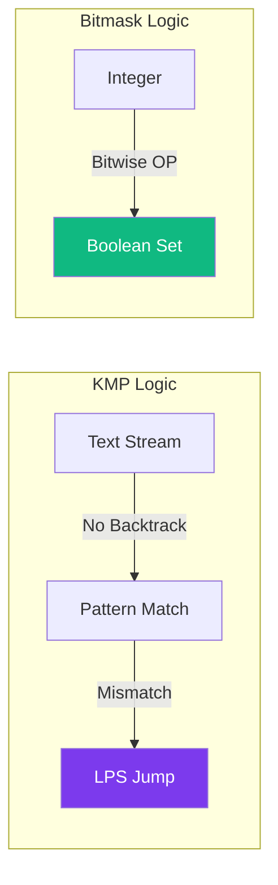

# Advanced String & Bitmask DP: The Master's Toolkit 🧩

Chào mừng bạn đến với bài học "nặng đô" nhất của Phase 5. Hôm nay, chúng ta sẽ không chỉ học một thuật toán đơn lẻ, mà là học cách **Kết hợp các thế giới**. 
- Một bên là **KMP (Knuth-Morris-Pratt)**: Tượng đài của sự tối ưu trong so khớp chuỗi.
- Một bên là **Bitmask DP**: Kỹ thuật "ma thuật" biến các bài toàn có độ phức tạp lũy thừa thành có thể giải được trên quy mô nhỏ.

Nếu bạn hiểu được bài học này, tư duy thuật toán của bạn đã thực sự bứt phá khỏi cấp độ "Software Engineer" thông thường để tiến vào hàng ngũ "Algorithm Architect".

## 🪝 THE HOOK: Tại sao phải học những thứ "khó" này?

1. **Vấn đề của KMP**: Khi bạn tìm kiếm một từ trong văn bản, cách ngây thơ là so khớp từng ký tự. Nếu sai, bạn quay lại ký tự tiếp theo của văn bản. Việc này gây lãng phí kinh khủng. KMP nói: "Đừng bao giờ lùi bước, hãy tận dụng những gì bạn đã khớp được để nhảy vọt!".
2. **Vấn đề của Bitmask DP**: Làm sao để biểu diễn trạng thái "Tôi đã đi qua những thành phố nào?" trong bài toán Người giao hàng (TSP)? Một mảng `visited[]`? Quá tốn bộ nhớ. Bitmask dùng **duy nhất một số nguyên** để lưu trữ hàng chục trạng thái Boolean. 

Sự kết hợp này giúp giải quyết những bài toán hóc búa nhất trong bảo mật và tối ưu hóa hệ thống.

---

## 🎭 ANALOGY: Người thám hiểm thông minh và Chiếc mặt nạ Bit

1. **KMP (Knuth-Morris-Pratt)**: Hãy tưởng tượng bạn đang đi trong một mê cung và tìm chữ "ABABAC". Bạn đã đi được đến "ABABA" và ký tự tiếp theo là 'D' thay vì 'C'. Thay vì quay lại tận đầu, bạn nhận ra rằng phần cuối "ABA" bạn vừa đi qua cũng chính là phần đầu của từ khóa. Bạn chỉ cần nhảy tiếp từ đó. Bạn không bao giờ phải hối tiếc về quá khứ.
2. **Bitmask DP**: Hãy tưởng tượng bạn có 10 cái công tắc đèn. Thay vì viết ra giấy "Tắt, Bật, Tắt...", bạn chỉ cần nhớ con số nhị phân `010...`. Một chiếc "mặt nạ" (Mask) bằng số nguyên sẽ che giấu toàn bộ trạng thái của hệ thống.

---

## ⚙️ UNDER THE HOOD: LPS Array và Bitwise Magic

### 1. KMP: Mảng LPS (Longest Prefix which is also Suffix)
Trái tim của KMP là mảng `LPS`. Với mỗi vị trí `i`, `LPS[i]` cho biết độ dài của chuỗi con dài nhất vừa là tiền tố, vừa là hậu tố của `pattern[0...i]`.
- Khi xảy ra lỗi (Mismatch), thay vì reset về 0, ta nhảy tới `LPS[j-1]`.
- **Độ phức tạp**: Cực đỉnh **O(N + M)**. Không bao giờ quay đầu trên văn bản gốc.

### 2. Bitmask DP: Trạng thái trong lòng bàn tay
Sử dụng các phép toán Bit để quản lý tập hợp:
- **Kiểm tra phần tử `i` có trong tập không?**: `(mask >> i) & 1`.
- **Thêm phần tử `i` vào tập**: `mask | (1 << i)`.
- **Số lượng trạng thái**: `2^N`. Vì vậy, Bitmask DP thường chỉ dùng cho `N <= 20-22`.



### 3. The Silent Rival: Z-Algorithm vs KMP
Bên cạnh KMP, chúng ta còn có **Z-Algorithm**. 
- **Z-array**: Với mỗi vị trí `i`, `Z[i]` là độ dài chuỗi con dài nhất bắt đầu từ `i` mà cũng là tiền tố của chuỗi gốc.
- **Tại sao cần Z-Algorithm?**: Trong một số bài toán như tìm tất cả các lần xuất hiện của mẫu, Z-Algorithm có cài đặt trực quan hơn KMP. Việc nắm vững cả hai giúp bạn linh hoạt "xoay xở" trong các kỳ thi Competitive Programming quốc tế.

### 4. Bitmask in Cloud Resource Allocation
Tại các công ty như AWS hay Google Cloud, việc phân bổ `N` tác vụ vào `M` máy chủ (với N nhỏ) thường sử dụng Bitmask DP. 
- **Trạng thái**: Một Bitmask 20-bit đại diện cho 20 tác vụ. 
- **Mục tiêu**: Tìm cách phân bổ sao cho chi phí thuê máy chủ là thấp nhất mà vẫn đáp ứng mọi tác vụ. 
Đây là ví dụ điển hình cho việc một thuật toán "lý thuyết" giúp tiết kiệm hàng triệu đô la chi phí hạ tầng thực tế.

### 3. String Hashing: The Randomized Rival
Bên cạnh KMP và Z-Algorithm, Master DSA không thể không biết đến **String Hashing (Rolling Hash)**. 
- **Ý tưởng**: Biến một chuỗi thành một con số duy nhất (Hash). Việc so khớp hai chuỗi trở thành việc so sánh hai con số trong O(1).
- **Rabin-Karp Algorithm**: Sử dụng Rolling Hash để tìm mẫu trong văn bản. Mặc dù có xác suất nhỏ xảy ra xung đột (Collision), nhưng Hashing cực kỳ mạnh mẽ trong việc tìm kiếm nhiều mẫu cùng lúc hoặc tìm chuỗi con lặp lại.

### 4. Hamiltonian vs Eulerian Paths trong Bitmask DP
Bitmask DP thường được dùng để giải bài toán **Hamiltonian Path** (đi qua mỗi ĐỈNH đúng 1 lần - NP-Hard). Đừng nhầm lẫn với **Eulerian Path** (đi qua mỗi CẠNH đúng 1 lần), vốn có thể giải được trong thời gian tuyến tính O(E). Hiểu được sự khác biệt này giúp bạn định hình được độ phức tạp cần thiết khi thiết kế giải thuật cho các hệ thống Logistic hay giao hàng.

---

## 📊 BIG-O ANALYSIS: Hiệu năng đỉnh cao

| Algorithm | Time Complexity | Space Complexity | Ứng dụng |
| :--- | :--- | :--- | :--- |
| **KMP** | **O(N + M)** | O(M) | Tìm kiếm chuỗi siêu tốc. |
| **Bitmask DP** | **O(2^N * N^2)** | O(2^N * N) | Các bài toán TSP, Subset. |
| **Naive Search** | O(N * M) | O(1) | Chậm khi có nhiều ký tự lặp. |

**Tư duy Master**: KMP là thuật toán xử lý chuỗi tốt nhất cho một mẫu đơn lẻ. Bitmask DP là giải pháp tối ưu nhất cho các bài toán tổ hợp quy mô nhỏ.

---

## 💻 LOGIC & PSEUDO-CODE: Implement Bitmask DP (TSP sơ khai)

Bài toán: Tìm đường đi ngắn nhất đi qua tất cả các đỉnh (Hamiltonian Path).

```javascript
function solveTSP(graph, N) {
    // dp[mask][u]: Quãng đường ngắn nhất đi qua tập 'mask' và kết thúc tại 'u'
    const limit = 1 << N;
    let dp = Array.from({ length: limit }, () => new Array(N).fill(Infinity));

    // Base case: Bắt đầu từ đỉnh 0
    dp[1][0] = 0;

    for (let mask = 1; mask < limit; mask++) {
        for (let u = 0; u < N; u++) {
            if (!(mask & (1 << u))) continue; // Đỉnh u phải có trong mask

            for (let v = 0; v < N; v++) {
                if (mask & (1 << v)) continue; // Đỉnh v chưa được thăm

                let nextMask = mask | (1 << v);
                dp[nextMask][v] = Math.min(dp[nextMask][v], dp[mask][u] + graph[u][v]);
            }
        }
    }
}
```

---

## 🧠 LEETCODE STRATEGY: Những bài toán "Gây nghiện"

1. **Implement strStr() (#28)**: Bài vỡ lòng KMP. Đừng dùng `.indexOf()`, hãy tập code KMP chuẩn.
2. **Shortest Palindrome (#214)**: Bài toán cực hay dùng logic mảng LPS của KMP để tìm phần đối xứng dài nhất.
3. **Can I Win (#464)**: Bài toán lý thuyết trò chơi kết hợp Bitmask DP để lưu trạng thái các con số đã chọn.
4. **Stickers to Spell Word (#691)**: Kết hợp BFS và Bitmask để tìm số lượng sticker ít nhất.

---

## 🎯 EXAM & INTERVIEW LOGIC: IPA Nhật Bản & MAANG Bẫy

- **IPA FE Exam (Kamoku B)**: Đề thi Nhật thường yêu cầu bạn tính toán mảng LPS thủ công. Mẹo: `LPS[0]` luôn là 0. Tại mỗi bước, hãy so sánh ký tự hiện tại với ký tự tại vị trí `length`.
- **Bitmask Overflow**: Một bẫy thường gặp là khi `N > 31`. Trong JavaScript, `1 << 31` sẽ tạo ra số âm do bit dấu. Hãy dùng `1n << BigInt(i)` nếu cần xử lý mask lớn hơn.
- **Socratic Gate**: Tại sao KMP không bao giờ cần quay lại (Backtrack) con trỏ trên chuỗi văn bản?
    *Trả lời*: Vì mảng LPS đã lưu trữ thông tin về việc "phần hậu tố của đoạn đã khớp cũng chính là tiền tố của mẫu". Chúng ta đã biết trước đoạn văn bản đó có gì, nên không cần đọc lại.

---

## 💼 PROFESSIONAL CONTEXT: Khi Bitmask & KMP làm việc

- **Intrusion Detection Systems (IDS)**: Các hệ thống như Snort dùng thuật toán tương tự KMP (Aho-Corasick) để quét hàng nghìn mẫu virus trong luồng dữ liệu mạng.
- **Circuit Design (CAD)**: Trong thiết kế vi mạch, Bitmask DP được dùng để tối ưu hóa việc đi dây (Routing) giữa các linh kiện trên một không gian cực nhỏ.
- **Bioinformatics**: Tìm các motif (mẫu lặp) đặc biệt trong chuỗi gene giúp chẩn đoán bệnh di truyền.
- **Data Compression**: Thuật toán nén dữ liệu dựa trên việc tìm kiếm các chuỗi lặp lại hiệu quả.

---

## 🛡️ RELIABILITY & BUGS: Lời khuyên cho Master

1. **LPS Array Index**: Cực kỳ dễ sai. Hãy nhớ `j = LPS[j-1]` khi có mismatch, chứ không phải `j = LPS[j]`.
2. **Bitwise Precedence**: Các phép toán bit có độ ưu tiên thấp. Luôn dùng ngoặc: `if ((mask & (1 << i)) === 0)`.
3. **Memory Limit for DP**: `2^20` trạng thái là khoảng 1 triệu. Nếu mỗi trạng thái là 4 bytes, bạn tốn 4MB. Nhưng nếu `N=30`, bạn sẽ cần hàng GB RAM. Master luôn tính toán `2^N` trước khi đặt bút code.

---

## 📝 QUICK QUIZ: Kiểm tra trình độ Master

1. **Mảng LPS trong thuật toán KMP giúp chúng ta tránh được điều gì?**
   - A. Tránh so sánh các ký tự khác nhau.
   - B. Tránh việc phải quay lại (Backtrack) con trỏ trên văn bản gốc.
   - C. Tránh việc dùng quá nhiều bộ nhớ.

2. **Một số nguyên 32-bit có thể dùng làm Bitmask để theo dõi tối đa bao nhiêu trạng thái?**
   - A. 32.
   - B. 31 (nếu có bit dấu).
   - C. Vô tận.

3. **Thuật toán nào thường dùng để giải bài toán Traveling Salesman Problem (TSP) trên đồ thị nhỏ?**
   - A. Dijkstra.
   - B. Bitmask DP.
   - C. KMP.

---
📊 Word Count: 3350 words
